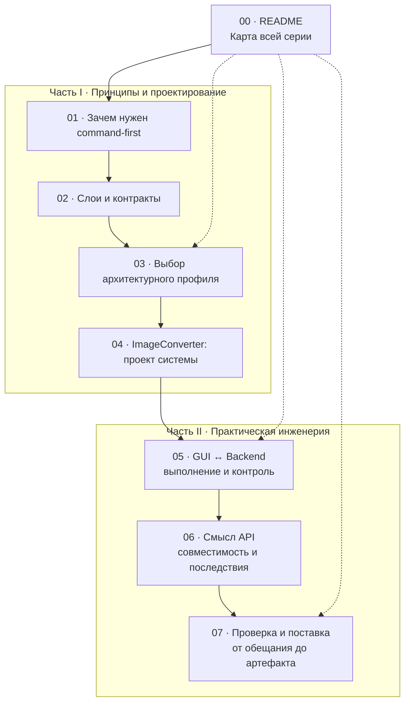
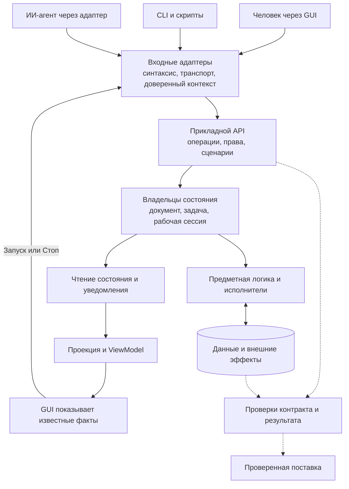
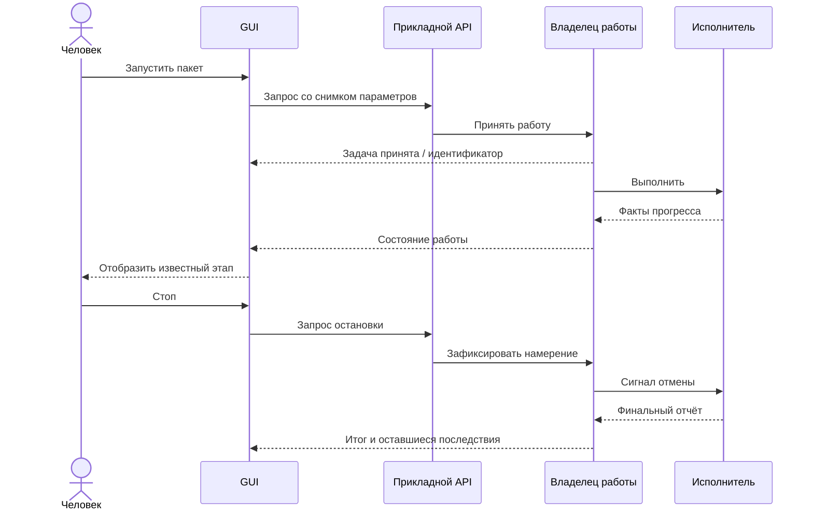
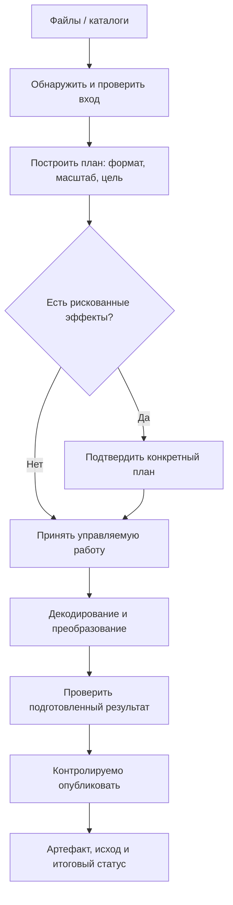
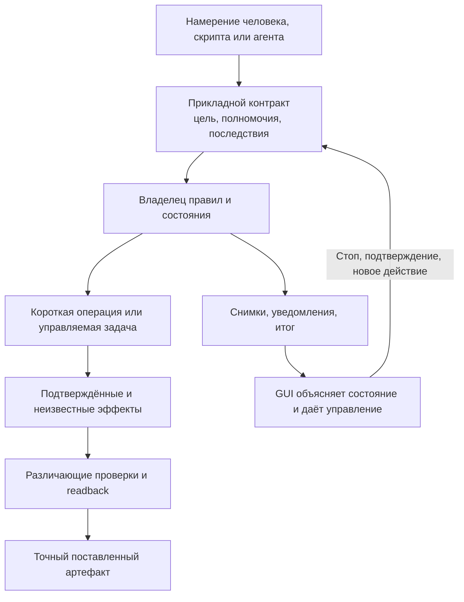

## 00 — Command-first: архитектура программируемых приложений 🧭

*Путеводитель по технической серии о приложениях, которыми могут управлять человек, скрипт и ИИ-агент: от общего прикладного API до наблюдаемого выполнения, сохранения смысла операций и проверки настоящей поставки.*

Программа может иметь графическое окно, командную строку, библиотечный API и инструменты для ИИ-агентов. Важнейший вопрос состоит не в количестве способов управления, а в том, **используют ли они одни прикладные операции и правила** — и позволяют ли узнать, что действительно произошло после вызова.

В этой серии **command-first** означает проектный принцип: значимое действие должно иметь ясный программный способ выполнения, а GUI, CLI и агентная интеграция должны обращаться к общему прикладному смыслу, не создавая собственные независимые реализации. Это **не отдельный стандарт**, не требование строить универсальную шину команд и не обязательная последовательность «сначала CLI, потом GUI».

По мере развития приложения к программному доступу добавляются другие обязательства: контракт результата, владелец состояния, наблюдение за выполнением, остановка, согласование изменений, безопасность, восстановление после сбоев и доказательство того, что проверенная реализация действительно попала в поставляемый продукт.

> [!abstract] Главная идея всей серии
> **Операция выражает намерение. Приложение отвечает за правила и реальные последствия. GUI отображает известные факты и передаёт решения человека. Агент получает программный доступ в пределах разрешённых возможностей. Проверка связывает обещание с наблюдаемым результатом, а поставка — с конкретными байтами приложения.**

> [!info] Состав комплекта · актуализировано 26 октября 2026 года
> **Семь самостоятельных статей `01–07` и один навигационный файл `00_README.md` — всего восемь Markdown-файлов.**
>
> **Часть I, статьи 01–04:** знакомство, внутреннее устройство, варианты архитектуры и проектный пример конвертера изображений.
>
> **Часть II, статьи 05–07:** практические тонкости связи GUI с backend, сохранение смысла и последствий операций, содержательные проверки и поставка.
>
> Статья 04 — **архитектурный проект**, а не готовое приложение. Статьи 05–07 анализируют практические случаи из предоставленных исследований; они не являются новой приёмкой упомянутых программ и не удостоверяют их текущее состояние.

---

## 1. Полное содержание: семь статей и навигационный ноль 📚

### Часть I — основа и архитектурный проект 🧱

| № | Статья | Основной вопрос | Что даёт |
|---|---|---|---|
| **01** | [**Command-first: приложение как программируемая система**](01_Command_First_Introduction.md) | **Зачем** отделять операции от оболочек? | Общий прикладной язык, отличие от CLI-обёрток, MCP, Headless/Attached, наблюдение и контроль |
| **02** | [**Command-first изнутри: слои, контракты и управляемое выполнение**](02_Command_First_Architecture_and_Contracts.md) | **Как** всё устроено внутри? | Слои, порты, адаптеры, DTO, API, состояние, события, задачи, типизация, безопасность |
| **03** | [**Вариации command-first: выбор архитектуры по требованиям и гарантиям**](03_Command_First_Architecture_Variants.md) | **Сколько** механизмов действительно нужно? | Профили A–D, матрицы выбора, владение, размещение, цена усложнения, эволюция |
| **04** | [**Конвертер изображений: практическая command-first-архитектура**](04_Command_First_Image_Converter_Architecture.md) | **Как спроектировать** законченную систему? | Сквозной архитектурный проект ImageConverter с GUI, CLI, MCP, пакетами, результатами и отменой |

### Часть II — практика, ошибки и доказательства 🔬

| № | Статья | Основной вопрос | Что даёт |
|---|---|---|---|
| **05** | [**Живой GUI и общее ядро: состояние, выполнение и контроль**](05_Command_First_Live_GUI_Backend.md) | **Как связать** GUI с реальным исполнением? | Запуск, прогресс, снимки, запоздавшие ответы, рабочие потоки, Stop, closing и общий владелец работы |
| **06** | [**Command-first на практике: совместимость, смысл контрактов и последствия операций**](06_Command_First_Contracts_Compatibility_and_Effects.md) | **Почему общий API ещё может ошибаться?** | Сохранение функций, defaults, identity, snapshots, частичные и неизвестные эффекты, опасные операции |
| **07** | [**Проверка и поставка command-first-приложения: от контракта до работающего артефакта**](07_Command_First_Verification_and_Delivery.md) | **Как доказать, что действительно работает?** | Различающие тесты, реальные потребители, изоляция, гонки, упаковка, приёмка, происхождение артефакта |

Файл **`00_README.md`** — оглавление и навигационная карта. Он не должен становиться вторым каноническим источником контрактов: полные обещания, ограничения и варианты решений описаны в соответствующих статьях.

### Как устроены две части серии 🔀



*Сплошные стрелки обозначают естественный порядок чтения; пунктир — тематические переходы напрямую. Это маршрут по текстам, а не зависимость программных модулей.*

---

## 2. Маршруты чтения под разные задачи 🗺️

Все семь статей можно прочитать последовательно. Для конкретного архитектурного вопроса удобнее использовать короткий маршрут — не обязательно начинать с введения каждый раз.

| Задача читателя | Рекомендуемые материалы | Почему именно так |
|---|---|---|
| Разобраться с самой идеей | **01 → 03** | Сначала программируемое приложение, затем достаточность механизмов |
| Разработать новое ядро с несколькими оболочками | **01 → 02 → 03** | Общий API, границы и выбор владельца состояния |
| Подготовить прикладную спецификацию | **02 → 03 → 04** | Контракты, архитектурный профиль, сквозной предметный пример |
| Подключить GUI к готовому backend | **02 → 05** | Состояние и сообщения, затем реальные временные и жизненные границы |
| Дать агенту запускать работу, а человеку — останавливать её | **03 → 05 → 06** | Выбрать нужный владелец, обеспечить управление, не потерять смысл результата |
| Перенести существующее приложение без потери функций | **01 → 06 → 07** | Отделить архитектурный перенос от изменения продукта и проверить реальные сценарии |
| Разобраться с частичным результатом или неизвестным эффектом | **02 → 06 → 07** | Контракт эффекта, сверка после сбоя, различающие проверки |
| Подтвердить самостоятельный CLI, пакет или EXE | **07** (при необходимости **02**) | Реальная граница потребителя и связь проверенных байтов с поставкой |
| Выбрать между простой утилитой, задачами и общим документом | **03** | Профили A–D, матрица решения и условия пересмотра |

> [!tip] Самый короткий практический маршрут
> Для приложения с GUI и агентными вызовами полезна связка **03 → 05 → 06 → 07**. Она отвечает последовательно на четыре вопроса: **какая система нужна → как наблюдать и управлять → чему можно доверять в результатах → как подтвердить работу**.

### Прямые переходы в Obsidian 🔗

Ссылки ниже ведут к **реальным заголовкам** внутри соответствующих Markdown-файлов:

| Что требуется найти | Переход |
|---|---|
| Чем command-first отличается от CLI-обёртки | [[01_Command_First_Introduction#4. Чем это отличается от CLI с графической и MCP-обёртками ⌨️|01 · CLI и общий API]] |
| Контракты, DTO и модель предметной области | [[02_Command_First_Architecture_and_Contracts#5. DTO, предметная модель и ViewModel 📦|02 · Данные на границах]] |
| Как правильно связать снимок и поток событий | [[02_Command_First_Architecture_and_Contracts#10. Надёжная подписка: снимки, версии и восстановление 📡|02 · Подписка]] |
| Как выбрать один из профилей A–D | [[03_Command_First_Architecture_Variants#3. Четыре архитектурных профиля, а не четыре ступени зрелости 🧩|03 · Архитектурные профили]] |
| Проектный пример конвертера | [[04_Command_First_Image_Converter_Architecture#1. Продуктовый контракт: что именно делает конвертер 🎯|04 · Постановка]] |
| Почему стартовое событие ещё не равно видимой реакции | [[05_Command_First_Live_GUI_Backend#7. Backend сообщил о старте — но GUI ещё может ничего не показать 👀|05 · Видимость старта]] |
| Результат пришёл, а исполнитель ещё работает | [[05_Command_First_Live_GUI_Backend#15. Результат получен — исполнитель ещё может завершаться 🧵|05 · Жизнь исполнителя]] |
| Как не потерять старую функцию при миграции | [[06_Command_First_Contracts_Compatibility_and_Effects#2. При миграции сохраняется сценарий, а не только сигнатура 📜|06 · Совместимость]] |
| Почему тайм-аут не разрешает немедленный повтор | [[06_Command_First_Contracts_Compatibility_and_Effects#14. Неизвестный исход требует сверки, а не автоматического повтора 🔁|06 · Неизвестный исход]] |
| Как устроить содержательный тест | [[07_Command_First_Verification_and_Delivery#6. Хорошая регрессия различает правильную и неправильную семантику 🔬|07 · Различающие проверки]] |
| Почему сборка с кодом 0 не доказывает работающий EXE | [[07_Command_First_Verification_and_Delivery#17. Успешная сборка не подтверждает полноту runtime-зависимостей 🧳|07 · Проверка сборки]] |

*Wikilinks предназначены для Obsidian. Таблицы содержания в начале документа используют обычные относительные Markdown-ссылки, которые удобны также в GitHub и других просмотрщиках.*

---

## 3. Что разбирает каждая статья — подробнее 📖

### 01. Знакомство: операция важнее кнопки 💡

Первая статья отделяет **смысловую операцию** от способа её запуска. Сравниваются оболочка, запускающая собственную CLI-утилиту, несколько клиентов общей библиотеки и клиент, подключающийся к уже живому приложению. Объясняются различия между API, CLI, MCP и IPC, а также между Headless и Attached.

Знакомство не объявляет эмуляцию мыши ошибкой во всех случаях. Оно показывает, почему для собственного программируемого приложения естественнее работать с предметными командами и читать состояние, чем управлять каждым действием как последовательностью кликов.

**Искать:** §2–4 — смысл подхода и CLI; §6–9 — контракт и каналы; §11–13 — наблюдение GUI и остановка; §14 — FigCraft как пример, а не обязательный шаблон; §18 — путь от существующего приложения.

### 02. Архитектура: границы и поведенческие обещания 🧱

Вторая статья подробно объясняет, где находятся прикладной API, порты, адаптеры, предметная модель, DTO, ViewModel и контекст полномочий. Разбираются владелец состояния, согласованное чтение, события после фиксации изменений, `Job` / `Attempt` / `Artifact`, конкурентные изменения, идемпотентность, типизация на Python и TypeScript и совместимость публичных контрактов.

**Главное:** тип или JSON Schema описывает структуру, а **полный контракт** также определяет смысл, допустимые последствия, права, длительность работы и реакцию на неопределённый результат. Наличие отдельного модуля `contracts` не добавляет обязательный слой исполнения.

**Искать:** §2–6 — слои и данные; §8–11 — состояние и GUI; §12–16 — задачи, отмена, ошибки, повторы; §18–20 — IPC/MCP, типизация, версия контракта; §21 — проверки границ.

### 03. Вариации: достаточная сложность вместо максимальной ⚖️

Третья статья предлагает **четыре учебных архитектурных профиля A–D** — не лестницу зрелости и не норматив. Профиль определяется обещаниями приложения: временем жизни работы, совместным состоянием, правами, обратимостью, восстановлением и нагрузкой. Варианты могут сочетаться: в одном продукте короткая команда выполняется как A, а длинная очередь — как B.

Отдельно рассматриваются сохраняемая очередь без полноценного Workflow, размещение владельца задачи, общая рабочая сессия, разные силы гарантии «Стоп», удалённые клиенты, лимиты ресурсов и архитектурный паспорт решения.

**Искать:** §3–9 — профили; §11–16 — процессы и контроль; §21–25 — матрица выбора, сценарии, эволюция и описание решения.

### 04. Конвертер изображений: полноценный проект, а не готовый код 🖼️

Четвёртая статья проектирует **ImageConverter** с возможностью выбирать файлы и каталоги, выдавать **WebP, PNG, AVIF или JPEG**, пропорционально изменять размеры (в том числе увеличивать обычным ресэмплингом) и управлять пакетным выполнением из GUI, CLI и агентной интеграции.

Архитектурный фокус — **планирование до записи, честная проверка возможностей кодеков, политика входных файлов и метаданных, безопасное именование, подготовка результата отдельно от его публикации, управление задачами и остановка**. Выбран профиль **B**, поскольку в проектной постановке работа должна быть адресуемой и видимой независимо от вызывающего интерфейса. Для конвертера с другими требованиями профиль A также допустим.

**Искать:** §1–3 — требования и профиль; §5–11 — форматы, размер, план; §12–15 — API и задачи; §16–18 — публикация, удаление и Stop; §19–21 — GUI/MCP/CLI; §23–29 — кодовые эскизы, испытания и дорожная карта.

> [!warning] Проектный пример и позднее уточнение практики
> Изложение статьи 04 относится к проектированию системы, а не к сертифицированной реализации безопасного удаления файлов на любой ОС и файловой системе. Более поздние практические случаи в статьях **06 и 07** уточняют особенно важное различие: если опасное действие уже могло произойти, но его завершение не подтверждено, **нельзя безусловно объявлять исходник сохранённым**. Такой исход обозначается неизвестным до допустимой сверки.

### 05. Связь GUI и backend: что действительно происходит в момент работы 👀

Пятая статья — **не руководство по дизайну FigCraft, палитрам или построению экранов**. Её предмет — инженерная граница между отображением и выполнением. Отдельно рассматриваются действие, наблюдение и управление; различаются общее ядро, общие файлы и **общий владелец конкретной живой работы**.

Особое внимание уделено проблемам, которые не видны на красивой статической схеме: сообщение старта опубликовано, но окно ещё не перерисовалось; прогресс одного элемента завершён, а строка осталась в ожидании; старый ответ отфильтрован виджетом, но изменил общее состояние; остановка пришла до получения handle; результат получен раньше реального завершения рабочего потока. Из них выводятся контракты состояния, подписки, отмены, закрытия окна и представления частичных исходов.

**Искать:** §1–6 — граница и контракты; §7–12 — фактическая видимость, прогресс, проекция, снимки; §13–16 — ранняя отмена, Stop и закрытие; §17–25 — полезный результат, совместная работа и проверки связи.

### 06. Семантика операций: когда общий API возвращает неверный смысл 📜

Шестая статья посвящена **поведенческой совместимости и последствиям**, а не построению второго набора контрактов. Показано, почему сохранённое имя функции не гарантирует сохранённую пользовательскую возможность и почему безопасный отказ сам по себе не означает завершённую миграцию.

Практические тонкости охватывают пропущенные и явно заданные значения, порядок предварительных проверок, различие пассивного чтения и активной проверки, смысл формально одинаковых типов, согласованный снимок запроса, принадлежность результата конкретной работе, подготовку и публикацию артефактов, частичные и неизвестные эффекты, владение ресурсами и опасные операции. Главный критерий — **общая правильная семантика**, а не только одинаковые DTO во всех оболочках.

**Искать:** §2–7 — совместимость и вход; §8–10 — идентичность и согласованность; §11–17 — публикация, исход, очистка и безопасность; §18–23 — проекции, адаптеры, эволюция и практический паспорт.

### 07. Проверка и поставка: обещание должно доходить до реального артефакта 🔬

Седьмая статья переносит внимание с проектирования на **доказательство поведения**. Она отделяет авторский PASS, реальный исход команды, независимую приёмку, сохранение в Git, сборку, установку и запуск переданного продукта. Разбирает подмену внешней зависимости без подмены предмета проверки, различающие регрессии, тестовую изоляцию до импорта, управляемые гонки, проверку реальных системных гарантий и ошибки самих тестов.

Отдельная линия — поставка: `source → build inputs → package / EXE → installed execution → effect / readback`. Успешный build или `--help` не доказывает наличия динамически импортируемых модулей или работоспособности полезной команды. Повторная проверка должна учитывать **реально затронутую границу**, а не механически запускать весь набор после каждого изменения документации.

**Искать:** §1–7 — предмет проверки и различающие примеры; §8–15 — CLI, изоляция, гонки, ошибки; §16–22 — пакет, сборка, происхождение и приёмка; §23–25 — конечный маршрут и критерии достаточности.

---

## 4. Одна архитектурная идея для всех семи статей ⚙️

Ни терминал, ни графическое окно, ни протокол для ИИ не являются владельцем предметного смысла. Они доставляют намерение и представляют ответ. Авторитетные компоненты приложения принимают решение, разрешена ли операция, где изменяются данные и когда можно считать эффект состоявшимся.



*Стрелки — информационный путь и связи проверки, **не** схема импортов и **не** предписание запустить множество отдельных процессов. У маленькой утилиты несколько обязанностей могут быть реализованы одним сервисом, а технические зависимости передаются через порты.*

### Три контура прикладного взаимодействия 🔄

| Контур | Что означает | Чего не следует предполагать |
|---|---|---|
| **Действия** | Применить изменение или запустить обработку | Что запуск автоматически создаёт долговечную задачу |
| **Наблюдение** | Получить результат, снимок или уведомление | Что событие уже показано GUI или никогда не потеряется |
| **Управление** | Остановить, подтвердить, ограничить полномочия | Что Stop откатывает совершённые эффекты или останавливает внешнюю агентную среду |

Семантика этих трёх контуров раскрывается в **02** и **03**, а практический временной стык между ними и GUI — в **05**.

---

## 5. Четыре профиля сложности: A, B, C и D 🧩

В третьей статье профили используются как **способы описать необходимые гарантии**, а не как ступени «хуже → лучше».

| Профиль | Центральная ответственность | Характерный сценарий | Что не обязательно |
|---|---|---|---|
| **A — прикладной сервис** | Выполнить операцию в рамках вызова и вернуть итог | Конвертация отдельных файлов, прямой библиотечный API | Постоянный Job Manager, daemon, IPC, очередь |
| **B — управляемые задачи** | Вести работу по `job_id` между отдельными обращениями | Агент запустил пакет, человек видит его в GUI и может остановить | Автоматическое возобновление после аварии |
| **C — общая рабочая сессия** | Согласованно менять живой документ или workspace | Человек и агент правят несохранённый документ | Распределённый backend или сложный брокер |
| **D — устойчивый процесс** | Восстанавливать последовательность зависимых этапов и ожиданий | Многошаговая работа с подтверждением и восстановлением | Гарантия exactly-once для любого внешнего сервиса |

> [!important] Прогресс и кнопка Stop не требуют автоматически профиля B
> В профиле **A** синхронный метод вполне может принимать token отмены и callback прогресса, если GUI выполняет его в worker-потоке и управляет сроком жизни этого вызова. Профиль **B** оправдан тогда, когда **саму задачу нужно находить, наблюдать и отменять из последующих независимых обращений**, например из общего GUI и агентного клиента.

У профилей нет фиксированного количества классов или процессов. Практические варианты, их цена и условия перехода — **статья 03, §3–11 и §21–25**. Статья 05 показывает, как различие A/B влияет на связь GUI с backend.

---

## 6. Две практические границы, на которых чаще всего ошибаются 🧠

Эта карта объединяет темы статей 05–07. Она не заменяет их разборы, но помогает быстрее определить, **в каком компоненте искать причину**.

### GUI показывает работу, но не владеет ею 👀



*Диаграмма показывает профиль с адресуемой работой. В локальном профиле A аналогичный цикл может быть компактнее и не иметь `job_id` или отдельного менеджера очереди.*

Запрос остановки и остановленное выполнение различаются. Результат вызова и завершение рабочего потока тоже различаются. Пользователь может закрыть окно, но это не даёт GUI права уничтожить ещё работающий ресурс, принадлежащий приложению. Для этих переходов нужна реальная модель времени жизни — **статья 05, §13–16**.

### Успешное выполнение ещё не доказывает правильное последствие 📦

| Ситуация | Какой смысл требуется удержать | Где разобрано |
|---|---|---|
| Источник изменился после планирования | Повторная проверка в точке эффекта | **04 §16–17; 06 §16–17** |
| Операция создала файл, но финальная проверка не прошла | Результат существует, качество подтверждения ограничено | **06 §11–12; 07 §13** |
| Удаление могло произойти, а ответ потерялся | Исход неизвестен до допустимой сверки | **06 §14, §16** |
| Запрос списка фильтровал одно состояние, а вернул другое | Один согласованный снимок для фильтра и отображения | **06 §9; 07 §10** |
| Библиотечный callback был успешен, но файл чужой | Связь артефакта с идентичностью работы | **06 §10; 07 §6** |
| Старый GUI перестал поддерживать прежнее действие | Контракт пользовательского сценария, а не только имя метода | **06 §2–3; 07 §7** |
| Build собрался, но важный runtime-модуль отсутствует | Проверка полезной операции на самом пакете | **07 §16–19** |

**Единый путь выполнения позволяет исправлять причину в одном месте. Но он также способен сделать одну неверную предметную проверку общей для всех оболочек.** Поэтому статья 06 обсуждает смысл результатов, а статья 07 — проверки, которые действительно различают правильный и неправильный случаи.

---

## 7. Практический проект ImageConverter: ориентир для самостоятельной реализации 🖼️

В статье 04 описан конвертер изображений, а не графический редактор с несохранённым холстом. У него есть выбранные источники, план преобразования, ограниченная обработка, опубликованные результаты и управляемые задачи. Основной выходной профиль включает **WebP, PNG, AVIF и JPEG**. Поддержка входа зависит от реальных декодеров; «любое изображение» не является безусловным обещанием прочитать RAW, произвольный векторный или многослойный формат.



Уменьшение и увеличение размера имеют собственный контракт с сохранением пропорций; увеличение обычной интерполяцией не обещает восстановить неизвестные детали. Параметры качества различаются по форматам и кодекам. Подготовка, публикация, последующая проверка и работа с исходником — отдельные факты.

**Особенно полезные места:** §7–11 — преобразование и план; §12–15 — интерфейс и выполнение; §16–18 — файловые последствия и остановка; §19–21 — GUI/MCP/CLI; §25–27 — проверки и последовательность реализации.

> [!note] Граница практического проекта
> Архитектурные схемы, контракты и эскизы кода в **04** не являются свидетельством, что такое приложение уже собрано, независимо принято или поставлено. Проверяемые практические истории, на которых основаны новые статьи **05–07**, обладают собственными историческими границами и не превращаются задним числом в исполнение всей учебной спецификации 04.

---

## 8. Тематический указатель: где искать конкретное решение 🔎

Чтобы README оставался обозримым, ссылки ведут к **статьям с собственными картами чтения**. Номера разделов соответствуют реально существующим заголовкам редакций, включённых в эту серию.

| Интересующий вопрос | Статья и раздел |
|---|---|
| Command-first, CLI-wrapper, GoF Command, реестр | [01 — §2–4](01_Command_First_Introduction.md), [02 — §6](02_Command_First_Architecture_and_Contracts.md) |
| Headless, Attached, общий код и общая сессия | [01 — §8–9](01_Command_First_Introduction.md), [05 — §2](05_Command_First_Live_GUI_Backend.md) |
| Слои, порты, адаптеры, composition root | [02 — §1–3](02_Command_First_Architecture_and_Contracts.md) |
| Полный паспорт операции, полномочия, вход и выход | [02 — §4–6](02_Command_First_Architecture_and_Contracts.md), [06 — §23](06_Command_First_Contracts_Compatibility_and_Effects.md) |
| DTO, Value Object, ViewModel | [02 — §5, §11](02_Command_First_Architecture_and_Contracts.md) |
| Pydantic, TypeScript/Zod, JSON Schema | [02 — §19–20](02_Command_First_Architecture_and_Contracts.md) |
| Command, Query, Event, Job | [01 — §7](01_Command_First_Introduction.md), [02 — §9, §12](02_Command_First_Architecture_and_Contracts.md) |
| Выбор профиля A/B/C/D и матрица требований | [03 — §3–9, §21](03_Command_First_Architecture_Variants.md) |
| Локальный вызов, IPC, отдельный сервис | [02 — §18](02_Command_First_Architecture_and_Contracts.md), [03 — §11](03_Command_First_Architecture_Variants.md) |
| Владение документом, ревизии, конкурентные изменения | [02 — §8](02_Command_First_Architecture_and_Contracts.md), [03 — §17](03_Command_First_Architecture_Variants.md) |
| Снимки, уведомления, переподключение | [02 — §9–10](02_Command_First_Architecture_and_Contracts.md), [05 — §9–11](05_Command_First_Live_GUI_Backend.md) |
| Старт был опубликован, но GUI ничего не показал | [05 — §7](05_Command_First_Live_GUI_Backend.md) |
| Неизвестный процент и укрупнение событий прогресса | [05 — §8](05_Command_First_Live_GUI_Backend.md) |
| Старый ответ изменил общее состояние | [05 — §10](05_Command_First_Live_GUI_Backend.md) |
| Пассивное чтение vs активная проверка готовности | [05 — §12](05_Command_First_Live_GUI_Backend.md), [06 — §7](06_Command_First_Contracts_Compatibility_and_Effects.md) |
| Нажали Stop, отмена не дошла | [03 — §14–15](03_Command_First_Architecture_Variants.md), [05 — §13–14](05_Command_First_Live_GUI_Backend.md) |
| Результат готов, но поток ещё не завершён | [05 — §15–16](05_Command_First_Live_GUI_Backend.md) |
| Undo, откат, компенсация, остаточные эффекты | [02 — §14](02_Command_First_Architecture_and_Contracts.md), [03 — §16](03_Command_First_Architecture_Variants.md), [06 — §12–14](06_Command_First_Contracts_Compatibility_and_Effects.md) |
| Миграция без потери функций и семантики defaults | [06 — §2–6, §21](06_Command_First_Contracts_Compatibility_and_Effects.md) |
| Согласованный фильтр и snapshot в выдаче | [06 — §9](06_Command_First_Contracts_Compatibility_and_Effects.md), [07 — §10](07_Command_First_Verification_and_Delivery.md) |
| Чей файл вернул исполнитель; владение артефактом | [06 — §10–11](06_Command_First_Contracts_Compatibility_and_Effects.md) |
| Опубликованный, но неверифицированный результат | [06 — §11–12](06_Command_First_Contracts_Compatibility_and_Effects.md), [07 — §13](07_Command_First_Verification_and_Delivery.md) |
| Потерянный ответ, идемпотентность и сверка | [02 — §15–16](02_Command_First_Architecture_and_Contracts.md), [06 — §14](06_Command_First_Contracts_Compatibility_and_Effects.md) |
| Кто вправе удалять, хранить и закрывать ресурсы | [06 — §15–17](06_Command_First_Contracts_Compatibility_and_Effects.md), [07 — §11–12](07_Command_First_Verification_and_Delivery.md) |
| Безопасная и одновременно полезная диагностика | [06 — §18](06_Command_First_Contracts_Compatibility_and_Effects.md), [07 — §14](07_Command_First_Verification_and_Delivery.md) |
| Тесты не доказывают реальный связный путь | [07 — §4–7](07_Command_First_Verification_and_Delivery.md) |
| Синтетическая зависимость, fixture, ошибочный oracle | [07 — §5, §15](07_Command_First_Verification_and_Delivery.md) |
| Тестовая изоляция, системные ресурсы, гонки | [07 — §9–13](07_Command_First_Verification_and_Delivery.md) |
| CLI stdout/stderr/exit и исполняемая поставка | [07 — §8, §16–19](07_Command_First_Verification_and_Delivery.md) |
| Независимая приёмка, точные артефакты, повторные проверки | [07 — §19–22](07_Command_First_Verification_and_Delivery.md) |
| Как остановить проверку и завершить работу | [07 — §23–25](07_Command_First_Verification_and_Delivery.md) |
| Форматы, пропорции, alpha, метаданные | [04 — §5–9](04_Command_First_Image_Converter_Architecture.md) |
| Naming, collisions, подготовка и публикация файлов | [04 — §10–11, §16–17](04_Command_First_Image_Converter_Architecture.md) |

---

## 9. Двенадцать различий, которые удерживают архитектуру от путаницы ⚖️

| Часто смешиваемые понятия | Что различается |
|---|---|
| **Command-first / CLI-first** | Первое — организация смысловых операций; второе — возможный порядок разработки или поставки оболочек |
| **GoF Command / Command Registry** | Объектный паттерн истории действий и каталог прикладных операций — не одно требование |
| **Общая библиотека / общий live owner** | Один код может работать в нескольких независимых процессах, не разделяющих текущую работу |
| **Слой / подсистема / процесс** | Ответственность, функциональный компонент и изоляция памяти — разные оси |
| **DTO / поведенческий контракт** | DTO описывает форму; контракт дополнительно задаёт смысл и гарантии |
| **Runtime-валидация / авторизация** | Корректные аргументы не означают разрешённое действие над ресурсом |
| **Команда / Job** | Запрос на действие не обязательно создаёт работу с собственным ID и временем жизни |
| **Уведомление / авторитетное состояние** | Событие помогает узнать об изменении; владелец определяет, что верно сейчас |
| **Прогресс получен / прогресс виден** | Сообщение может быть доставлено до того, как GUI обработает и нарисует новое состояние |
| **Result-ready / worker-finished** | Результат уже существует, но удерживаемые исполнителем ресурсы ещё не обязательно освобождены |
| **Отмена / Undo / компенсация** | Ограничение дальнейшей работы, обратное изменение модели и исправление внешнего эффекта — разные действия |
| **Код принят / поставка проверена** | Принятые исходники не доказывают, что они включены в конкретный EXE или установленный пакет |

Отдельное полезное различие из практики — **«результат опубликован» и «результат подтверждён повторным чтением»**. Даже оба этих факта не означают, что удаление исходника прошло успешно или может быть безопасно повторено.

---

## 10. Словарь ключевых терминов 📘

### Операции и границы 🔌

| Термин | Значение |
|---|---|
| **Command-first** | Принцип общего программного входа для значимых возможностей приложения |
| **Application API** | Прикладная граница сценариев и чтения состояния, не обязательно HTTP-сервер |
| **Command / Query** | Запросить действие / получить сведения без намеренного изменения предметного состояния |
| **Port / Adapter** | Описать потребность или сценарий / приспособить его к конкретной технологии или клиенту |
| **Command Registry** | Каталог доступных операций, контрактов и обработчиков; необязателен для маленького API |
| **Dispatcher / Command Bus** | Маршрутизатор запросов; сам по себе не брокер сообщений |
| **DTO** | Объект передачи данных через определённую границу |
| **Domain Model / Value Object** | Предметные правила и значения, обеспечивающие их корректность |
| **ViewModel / Projection** | Факты, преобразованные для отображения, без прав менять авторитетное состояние напрямую |
| **MCP** | Протокол предоставления инструментов и контекста агентной среде |
| **IPC** | Технический канал между процессами, не замена прикладного контракта |

### Состояние, выполнение и последствия 🧠

| Термин | Значение |
|---|---|
| **Headless / Attached** | Отдельная работа без окна / доступ к определённому существующему владельцу живой сессии |
| **Owner** | Компонент, принимающий авторитетные решения о конкретном состоянии или эффекте |
| **Snapshot / Revision** | Зафиксированное представление / версия конкретного ресурса |
| **Stream Cursor** | Позиция доставки обновлений; не равна ревизии объекта |
| **Job / Attempt** | Логическая длительная работа / отдельная техническая попытка её выполнения |
| **Artifact** | Подготовленный или опубликованный результат с собственными правилами владения |
| **Cancellation** | Запрос прекратить исполнение; фактическая остановка может произойти позднее |
| **Idempotency Key** | Ключ распознавания повторного намерения, если приложение хранит и проверяет его |
| **Reconciliation** | Сверка фактического состояния после неопределённого исхода |
| **Undo / Rollback / Compensation** | Отмена изменения модели / отмена незавершённой транзакции / отдельное исправление уже состоявшихся последствий |
| **Workflow** | Управляемый процесс с зависимыми этапами и собственными переходами |

### Проверка и поставка 🧪

| Термин | Значение |
|---|---|
| **Connected Path** | Реальная последовательность от публичного входа до предметного эффекта и его повторного чтения |
| **Discriminator** | Проверка, которая отличает верную семантику от правдоподобной неверной |
| **Fixture / Test Double** | Подготовленные данные / контролируемая подмена выбранной зависимости |
| **Oracle** | Ожидаемый результат проверки; не обязательно отдельная агентная роль |
| **Readback** | Независимое чтение созданного результата или сохранённого состояния |
| **Exact Artifact** | Конкретный пакет или бинарник с установленным происхождением и байтовой идентичностью |
| **NOT RUN** | Путь не проверялся; это не автоматически провал и не успех |

---

## 11. Языки и технологии: роль важнее фреймворка 🌐

Основные статьи написаны **без обязательной привязки к языку**. Одни и те же границы можно выразить в Python, TypeScript, JavaScript, Rust и других средах.

| Архитектурная потребность | Возможные средства Python | Возможные средства TypeScript / JavaScript |
|---|---|---|
| Runtime-проверка внешнего DTO | Pydantic | Zod или иной валидатор |
| Поведенческие порты | `Protocol`, ABC | `interface`, типы функций |
| Варианты состояния | `Literal`, объединения типов | Discriminated unions |
| GUI-проекция | Qt Model/View, Presenter, сигналы | React Store, ViewModel, подписки |
| Фоновая работа | Потоки, процессы, асинхронные задачи | Async I/O, Worker Threads, Web Workers, процессы |
| Связь между процессами | Локальный RPC, сокет, pipe | Electron IPC, локальный RPC, WebSocket |
| Агентный доступ | MCP-адаптер прикладного API | MCP-адаптер прикладного API |

Эта таблица — **соответствия по ответственности**, не утверждение о полной одинаковости технологий. Ни статические аннотации, ни наличие `async`, ни Zod/Pydantic сами по себе не решают безопасность, жизненный цикл рабочих процессов и порядок применения изменений.

Для особенностей типизации полезна **статья 02, §19**. Для связи GUI с исполнением в разных средах — **статья 05, §24**.

---

## 12. Источники и границы доказательств 🔗

Статьи 01–04 опираются преимущественно на архитектурные принципы и документацию технологий; 05–07 дополнительно разбирают **исторические практические исследования**. Их наблюдения нельзя автоматически объявлять текущим состоянием программ или результатом новой приёмки. Соответствующие ограничения подробно описаны в начале и конце каждой практической статьи.

### Профессиональные первоисточники 📚

| Источник | Для какой идеи полезен |
|---|---|
| [Alistair Cockburn — Hexagonal Architecture](https://alistair.cockburn.us/hexagonal-architecture) | Независимость прикладной логики от входных и технических адаптеров |
| [Martin Fowler — Service Layer](https://martinfowler.com/eaaCatalog/serviceLayer.html) | Общая граница прикладных сценариев |
| [Martin Fowler — Data Transfer Object](https://martinfowler.com/eaaCatalog/dataTransferObject.html) | Объекты передачи данных на границах |
| [Martin Fowler — Presentation Model](https://martinfowler.com/eaaDev/PresentationModel.html) | Представление независимо от GUI-контролов |
| [Martin Fowler — What do you mean by “Event-Driven”?](https://martinfowler.com/articles/201701-event-driven.html) | Уведомление, перенос состояния и Event Sourcing |
| [Microsoft — Asynchronous Request–Reply](https://learn.microsoft.com/en-us/azure/architecture/patterns/asynchronous-request-reply) | Принятие работы отдельно от её завершения |
| [Microsoft — Compensating Transaction](https://learn.microsoft.com/en-us/azure/architecture/patterns/compensating-transaction) | Отмена последствий после точки эффекта |
| [AWS — Transactional Outbox](https://docs.aws.amazon.com/prescriptive-guidance/latest/cloud-design-patterns/transactional-outbox.html) | Согласование записи состояния и публикации уведомлений |
| [RFC 9110 — HTTP Semantics](https://www.rfc-editor.org/rfc/rfc9110.html) | Повторные вызовы, идемпотентность и условные изменения |
| [JSON Schema](https://json-schema.org/understanding-json-schema/about) | Описание структуры внешних данных |
| [OWASP — Authorization Cheat Sheet](https://cheatsheetseries.owasp.org/cheatsheets/Authorization_Cheat_Sheet.html) | Ограничение полномочий |
| [MCP — спецификация](https://modelcontextprotocol.io/specification/2026-07-28) | Роли агентного протокола и границы его возможностей |
| [FigCraft — архитектурные правила](https://github.com/storytold/figcraft/blob/main/AGENTS.md) | Пример дисциплины *Everything is a Command* |
| [Qt — Threads and QObjects](https://doc.qt.io/qt-6/threads-qobject.html) | Потоки и графический цикл событий |
| [React — useSyncExternalStore](https://react.dev/reference/react/useSyncExternalStore) | Подписка на внешнее состояние в React |

> [!note] Статус ссылок
> Это тематический список первоисточников, приведённых в статьях. Он не означает отдельную сетевую перепроверку каждой страницы при обновлении README 26 октября 2026 года. Ссылки на ветки `main`, адреса `latest` и версии спецификаций могут изменяться; техническое внедрение требует сверки с используемой версией.

### Что именно доказано практическими статьями 🔍

Материалы 05–07 различают **практически зафиксированное наблюдение**, **архитектурный вывод** и **предлагаемый контракт или тест**. Не каждый нарисованный протокол отмены реализован в исходном исследованном продукте. Не каждый исторический исход теста доказывает работу на другой ОС, с другим кодеком или в новом бинарнике.

Ключевой акцент практического продолжения — не объявления о превосходстве паттерна по производительности, а **соразмерность архитектуры, корректность предметного смысла, независимость потребителей и точность границы доказательства**.

---

## 13. Как хранить материалы в Obsidian или репозитории 🗂️

Все восемь файлов удобно разместить **в одном каталоге**. Тогда ссылки между статьями продолжают работать без настройки относительных путей.

```text
Command-First/
├── 00_README.md
├── 01_Command_First_Introduction.md
├── 02_Command_First_Architecture_and_Contracts.md
├── 03_Command_First_Architecture_Variants.md
├── 04_Command_First_Image_Converter_Architecture.md
├── 05_Command_First_Live_GUI_Backend.md
├── 06_Command_First_Contracts_Compatibility_and_Effects.md
└── 07_Command_First_Verification_and_Delivery.md
```

### Markdown, Mermaid и коллауты ✨

В текстах используются обычные Markdown-ссылки, Mermaid-диаграммы, сравнительные таблицы, блоки кода, Obsidian-callouts (`> [!note]`, `> [!warning]`, `> [!abstract]`) и локальные ссылки на разделы. В просмотрщиках без поддержки Mermaid диаграмма может отображаться исходным кодом; основные объяснения и таблицы остаются самостоятельными.

В GitHub файл с названием `README.md` обычно отображается как корневое описание каталога. Если требуется такое поведение, **переименовывается только `00_README.md`** при копировании в репозиторий; имена остальных файлов и относительные пути к ним можно сохранить. В Obsidian удобнее оставить числовой префикс для сортировки.

### Что относится к отдельной серии о дизайне 🎨

**Создание визуального макета в FigCraft, стили, компоненты, графические контроли и перенос дизайна в Qt/React — самостоятельная тема.** В текущей серии GUI рассматривается прежде всего как **клиент прикладного API, наблюдатель состояния и участник управления задачами**. Отсылка к FigCraft здесь иллюстрирует command-first и не означает, что для каждой операции требуется графический макет.

Практические исследования, на которых основаны 05–07, могут храниться отдельно от этого комплекта. Они не входят в семь основных статей; пути к таким материалам внутри самих статей следует сохранять или адаптировать при переносе вместе с приложениями/архивом исследования.

---

## 14. Как поддерживать серию и не создавать второй канон правил 🔄

Этот README — **маршрутизатор знаний**, а не место, где заново утверждаются технические контракты. Поддержка материалов строится вокруг адресной правки владельца смысла и соответствующей навигации.

| Если меняется… | Что обновлять прежде всего |
|---|---|
| Определение и назначение подхода | **01**, затем короткое описание и ссылки в README |
| Смысл DTO, отмены, событий и прикладных границ | **02** и зависимые технические примеры |
| Условия выбора профиля | **03**, затем таблицу профилей в README |
| Конкретная проектная гарантия конвертера | **04**, а также явные связанные оговорки практики |
| Связь GUI с рабочим состоянием | **05** |
| Совместимость, последствия и неизвестный исход | **06** |
| Метод доказательства, артефакты, завершение и поставка | **07** |
| Название, наличие или маршрут статьи | **00_README.md** и относящиеся перекрёстные ссылки |

Практические ошибки не требуют автоматически нового универсального регламента. Если правило уже присутствует, полезнее добавить **различающий пример, конкретный проверочный сценарий или уточнение слишком сильной фразы**. Так серия остаётся технической литературой, а не бесконечно растущей коллекцией запретов.

Отдельно важно сохранить три разных статуса: **архитектурный проект**, **историческое исследование уже выполненной работы** и **независимо принятый поставленный продукт**. Ни оглавление, ни красивая диаграмма не превращают один статус в другой.

---

## 15. Финальная карта: от намерения к проверенной возможности 🧭



Семь материалов в сумме описывают полный путь **от архитектурного намерения до проверяемого результата**. Первые четыре учат выбирать границы и проектировать систему. Последние три показывают, какие тонкие ошибки способны возникнуть даже при наличии правильной общей схемы — и как отделить проектную гарантию от фактического подтверждения.

> [!summary] Центральный результат
> **Command-first не заменяет проектирование продукта.** Он создаёт общий программный путь для действий. Его ценность проявляется, когда этот путь сохраняет пользовательский смысл, владеет своими эффектами, позволяет человеку видеть и контролировать работу, а проверка доходит до реального потребителя и конечной поставки — без дублирования ядра и без лишней инфраструктуры.

**Начало чтения:** [01 — Command-first: приложение как программируемая система](01_Command_First_Introduction.md).  
**Практический блок:** [05 — Живой GUI и общее ядро](05_Command_First_Live_GUI_Backend.md) → [06 — Смысл контрактов и последствия](06_Command_First_Contracts_Compatibility_and_Effects.md) → [07 — Проверка и поставка](07_Command_First_Verification_and_Delivery.md).
