## 05 — Живой GUI и общее ядро: состояние, выполнение и контроль 🧭

*Как связать графический интерфейс с прикладной логикой так, чтобы действия человека и агента проходили через общие правила, прогресс отражал действительность, остановка доходила до исполнителя, а закрытие окна не разрушало ещё работающую систему.*

Общее ядро позволяет подключить к приложению несколько способов управления. Но между возможностью вызвать функцию и действительно живым интерфейсом лежит самостоятельная инженерная задача. Окно должно понимать, какая работа выполняется, какие сведения уже подтверждены, к какому запуску относится ответ и когда можно освободить связанные ресурсы.

Именно на этой границе возникают неприятные ошибки, которые почти не видны на статической схеме архитектуры. Событие старта уже опубликовано, но экран ещё заблокирован. Результат получен, но рабочий поток не завершился. Кнопка «Стоп» нажата, однако запрос остановки ждёт позади той самой операции, которую требуется прервать. Старый ответ не показан в окне, но успел перезаписать общее состояние приложения. Финальный итог верен, а строки списка всё время обработки оставались в ожидании.

Этот материал посвящён **связи GUI с backend**, а не визуальному проектированию. Под backend здесь понимается прикладная часть, которая исполняет операции и владеет их состоянием. Это может быть библиотека в том же процессе, локальная служба или удалённый сервер. Веб-технологии для такой границы не обязательны.

> [!abstract] Главная мысль
> Живой интерфейс — не анимация, запускаемая рядом с работой. Это согласованное представление реального выполнения, дополненное каналом управления. Общий API определяет смысл действий; исполнитель выполняет работу; владелец состояния устанавливает факты; GUI показывает известное и передаёт решения человека.

### Место статьи в серии 📚

[Первая статья][a1] вводит command-first как принцип программно доступных операций. [Вторая][a2] описывает слои, DTO, события и жизненные циклы. [Третья][a3] связывает необходимые механизмы с требованиями приложения. [Четвёртая][a4] собирает эти решения на примере конвертера изображений.

Пятая статья начинает практическое продолжение: она разбирает **стык представления и выполнения**, на котором корректные по отдельности компоненты ещё могут образовать некорректную систему.

| Входит в этот материал | Остаётся за его границей |
|---|---|
| Общая рабочая сессия GUI и агента | FigCraft, создание макета и перенос визуального дизайна |
| Прикладные и локальные состояния | Палитры, типографика, геометрия и оформление контролов |
| Запуск, прогресс, отмена, результат, освобождение ресурсов | Полное руководство по Qt, React или Electron |
| Снимки, идентичность, запоздавшие ответы и переподключение | Полный аудит файловых кодеков и платформенного удаления |
| Преобразование фактов backend в модель представления | Самостоятельная история разработки конкретного продукта |
| Проверки временных переходов и реального управляющего пути | Общая методика релиза и вся матрица поставки приложения |

Понятность сообщения рассматривается лишь там, где она зависит от **семантики данных**: можно ли писать «готово», «отменено», «исходник сохранён», «найдено 20». Конкретное оформление этих сообщений относится к отдельной теме дизайна интерфейсов.

### Основания и границы примеров 🔎

Практическая основа — предоставленные исследования общего ядра, конвертера, загрузчика и их потребителей. Они описывают исторические реализации и проверки в собственной временной границе. В этой статье не выполняется новая приёмка исходников, установок, устройств или бинарников. Сведения о приложении с поиском и захватом используются **по сравнительному исследованию**: полный набор его первичных материалов здесь не рассматривается. [П1, §1; §17][practice]

Далее различаются три вида содержания:

| Обозначение в тексте | Что оно означает |
|---|---|
| **Практический случай** | Наблюдение, зафиксированное в указанном исследовании; его ограничения сохраняются |
| **Архитектурный вывод** | Обобщение механизма и его последствий, а не дополнительный факт о продукте |
| **Предлагаемая модель** | Учебный контракт, алгоритм или схема; они не объявляются уже реализованным API исследованных приложений |

Названия DTO и сообщений в учебных примерах условные. Они показывают смысл границы, а не предписывают создать одинаковый framework во всех проектах. Ссылки **П1–П4** ведут к практическим материалам; внешние ссылки — к первичной технической документации. Карта источников расположена [в конце статьи](#sources).

### Карта чтения 🗺️

> [!info] Основные маршруты
> **Основа связи:** [три контура](#three-circuits) → [общий код и общая работа](#same-owner) → [ответственности](#responsibilities).
>
> **Запуск и наблюдение:** [независимые состояния](#state-axes) → [идентичность и снимок запроса](#identity) → [контракты](#contracts) → [событие и отрисовка](#visible-feedback) → [прогресс](#progress).
>
> **Согласованность:** [проекция](#projection) → [запоздавшие ответы](#stale-results) → [снимки и подписки](#subscription) → [пассивное состояние](#passive-state).
>
> **Контроль:** [ранняя отмена](#early-cancel) → [семантика «Стоп»](#stop-contract) → [результат и завершение исполнителя](#finish) → [закрытие и владение](#shutdown).
>
> **Практическая сборка:** [неполный результат](#outcomes) → [недостающий API](#missing-contract) → [человек и агент](#human-agent) → [связные сценарии](#scenarios) → [проверки](#testing) → [достаточная архитектура](#minimum).

---

<a id="three-circuits"></a>
## 1. Три контура вместо одной связи «кнопка → функция» 🔌

При первом подключении GUI к готовому ядру внимание обычно сосредоточено на вызове операции. Кнопка собирает параметры, передаёт их сервису и получает ответ. Для короткого действия этого иногда достаточно.

Когда операция длительная, запускается агентом или переживает отдельный запрос, требуется различать три контура.

**Контур действий** передаёт намерение: обработать выбранные файлы, начать загрузку, выполнить поиск. **Контур наблюдения** сообщает факты: работа принята, обработан элемент, результат опубликован, произошёл отказ. **Контур управления** позволяет запросить остановку, подтвердить опасное действие или запретить дальнейшие операции определённой сессии.

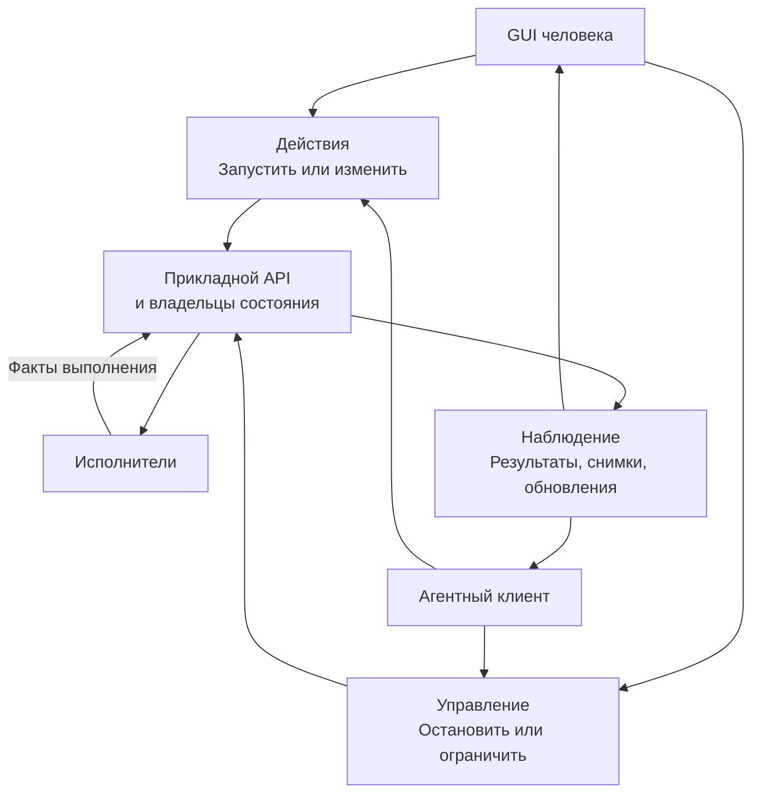

*Стрелки обозначают информационные пути. Три контура не требуют трёх серверов, очередей или даже трёх отдельных классов.*

У локальной операции они могут выражаться одним методом, callback прогресса и токеном отмены. У сервиса задач — методами запуска и остановки, запросом состояния и подпиской. Обе конструкции способны поддерживать живой GUI.

### Почему один контур не заменяет другой 🧩

Наличие команды `convert` не объясняет, где находится текущая работа. Наличие события `started` не даёт возможности её остановить. Наличие `cancel` не означает, что GUI сможет узнать окончательную судьбу уже созданных файлов.

В сравнительном исследовании эти различия проявились практически: конвертер сохранил синхронный вызов с прогрессом и отменой, а загрузчик получил адресуемые задачи у общего runtime. Нужная инфраструктура различалась, хотя оба продукта использовали общий прикладной вход. [П1, §4.3–4.4][practice]

Поэтому проектирование связи начинается не с выбора библиотеки событий, а с вопроса: **какой контур должен оставаться работоспособным в каждый момент выполнения**.

Если тяжёлая работа занимает единственный путь обработки управляющих сообщений, кнопка остановки существует только формально. Если GUI узнаёт о результатах только из собственных обработчиков кнопок, работа агента для него невидима. Если события нельзя восстановить запросом состояния, поздно открытое окно может никогда не узнать о существующей задаче.

---

<a id="same-owner"></a>
## 2. Общий код, общие файлы и общая работа — три разные гарантии 🧠

Самое важное решение при добавлении GUI — **к какому экземпляру приложения он подключается**.

Общий пакет с функциями решает повторное использование логики. Общий каталог данных решает доступ к сохранённым сведениям. Общий владелец выполнения решает управление конкретной живой работой. Эти свойства не следуют одно из другого.

### Локальный вызов с собственным исполнителем: профиль A 🔧

В небольшом конвертере допустима такая конструкция:

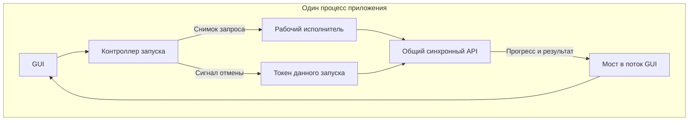

В практическом конвертере `convert(ConversionRequest, cancellation, on_progress)` возвращает окончательный `BatchResult`. Работа живёт в этом вызове; GUI размещает его в worker, удерживает ресурсы и получает сообщения. Отдельной долговечной Job-модели нет. Второй GUI использовал тот же API без второго конвертера и без переноса файловой политики в окно. [П2, §3.3–3.4][compressor]

Это полноценная архитектура для выбранных требований. Длительный вызов не обязан превращаться в серверную задачу только ради полосы прогресса.

Но отдельный CLI-процесс, импортировавший тот же пакет, создаёт **другое выполнение**. Уже открытый GUI не получает доступ к его callback, токену и памяти. Никакая одинаковая версия библиотеки не создаёт канал наблюдения сама.

Даже в одном процессе само совпадение импортируемой функции недостаточно. Если агентный адаптер самостоятельно вызвал её со своим токеном и наблюдателем, контроллер окна может ничего не знать об этой работе. Нужен согласованный вход через живущий на уровне приложения контекст исполнения либо явное подключение GUI к его сообщениям. Для одной локальной операции это может оставаться компактной привязкой, без долговечного менеджера задач.

### Адресуемая работа у общего владельца: профиль B ⚙️

Если агент должен запускать работу независимо от окна, а человек — находить и останавливать её через GUI, нужен общий владелец этой работы.

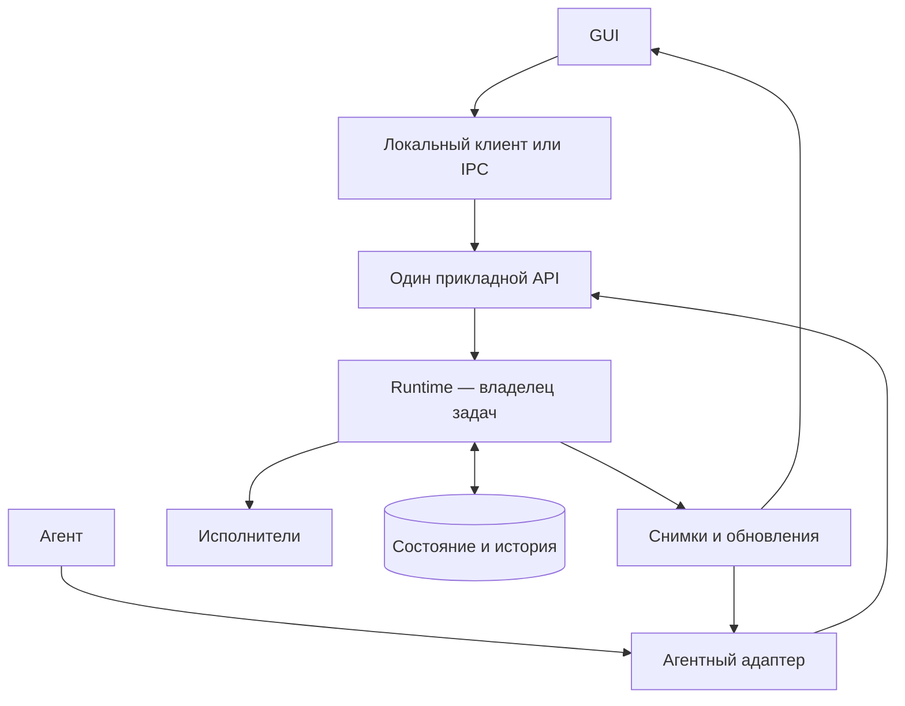

Runtime — здесь конкретный работающий экземпляр прикладной системы, а не название обязательного класса. Он может находиться внутри desktop-процесса, в отдельной локальной службе или на сервере.

Практический загрузчик использовал один runtime для GUI и встроенного HTTP MCP. Отдельный CLI с тем же каталогом истории не становился его клиентом. Запрос отмены без нужного владельца возвращал `OWNER_REQUIRED`, а второй пишущий runtime того же профиля — `OWNER_BUSY`. Это честное разграничение общей истории и общего исполнения. [П4, §5.1–5.3][downloader]

### Место жизни определяет поведение закрытия 🏠

| Размещение работы | Что означает закрытие окна в предлагаемой модели |
|---|---|
| Работа принадлежит экземпляру окна или его локальному контроллеру | Окно должно завершить оговорённую остановку и освобождение ресурсов либо передать владение существующему host |
| Работа принадлежит desktop-host, окно — один из клиентов | Закрытие представления не обязательно завершает host; политика приложения задаётся явно |
| Работа принадлежит локальной службе | GUI отключается, служба продолжает работу в пределах собственного контракта |
| Работа принадлежит удалённому сервису | Закрывается клиентская подписка; судьба задачи определяется сервером и отдельными управляющими операциями |

Фраза «работает в фоне» недостаточна. Фон может означать рабочий поток живого процесса, процесс в трее, отдельную службу или сервер. У этих вариантов разное время жизни и разные способы восстановления.

> [!important] Минимум определяется обещанием
> Для собственного длительного вызова достаточно управляемого исполнителя. Для управления одной работой из нескольких независимых обращений нужен адресуемый владелец. Для продолжения после закрытия окна нужен подходящий host. Для восстановления после аварии нужны сохранённые данные и правила восстановления. Это четыре разных требования.

---

<a id="responsibilities"></a>
## 3. Где проходит граница между GUI и backend 🧱

«Тонкий интерфейс» часто понимают слишком буквально: обработчик вызывает API и выводит полученный объект. На практике между виджетами и прикладным сценарием существует полезная работа по организации взаимодействия.

Она не является второй бизнес-логикой, пока не присваивает себе предметные решения.

| Компонент | Законная ответственность | Что не должно туда попадать |
|---|---|---|
| **Виджеты или компоненты** | Принимать ввод, показывать данные, управлять локальным фокусом | Публикация файлов, удаление исходников, изменение очереди в обход API |
| **Контроллер / Presenter** | Зафиксировать запрос, связать запуск с представлением, обработать ожидание и закрытие | Собственная версия правил преобразования и допусков |
| **Проекция / ViewModel** | Хранить известное состояние и превращать его в данные экрана | Объявлять неподтверждённые последствия успешными |
| **Мост исполнения или транспорта** | Доставить вызов и сообщения через потоковую либо процессную границу | Незаметно создавать другую сессию вместо запрошенной |
| **Прикладной владелец** | Применить правила, определить состояние и исход, обработать управление | Читать поля формы, вызывать методы конкретного окна |
| **Исполнитель** | Выполнить план, сообщить прогресс, обработать поддержанную отмену | Самовольно менять общую текущую задачу или UI |

Это карта ролей, не требование создать шесть последовательных слоёв. В небольшой программе контроллер и проекция могут быть компактными частями одного модуля. Важны границы принятия решений.

### Тонкий адаптер может быть содержательным 📐

Контроллеру разрешено знать, что пока операция запускается, повторное нажатие не должно создавать второй случайный запуск. Ему разрешено удерживать worker, привязать ответ к поколению формы и отписаться при уничтожении представления.

Но ему не следует решать, безопасно ли перезаписать выходной файл, какой результат принадлежит задаче и можно ли считать источник удалённым. Эти факты должны поступать от соответствующих владельцев приложения.

Отделение состояния представления от конкретных GUI-контролов описывает паттерн [Presentation Model][presentation-model]. В рассматриваемой конструкции ViewModel нужна не ради дополнительного класса, а ради возможности проверить отображаемый смысл отдельно от кнопок и графического движка.

### Один batch нельзя незаметно заменить серией отдельных вызовов 📦

Если общий API принимает пакет целиком и проверяет пересечения выходных путей, GUI не должен ради удобных карточек выполнять отдельный `convert` для каждого файла. Такая оболочка изменит границу проверки: межфайловый конфликт может исчезнуть из предварительного плана.

В практическом конвертере этот выбор был сделан явно: один общий batch, отдельное обнаружение входов и окончательная проверка в основном сценарии. Preview не резервировал файловую систему и не подменял результат настоящего API. [П3, §3][gui-report]

Следовательно, **единица отображения и единица исполнения не обязаны совпадать**. Один пакет может иметь множество строк результата, не превращаясь во множество независимых прикладных операций.

---

<a id="state-axes"></a>
## 4. У приложения не одно состояние «занято» 🔄

Главный источник ошибок на стыке — попытка описать всё одним флагом `busy` или одним перечислением `idle/running/done`.

Такой флаг смешивает состояние работы, состояние ресурса, знание наблюдателя и локальное ожидание. Пока всё происходит быстро и по порядку, смешение незаметно. При отмене, задержке доставки или закрытии окна оно становится опасным.

### Независимые оси состояния 🧭

В предлагаемой модели достаточно различать несколько небольших осей:

| Ось | Примеры значений | Кто устанавливает |
|---|---|---|
| **Локальное намерение** | Запрос не отправлен, отправляется, отмена нажата | Контроллер представления |
| **Прикладное выполнение** | Принято, выполняется, завершено, отменено, отказано | Прикладной владелец |
| **Жизнь исполнителя** | Создаётся, активен, завершает освобождение, освобождён | Владелец worker/runtime |
| **Наблюдение** | Синхронизировано, ожидает данные, связь потеряна, снимок устарел | Клиент наблюдения |
| **Подтверждённые последствия** | Результат опубликован, проверен, сохранён; исход отдельного действия неизвестен | Владельцы соответствующих эффектов |
| **Локальная форма** | Выбор файлов, черновые настройки, выбранная строка | GUI |

Не требуется хранить весь декартов продукт этих значений отдельным enum. Наоборот: независимые данные позволяют избежать десятков искусственных состояний вроде `running_disconnected_cancel_clicked_result_pending`.

### Пример: работа завершилась, окно ещё не готово к новому запуску ⏳

Допустимо такое сочетание:

```text
Прикладной результат: получен, пакет частично выполнен.
Исполнитель: заканчивает освобождение ресурсов.
Наблюдение: локальный канал исправен.
Намерение пользователя: закрыть окно после завершения.
Доступность нового запуска в этом однопоточном слоте: нет.
```

Здесь нельзя вернуть карточку в состояние «выполняется» только потому, что поток ещё жив. Но нельзя и уничтожить worker только потому, что результат уже показан.

Практический конвертер разделял `result_ready` и `QThread.finished`, удерживал worker и откладывал закрытие окна. Это конкретная реализация нужного различия, а не основание объединять эти сигналы общим обработчиком «всё закончено». [П2, §4.5][compressor]

### Пример: связь потеряна, результат неизвестен только клиенту 📡

Другой допустимый набор:

```text
Последнее подтверждённое состояние задачи: выполняется.
Последняя версия: 12.
Наблюдение: соединение разорвано.
Окончательный результат: пока неизвестен этому клиенту.
```

Из него не следует ни падение задачи, ни её остановка, ни отсутствие результата. GUI должен сохранить последнее известное состояние с указанием его ограниченной свежести и восстановить наблюдение по контракту.

**Неизвестное состояние наблюдения и неизвестный побочный эффект — разные вещи.** В первом случае клиент не знает, что произошло у владельца. Во втором сам владелец может знать, что внешнее действие началось, но не иметь подтверждения его окончательного исхода.

---

<a id="identity"></a>
## 5. Идентичность запуска появляется до тяжёлой работы 🪪

Асинхронная связь требует ответа на простой вопрос: **к чему относится это сообщение**.

Номер строки таблицы не подходит: порядок может измениться. Текст запроса не всегда уникален. Имя файла может повторяться. Одна и та же форма способна пережить несколько запусков и получить запоздавшие события каждого из них.

### Минимальная система идентификаторов 📎

Не каждое приложение нуждается во всех перечисленных полях. Они добавляются по соответствующей границе.

| Идентификатор | Для чего нужен | Чего не доказывает |
|---|---|---|
| `run_id` | Различить локальные запуски одной операции | Долговечность, авторизацию или защиту от повторов |
| `job_id` | Обратиться к работе между отдельными вызовами | Принадлежность конкретной попытки исполнения |
| `attempt_id` | Различить попытки одной логической задачи | Право старой попытки публиковать результат |
| `view_generation` | Не применить старый ответ к новой форме/выборке | Актуальность общего состояния backend |
| `revision` | Упорядочить состояния одного ресурса | Положение во всём потоке событий |
| `owner_epoch` | Отличить поколения временного runtime | Версию схемы API |
| `stream_cursor` | Продолжить конкретную подписку | Семантическую версию документа или задачи |

Для одного локального конвертирования может хватить `run_id` и фиксированного запроса. Для общей очереди понадобятся `job_id` и версия задачи. Если сообщения переживают перезапуск временного владельца, потребуется различение поколений. Это не повод заранее переносить все поля в каждую функцию.

### Снимок запроса отделяет выполненное от нового черновика 🧊

Перед запуском GUI собирает неизменяемый запрос. После этого worker не читает текущие значения виджетов.

```text
Черновик формы
    формат = WebP
    качество = 80
    выбранные входы = [A, B]
            ↓ фиксация
Запрос запуска R
    формат = WebP
    качество = 80
    входы = [A, B]
            ↓
Выполнение и результат R
```

Если человек затем выставит качество 60 для следующей операции, результат текущей продолжает относиться к 80. Интерфейс может разрешать редактирование будущего черновика, но не должен молча смешивать его с выполняющейся работой.

Практический GUI конвертера именно так строил immutable request. Исследование отдельно рекомендует выводить параметры завершённой обработки из request/result snapshot, а не из текущих полей формы. [П2, §3.4][compressor]; [П3, кейс D][gui-report]

### Предварительная выборка не является вечной гарантией входов 🔍

Между discovery и началом преобразования файл может измениться или исчезнуть. Поэтому снимок формы фиксирует **намерение**, а не отменяет проверки на границе выполнения.

Если предварительная выборка и фактический batch имеют разные правила отбора, GUI не должен угадывать активный файл по номеру элемента preview. В исследованном конвертере сообщение `item_started` не содержало source; новый GUI не приписывал ему путь по индексу, а показывал общую активность. Завершённые строки обновлялись по фактическому `item.source`. [П3, §5][gui-report]

Это важное ограничение: **неполный контракт требует честного неполного отображения либо явного расширения API, но не реконструкции отсутствующего факта на глаз**.

---

<a id="contracts"></a>
## 6. Контракты связи: запуск, наблюдение и управление 📜

Публичный контракт должен сообщать не только набор полей, но и время их появления, источник истины и последствия потери ответа.

Для живого GUI особенно важны три различия: принятие запроса не равно завершению работы; событие не всегда является сохраняемой записью; прекращение ожидания не равно отмене операции. Разделение принятия и окончательного результата является основой паттерна [Asynchronous Request–Reply][async-request-reply].

### Два достаточных поведенческих интерфейса ⚙️

Для профиля A возможна компактная форма:

```text
convert(request_snapshot, execution_context) -> BatchResult

execution_context:
    cancellation_signal
    progress_sink
```

Вызов синхронный относительно своего исполнителя. GUI не исполняет его на занятом графическом потоке, а организует соответствующий worker. Итог возвращается из вызова; промежуточные сообщения не заменяют итог.

Для профиля B другая форма:

```text
start_operation(request, trusted_context) -> JobAccepted
get_job(job_id, trusted_context) -> JobSnapshot
observe_jobs(selection, continuation, trusted_context) -> Subscription
request_cancel(job_id, trusted_context) -> CancelDecision
```

Это **условные интерфейсы статьи**. Наличие четырёх методов не означает обязательного сетевого сервиса: все они могут вызываться локально. Внешний адаптер сериализует только переносимые данные, но не callback, живой mutex или ссылку на окно.

### Наблюдение тоже имеет паспорт 📡

| Часть договора | Пример решения |
|---|---|
| Контекст выполнения callback | Мост принимает сообщение в рабочем потоке и переносит применение в GUI-поток |
| Идентичность | Все сообщения несут `run_id` либо `job_id` |
| Порядок | Гарантирован в пределах потока или явно восстанавливается по версиям |
| Допустимость повторов | Повторный полный снимок не создаёт новую строку и не увеличивает счётчик |
| Допустимость пропусков | Промежуточный процент можно объединить; итог доступен отдельным способом |
| Поведение медленного подписчика | Ограниченный буфер и определённая пересинхронизация, не бесконечный рост памяти |
| Ошибка наблюдателя | Не запускает преобразование заново и не переписывает его последствия |
| Завершение подписки | Возвращается явный способ отписки; поздние callback защищены от обращения к уничтоженному представлению |

В практическом конвертере отказ observer callback отключал наблюдатель с предупреждением, но не приводил к повторной конвертации. Это полезная граница: уведомление о работе и сама работа имеют разные результаты. [П2, §4.4][compressor]

### Пример снимка задачи 📦

Следующий JSON — предлагаемая модель для общей очереди, а не wire-формат какого-либо исследованного продукта:

```json
{
  "schema_version": 1,
  "owner_epoch": "runtime-7",
  "job_id": "job-42",
  "revision": 12,
  "operation": "images.convert",
  "state": {
    "status": "running",
    "phase": "encoding",
    "progress": {
      "kind": "items",
      "finished": 2,
      "total": 5
    }
  },
  "cancel_requested": false,
  "result_ref": null
}
```

`finished` здесь означает число элементов с окончательным исходом, а не число успешных файлов и не долю времени. `result_ref: null` означает отсутствие доступной ссылки на итог в этом состоянии. Права клиента на отмену определяются отдельно: они могут меняться без изменения предметной версии задачи.

Временной штамп полезен для объяснения свежести, но не подменяет `revision`. Произвольные часы разных процессов не дают надёжного порядка изменений.

### Ответ запуска и уведомление могут обогнать друг друга 📨

В общей сессии событие `job.created` способно попасть в GUI раньше, чем вернётся ответ `start_operation`. Если обработчик кнопки создаёт карточку по ответу, а подписка — ещё одну по событию, на экране возникают две работы вместо одной.

В предлагаемой модели оба пути сходятся в одной операции обновления проекции по авторитетному `job_id`. Предварительное локальное ожидание привязывается к ответу через идентификатор намерения; оно не становится второй настоящей задачей. Если уведомление уже принесло более новую версию, поздний ответ запуска не возвращает карточку в `queued`.

Для неподтверждённых сообщений допускается ограниченный буфер или последующее чтение состояния. Но сопоставление по похожему названию, времени или номеру строки не заменяет явной связи. Клиентская корреляция при этом остаётся корреляцией: сервер не обязан считать её ключом идемпотентности, пока это не определено отдельным контрактом.

Отключение кнопки Start предотвращает часть случайных повторных нажатий в одном окне. Оно не защищает от второго окна, агента или повторной сетевой доставки. Допуск параллельной работы и распознавание повторов принадлежат приложению, а не визуальному состоянию кнопки.

### Схема не устанавливает доверие 🔐

Клиентский `actor_id` или `origin: "gui"` не является полномочием. Принимающая сторона устанавливает доверенный контекст и проверяет право действия над конкретной задачей. Такое разделение согласуется с рекомендациями OWASP о проверке доступа для каждого запроса и минимальных полномочиях. [Authorization Cheat Sheet][authorization]

GUI может показывать инициатора для удобства, но не должен выдавать право остановить любую работу только потому, что в сообщении нарисовано имя агента.

---

<a id="visible-feedback"></a>
## 7. Backend сообщил о старте — но GUI ещё может ничего не показать 👀

Отправка события, изменение модели представления и появление кадра — разные стадии. Их смешение позволяет получить формально правильный backend и визуально зависшее приложение.

### Практический случай: событие перед блокирующим хвостом 🔬

В сравнительном исследовании описана контролируемая проверка приложения с захватом: после публикации канонического `capture_started` синхронный участок продолжал удерживать GUI. Обработка очереди, привязка handle, применение состояния и отрисовка происходили только после освобождения этого участка.

Проверка проходила через настоящий прикладной маршрут, но использовала синтетические края захвата и планировщика. Она установила конкретный механизм задержки интерфейса. Она **не** доказывала потерю физически записанных данных, точное время ожидания пользователя или работоспособность установленного приложения на настоящем устройстве. [П1, §8.5][practice]

Из случая следует ограниченный, но важный вывод: **ранняя публикация факта не гарантирует раннюю возможность его увидеть**.

### Цепочка наблюдаемой реакции ⏱️

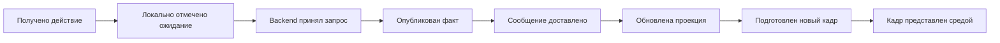

Это не обязательная строгая временная цепочка всех сообщений. Например, уведомление о принятии может обогнать ответ на запрос. Схема разделяет **разные наблюдаемые рубежи**, которые требуется связывать идентичностью запуска.

В Qt queued-соединение вызывает слот, когда управление возвращается циклу событий потока-получателя. Поэтому queued-доставка в занятый GUI-поток не обеспечивает немедленного применения сообщения. GUI-объекты Qt, в свою очередь, должны обслуживаться главным потоком. [Threads and QObjects][qt-threads]

В браузерной среде обработка задач и обновление rendering также имеют отдельные правила. Один вызов обновления состояния не является обещанием немедленного отображения кадра; возможность отрисовки зависит от цикла событий и состояния документа. [HTML Standard — Event loops][html-loop]

### Что должен делать путь запуска ⚙️

В предлагаемой модели контроллер быстро фиксирует локальное намерение, идентичность запуска и возможность ранней отмены. Затем передаёт тяжёлую работу подходящему исполнителю и возвращает управление циклу GUI.

Локальное состояние может называться «Запускается» или «Запрос отправлен». Оно не утверждает, что кодек, загрузка или запись уже работают. Уверенное «Выполняется» появляется после относящегося к этому запуску подтверждения владельца.

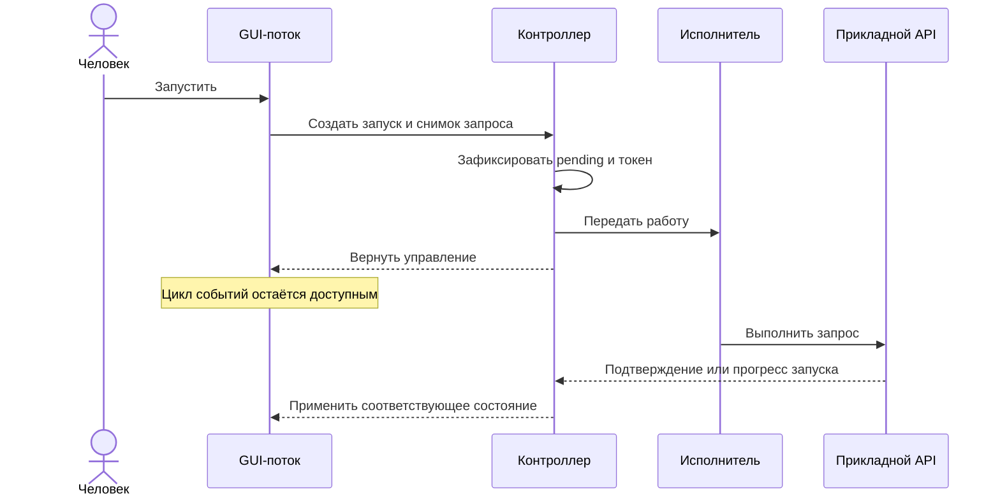

Если работа очень короткая, промежуточное состояние может не попасть в отдельный видимый кадр. Это не обязательно дефект. Существенно, чтобы длительная работа не лишала человека обратной связи и управления, а приложение не вставляло искусственные задержки только ради демонстрации спиннера.

### Перенос одного вызова не устраняет все блокировки 🧵

Подготовка запроса тоже способна оказаться тяжёлой: обход дерева файлов, декодирование preview, загрузка модели, сбор возможностей, восстановление истории. Перенос только финального `convert()` не поможет, если до него GUI синхронно выполняет большую подготовку.

Однако перенос не должен нарушать правила владения. Объект с привязкой к потоку, соединение или нативный ресурс нельзя произвольно создать в GUI и затем использовать где угодно. Исполнитель должен получать переносимые данные либо ресурсы, для которых такой маршрут явно допустим.

Обратный путь тоже может блокировать окно. Если callback прогресса сортирует всю таблицу, перестраивает тысячи строк или декодирует большие миниатюры, backend уже работает правильно, а интерфейс тратит всё время на применение его сообщений. Здесь требуется ограничить стоимость **обработки обновления**, а не переносить ещё один предметный сервис.

> [!warning] Принудительная обработка событий не заменяет архитектуру
> Вставка ручной «прокрутки» GUI-цикла внутрь тяжёлого сценария может разрешить повторный вход в обработчики в промежуточном состоянии. Для рассматриваемой модели предпочтительнее короткие управляющие участки, отдельное исполнение и явные переходы, а не попытка оживить окно посреди неделимой операции.

---

<a id="progress"></a>
## 8. Прогресс — контракт данных, а не таймер для полосы 📊

Прогресс полезен, только если определено, **что именно измеряется**. Обработанные элементы, прочитанные байты, завершённые этапы и ожидаемое оставшееся время — разные величины.

Для пакетного конвертера «2 из 5 файлов получили итог» не означает «прошло 40% времени». Третий файл может быть больше остальных. Отдельный кодек может вообще не предоставлять промежуточную готовность.

### Что может сообщать backend 📐

| Факт | Корректное представление данных | Необоснованное продолжение |
|---|---|---|
| Известен только текущий этап | `phase = encoding`, неопределённая готовность | Измеренный процент внутри кодека |
| Известно число завершённых элементов | `finished = 2`, `total = 5` | Точное оставшееся время |
| Известны обработанные байты текущего этапа | Единицы и граница этапа указаны явно | Процент завершения всего сценария |
| Готов результат одного элемента | Его идентичность и окончательный исход | Успех всего пакета |
| Объём ещё обнаруживается | Найдено N, итоговое количество неизвестно | Постоянный знаменатель, который якобы уже окончателен |

После фиксации полного manifest знаменатель пакета может быть известен. Если приложение сознательно использует потоковое обнаружение, изменение общего количества должно быть частью контракта. GUI не должен самостоятельно решать, какой из этих режимов реализован.

В практическом конвертере известны этап и число завершённых элементов, но не внутренний процент нативного кодека. Поэтому достоверная полоса строится по доступным единицам, а не по приблизительному таймеру. [П1, §8.4][practice]

### Практический случай: правильный финал скрывал неправильный процесс 🧪

При проверке нового GUI конвертера один элемент уже завершился, а следующий кодек был удержан контролируемым барьером. В этот момент полоса оставалась неопределённой. Другой контрпример показал, что объединение обновлений оставляло завершённую строку в состоянии ожидания.

После исправления использовались последнее неизменяемое состояние прогресса и пакет завершённых элементов. Те же промежуточные проверки были сохранены: их не заменили утверждением о финальном успехе. [П3, кейс E][gui-report]

**Вывод:** итоговая карточка и живой ход выполнения — разные предметы проверки. Правильный результат в конце не доказывает правильную информацию между началом и концом.

### Частые проценты можно объединять, завершённые элементы — нельзя забывать 📬

При высокой частоте сообщений GUI не обязан рисовать каждое значение. Для процентов допустима стратегия «последнее значение побеждает». Но если тем же способом заменить все сообщения одним последним событием, сведения о ранее завершившихся файлах исчезнут.

В предлагаемой локальной модели мост хранит разные категории отдельно:

```text
Mailbox конкретного запуска
    latest_progress              — последний актуальный снимок прогресса
    pending_item_updates[id]     — последнее изменение каждого элемента
    terminal_result              — итог; не вытесняется обычным прогрессом
    executor_lifecycle           — сведения о завершении исполнителя
```

При переносе данных в GUI мост под короткой синхронизацией забирает накопленное, после чего освобождает блокировку. Дорогое преобразование в строки и виджеты выполняется уже вне этой блокировки.

```text
publish_item_update(update):
    в защищённой короткой секции:
        сохранить более новую версию для update.item_id
    запросить один будущий drain, если он ещё не назначен

drain_on_gui():
    в защищённой короткой секции:
        забрать накопленный пакет
        разрешить назначение следующего drain
    применить пакет к проекции
    обновить только затронутые элементы представления
```

Это псевдокод принципа, не готовая реализация очереди. Реальный мост должен корректно обрабатывать гонку публикации и снятия признака назначенного drain, остановку приёмника и выбранную модель памяти.

### Ограниченная память требует честной политики 🧮

Хранение последней записи для каждого элемента ограничивает число повторных сообщений, но не делает память постоянной при бесконечном числе файлов. Возможны три решения: ограничить размер пакета, вынести результаты в адресуемое хранилище либо показывать ограниченную страницу с возможностью дочитывания.

Просто выбросить непоместившиеся завершённые элементы допустимо лишь при наличии другого канала восстановления. Например, итог содержит полный набор outcomes либо ссылку на постранично читаемый результат. В противном случае «оптимизация прогресса» становится потерей информации.

Для аудита и обязательных шагов процесса действует другая политика. Их нельзя автоматически сворачивать как проценты. Не каждое уведомление имеет одинаковую допустимость потери.

### Итоговая сверка не должна угадывать судьбу отсутствующих строк ✅

Терминальный результат в предлагаемой модели является окончательным источником сведений о выполненном пакете. Он восстанавливает корректный итог, даже если промежуточное обновление не отрисовалось.

Но отсутствие элемента в сокращённом ответе не означает автоматически «отменён». Контракт должен объяснять, содержит ли результат все входы, только попытки, только успешные элементы или страницу большого отчёта. Только после этого GUI может преобразовать ожидающие строки в `not_attempted`, `skipped` или другой определённый исход.

Повторная доставка одного итога не должна повторно увеличивать счётчики. Применение по идентичности и версии надёжнее, чем «на каждое событие completion прибавить единицу».

---

<a id="projection"></a>
## 9. Проекция GUI — читатель фактов, а не второй владелец работы 🪟

Между сообщением backend и виджетом полезно иметь локальную проекцию. Она хранит то, что клиент знает о приложении: задачи, элементы результатов, версии и состояние соединения.

ViewModel затем превращает эти факты в данные конкретного представления: название строки, текст этапа, тип индикатора, предупреждение и доступные действия.

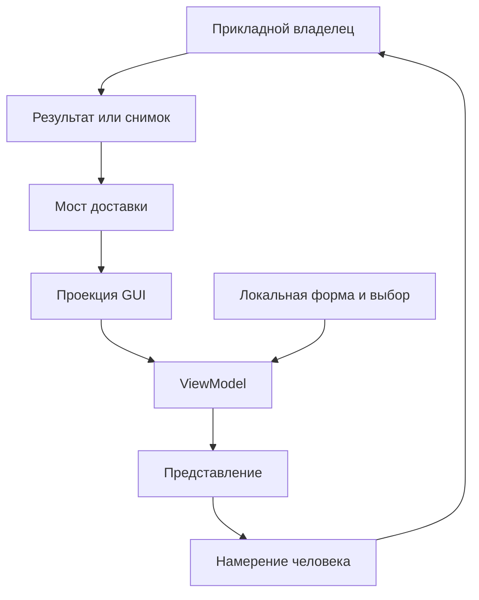

Локальная форма и подтверждённые параметры выполненной операции не сливаются. Они могут участвовать в одной ViewModel, но остаются разными источниками.

### Что допустимо вычислять в представлении 🧾

GUI вправе локализовать код этапа, форматировать размер файла, вычислить разницу известных размеров или показать краткий текст по типизированной ошибке. Это преобразование представления, а не повторение кодека.

Например, если известны оба размера и исходный размер больше нуля, можно показать относительное изменение. Если результат больше исходника, интерфейс сообщает увеличение, а не сохраняет надпись «экономия» с неожиданным знаком. Если один размер неизвестен, относительная величина тоже неизвестна.

Нельзя выводить судьбу исходника из факта наличия результата. Нельзя считать файл проверенным только потому, что у него есть путь. Нельзя предлагать повтор всей операции лишь на основании неуспеха последующей записи истории.

В исследованиях конвертера подчёркнуто, что полезные данные уже существовали в API, но представление использовало лишь их часть. Предложение построить человеческий результат из этих фактов не означало, что такой ремонт уже завершён. [П2, §6.11][compressor]; [П3, кейс D][gui-report]

### Публикуемый снимок не должен незаметно меняться 🧊

Сообщение, обозначенное как версия 12, должно оставаться данными этой версии. Если отправитель передал ссылку на изменяемый список, а затем продолжил менять его, версия перестаёт описывать фактическое содержимое.

В предлагаемой модели используются неизменяемые значения, копирование либо явная передача владения. Выбор зависит от среды и объёма данных. Аннотация `readonly` или замороженная внешняя оболочка не доказывает глубокой неизменяемости вложенных коллекций.

React предоставляет `useSyncExternalStore` для подписки на внешнее хранилище: при отсутствии изменений снимок должен сохранять идентичность, а при изменении mutable store возвращается соответствующий новый неизменяемый снимок. Функция подписки возвращает функцию отписки. Это конкретный механизм реализации, а не замена прикладному владельцу. [React — useSyncExternalStore][react-store]

### Ошибка представления не переписывает состоявшуюся операцию 🚧

Если форматирование размера или обработчик уведомления завершились исключением, GUI может показать проблему отображения и запросить состояние повторно. Он не должен объявлять, что файл не был создан, или автоматически повторять конвертацию.

Полезно различать:

```text
Ошибка операции: приложение не выполнило обещанный сценарий.
Ошибка наблюдения: клиент не получил или не смог применить сведения.
Ошибка представления: сведения получены, но экран не смог их корректно показать.
```

Один и тот же пользовательский сигнал «что-то не получилось» скрывает разные последствия. Внутренний контракт обязан их различать, даже если внешнее объяснение остаётся коротким.

---

<a id="stale-results"></a>
## 10. Запоздавший ответ: защита окна не защищает общее состояние ⌛

Обычный механизм GUI — поколение запроса. При новом поиске счётчик увеличивается, и ответ старого поиска не применяется к текущей форме.

Это полезно, но решает только локальную задачу. Старое выполнение может успеть изменить общий `current_result` в backend ещё до того, как GUI отбросит его сообщение.

### Практический риск: текущий результат имеет собственного владельца 🧠

В сравнительном исследовании поискового приложения найден маршрут: исполнение отпускает lock на время запроса, затем записывает общий статус и текущий результат без проверки актуальности именно этой попытки. Защита по UI-counter не препятствует старой операции заменить общий результат новой.

Это **статически установленный риск исходной цепочки**, а не воспроизведённая в данном исследовании пользовательская гонка. В том же источнике отмечена сильная проверка идентичности при раскрытии результата; рекомендация относится к развитию существующего владельца, а не созданию обходного поиска в GUI. [П1, §7.6][practice]

### Две независимые проверки актуальности 🔒

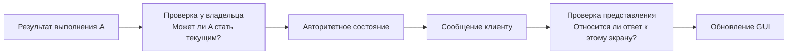

В предлагаемой модели политика «последнее намерение определяет текущий результат» реализуется у владельца соответствующего контекста. Это может быть конкретное поисковое пространство, документ или вкладка, но не обязательно один глобальный слот на весь продукт.

```text
начать_запрос(scope, request):
    в короткой секции владельца:
        ticket = новое поколение данного scope
        зафиксировать ticket как текущий
        snapshot = зафиксировать вход запроса

    result = выполнить(snapshot)  # вне общей критической секции

    в короткой секции владельца:
        если ticket всё ещё текущий:
            опубликовать result как текущий результат scope
        иначе:
            сохранить или отбросить result по политике устаревших запросов
```

Это алгоритм для результата чтения. Он **не** отменяет уже выполненную запись во внешнюю систему. Если запрос имеет побочные эффекты, устаревание представления не даёт права забыть их, удалить чужой результат или объявить операцию неисполненной.

### Политика latest-wins подходит не всем действиям ⚖️

Для подсказок поиска часто разумно показывать только ответ последнего запроса. Для экспорта двух документов обе работы остаются действительными: более поздняя не делает раннюю ошибкой. Для последовательного редактирования документа необходимы правила версий и конфликтов, а не глобальное «последний ответ победил».

Поэтому `generation` ограничивается конкретным смысловым контекстом. Смена выбранной строки в GUI не должна отменять постороннюю задачу агента. Запуск новой операции не должен очищать результат старой, который ещё нужен истории или другому окну.

### Позднее сообщение нельзя целиком выбрасывать до учёта ресурсов 🧹

Есть ещё одна тонкость. Если все callbacks начинаются с `if run_id != current: return`, старое сообщение о завершении может быть отброшено вместе с обязанностью освободить принадлежащий ему worker.

В предлагаемой конструкции обработка разделяется:

```text
Сообщение жизненного цикла
    → сначала учёт у владельца соответствующего исполнения;
    → затем решение, относится ли оно к текущему представлению.
```

Старый результат может быть неинтересен текущей вкладке, но его ресурсы всё ещё принадлежат конкретному владельцу. Фильтр отображения не является механизмом cleanup.

### Согласованность нужна и внутри одного ответа 📋

В практическом загрузчике запрос с фильтром `downloading` выбирал строку, а mapper затем повторно читал уже завершившуюся live task. В результате в отфильтрованный ответ попадал статус `done`.

Исправление сохранило один detached снимок через цепочку **capture → filter → limit → mapping**. Источники не требуют глобальной транзакции всей системы: необходимо лишь, чтобы поля конкретного ответа соответствовали тому состоянию, по которому выполнялся его отбор. [П4, кейс 2][downloader]

Это различие полезно для таблиц GUI. Допустимо получить согласованный, но уже немного устаревший снимок. Недопустимо назвать его согласованным, если критерий отбора и отображаемые поля относятся к разным моментам.

---

<a id="subscription"></a>
## 11. Подписка и снимок: как окно догоняет приложение 📡

Если GUI показывает только события, пришедшие после его открытия, он не является полноценным наблюдателем общей сессии. Уже существующие задачи, результаты и предупреждения останутся вне экрана.

Для адресуемого runtime нужен способ получить текущее состояние, а затем наблюдать изменения. Для локального вызова A достаточно сохранить результат и текущие данные у живущего дольше представления контроллера, если продукт вообще обещает повторное подключение окна в рамках этого процесса.

### Гонка начального подключения 🕳️

Наивная последовательность «получить список, потом подписаться» оставляет промежуток. Новая задача может возникнуть после снимка, но до подписки. Она не попадёт ни туда, ни туда.

В предлагаемой модели B возможны два решения.

**Согласованный снимок и курсор.** API возвращает снимок на определённой границе потока, после чего клиент читает изменения строго после неё. Если продолжение больше недоступно, выполняется новая синхронизация.

**Подписка до снимка.** Подписка сначала подтверждает готовность и буферизует сообщения, затем клиент получает снимок и применяет накопленные более новые версии. Переполнение буфера или потеря непрерывности приводит к пересинхронизации, а не замалчивается.

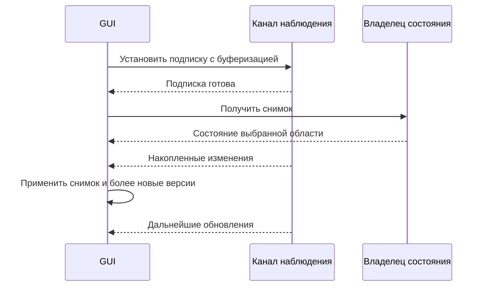

Схема с предварительной подпиской корректна только при определённых гарантиях готовности, доставки и буфера. Она не создаёт надёжность поверх канала, который молча теряет любые сообщения.

List/watch с версиями и восстановлением при утрате доступной истории применяется, например, в Kubernetes API. Здесь заимствуется принцип согласования начального состояния с продолжением, а не сам протокол или необходимость инфраструктуры Kubernetes. [Kubernetes — API Concepts][list-watch]

### Версия не лечит потерянное последнее сообщение 🔢

`revision` позволяет не применить версию 11 поверх 12. Но если финальное обновление 13 потеряно и больше сообщений нет, сравнивать нечего: карточка останется в старом состоянии.

Поэтому нужна дополнительная гарантия: восстановимый поток, повторное чтение после разрыва или периодическая сверка. Число версии не является механизмом доставки.

После смены поколения временного runtime старые сообщения не должны сравниваться с новыми как будто они принадлежат одному счётчику. Либо идентичность задач и версии устойчивы между перезапусками, либо клиент явно распознаёт новый `owner_epoch` и заново собирает проекцию.

### Удаления и права видимости требуют отдельного внимания 🧹

Объект, удалённый из списка, не может сообщить о себе новым полным содержимым. Нужен сигнал удаления, tombstone либо авторитетная пересборка выбранной области.

Аналогично отзыв права доступа — не обязательно новая версия самой задачи. Если GUI отбрасывает сообщение только потому, что предметный `revision` не изменился, он может пропустить изменение доступных действий или видимости. Такие сведения должны иметь собственную область версии либо приводить к пересинхронизации разрешённого представления.

При постраничном чтении отсутствие объекта на одной странице не означает его удаления. Очистка проекции по отсутствию допустима только в пределах полного авторитетного снимка соответствующей выборки.

### Общая история не становится live-подпиской автоматически 💾

Практический загрузчик позволял читать сохранённую историю без создания executor и без recovery. Этот режим показывал последнее сохранённое состояние, а не живой прогресс GUI-runtime. [П4, §5.2–5.3][downloader]

Это полезная возможность, если она так и названа. Ошибка начинается, когда периодическое чтение общего JSON объявляют подключением к текущему исполнению и обещают через него управлять токенами другого процесса.

---

<a id="passive-state"></a>
## 12. Чтение состояния и активная проверка готовности — разные операции 🔍

Открытие панели, перерисовка компонента и периодический опрос должны иметь понятную стоимость и последствия. Название `get_status` само по себе этого не гарантирует.

### Практический случай: status достигает внешней работы 🧪

В сравнительном исследовании установлена цепочка поискового приложения: запрос состояния строит сведения о возможности поиска, provider вызывает `health()`, а тот формирует запрос и может дойти до model/HTTP work.

Это статическое наблюдение поддержанной конфигурации. Оно не доказывает конкретную отправку данных пользователя, фактический счёт или стоимость. Перенос вызова в worker мог бы защитить отзывчивость окна, но не превратил бы активную проверку в пассивное чтение. [П1, §5.8][practice]

### Четыре разных намерения клиента 🧭

В предлагаемой границе полезно различать:

| Намерение | Пример операции | Что получает GUI |
|---|---|---|
| Увидеть последнее известное | Пассивный snapshot | Наблюдённое состояние, время проверки, возможная устарелость |
| Проверить доступность сейчас | Active check | Результат конкретной проверки с её ограничениями |
| Оценить локальный план | No-send estimate | Известные объёмы и явно неизвестные величины |
| Выполнить работу | Прикладная команда | Принятие, прогресс, результат и последствия |

Это проектное разделение, а не универсальный запрет любого ввода-вывода в query. Локальное чтение хранилища может быть необходимым и ожидаемым. Суть в том, чтобы клиент не принимал активное сетевое действие за безобидное чтение уже имеющегося снимка.

В конвертере `get_capabilities()` намеренно выполнял локальные синтетические проверки кодеков с кэшем процесса. Такой путь отличался от обращения к удалённой модели, но тоже имел стоимость и условия инициализации. [П2, §3.3][compressor]

### Возможность, право и текущая готовность не равны друг другу 🧩

Поддержка формата в продукте не означает доступность кодека в данной установке. Доступность кодека не означает право записывать в выбранный каталог. Полученное вчера подтверждение подключения не означает текущую готовность сервиса.

Поэтому GUI полезно получать различимые факты: реализована ли возможность, разрешена ли клиенту, проверялась ли в текущей среде и когда. Неизвестность нельзя автоматически превращать в `unsupported` или в уверенное `ready`.

При этом доступность кнопки остаётся подсказкой представления. Окончательная проверка проводится при исполнении: ресурс или полномочие могли измениться после отображения состояния.

> [!tip] Новый экран иногда требует нового чтения, но не нового движка
> Если GUI не может получить нужный факт без запуска дорогой проверки, небольшая пассивная проекция у существующего владельца может быть правильной эволюцией API. Создание второго независимого состояния готовности внутри окна лишь переносит рассогласование в другое место.

---

<a id="early-cancel"></a>
## 13. Отмена может прийти раньше, чем вернулся handle запуска 🛑

Одна из самых неудобных гонок возникает в начале работы. Человек нажал «Запустить», backend ещё инициализируется, а человек уже нажал «Стоп» или закрыл окно.

Если контроллер создаёт средство отмены только после возврата handle, в этот промежуток остановку некуда адресовать. Если же он просто забывает запуск при закрытии формы, поздно вернувшийся handle может остаться без владельца.

### Локальная операция: токен создаётся заранее 🔑

Для профиля A достаточное решение — создать одноразовый токен до передачи работы исполнителю. Рабочий код получает тот же токен и не сбрасывает его при собственной инициализации.

```text
Начало запуска R:
    создать immutable request R
    создать cancellation token R
    зарегистрировать владение исполнением R
    отметить локальное ожидание
    передать работу исполнителю

Нажатие «Стоп»:
    установить cancellation token R

Начало работы исполнителя:
    проверить тот же cancellation token R
    выполнить только разрешённые дальнейшие шаги
```

В практических материалах представлены оба относящихся решения: конвертер создаёт токен на отдельную операцию, а backend загрузчика не очищает уже поданный сигнал при создании сервиса. Поэтому отмена до фактического старта не исчезает из-за поздней инициализации. [П1, §8.2][practice]; [П4, §6.2][downloader]

Токен нового запуска — новый объект. Повторное использование старого токена со сбросом создаёт риск: ещё завершающаяся работа A может внезапно перестать видеть отмену после запуска B.

### Удалённый запуск: намерение отмены нужно сохранить 📡

Если `job_id` выдаёт сервер, клиент может узнать его позже локального нажатия «Стоп». Тогда у контроллера существуют два разных факта: запрос запуска ещё не разрешён, но желание остановить его уже зафиксировано.

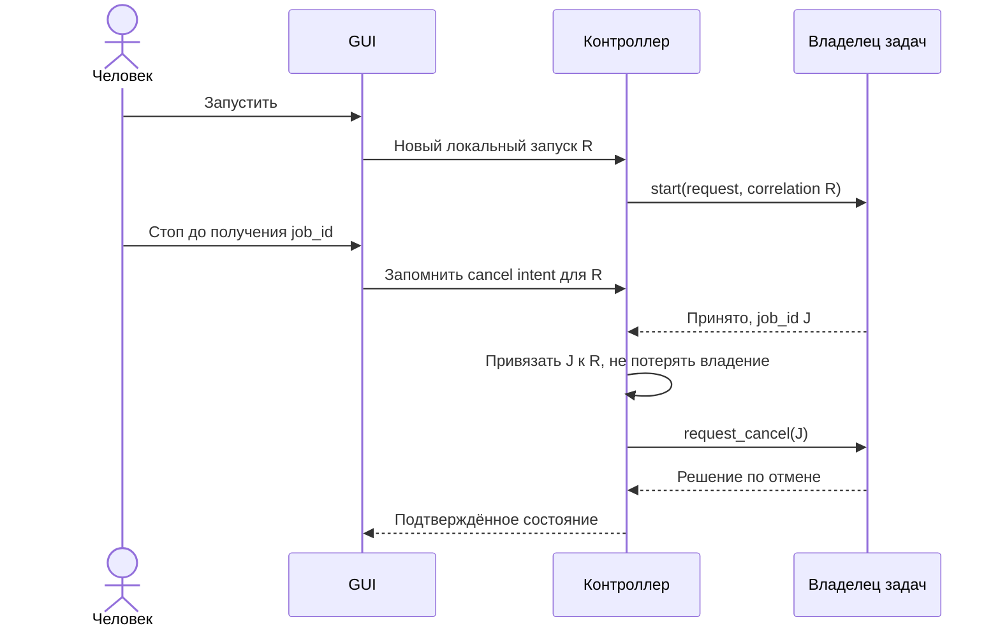

Это предлагаемая политика, а не свойство любого RPC. Она требует, чтобы контроллер переживал исчезновение конкретного виджета либо передавал незавершённую процедуру владельцу уровня приложения.

Другой вариант — сервер позволяет управлять ещё не завершённым запуском по заранее согласованному идентификатору намерения. Но для него нужен отдельный контракт сопоставления, доступа и повторов. Простого поля `request_id` без хранения и правил недостаточно.

### Потеря ответа усложняет отмену, а не разрешает забыть работу 🌫️

Если ответ с `job_id` потерян, GUI может не знать, создана ли задача. Повторный запуск без механизма распознавания намерения способен создать дубликат. Закрытие локальной карточки не уничтожает уже принятую работу.

В зависимости от продукта используются сохранённый ключ идемпотентности, запрос состояния запуска, поиск в доступной области задач или явная неопределённость, требующая сверки. Это продолжение контракта запуска, а не обязанность GUI самостоятельно искать «похожую» задачу по времени и имени файла.

### Ошибка создания исполнителя тоже имеет завершение 🚧

Синхронный отказ при постановке в worker — отдельная ветвь. Если работа гарантированно не началась, локальный слот освобождается, а GUI получает отказ запуска. Если успели появиться ресурсы или внешний эффект, эта ветвь требует обычного учёта приобретённого и известного результата.

Поэтому флаг занятости нельзя очищать в одном безусловном `except`, который не различает «исполнитель не создан» и «ответ не получен после начала работы».

---

<a id="stop-contract"></a>
## 14. «Стоп» — протокол управления, а не присваивание статуса 🚦

Кнопка должна запрашивать остановку у компонента, который действительно владеет работой. Она не должна самостоятельно превращать задачу в `cancelled`, удалять результаты или считать рабочий поток остановленным.

Кооперативная отмена специально разделяет отправителя запроса и слушателя, который обнаруживает сигнал и корректно реагирует. Такой механизм описан в документации .NET; общий принцип применим и к другим средам. [Cancellation in Managed Threads][cancellation]

### Три момента остановки ⏳


Нажатие кнопки подтверждает только действие человека. Принятие запроса — факт управляющего слоя. Окончательное `cancelled` — результат исполнения соответствующей политики.

При этом задача могла завершиться до обработки сигнала. Тогда корректным ответом окажется уже существующий результат, а не искусственное переписывание успеха в отмену.

### Управление не должно ждать позади самой работы 🛤️

Практический GUI конвертера передавал отмену через прямой вызов потокобезопасного токена. Если бы тот же запрос был поставлен обычным queued-вызовом в занятый кодеком поток, он мог бы выполниться только после окончания конвертации. [П1, §8.2][practice]

Общий вывод шире Qt: **управляющая возможность должна оставаться доступной, пока исполнитель занят**.

Это не означает разрешения вызывать любые методы worker из чужого потока. Напрямую используется только специально предназначенный для этого сигнал или другой потокобезопасный механизм. Остальные объекты сохраняют свои правила владения и сериализации доступа.

Также недопустимо держать общую блокировку менеджера задач на всё время кодирования. Короткий переход состояния защищается отдельно от длительной работы. Иначе запрос остановки упрётся в ту же блокировку, даже если формально пришёл по другому каналу.

### Какие ответы полезны GUI 📬

В предлагаемом контракте решение о запросе отмены выглядит так:

| Решение | Значение | Поведение представления |
|---|---|---|
| `requested` | Намерение остановки принято | Показать ожидание, продолжать наблюдать фактическую работу |
| `already_finished` | Работа уже имеет итог | Применить актуальный результат |
| `not_supported` | Данная операция не предоставляет такой остановки | Не изображать успешную отмену |
| `too_late` | Пройдена определённая контрактом граница | Объяснить завершающий участок и дождаться результата |
| Отказ доступа | Этот клиент не вправе управлять задачей | Сохранить отображение фактов, не подменять отказ локальным статусом |

Не каждое приложение обязано иметь все варианты. Если точка `too_late` не определена в реальном сценарии, название не должно служить оправданием произвольно неработающей кнопки.

### Слабая и сильная гарантии остановки отличаются 🔒

Обычная гарантия: исполнитель проверяет сигнал на предусмотренных границах и прекращает дальнейшую работу, когда это возможно. Между последней проверкой и следующим эффектом действие ещё может завершиться.

Более сильная гарантия: после определённого подтверждения новые результаты данного запуска больше не публикуются. Она требует согласования отмены с точкой публикации. Например, владелец сериализует принятие отмены и выдачу разрешения на необратимый завершающий шаг.

Такую гарантию нельзя получить увеличением частоты проверок токена. Она также не обязана означать, что все ресурсы уже освобождены. **Запрет нового эффекта и завершённый shutdown остаются разными обещаниями.**

В практическом конвертере остановка была кооперативной: после последней контрольной точки ещё мог завершиться link/readback; поздний токен не переписывал готовый успешный пакет в отменённый. [П2, §4.5][compressor]

### Отмена, пауза, timeout и Undo не взаимозаменяемы 🧩

Timeout ожидания сообщает, что клиент перестал ждать. Пауза требует возможности сохранить продолжение. Undo выполняет предусмотренную обратную операцию. Отмена ограничивает дальнейшее исполнение.

Практический загрузчик отдельно сохранял эту границу: timeout `wait_for_download` не отменял Job, а `close(wait=False)` не выдавал ещё живой runtime за полностью завершённый. [П4, §6.2][downloader]

Поэтому человек должен видеть, что именно произошло: «ожидание прекращено», «остановка запрошена», «работа остановлена» или «изменения отменены». Это не вопрос красивого текста, а отражение разных прикладных фактов.

---

<a id="finish"></a>
## 15. Результат получен — исполнитель ещё может завершаться 🧵

Сценарий вычислил полезный результат и передал его GUI. Затем ему ещё нужно закрыть временные файлы, отпустить блокировку, завершить нативный вызов, выполнить `finally` или передать управление владельцу потока.

Поэтому окончание полезной работы и окончание её технического окружения не следует выводить из одного callback.

### Практический случай: `result_ready` и завершение потока 🧪

В конвертере результат и `QThread.finished` обработаны отдельно. До завершения worker удерживается, повторный запуск в том же одиночном слоте не допускается, а запрос закрытия окна откладывается. Исправление старого GUI также убрало блокирующее ожидание из обработчика Stop и искусственный нулевой итог. [П2, §4.5][compressor]

Это полезная практика, но переносимым контрактом должно быть не конкретное имя сигнала, а **условие освобождения ресурсов**.

Например, документация Qt уточняет, что после `finished()` ещё возможна очистка `thread_local`; для синхронизации со всеми эффектами потока требуется соответствующее ожидание завершения. Неограниченно блокировать ради этого GUI-поток нельзя: владелец исполнения должен организовать подтверждение завершения без замораживания представления. [QThread][qt-thread]

### Три разных результата завершения 📦

В предлагаемой модели полезно различать:

```text
OperationOutcome
    Что произошло с предметной работой и её результатами.

ExecutorCompletion
    Закончилось ли исполнение конкретной попытки.

ResourceReleaseReport
    Какие собственные ресурсы освобождены и какие проблемы остались.
```

Это роли данных, не обязательные три публичных DTO. Маленькое приложение может хранить их компактно. Существенно не потерять различия.

Если освобождение временных ресурсов входит в определение полного успеха операции, окончательный результат формируется после этого этапа. Если полезный артефакт уже готов, а ошибка позднего освобождения относится к host, сохраняются оба факта: артефакт существует, закрытие host завершилось с проблемой. Нельзя без объяснения переписать всю работу в «ничего не получилось».

### Окончание физического потока не всегда нужно для следующей задачи ⚖️

У постоянного рабочего пула поток живёт между заданиями. В таком случае GUI ждёт завершения **своей работы и её ресурсов**, а не смерти общего потока.

У отдельного worker на один запуск, наоборот, его завершение может быть нужной границей. Для runtime с несколькими независимыми задачами освобождение одной не должно блокировать запуск всех остальных без предметной причины.

Поэтому правило звучит точнее так:

> Новый запуск допускается, когда освободились необходимые ему ресурсы и завершился конфликтующий предшественник. Это не универсальный запрет параллелизма до закрытия всех потоков приложения.

### Порядок доставки результата и завершения нельзя угадывать 📬

Если результат и сообщение о завершении идут по разным каналам, уведомление о завершении может оказаться обработано раньше результата. Освобождение слота только по первому такому сообщению создаёт окно, в котором поздний итог A придёт уже во время B.

В предлагаемой конструкции владелец execution handle сохраняет итог в адресуемом слоте до объявления завершения. Контроллер либо получает упорядоченные сообщения одного канала, либо после completion читает сохранённый итог и завершает сверку.

Если исполнитель завершился без обязательного результата, это отдельная ошибка протокола исполнения. Она не доказывает отсутствие побочных эффектов. Известные артефакты и диагностика сохраняются, а неизвестные последствия так и обозначаются.

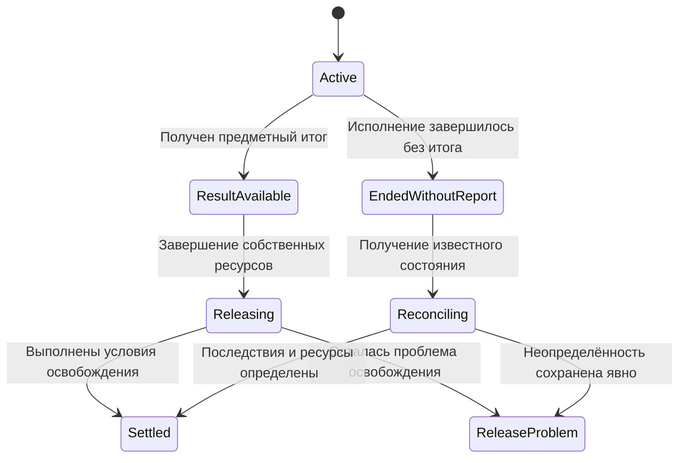

*Это жизненный цикл локального исполнения, а не замена `queued/running/succeeded` у прикладной задачи. В конкретной реализации некоторые стадии могут совпасть по времени.*

---

<a id="shutdown"></a>
## 16. Закрытие окна: кто вправе закрыть backend 🏠

Закрытие представления, прекращение новых операций, остановка текущих исполнителей и освобождение runtime — разные действия.

Без явного владения интерфейс легко делает одно из двух: оставляет работу бесхозной либо закрывает общий runtime, которым ещё пользуется другой клиент.

### Owned и borrowed: важнее происхождения, чем времени появления 🔑

**Owned-ресурс** создан или получен данным контекстом с обязанностью освободить его. **Borrowed-ресурс** предоставлен другим владельцем; локальный адаптер использует его, но не присваивает право окончательного закрытия.

В практическом загрузчике обнаружился показательный дефект cleanup. Контекст сохранял исходный список logging handlers, а при выходе закрывал все текущие обработчики и восстанавливал прежний список. Чужой handler, добавленный после входа, тоже оказался закрыт. Операция завершалась успешно, но последующая запись вызывающей стороны терялась.

Исправление учитывало конкретно приобретённые `owned`-ресурсы. Оно не требовало нового logging framework. [П4, кейс 5][downloader]

**Отсутствие ресурса в исходном списке не доказывает, что его создал данный контекст.** Это правило одинаково относится к подпискам, потокам, серверам, файловым handles и диагностическим каналам.

### Политика закрытия выбирается по владельцу работы 🧭

| Ситуация | Корректная обязанность GUI |
|---|---|
| Окно владеет единственным локальным запуском | Запросить согласованное завершение и не уничтожать нужные ресурсы раньше подтверждения |
| Окно заимствует runtime desktop-host | Отвязать своё представление; решение о закрытии runtime остаётся у host |
| Окно подключено к службе | Завершить свою подписку; отправлять отмену задачи только как отдельное намеренное действие |
| Окно закрывается во время Start | Сохранить ответственность за поздний handle и уже отправленное намерение отмены |
| Окно закрывается после результата, но до освобождения | Показать завершение ожидания либо передать его владельцу уровня приложения |

Если продукт обещает продолжение после закрытия последнего окна, host действительно должен продолжать жить. Скрытие окна не создаёт службу, а сохранение `job_id` не сохраняет работающий процесс.

### Последовательность shutdown для собственного runtime 🚦

В предлагаемой модели host сначала прекращает допуск новых обычных работ. Затем применяет выбранную политику к ожидающим и активным задачам, сохраняет возможность нужного управления, дожидается завершения собственных исполнителей и только после этого освобождает защищающие их ресурсы.

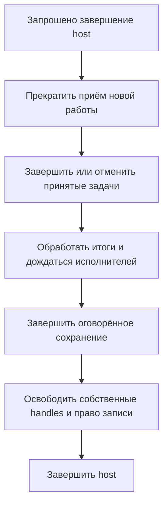

Это порядок обязанностей, а не универсальная последовательность сетевых вызовов. В конкретном продукте listener может закрываться раньше, если дальнейшая политика больше не требует внешних команд. Но оставшийся путь локальной отмены и завершения не должен исчезать случайно.

В загрузчике право единственного писателя не освобождалось раньше реального завершения работы; заимствованный runtime не закрывался CLI-адаптером. [П4, §5.2; §6.2][downloader]

### Частичная инициализация тоже создаёт обязанности 🧰

Предположим, host успел открыть хранилище и создать подписку, но не смог запустить исполнитель. Cleanup должен закрыть именно приобретённое, в подходящем порядке. Не следует ждать «полного успешного setup», чтобы начать учитывать ownership.

Ошибки освобождения не должны стирать исходную ошибку запуска. При этом неизвестность о живом исполнителе нельзя скрыть текстом «ресурсы очищены». Система сохраняет обе причины и не разрешает второму владельцу конфликтующий доступ без соответствующего основания.

### Отписка и отмена — разные действия даже в frontend 🔌

Удаление компонента React обычно требует cleanup его подписок и локальных ресурсов. Это не означает автоматического права отменить общую серверную задачу, которую наблюдают другие окна.

Документация `useEffect` описывает вызовы setup/cleanup, включая дополнительный цикл в режиме разработки Strict Mode. Поэтому привязка необратимой команды к простому монтированию компонента требует осознанной политики: повторный setup не должен случайно дублировать пользовательское действие. [React — useEffect][react-effect]

У локального preview может быть другая семантика: представление действительно владеет вычислением и отменяет его при смене входа. Оба решения допустимы, если владение определено, а не выведено из наличия функции cleanup.

### Принудительное завершение не является обычной кнопкой Stop ⚠️

Уничтожение потока или процесса способно прервать работу посреди изменения ресурсов. Например, документация Qt отдельно предупреждает о рисках `terminate()`: исполнение может закончиться без нормальной очистки. [QThread][qt-thread]

Для отдельного изолированного исполнителя продукт может иметь аварийный режим завершения. Но он требует собственных правил о временных данных, неизвестных эффектах и восстановлении. Его нельзя молча включать вместо обещанной кооперативной отмены.

---

<a id="outcomes"></a>
## 17. GUI должен сохранить полезный результат даже при неполном исходе 📦

Общий `success: bool` удобен для короткого примера, но плохо описывает сценарий с несколькими последствиями.

Конвертация может закончиться успешно, файл — быть опубликован, проверка — подтвердить его содержимое, а последующее действие над исходником — остаться неопределённым. Или файл существует, но история не сохранилась. Или первый элемент пакета выполнен, а следующий завершился неожиданной ошибкой.

Сравнительное исследование рассматривает именно такие случаи. Оно не предлагает одну обязательную схему результата для всех продуктов, но требует не стирать известные эффекты из-за позднего отказа. [П1, §9.1][practice]

### Разные оси результата должны дойти до представления 🧭

| Вопрос | Источник факта | Неверное сокращение |
|---|---|---|
| Выполнено ли преобразование? | Итог конкретного элемента | Любой существующий файл означает успех |
| Опубликован ли результат? | Владелец публикации | Кодек вернул управление — значит файл уже доступен в целевом месте |
| Проверен ли опубликованный результат? | Readback/verification по контракту | Путь известен — значит содержимое проверено |
| Что произошло с исходником? | Результат отдельного действия над источником | Ошибка означает, что исходник точно остался |
| Сохранён ли итог задачи? | Хранилище или владелец долговечности | Карточка появилась — значит результат переживёт перезапуск |
| Освобождён ли исполнитель? | Владелец lifetime | Итог получен — значит все handles закрыты |

В практическом конвертере публикация учитывалась до окончательной проверки: созданный final мог остаться `unverified`, а пакет — частичным. Поздний кандидат с удалением источников дополнительно разделял `retained/deleted/unknown`; его окончательная независимая приёмка на границе исследования не была завершена. Эти статусы нельзя приписывать всем ранее поставленным версиям. [П2, §4.3–4.4; §6.10; §7.2][compressor]

### Учебный пример сообщения с полезным остатком 📜

Ниже показан условный результат одного элемента. Это пример представления нескольких фактов, не копия публичного DTO исследованного приложения:

```json
{
  "item_id": "item-1",
  "conversion": "succeeded",
  "artifact": {
    "name": "result.webp",
    "publication": "published",
    "verification": "verified"
  },
  "source_disposition": "unknown",
  "warnings": [
    {
      "code": "SOURCE_ACTION_UNCONFIRMED",
      "recovery": "reconcile_before_retry"
    }
  ]
}
```

Смысл представления: результат создан и проверен; исход последующего действия над источником не подтверждён; повторять разрушительный шаг без сверки нельзя.

GUI не должен закрасить всё зелёным по `conversion = succeeded`. Но и сообщение «конвертация не удалась» потеряет уже полезный результат.

### Unknown — не синоним нуля, отказа или сохранности 🌫️

В исследовании загрузчика зафиксирован настоящий нативный вызов Корзины: исходный файл после попытки отсутствовал, но назначение и восстановимость не были подтверждены. Это авторская проверка в границе ещё не завершённой Q2-приёмки. Она не доказывает исправность функции восстановления, но уже опровергает безусловное «при ошибке ничего не произошло». [П4, кейс 4][downloader]

Для интерфейса вывод узкий: **ошибка после потенциального эффекта не разрешает показывать гарантированное прежнее состояние**.

То же относится к наблюдателю: потеря соединения не позволяет заменить последнее известное количество нулём. Неизвестный размер файла не равен пустому файлу. Отсутствующая оценка времени не равна мгновенному завершению.

### Повтор должен соответствовать причине, а не общей красной иконке 🔁

Если не сохранилась история, повторная конвертация может создать коллизию. Если потерян ответ запуска, повтор может создать вторую задачу. Если неизвестен исход удаления, повтор способен затронуть уже другой объект по тому же пути.

В предлагаемом контракте результат содержит допустимую стратегию восстановления: перечитать состояние, получить актуальный снимок, повторить только безопасный этап, заново подготовить план либо запросить решение человека. GUI показывает доступное действие, но окончательный допуск снова проверяет backend.

### Локальные измерения не становятся измерениями backend автоматически ⏱️

GUI может измерять время ожидания от нажатия до ответа. Это не обязательно время кодирования: сюда входят очередь, доставка и подготовка. После позднего подключения окно вообще не наблюдало начало работы.

Поэтому длительность, скорость и ETA показываются с определённым происхождением. В исследованном конвертере пофайловые elapsed/ETA отсутствовали в результате; наличие `monotonic` для ограничения частоты сигналов не создавало эти измерения. [П2, §6.11][compressor]

---

<a id="missing-contract"></a>
## 18. Когда проблема находится в проекции, а когда — в API 🧩

Неполный экран может иметь две совершенно разные причины.

Первая: backend уже отдаёт нужные факты, но GUI плохо их использует. Вторая: пользовательский сценарий требует сведений или гарантий, которых API вообще не предоставляет.

Ремонтировать эти случаи одинаково нельзя.

### Данные есть — нужна человеческая проекция 🪞

В конвертере результат содержал размеры, форматы, параметры, пути, ошибки и предупреждения. Технические строки в основном журнале не были доказательством отсутствующего ядра. Значительную часть полезного результата можно было построить из существующего контракта. [П3, кейс D][gui-report]

Здесь не нужен новый сервис обработки, второй сериализатор бизнес-правил или парсер диагностических строк. Нужен Presenter, который использует уже доступные типизированные данные.

### Данных нет — внешний вид не создаёт их смысл 🔍

Другой пример из сравнительного исследования: полный фильтр по кадрам должен сообщать точное число совпадений и позволять достичь каждого из них. Ранжированный поиск, возвращающий ограниченные первые N результатов, решает другую задачу.

Увеличение лимита отрисовки или виртуализация списка не создают полный count и continuation, если их нет у прикладного чтения. В исследовании это сформулировано как предложение к существующим владельцам read-контракта, а не как уже реализованный новый API. [П1, §10.7][practice]

### Короткая диагностика границы 🧭

| Потребность GUI | Если факт уже есть | Если факта или гарантии нет |
|---|---|---|
| Показать параметры завершённой операции | Читать сохранённый request/result snapshot | Добавить происхождение параметров в общий контракт |
| Подсветить текущий элемент | Использовать его устойчивую идентичность | Показать общую активность либо согласованно расширить progress DTO |
| Показать все совпадения | Использовать согласованные count/page/cursor | Не выдавать top-N за полную выборку; изменить read-сценарий |
| Вернуться к прошлой выдаче | Использовать ещё действительный result handle | Показать устаревание либо добавить ограниченный срок жизни снимка |
| Остановить чужой процесс | Обратиться к его управляющему API | Не создавать локальный токен и не объявлять имитацию отменой |
| Показать оставшееся время | Использовать измерение с указанной семантикой | Не придумывать ETA из декоративного таймера |

### Готовность ресурса — ещё одна прикладная граница 🎬

В сравнительном исследовании также разобрана последовательность загрузки медиа и перехода к позиции: принятие `load` не гарантирует, что ресурс уже готов выполнить `seek`. Рекомендация связывает ожидаемую позицию с идентичностью конкретного медиа и его readiness; поздняя готовность A не должна переместить уже выбранное B.

Это source-conditioned риск и проектная рекомендация, а не новый нативный тест воспроизведения. [П1, §10.7][practice]

Та же форма возникает у любого ресурса: выбран документ — ещё не значит загружен; модель выбрана — ещё не значит подготовлена; подключение установлено — ещё не значит разрешена конкретная операция. GUI должен опираться на нужный факт готовности, а не на похожий ранний сигнал.

### Безопасный обход невозможной функции не становится её реализацией 🚫

Если текущий API не поддерживает прежний пользовательский сценарий, GUI обязан честно показать ограничение. Но отключённая кнопка не доказывает, что функциональность сохранена или согласованно исключена.

Практика удаления оригиналов показала именно эту границу: новый интерфейс не создавал исходную потерю и не должен был чинить её собственным `unlink`. Требовалось решение общего прикладного контракта и полномочий на изменение продукта. [П2, §6.4][compressor]

Детальное сохранение поведения относится к отдельному материалу о миграции. Для связи GUI с backend достаточно зафиксировать правило: **адаптер не обходит неподдержку ядра, но и не объявляет её выполненным требованием**.

---

<a id="human-agent"></a>
## 19. Человек и агент работают с одним приложением, но не обязаны делить фокус 🤝

Когда агент подключён к тому же владельцу состояния, его работа становится обычным источником изменений. GUI показывает её через общий список задач и результатов, а не через специальные ветви «если запущено кнопкой».

При этом источник запуска может иметь значение для объяснения и полномочий: кто начал работу, какая сессия отвечает за неё, кто вправе остановить и какие действия требуют подтверждения.

### Общая модель не означает общий курсор 🖱️

Агент способен изменить документ или добавить задачу, не переключая вкладку человека. Выбор строки, прокрутка, раскрытые панели и локальный фильтр могут принадлежать конкретному представлению.

Режим «следовать за агентом» в предлагаемой модели является отдельной политикой GUI. Он меняет фокус наблюдения, а не способ выполнения предметных команд.

Это особенно важно, когда человек редактирует будущие настройки, а агент выполняет прежний снимок. GUI показывает активный запрос отдельно от черновика и не переносит параметры между ними без явного действия.

### Управление задачей и допуск сессии — разные полномочия 🔐

Человек может остановить текущую задачу, но агент затем отправит новую. Поэтому продукт с самостоятельной автоматизацией может предоставлять отдельный запрет дальнейших изменяющих действий агентной сессии.

Предлагаемая последовательность: доверенный владелец допуска запрещает новые соответствующие запросы, обрабатывает уже ожидающие задания и запрашивает остановку активных по их контракту. GUI сообщает границу: новые действия запрещены, работающие задачи ещё могут завершать допустимый участок.

Если требуется более сильное обещание — после подтверждения блокировки не фиксируются новые изменения этой сессии — проверка допуска должна быть согласована с точкой применения эффекта. Простая проверка флага при чтении очереди оставляет окно для уже выданной работы.

Эта блокировка не выключает внешнюю языковую модель и не отнимает у неё независимый доступ к терминалу. Она ограничивает конкретный путь приложения. [П1, §8.1; §3.4][practice]; [статья 02, управление сессией][a2]

### Доступность кнопки вычисляется, право — проверяется 🛡️

В предлагаемой ViewModel доступность отмены складывается из нескольких условий:

```text
Можно запросить отмену сейчас:
    клиент имеет соответствующее право;
    работа поддерживает такую операцию;
    текущее известное состояние допускает запрос;
    нет уже ожидающего эквивалентного запроса от этого представления.
```

Это удобство клиента, не окончательный допуск. Backend повторно проверяет право и состояние при получении команды. Даже локальный привилегированный мост не должен доверять полю `is_human` из обычного DTO.

Для Electron это дополнительно выражается проверкой отправителя IPC и ограниченным набором предоставленных операций. Официальная документация отдельно требует валидации sender; общий TypeScript-интерфейс не создаёт такую защиту во время выполнения. [Electron — Security][electron-security]

### Подтверждение относится к конкретному действию 📜

Если опасный режим требует подтверждения человека, подтверждение связывается с зафиксированным набором объектов, параметрами и поколением запроса. Изменение формы после открытия диалога не должно незаметно изменить уже подтверждённое действие.

Если backend не позволяет достаточно точно проверить актуальность плана, GUI не должен обещать такую гарантию самостоятельно. Локальное согласие и авторитетная проверка ресурса — два разных рубежа.

В обычном конвертировании новых файлов отдельный сложный approval-протокол может быть избыточным. Для разрушительных действий он оправдывается последствиями, а не самим фактом участия ИИ.

---

<a id="scenarios"></a>
## 20. Два связных сценария: локальный вызов и работа агента 🎬

Отдельные правила легче проверить, когда они проходят через целый сценарий. Ниже — **учебные последовательности**, построенные на разобранных механизмах. Они не являются дополнительными историческими прогонами продуктов.

### Сценарий A: конвертация, ранняя остановка и закрытие окна 🔧

Утилита обрабатывает три изображения одним синхронным вызовом общего API. GUI запускает вызов в отдельном исполнителе. Выбран режим создания новых файлов без удаления исходников. Отмена проверяется между этапами и перед публикацией.

| Момент | Прикладная работа | Локальное представление и ресурсы |
|---|---|---|
| Выбраны три входа | Preview построен, преобразование ещё не началось | Форма готова к запуску; preview не объявлен резервированием файлов |
| Нажат Start | Контроллер фиксирует запрос R и токен R | Отображается ожидание запуска; повторный Start в тот же слот закрыт |
| Исполнитель начал сценарий | API заново проверяет входы и план | Сообщения относятся к R, а не к текущему состоянию полей |
| Первый элемент завершён | Есть подтверждённый результат A | Строка A обновляется, счётчик — 1 из 3 |
| Второй кодек занят | Завершён только A, внутренний процент B неизвестен | Общая активность B либо этап; нет выдуманного процента |
| Нажат Stop | Токен установлен; кодек ещё выполняется | «Остановка запрошена», не `cancelled` |
| Запрошено закрытие | Владелец сохраняет ответственность за исполнение | Окно не уничтожает worker; закрытие ожидает договорённой границы |
| Кодек вернул управление | Отмена обнаружена перед публикацией B | Отсутствие публикации B подтверждается сценарием, а не предположением GUI |
| Получен итог | A сохранён; B остановлен; C не начинался — по выбранному контракту | Итог показывает разные судьбы элементов; ресурсы ещё удерживаются |
| Исполнитель освобождён | Известные последствия и release учтены | Можно завершить закрытие и освободить собственные объекты |

У этого сценария нет постоянного `job_id`, внешнего сервера и восстановления после смерти процесса. Но есть реальный прогресс, действующая отмена и корректное закрытие.

Если бы Stop пришёл после последней проверки перед публикацией B, итог мог бы содержать и результат B. Это не противоречие: сценарий обещает кооперативную остановку, а не сильный запрет любого последующего эффекта после нажатия кнопки.

### Сценарий B: агент начал работу, GUI подключился позже 🤖

Во втором варианте работа принадлежит общему runtime. Агентный адаптер и GUI используют его API. Runtime может жить внутри desktop-host; для продолжения после его завершения потребовался бы другой договор.

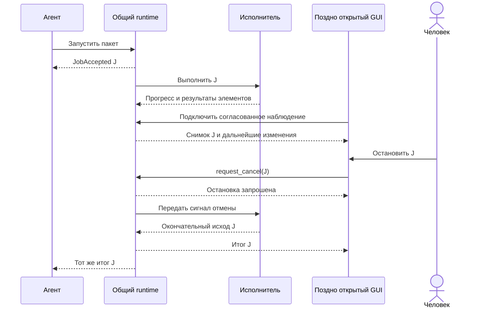

В карточке не нужна специальная предметная ветвь «задача агента». Она читается из того же состояния, что и задача человека. Дополнительные сведения об инициаторе влияют на объяснение и политику доступа, а не создают второй механизм конвертации.

При потере связи GUI сохраняет последнее известное состояние с отметкой несвежести. После восстановления он запрашивает актуальный снимок. Запоздалый прогресс не возвращает завершённую карточку в `running`.

Если человек только закрыл это представление, а runtime принадлежит другому host, GUI отписывается, но не присваивает себе право остановить все задачи. Если человек явно выбрал «Остановить», выполняется отдельная прикладная команда.

### Что в обоих сценариях общее, а что различается 🧩

Общими остаются зафиксированный запрос, идентичность, определённые последствия, доступное управление и отделение результата от освобождения ресурсов.

Различается адресуемость работы. В A работа доступна через живой контекст вызова. В B она имеет самостоятельную прикладную идентичность и может наблюдаться несколькими обращениями.

Именно это различие должно определять объём реализации. Объявить первый вариант «неполным», потому что в нём нет сервера, было бы так же неверно, как обещать второму общую очередь на основании одного общего файла истории.

---

<a id="controller"></a>
## 21. Как устроить контроллер связи без собственного framework 🧰

После множества схем легко захотеть создать отдельную универсальную систему запусков, ещё одну шину и общий реестр состояний поверх уже существующих компонентов. Обычно начинать с этого не требуется.

У контроллера есть небольшой набор самостоятельных обязанностей: связать намерение с запросом, обеспечить подходящее исполнение, получить сведения, поддержать управление и завершить принадлежащий ему lifetime.

### Компактное разделение данных 📦

В предлагаемом локальном варианте достаточно трёх связанных записей:

```text
Draft
    текущие выбранные входы и настройки будущего запуска

ExecutionBinding
    run_id
    immutable_request
    cancellation_signal
    executor_handle
    outcome_or_unknown
    resource_state
    close_requested

ViewProjection
    отображаемый запуск
    известные результаты элементов
    последнее состояние прогресса
    локальные ожидания
    состояние наблюдения
```

`ExecutionBinding` не обязан быть публичной Job. Это локальная запись владения. Она может существовать дольше отдельной панели, но не переживать завершение процесса.

В профиле B часть этой записи находится у runtime: задача, текущая попытка, результат и состояние исполнения. GUI оставляет у себя клиентскую привязку и проекцию. Дублировать backend-менеджер задач внутри каждого окна не требуется.

### Входные события и исходящие эффекты лучше различать ↔️

Контроллер получает факты: локальное нажатие, ответ запуска, progress, result, completion, disconnect. По ним он обновляет состояние и при необходимости инициирует действие: отправить запрос, установить токен, перечитать снимок, отписаться.

Такую логику удобно описать таблицей переходов или небольшой чистой функцией:

```text
transition(current_state, incoming_message)
    -> next_state + required_effects
```

Например, `StopClicked` в состоянии ожидания handle сохраняет cancel intent. `StartAccepted` с тем же запуском затем порождает `RequestCancel`. `StartRejected` завершает локальное ожидание и не создаёт отмену несуществующей задачи.

Это способ сделать причинность проверяемой. Он не требует библиотеки конечных автоматов, глобального reducer для всего продукта или запрета обычных методов класса.

### Короткий алгоритм обработки исполнения 📐

```text
handle_execution_message(message):
    binding = найти известное исполнение message.run_id
    если binding отсутствует:
        зарегистрировать диагностическое несоответствие
        не изменять текущую форму по неизвестному сообщению
        завершить обработку

    учесть сообщение в lifecycle этого binding
    сохранить известный результат и ошибки освобождения

    если представление всё ещё связано с binding:
        обновить его проекцию по правилам версий и состояний

    если достигнута договорённая граница завершения:
        освободить только принадлежащие binding локальные ресурсы
        выполнить ожидающее закрытие, если оно остаётся актуальным
```

Псевдокод не описывает конкретную синхронизацию. Если сообщения поступают из нескольких потоков, изменение `binding` сериализуется у его владельца. GUI-применение выполняется в разрешённом контексте графического фреймворка.

Неизвестный `run_id` не даёт права закрыть произвольный чужой ресурс. Чтобы позднее сообщение не стало бесхозным, запись исполнения должна удерживаться до завершения собственной протокольной обязанности. Сам контроллер не является аварийным сборщиком всех процессов приложения.

### Какие данные не стоит хранить дважды 🗂️

Если у runtime уже есть актуальный `JobSnapshot`, GUI не нужен второй независимый автомат задачи, который сам выставляет `succeeded`. Локальная проекция хранит полученное состояние и добавляет только клиентские факты: ожидается ответ на отмену, соединение потеряно, выбрана строка.

Если ядро уже возвращает безопасную структурированную ошибку, GUI не нужен альтернативный классификатор по тексту traceback. Если у операции есть сохранённый request snapshot, не нужен второй набор «фактически использованных» параметров, собранный из полей формы после завершения.

**Хороший контроллер соединяет существующие договорённости. Он не конкурирует с ними за право определять результат.**

---

<a id="diagnostics"></a>
## 22. Наблюдаемость связи: какой рубеж действительно задержался 📈

Когда приложение «не реагирует», причина может находиться в разных местах. Backend ещё не принял запрос. Событие опубликовано, но не доставлено. GUI получил сообщение, но занят преобразованием. Модель обновилась, но кадр ещё не представлен. Операция завершилась, а клиент продолжает ждать потерянный итог.

Одна запись «начало обработки» не различает эти ситуации.

### Полезные временные отметки ⏱️

Для диагностики предлагаемой связи можно фиксировать несколько моментов:

| Метка | Что наблюдается |
|---|---|
| `intent_received` | Контроллер получил действие человека или клиента |
| `dispatch_started` | Началась передача запроса исполнителю или владельцу |
| `admission_observed` | Получено подтверждение принятия или отказа |
| `first_fact_received` | Клиент получил первое сообщение о реальной работе |
| `projection_applied` | Изменение применено к локальному состоянию |
| `frame_observed` | Выбранный механизм проверки наблюдал соответствующий кадр |
| `outcome_received` | Получен предметный итог |
| `resources_settled` | Выполнена согласованная граница освобождения |

Это пример диагностических точек, не обязательная схема телеметрии для каждого приложения. Для маленькой утилиты достаточно нескольких из них.

Измерения внутри одного процесса выполняются подходящими монотонными часами. Простое вычитание временных штампов разных машин без оговорённой синхронизации не является точным измерением задержки участка. Для межпроцессной корреляции полезны идентификаторы запуска и сообщения, а не предположение, что все часы абсолютно совпадают.

### Heartbeat — не доказательство всей отзывчивости 💓

Работающий таймер GUI показывает, что соответствующий цикл способен выполнять этот callback. Он не доказывает, что нужная кнопка доступна, её обработчик доходит до владельца или требуемое состояние уже отрисовано.

Обратное тоже важно: отсутствие нового процента не доказывает зависание. Кодек мог находиться в поддержанном, но непрозрачном длительном этапе. Нужно знать, какой сигнал ожидался по контракту и где он измерялся.

Практический контролируемый кейс со стартовым событием полезен именно тем, что различал каноническую публикацию, обработку GUI и более поздний видимый эффект, а не ограничивался одним логом backend. [П1, §8.5][practice]

### Разные каналы имеют разную аудиторию 🧾

Прикладное состояние — источник для управления. Человеческое представление — объяснение результата. Диагностика — инструмент поиска причины. Аудит — отдельная запись значимых действий, если он нужен продукту.

Разрешённый путь результата в локальной карточке не обязан автоматически попадать в экспортируемый технический журнал. Отсутствие пути в безопасной диагностике не требует скрывать разрешённый результат от самого пользователя.

Ошибку подписчика можно связать с `run_id`, этапом и классом сбоя без записи содержимого всех файлов или полного запроса модели. Наблюдаемость должна помогать различать причины, а не копировать всё состояние приложения на всякий случай.

### Граница производительности задаётся сценарием, а не выдуманной нормой 🎯

Приёмочный критерий может требовать, чтобы человек получал подтверждение и сохранял возможность остановки во время контролируемого длительного участка. Конкретный временной бюджет выбирается для продукта и среды.

Не следует переносить один исторический замер, offscreen-тест или произвольное число миллисекунд на все компьютеры. Полезнее зафиксировать, что именно измерялось: начало callback, применение модели, кадр, физическое взаимодействие или окончательный результат.

---

<a id="testing"></a>
## 23. Как проверять именно связь, а не заранее правильный экран 🧪

Тест, который вручную подставил `Succeeded` в ViewModel и увидел правильный текст, полезен для проекции. Но он ничего не говорит о том, когда этот результат появляется в настоящем сценарии и не уничтожается ли worker раньше времени.

Для связи нужен путь **действие → реальный прикладной владелец → исполнение → результат → применение в GUI**, с проверяемой границей между этапами.

В практических исследованиях есть такие проверки: настоящее действие окна доходило до общего API и созданного изображения, которое затем независимо открывалось; барьеры удерживали реальные участки encode/publication, чтобы проверить промежуточное состояние, отмену и завершение потока. Это не приравнивалось к проверке всех физических устройств ввода и всех платформ. [П3, §6][gui-report]

### Управляемое расписание сильнее случайного `sleep` 🕰️

Для гонки важно воспроизвести причинный порядок, а не надеяться, что компьютер окажется достаточно медленным.

Например, исполнитель сообщает, что достиг границы кодирования. Проверка ждёт этого подтверждения. Затем нажимает Stop через настоящий контроллер, проверяет промежуточное состояние и только после этого освобождает исполнитель. Так становится ясно, была ли отмена доступна во время работы.

Сам барьер не должен подменять проверяемую логику готовым успешным результатом. Если предмет проверки — публикация артефакта, её выполняет настоящий владелец. Если предмет — GUI-переход, допустима контролируемая инфраструктурная задержка, но она должна быть явно названа.

### Матрица временных границ 📋

Следующая матрица — предлагаемый набор проверок по применимости, а не заявление о новом выполнении всех сценариев.

| Контрольная ситуация | Наблюдаемая гарантия | Что недостаточно проверить |
|---|---|---|
| Start ещё не вернул handle, человек нажал Stop | Намерение не теряется, поздний handle получает владельца и нужное управление | Наличие метода `cancel()` |
| Кодек занят, приходит отмена | Управляющий путь доступен до возврата тяжёлого вызова | Что отмена когда-нибудь вызвана после завершения |
| Результат получен, исполнитель удержан на завершающем участке | Итог виден, но конфликтующий новый запуск и разрушение ресурсов ещё не допускаются | Один финальный callback |
| Close во время работы | Выполняется выбранная политика владения, нет уничтожения активного worker | Что обработчик закрытия вернул значение |
| Close при borrowed runtime | Удаляется подписка окна, общий runtime остаётся пригодным | Что окно исчезло |
| Первый элемент готов, второй удержан | Первая строка уже завершена, прогресс соответствует известному объёму | Только итог всего пакета |
| Observer падает после полезного эффекта | Работа не повторяется из-за ошибки наблюдения, известный результат сохраняется | Отсутствие исключения в GUI |
| После отмены выполняется новый запуск | Новый токен и корректные ресурсы, старые сообщения не меняют новый результат | Что кнопку Start снова включили |

### Матрица согласованности 📐

| Контрольная ситуация | Что должно различаться |
|---|---|
| A завершается после более нового B | Устаревший ответ не заменяет нужный текущий результат; для записей отдельно учитываются уже произошедшие эффекты |
| Задача меняется между фильтром и mapper | DTO соответствует снимку, по которому выполнялся отбор |
| Событие 11 доставлено после 12 | Проекция не возвращается в прошлое |
| Потеряно последнее уведомление | Сверка или восстановление потока возвращает окончательный итог |
| Задача создана на границе snapshot/subscribe | Она появляется без пропуска или клиент обнаруживает необходимость повторной синхронизации |
| Пришёл дубликат завершённого элемента | Не возникает вторая строка и не увеличиваются счётчики повторно |
| Пользователь изменил настройки после запуска | Детали результата показывают параметры выполненного запроса |
| Доступ отозван без изменения версии задачи | Клиент не продолжает показывать запрещённые данные или прежние действия только из-за равного `revision` |

Для конкретного продукта выбираются риски, которые соответствуют его обещаниям. Локальному синхронному вызову без переподключения не нужна полноценная матрица сетевого replay. Но разнесение GUI и владельца по процессам делает такие проверки содержательными.

### Проверка должна отличать новую логику от старой неправильной 🔬

Полезный контрпример падает на реализации, нарушающей заявленное свойство, и проходит после адресного исправления. Если проверка всегда вручную выставляет финальное состояние, она не различит потерянное событие завершённого элемента.

В исследованном загрузчике переход между отбором и преобразованием DTO был специально управляемым. Это позволило показать противоречие фильтру, а затем подтвердить ремонт одного captured projection. [П4, кейс 2][downloader]

Такие проверки не обязательно требуют большого тестового framework. Небольшой барьер в разрешённой инфраструктурной точке может быть полезнее длинной последовательности случайных задержек.

### Что именно доказывает визуальная проверка 👁️

| Вид проверки | Что подтверждает | Чего сам по себе не подтверждает |
|---|---|---|
| Тест проекции | Преобразование DTO в состояние представления | Доставку и реальный цикл событий |
| Связный GUI/API-тест | Проход намерения через настоящий прикладной путь | Физический ввод на всех ОС |
| Heartbeat под нагрузкой | Выполнение конкретного callback в GUI-цикле | Видимость нужного кадра и полезность управления |
| Offscreen-кадр | Рендер указанного состояния в данной среде | Физическое отображение на мониторе |
| Проверка нативного окна | Наблюдение выбранного реального оконного пути | Все DPI, устройства, шрифты и варианты жизненного цикла |
| Проверка установленного артефакта | Работа связки на проверенных байтах поставки | Автоматическую исправность другой сборки |

Практический отчёт сохраняет именно такие ограничения: offscreen, нативный Qt-путь и физические OS-действия не объявлены одной проверкой. [П3, §6][gui-report]

### Отказ проверки не всегда означает дефект продукта 🧯

Неправильное поле события в helper, два графических application-объекта в одной проверочной среде или неверное ожидание порядка ввода могут ломать стенд, а не приложение. Это не оправдание отбрасывать любой красный результат: требуется установить, какая граница достигнута и какое обещание нарушено.

Продуктовая логика не должна изменяться лишь для того, чтобы удовлетворить ошибочное ожидание private probe. В практическом GUI-исследовании такие случаи отделены от настоящих дефектов прогресса и lifetime. [П3, кейс F][gui-report]

Подробная методика доказательства и поставки относится к отдельному продолжению. Для этой статьи достаточно принципа: **успешный итог не заменяет проверку перехода, а ошибка стенда не разрешает ослабить контракт приложения**.

---

<a id="stacks"></a>
## 24. Что меняется при выборе Qt, React, Electron или другого стека 🧬

Архитектурная граница остаётся одной: представление не владеет предметными последствиями, а исполнитель не обращается к виджетам. Меняется механизм доставки и управления ресурсами.

### Соответствие ролей, а не обязательный стек 🔌

| Роль | Desktop с Qt | React в браузере | Electron |
|---|---|---|---|
| Прикладной владелец | Объект ядра, runtime или сервис | Браузерное ядро либо сервер | Main/служба/отдельный исполнитель |
| Мост сообщений | Подходящие queued-сигналы, модели, IPC | HTTP, поток обновлений, сообщения worker | Ограниченный preload/IPC-клиент |
| Проекция | Модель данных, Presenter, ViewModel | Store и селекторы | Store renderer поверх прикладного API |
| Тяжёлое выполнение | Подходящий поток/процесс/нативная асинхронность | Worker либо сервер, когда требуется | Исполнитель вне занятого renderer; main также не должен блокировать управление |
| Отписка | Разрыв собственной связи и lifetime receiver | Cleanup подписки | Снятие собственных IPC-подписок |
| Окончательная остановка | Владелец работы | Backend или локальный владелец | Владелец runtime, не произвольный renderer |

Это карта возможных размещений, а не обещание, что любая библиотека работает в любом потоке. Конкретные ограничения ресурсов проверяются по документации выбранной среды.

Для Qt особенно важны принадлежность объектов потокам и queued-доставка. Для React — согласованные снимки внешнего store и корректная очистка подписок. Для Electron — граница привилегированного процесса и проверяемый узкий IPC. [Qt][qt-threads] · [React][react-store] · [Electron][electron-security]

### Общий тип не отменяет реальную границу процесса 🧾

Одинаковый интерфейс в двух частях программы удобен для разработки. Но передача по IPC всё равно имеет сериализацию, неизвестный ввод, ошибки доставки и разные времена жизни.

Поэтому внешний payload проверяется на принимающей стороне. Не передаются живые GUI-объекты, callback и открытые соединения как будто это обычный DTO. Ответы валидируются и связываются с нужной сессией. Неизвестное состояние новой версии не преобразуется по умолчанию в успех.

Если вся операция выполняется внутри одного процесса и данные уже прошли доверенную прикладную границу, не требуется сериализовать каждый внутренний вызов в JSON. Транспорт добавляется там, где действительно существует транспортная граница.

### Синхронное ядро совместимо с отзывчивым GUI ⚙️

Метод, который синхронно возвращает результат, не обязательно должен блокировать окно: его можно выполнять в подходящем исполнителе. И наоборот, метод с `async` или `Promise` способен удерживать важный поток, если внутри выполняется тяжёлая синхронная работа.

Практический профиль A конвертера — хороший пример первого варианта. Общая архитектура не требовала переписать весь кодекный путь в асинхронный API, чтобы получить прогресс и отмену. [П2, §3.3–3.4][compressor]

Для среды браузера механизм задач и rendering определён отдельно; обещание вернуть `Promise` не означает обещание показать кадр перед следующей тяжёлой частью. [HTML Standard][html-loop]

### Запуск внешнего CLI также остаётся допустимым адаптером ⌨️

Если полезная операция уже предоставлена качественной утилитой, GUI может запускать её как дочерний процесс. Тогда архитектурный контракт включает структуру результата, stderr, код завершения, владение дочерним процессом и семантику отмены.

Нельзя считать первый JSON окончательным успехом без знания протокола. Например, практический загрузчик в отдельном CLI сначала печатал принятую задачу, затем ожидал терминального результата и сохранения; поздний отказ влиял на итоговый exit. [П4, §6.3][downloader]

Такой вариант не хуже прямой библиотеки по определению. Он просто имеет другую границу исполнения, которую GUI обязан обслуживать честно.

---

<a id="minimum"></a>
## 25. Достаточная архитектура: что требуется сразу, а что добавляется по необходимости 🌱

После подробного разбора возникает риск построить систему сложнее самого приложения. Практические источники дают противоположный ориентир: исправлять конкретного владельца и добавлять механизм только под необходимую гарантию.

### Минимум для одного локального вызова 🧰

Для небольшой утилиты с GUI достаточно общего метода операции, неизменяемого запроса, подходящего исполнителя, одноразового средства отмены, типизированных сообщений прогресса и результата, а также контроллера владения.

У контроллера есть идентичность текущего запуска, локальная проекция и определённая процедура закрытия. Этого хватает для живого наблюдения без долговечной очереди.

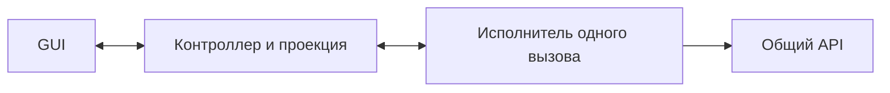

Схема намеренно мала. Она не отменяет внутренних файловых правил или сложного кодека; она лишь не добавляет отдельную жизнь Job там, где работа принадлежит вызову.

### Минимум для общей работы человека и агента 🤝

Если работу требуется адресовать между вызовами, появляется runtime с задачами, их идентичностью, состоянием, управлением и наблюдением. GUI и агент подключаются к нему, а не создают два независимых менеджера.

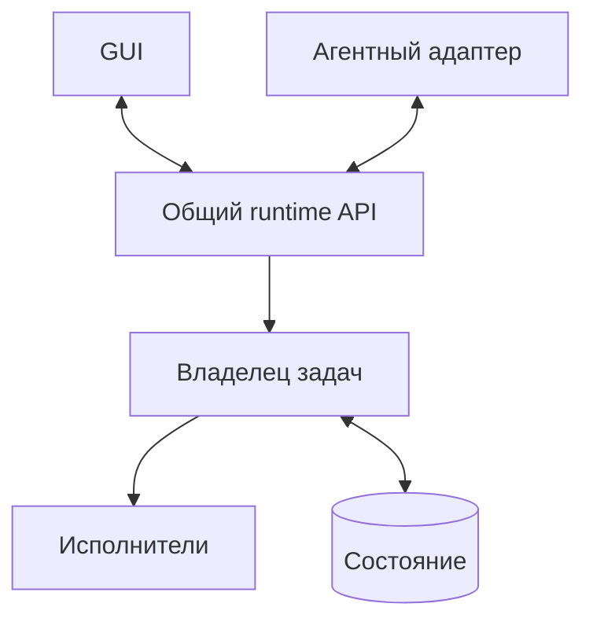

Хранилище здесь может быть в памяти или на диске. Сохранённая история не равна автоматическому возобновлению исполнения. Практический загрузчик сохранял историю, но после аварии отмечал незавершённые работы как прерванные, не продолжая их автоматически. [П4, §5.3][downloader]

### Условие добавления механизма 🗺️

| Требование | Оправданное добавление | Что не следует автоматически |
|---|---|---|
| Несколько частых обновлений перегружают GUI | Объединение прогресса и пакетное применение | Универсальный брокер событий |
| Окно подключается поздно | Снимок текущего состояния | Event Sourcing |
| Связь может рваться | Восстановление наблюдения или сверка | Повтор изменяющего запроса без проверки |
| Агент управляет открытой сессией | Канал к её реальному владельцу | Новый независимый headless runtime |
| Работа должна жить после окна | Владелец уровня host/службы/сервера | Восстановление после падения этого владельца |
| Несколько окон используют один результат | Явная идентичность и срок жизни результата | Один глобальный `current_result` без политики |
| Нужен запрет новых эффектов после подтверждения Stop | Координация отмены с точкой применения | Автоматическое Undo уже выполненного |
| API отдаёт недостаточно для сценария | Узкая эволюция контракта существующего владельца | Второй backend внутри GUI |

### Компактный паспорт связи 📓

Такую запись можно держать в существующей документации приложения. Отдельный регламент на каждую строку не нужен.

```text
Владелец работы: локальный вызов / общий runtime / служба.
Время жизни: до результата вызова / между обращениями / после закрытия окна.
Запуск: что означает подтверждение и где фиксируется снимок параметров.
Идентичность: чем различаются запуск, задача, попытка и поколение представления.
Наблюдение: результат, прогресс, снимок, правила порядка и восстановления.
Отмена: способ доставки, точки реакции, остающиеся последствия.
Завершение: предметный итог отдельно от освобождения ресурсов.
Закрытие: owned и borrowed; судьба позднего handle и подписок.
Неопределённость: что показывается при потере связи или неизвестном эффекте.
Полномочия: кто вправе читать, останавливать и запрещать новые действия.
Проверка: какие промежуточные переходы реально различаются тестом.
```

Паспорт не заменяет реализацию. Его польза в том, что команды разработки и клиенты перестают выводить поведение из имени `start`, `stop` или `finished`.

---

<a id="takeaways"></a>
## 26. Практические выводы: живой интерфейс требует честной связи, а не второго ядра 🎯

Практика общего ядра показала реальное переиспользование: новый графический потребитель мог вызывать прежний сценарий конвертации без копирования кодека и файловой политики. Но эта удача не устранила собственные обязанности связи — промежуточный прогресс, идентичность, отмену, lifetime и смысл отображаемого результата. [П2, §3.4][compressor]

Главная поправка к упрощённой схеме «backend отправляет событие, GUI показывает спиннер» состоит в том, что **между отправкой и полезной обратной связью есть несколько независимых гарантий**.

Событие должно относиться к нужной работе. Его нужно доставить и применить в подходящем контексте. Представление должно сохранить смысл факта. Цикл GUI должен получить возможность показать изменение. Управляющий путь должен оставаться доступным. А владелец ресурсов — существовать до настоящего завершения своей обязанности.

### Сжатая карта ошибок и правильных границ 🧭

| Ошибочное предположение | Более точная граница |
|---|---|
| Общая библиотека означает общую задачу | Требуется один адресуемый владелец конкретного исполнения |
| Событие опубликовано — человек увидел старт | Доставка, применение и представление кадра различаются |
| Флаг `busy` описывает всё | Работа, исполнитель, наблюдение и локальное ожидание имеют разные состояния |
| Последний callback определяет истину | Истину устанавливает владелец с правилами актуальности |
| Старый ответ можно просто забыть | Его ресурсы и уже состоявшиеся эффекты всё ещё требуют учёта |
| Проценты можно сворачивать вместе со всем остальным | Частый прогресс, завершённые элементы и итог имеют разную допустимость потери |
| Stop означает cancelled | Это сначала запрос; итог определяет исполнение |
| Получен результат — можно уничтожить worker | Освобождение ресурсов имеет собственную границу |
| Закрытие окна означает закрытие backend | Решение зависит от owned/borrowed и срока жизни host |
| Нет ответа — ничего не произошло | Возможен неизвестный исход, требующий сверки |
| Неполный экран чинится новым сервисом | Иногда достаточно проекции; иногда действительно не хватает read-контракта |
| Тонкий GUI должен печатать DTO | Он должен объяснять подтверждённые факты без собственной предметной логики |

Эти различия не требуют одинакового количества классов во всех программах. Они требуют одинаковой аккуратности в обещаниях.

Простому приложению достаточно компактного контроллера одного вызова. Общей очереди нужен runtime, который действительно видят все клиенты. Редактору — ещё и ясная модель текущего документа и результатов чтения. Ни один вариант не обязан начинаться с универсальной шины или распределённого framework.

> [!summary] Итоговая формула
> **Операция исполняется у своего владельца. GUI хранит проекцию подтверждённых фактов и собственные локальные намерения. Управление обращается к той же работе, которую показывает экран. Идентичность связывает сообщения, версии защищают порядок, а явное владение сохраняет ресурсы до завершения.**
>
> Именно такая связь позволяет агенту работать через API, человеку — видеть настоящее выполнение и вмешиваться, а приложению — оставаться одной системой, а не набором оболочек с несовместимыми представлениями о происходящем.

### Граница следующего материала 📘

Отдельного подробного разбора заслуживают сохранение пользовательских сценариев при миграции, семантика исходных данных, принадлежность артефактов и неизвестные последствия внешних действий. В этой статье они затрагивались только там, где определяют правдивость GUI.

Визуальное проектирование, FigCraft, перенос компонентов в toolkit и оценка внешнего вида образуют самостоятельную тему. Корректная связь с backend необходима для работающего интерфейса, но не заменяет эти задачи.

[К основной карте серии](00_README.md) · [К архитектуре и контрактам][a2] · [К вариациям архитектуры][a3] · [К проекту конвертера][a4]

---

<a id="sources"></a>
## Источники, практические основания и пределы утверждений 🔗

Статья сочетает практические наблюдения из предоставленных исследований, явно обозначенные архитектурные выводы и учебные модели. Исторические сценарии не объявляются новыми выполненными проверками. Новые названия сообщений, схемы и псевдокод — иллюстрации, а не принятые изменения исследованных продуктов.

**Дата проверки внешней документации: 25 октября 2026 года.** Страницы без закреплённой версии могут меняться. Для внедрения существенна документация фактически выбранного runtime. Указанные здесь механизмы не означают рекомендацию автоматически обновлять библиотеку или менять стек.

### Практические материалы 📚

Относительные ссылки ниже работают, когда исходные отчёты находятся рядом с этой статьёй. Для понимания основного текста они не обязательны: содержание нужного случая и его доказательная граница изложены в соответствующем разделе. Частные пути, журналы сессий и идентификаторы участников в статью не переносятся.

| Код | Материал | Использованная область |
|---|---|---|
| **П1** | [Сравнительное исследование command-first][practice] | Профили A/B; общий владелец; lifecycle; callback и видимый старт; статические риски current-result и active status; границы результатов и GUI |
| **П2** | [Исследование ядра и CLI конвертера][compressor] | Синхронный API с прогрессом и отменой; второй GUI; публикация и результат; токен; result-ready и завершение; ограничения позднего кандидата |
| **П3** | [Исследование графического потребителя конвертера][gui-report] | Только связь с общим API: снимок запроса, промежуточные состояния, неподдержанные факты, человеческая проекция, контролируемые проверки и lifetime |
| **П4** | [Исследование загрузчика и общего runtime][downloader] | Общая GUI/MCP-сессия; process-local владение; history против live state; согласованный snapshot; отмена; borrowed cleanup; partial/unknown |

Подробности визуального макета из П3 не пересказываются: они относятся к другой серии. Исследование облачной CLI-утилиты не используется как самостоятельный GUI-кейс; его наличие в сравнительном корпусе не означает, что в нём был создан новый графический интерфейс.

### Карта доказательных границ ключевых случаев 🧪

| Случай | Что сообщает источник | Чего статья из этого не выводит |
|---|---|---|
| Второй GUI конвертера | Новый потребитель обращался к прежнему ядру; значимая область ядра не менялась | Автоматическую правильность всего нового интерфейса или экономию времени разработки |
| Промежуточная полоса и завершённая строка | Сохранены конкретные воспроизведения и исправления через связный путь | Что одна финальная проверка всегда ловит такие дефекты |
| `result_ready` и завершение | В реализации разделены результат и lifetime worker | Что любое событие с именем `finished` означает освобождение всех ресурсов любой среды |
| Старт захвата перед блокирующим хвостом | Контролируемый путь выявил задержку GUI после backend-события | Физическую запись, потерю данных, пользовательскую задержку или приёмку установленной программы |
| Старый поиск и общий current-result | Сравнительный отчёт устанавливает статический риск | Новый выполненный race-test или уже реализованный предложенный ремонт |
| `get_status` достигает активной проверки | Статически установлен поддержанный маршрут | Конкретную отправку пользовательских данных или фактическую стоимость |
| Отфильтрованный ответ меняет статус | В загрузчике воспроизведена и исправлена смена снимка между отбором и mapping | Необходимость глобальной транзакции всего приложения |
| Ошибка нативного удаления | Зафиксирован наблюдённый частично неизвестный исход; предел приёмки указан отдельно | Успешное восстановимое удаление или гарантированное отсутствие эффекта |

### Первичная техническая документация ⚙️

| Источник | Для какого различия используется |
|---|---|
| [Martin Fowler — Presentation Model][presentation-model] | Состояние представления отдельно от конкретных GUI-контролов |
| [Qt — Threads and QObjects][qt-threads] | Принадлежность объектов потокам, GUI-поток и queued-доставка |
| [Qt — QThread][qt-thread] | Результат, `finished`, синхронизация завершения и ограничения принудительного прерывания |
| [WHATWG — HTML Standard, Event loops][html-loop] | Различие исполнения задач и возможности обновления rendering |
| [Microsoft — Cancellation in Managed Threads][cancellation] | Кооперативная модель запроса и обработки отмены |
| [Microsoft — Asynchronous Request–Reply][async-request-reply] | Принятие работы отдельно от окончательного результата |
| [React — useSyncExternalStore][react-store] | Подписка на внешнее состояние, неизменяемый согласованный снимок и отписка |
| [React — useEffect][react-effect] | Жизнь setup/cleanup и повторный цикл в Strict Mode разработки |
| [Kubernetes — API Concepts][list-watch] | Версии, list/watch и восстановление при недоступном продолжении |
| [OWASP — Authorization Cheat Sheet][authorization] | Проверка полномочий на запрос и конкретный ресурс |
| [Electron — Security][electron-security] | Проверка отправителя IPC и граница привилегированного процесса |

### Что проверялось при подготовке самой статьи 📄

Подготовка документа не включает запуск приложений из исследований, повторение их проверок или продолжение незавершённых разработок. Структурные проверки Markdown, ссылок, примеров и диаграмм относятся только к этому материалу. Они не являются технической приёмкой описанных продуктов и не доказывают автоматически истинность каждого архитектурного вывода.

[a1]: 01_Command_First_Introduction.md
[a2]: 02_Command_First_Architecture_and_Contracts.md
[a3]: 03_Command_First_Architecture_Variants.md
[a4]: 04_Command_First_Image_Converter_Architecture.md
[practice]: COMMAND_FIRST_PRACTICE.md
[compressor]: 01-core-cli-and-command-first.md
[gui-report]: 02-design-to-code.md
[downloader]: 01-command-first-and-scope.md
[presentation-model]: https://martinfowler.com/eaaDev/PresentationModel.html
[qt-threads]: https://doc.qt.io/qt-6/threads-qobject.html
[qt-thread]: https://doc.qt.io/qt-6/qthread.html
[html-loop]: https://html.spec.whatwg.org/multipage/webappapis.html#event-loops
[cancellation]: https://learn.microsoft.com/en-us/dotnet/standard/threading/cancellation-in-managed-threads
[async-request-reply]: https://learn.microsoft.com/en-us/azure/architecture/patterns/asynchronous-request-reply
[react-store]: https://react.dev/reference/react/useSyncExternalStore
[react-effect]: https://react.dev/reference/react/useEffect
[list-watch]: https://kubernetes.io/docs/reference/using-api/api-concepts/
[authorization]: https://cheatsheetseries.owasp.org/cheatsheets/Authorization_Cheat_Sheet.html
[electron-security]: https://www.electronjs.org/docs/latest/tutorial/security
