## 06 — Command-first на практике: совместимость, смысл контрактов и последствия операций 🧭

*Почему общий API ещё не гарантирует правильного поведения. Как переносить существующие функции без потери смысла, отличать успешный вызов от состоявшегося эффекта и проектировать результаты, на которые могут безопасно опираться человек, скрипт и ИИ-агент.*

У нескольких клиентов появилась общая функция. Графический интерфейс больше не содержит собственную конвертацию, CLI перестал самостоятельно определять файловую политику, агент вызывает тот же прикладной сценарий. Архитектурная граница проведена правильно.

И всё же приложение может ошибаться.

Оно способно сохранить старое имя метода, но перестать выполнять прежнюю пользовательскую задачу. Принять отсутствующий параметр за явно переданный. Объявить файл результатом не той операции. Вернуть строку, которая не соответствует фильтру самого запроса. Сообщить об отказе после уже состоявшейся записи — и тем самым подтолкнуть агента повторить её. Наконец, оно может надёжно скрывать секреты, но искажать результат при каждом повторном преобразовании.

Эти ошибки возникают не из-за недостаточного количества архитектурных слоёв. Они возникают там, где **форма контракта определена точнее, чем его смысл и последствия**.

> [!abstract] Главная мысль
> Command-first создаёт один ответственный путь выполнения операции. Следующий инженерный шаг — сделать этот путь достоверным: сохранить намерение клиента, правильно определить допустимость действия, связать результат с его источником и честно сообщить о каждом существенном эффекте. Единый владелец правил помогает исправлять ошибки, но не делает сами правила правильными автоматически.

### Место статьи в серии 📚

[Статья 01][a1] объясняет идею программируемого приложения. [Статья 02][a2] описывает слои, DTO, порты и управление состоянием. [Статья 03][a3] помогает выбрать достаточную архитектуру. [Статья 04][a4] рассматривает конвертер изображений. [Статья 05][a5] посвящена связи GUI с общим ядром: запуску, наблюдению, отмене и времени жизни ресурсов.

Этот материал продолжает практическую часть, но переносит внимание **с отображения работы на достоверность самой операции**.

| Вопрос статьи №5 | Вопрос статьи №6 |
|---|---|
| Как GUI узнаёт, что работа началась? | Что приложение действительно приняло и с какими параметрами? |
| Почему старый ответ не должен менять новое окно? | Почему даже корректно доставленный ответ может содержать несовместимые факты? |
| Как показать неполный результат? | Как правильно установить, что выполнено, опубликовано, сохранено и осталось неизвестным? |
| Когда можно закрыть окно и освободить worker? | Какие ресурсы вправе освобождать операция и какие последствия нельзя скрыть ошибкой очистки? |
| Как человек останавливает работу агента? | Что агенту разрешено делать после отказа, тайм-аута или неоднозначного завершения? |

Визуальный дизайн, FigCraft, оформление контролов и перенос макетов в код здесь не рассматриваются. Подробная методика проверки и поставки составляет тему следующего материала. В этой статье проверки появляются лишь там, где без различающего примера нельзя понять сам контракт.

### Практическая основа и точность утверждений 🔎

Основа материала — исследования миграции облачной утилиты, конвертера и загрузчика, а также сравнительный разбор общего ядра. Исторические выводы этих исследований ограничены **25 октября 2026 года, 16:51:37.796228 UTC+05:00**. Они не являются свидетельством нынешнего состояния установленных программ. Статья не запускает приложения, не повторяет платформенные проверки и не объявляет новой приёмки. [П1, §1; §17][practice]

Для поискового ядра используются только сведения сравнительного отчёта. Указанные в нём дополнительные исследования не выдаются за самостоятельно прочитанные первичные материалы.

В тексте различаются три уровня:

| Уровень | Что означает |
|---|---|
| **Практический случай** | Историческое наблюдение из указанного исследования, с сохранением его ограничений |
| **Архитектурный вывод** | Объяснение механизма и его значения для похожих приложений |
| **Предлагаемая модель** | Учебный контракт или алгоритм; он не приписывается исследованному продукту |

Внешние первичные источники уточняют общие понятия — совместимость, идемпотентность, схемы, авторизацию и платформенные API. Они не заменяют исторические свидетельства. Названия полей в учебных примерах условны; переносимая идея важнее конкретного написания `Outcome`, `Envelope` или `EffectReceipt`.

### Карта чтения 🗺️

> [!info] Маршруты по статье
> **Сохранение смысла:** [граница общего ядра](#common-owner) → [совместимость при миграции](#migration-contract) → [безопасный отказ и потерянная функция](#feature-gap).
>
> **Вход операции:** [defaults и происхождение](#defaults) → [проверка и нормализация](#validation) → [порядок допуска](#admission) → [пассивное чтение и активная проверка](#read-effects).
>
> **Правильные данные:** [предметная идентичность](#semantic-identity) → [согласованный снимок](#query-snapshot) → [принадлежность результата](#artifact-identity).
>
> **Последствия:** [точка эффекта](#publication) → [многомерный результат](#outcome-model) → [пакеты](#batch) → [неизвестный исход и повтор](#reconciliation) → [владение и очистка](#cleanup) → [опасные действия](#destructive).
>
> **Сопровождение:** [безопасная проекция](#safe-projection) → [адаптеры](#adapters) → [эволюция контракта](#evolution) → [миграция по срезам](#vertical-migration) → [сквозной пример](#worked-example) → [паспорт операции](#operation-passport).

---

<a id="common-owner"></a>
## 1. Общий владелец правил — условие согласованности, но не доказательство правильности 🧱

Прикладное ядро решает важную задачу: разные оболочки перестают независимо толковать одно намерение. Переименование, загрузка, экспорт или конвертация проходят через общий сценарий. Исправление этого сценария становится доступно всем клиентам.

Но возможна и обратная сторона. Если общий сценарий неправильно понимает прозрачность изображения или принадлежность файла, все клиенты начинают воспроизводить одну и ту же ошибку. Отсутствие расхождений между GUI и CLI тогда означает только **согласованную неправильность**.

### Три разных исходных состояния 🔧

Практические исследования показывают, почему внедрение подхода нельзя свести к универсальной операции «создать папку application».

| Исходная ситуация | Что действительно требовалось | Что оказалось лишним |
|---|---|---|
| Облачная CLI-утилита с уже работающими сервисами | Отделить общую сборку зависимостей, допуск, defaults и безопасный результат от CLI | Переписывать нижние сервисы или добавлять HTTP-сервер |
| Конвертер с расходящимися сценариями класса и GUI | Собрать полный общий сценарий, включая обнаружение входов, имена, публикацию и ошибки | Ограничиться переносом одного вызова кодека |
| Загрузчик с уже существующим API | Устранить обходы API, закрепить владельца очереди, согласовать состояние, сохранение и артефакты | Создать второй facade только потому, что первый не назывался command-first |

Эта разница установлена исследованиями исходников и истории, а не выводится из названий проектов. [П1, §2.2–2.3][practice]; [П3, §4.2–4.3][cloud]; [П4, §3.1][downloader]

**Архитектурный вывод:** перед изменением структуры требуется установить, где находится реальная недостающая обязанность. Иногда отсутствует самостоятельный вход. Иногда вход существует, но его обходят. Иногда все уже используют общий API, а ошибочен сам общий контракт.

### Один путь должен сохранять смысл на каждом переходе 🧭

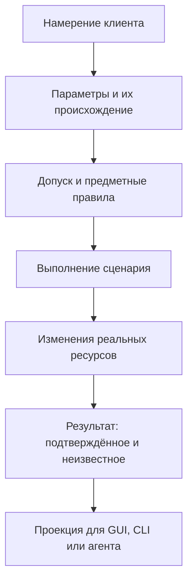

*Это последовательность смысловых границ, а не требование создать шесть слоёв или шесть классов.*

На входе может потеряться различие между отсутствующим и явным значением. В допуске — порядок обязательных проверок. При выполнении — идентичность целевого объекта. В результате — сведения об уже состоявшемся эффекте. В адаптере — отличие принятия от завершения.

Поэтому проверка только последнего JSON недостаточна для объяснения всей операции. Внешне аккуратный ответ может быть получен из внутренне противоречивой цепочки.

### Не всякое исправление требует нового механизма 📐

В облачной утилите сохранили существующие владельцы технического исполнения. В загрузчике конфликт файлов устранили пространством имён, связанным с уже имеющимся идентификатором задачи. В конвертере ошибки изображения исправили в общем imaging-сценарии. [П1, §2.2; §9.5; §11.3][practice]

Эти решения ценны своей соразмерностью. Они уточняют конкретную обязанность и не вводят второй источник правил. Command-first полезен здесь не количеством абстракций, а возможностью назвать **место, где должна быть устранена причина**.

---

<a id="migration-contract"></a>
## 2. При миграции сохраняется сценарий, а не только сигнатура 📜

У нового приложения границы первой версии можно определить заранее. Например, оно создаёт новые файлы, не заменяет существующие и не удаляет исходники. Такой небольшой продукт вполне последователен.

У существующего приложения те же ограничения могут отключить привычную функцию. Поэтому архитектурная миграция имеет дополнительное обязательство: объяснить, **что сохраняется, что исправляется и какие несовместимые изменения действительно разрешены**.

В определении рефакторинга отдельно подчёркивается сохранение наблюдаемого поведения. Если вместе со структурой меняется поведение, это может быть оправданной работой, но её следует называть и оценивать отдельно, а не скрывать в слове «рефакторинг». [Martin Fowler — Definition of Refactoring][refactoring]

### Совместимость имеет несколько измерений 🪞

| Измерение | Пример сохранности | Пример разрыва |
|---|---|---|
| **Исходный интерфейс** | Старый импорт и имя метода доступны | Вызов больше не компилируется или не находится |
| **Представление данных** | Клиент понимает сериализованный ответ | Новый `null` или неизвестное значение статуса ломает декодер |
| **Предметный смысл** | Те же допустимые параметры выполняют ту же задачу | Флаг сохранился, но операция всегда отвергается |
| **Defaults и порядок выбора** | Отсутствующий параметр имеет прежнее значение | CLI незаметно перекрывает конфигурацию |
| **Последствия** | Имена, записи и судьба исходных данных соответствуют договорённости | Результат стал сохраняться в другом месте или пропало последующее действие |
| **Время жизни** | Работа существует столько, сколько обещано | Команда возвращает принятие, а процесс сразу уничтожает исполнителя |

Первые три категории близки к различию source, wire и semantic compatibility в [AIP-180][api-compatibility]. Остальные строки — практическая детализация для рассматриваемых приложений. Набор допустимых изменений зависит и от того, обновляются ли все клиенты вместе или существуют независимо.

### Фактический код и требуемое поведение — разные основания 🔍

Исходники позволяют установить, что программа делает. Они не доказывают, что каждый существующий дефект необходимо сохранить. И наоборот, нынешнее отсутствие функции в новой реализации не доказывает, что её разрешили исключить.

Для миграции полезно сопоставлять три основания: действующее требование, принятый исходный сценарий и фактическую реализацию. Если они расходятся, требуется явное решение, а не автоматическое назначение одного из них абсолютным каноном.

**Предлагаемая модель** — компактная матрица в существующем плане:

| Прежний сценарий | Решение | Что должно остаться проверяемым |
|---|---|---|
| Корректный сценарий | Сохранить | Полезный результат и существенные отказы |
| Подтверждённая ошибка | Исправить | Контрпример старой ошибки и новый ожидаемый исход |
| Сценарий пока нельзя безопасно реализовать | Временно ограничить | Явный отказ и незакрытая продуктовая потребность |
| Функция больше не нужна | Исключить по решению владельца требований | Основание изменения, затронутые клиенты и переход |
| Новая возможность | Добавить отдельно | Собственный объём и критерий завершения |

Матрица не требует нового документа для каждой функции. Её задача — не дать техническому переносу незаметно изменить продуктовые обязательства.

### Совместимый адаптер может сохранять только часть поведения 🧩

В исследованном конвертере старый класс и основные методы сохранились. При этом ошибки стали явными, интерактивный вход изменился, а часть опасного поведения была отвергнута. Поэтому корректна формулировка «сохранены импорты и определённые успешные вызовы», но не безусловное «полная обратная совместимость». [П2, §4.1][compressor]

Такое уточнение полезно и клиентам-агентам. Наличие знакомого метода не даёт им права переносить все прежние предположения о файлах, отказах и повторах на новую реализацию.

---

<a id="feature-gap"></a>
## 3. Безопасный отказ не означает, что прежняя функция перенесена 🛑

Один из наиболее показательных практических случаев связан с удалением исходных изображений.

Прежний GUI действительно выполнял удаление после создания результата. Реализация была небезопасной: недостаточно проверяла результат и не обеспечивала требуемую защиту цели. Новый общий вход стал заранее отвергать запрос удаления. Это был явный, машинно-разбираемый отказ до эффекта, а не молчаливое игнорирование флага. [П2, §6.4][compressor]

Проблема возникла на другом уровне. Временный консервативный выбор был распространён на всю поставку и оформлен как окончательное исключение. Исследование не установило первичного согласования именно такого продуктового решения. Позднее требование рабочего режима подтвердило, что пользовательская потребность не исчезла. [П1, §3.4][practice]

### У технического ограничения и продуктового решения разные владельцы 🧱

Компонент исполнения вправе отказать, если не может обеспечить свою гарантию. Но решение о том, что функция больше никогда не требуется, относится к владельцу требований.

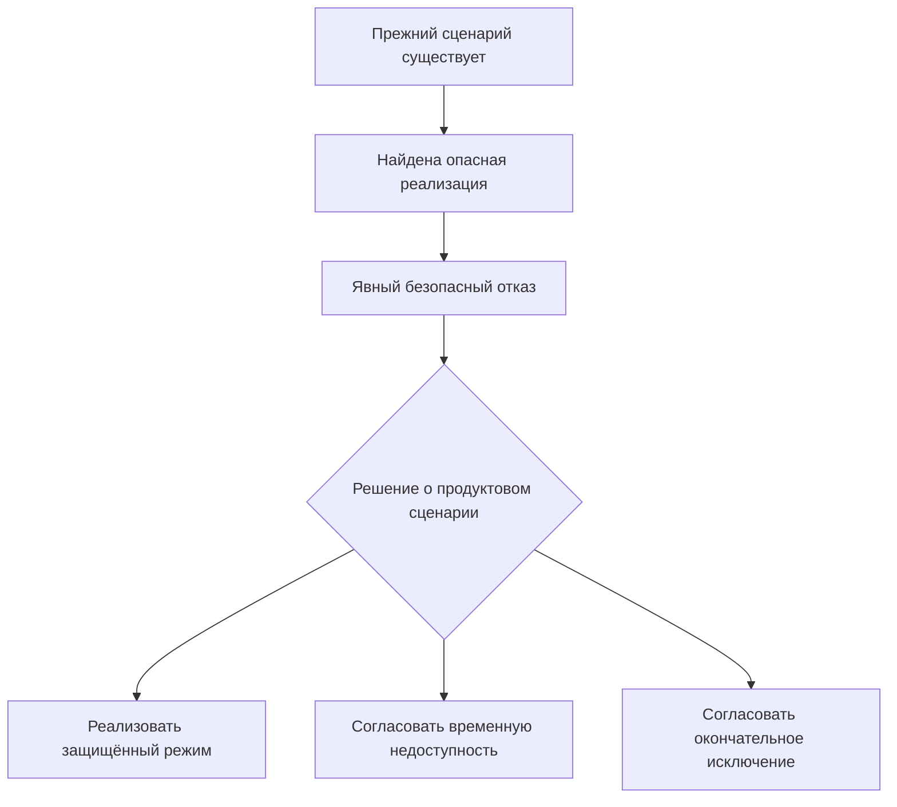

*Отказ предотвращает неподтверждённый эффект. Сам по себе он не выбирает ни одну из трёх продуктовых ветвей.*

Документированность ограничения важна: клиент не должен думать, что запрос выполнен. Но даже идеально описанный отказ не равен согласованному завершению миграции прежней функции.

### Ошибка не требует возвращать небезопасный код ⚠️

Из случая не следует необходимость восстановить старый `unlink` ради формального совпадения поведения. Разумная промежуточная позиция — сохранить безопасный отказ, явно назвать незавершённый сценарий и отдельно определить дальнейшую судьбу функции.

Поздний возврат удаления в исследованном конвертере потребовал изменения общего контракта, файлового механизма, CLI и обоих GUI. Он не свёлся к включению checkbox. На исторической границе исследования существовал проверяемый кандидат и успешные независимые исполнения, но не завершённая итоговая приёмка этого продолжения. [П2, §6.7–6.10; §7.2][compressor]

Это ограничение существенно: полезность выбранного направления не позволяет объявить незавершённый механизм полностью подтверждённым.

### Разрешение на испытание не равно способности продукта 🔐

Запрет исполнителю трогать личные данные во время разработки ограничивает **конкретную работу разработчика или агента**. Способность продукта выполнить опасную операцию по явному запросу — другое требование.

Смешение этих уровней приводит к странному результату: тестирование должно быть безопасным, поэтому функция исчезает из приложения. Более точное решение — проверять механизм на собственных синтетических ресурсах и сохранять отдельную модель продуктового допуска.

> [!important] Три статуса вместо одного слова «безопасно»
> **Безопасно отказало** — действие не разрешено или не обеспечено. **Функция сохранена** — пользовательский сценарий доступен в согласованной форме. **Изменение согласовано** — есть основание изменить прежний объём. Эти утверждения могут сочетаться, но не заменяют друг друга.

---

<a id="defaults"></a>
## 4. Значение по умолчанию — часть намерения, а не удобство парсера 🎛️

Один из первых скрытых разрывов после выделения общего API возникает из-за defaults.

CLI раньше всегда передавал значение, потому что парсер подставлял его автоматически. Прямой библиотечный клиент теперь может ничего не передать. GUI способен заменить пустую строку своим значением. Агент может отправить `null`, полагая его аналогом отсутствующего поля.

Если эти различия не определены, формально одинаковая операция начинает принимать разные решения в зависимости от оболочки.

### Практический случай: отсутствующий профиль стал явным 🔎

В облачной утилите CLI имел `profile="default"`. Парсер передавал его даже без соответствующего флага, и значение перекрывало профиль из окружения. После исправления отсутствие флага сохранялось как отсутствие; явно заданное `default` по-прежнему имело приоритет. Проверены именно обе ветви. [П3, MC-03][cloud]

Ошибка находилась не в системе конфигурации вообще. На границе адаптера была потеряна информация: **клиент выбрал это значение или приложение ещё должно выбрать его по правилам**.

### Отсутствующее, пустое и ложное не взаимозаменяемы 📦

| Вход | Возможный смысл по контракту | Что нельзя делать молча |
|---|---|---|
| Поле отсутствует | Использовать установленный порядок выбора | Выдавать его за явный выбор клиента |
| Поле равно `null` | Очистить, наследовать либо отказать — по конкретной схеме | Считать универсальным синонимом отсутствия |
| `false` | Явно выключить режим | Подменять default через проверку истинности |
| `0` | Допустимое нулевое значение либо предметный отказ | Автоматически считать «не задано» |
| Пустая строка | Пустой постфикс, пустое значение либо ошибка | Незаметно заменять непустым значением |
| Явное значение, совпадающее с default | Намеренный выбор клиента | Терять его приоритет над окружением |

Для учебного resolver достаточно следующего правила:

```text
resolve_option(explicit, environment, profile, product_default):
    if explicit is PRESENT:
        return validate(explicit.value)

    if environment defines the option:
        return validate(environment.value)

    if profile defines the option:
        return validate(profile.value)

    return validate(product_default)
```

Это псевдокод. `PRESENT` — признак наличия значения, а не обязательный класс. Конкретный порядок выбирается продуктом; он не обязан совпадать с показанным во всех приложениях.

### Общий API не обязывает все адаптеры иметь одинаковые defaults ⚖️

В исследованном конвертере старый совместимый класс сохранял HEIF и качество 50, а новый API/CLI использовал WebP и качество 80. Рекурсия тоже задавалась по-разному для старого directory-сценария и нового входа. Эти различия были описаны как намеренная политика адаптеров. [П2, §4.1][compressor]

Следовательно, требование «одни правила» не означает «все исторические оболочки обязаны одинаково интерпретировать отсутствие флага». Важно, чтобы различие было осознанным и адаптер передавал в общий сценарий точное эффективное намерение.

При необходимости результат может хранить **эффективные параметры** завершённой операции. Это позволяет понять, какое качество, формат или профиль реально применились. Происхождение параметров полезно для диагностики, но не даёт полномочий: `origin="gui"` не превращает запрос в доверенный.

### Схема не всегда подставляет default 🧾

В JSON Schema `default` является аннотацией и сам по себе не вставляет значение в отсутствующее поле при валидации. Такое заполнение относится к поведению конкретного валидатора, генератора формы или приложения. [JSON Schema — Annotations][json-defaults]

Поэтому наличие default в опубликованной схеме инструмента не доказывает, что прямой вызов ядра получит те же параметры. Владелец нормализации должен быть определён явно, а его поведение — согласовано с потребителями.

---

<a id="validation"></a>
## 5. Проверка структуры, нормализация и предметная проверка решают разные задачи 🧬

Типизированный запрос помогает связать компоненты. Runtime-валидация помогает отвергнуть фактически неверные данные. Однако ни одна из этих мер сама по себе не доказывает допустимость операции над реальным ресурсом.

В практическом конвертере неизменяемый DTO не считался проверкой всех входных значений: общий `convert()` выполнял собственную валидацию. В облачной утилите прямой API также проверял реальные типы, поскольку библиотечный клиент обходил CLI-парсер. [П1, §5.3][practice]

### Четыре вопроса к одному входу 🔍

| Проверка | Пример | Где находится смысл |
|---|---|---|
| **Структура** | Поле качества содержит число, а не объект | Входная схема |
| **Нормализация** | Псевдоним формата приводится к каноническому обозначению | Общая политика представления значения |
| **Предметная допустимость** | Выбранная комбинация формата и режима разрешена | Прикладная или предметная логика |
| **Допуск к реальному эффекту** | Клиент вправе записать именно этот результат в этот ресурс | Доверенный сценарий и инфраструктурная граница |

Такое разделение согласуется с различием синтаксической и семантической проверки в рекомендациях [OWASP Input Validation][input-validation]. Оно не задаёт один неизменный порядок всех проверок: часть сведений невозможно получить до чтения ресурса, а часть должна проверяться до любого дорогостоящего обращения.

### Удобное преобразование способно уничтожить основание проверки 🧊

Нормализация не всегда безобидна. После неё может исчезнуть информация, по которой требовалось принять решение.

У изображения декодер может изменить представление точности. У пути свёртка `..` может убрать промежуточного предка, значимого для выбранной политики доступа. У параметра преобразование пустой строки в default может стереть явное намерение.

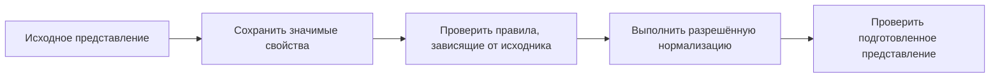

*Схема относится к правилам, которым нужны исходные свойства. Она не запрещает безопасную нормализацию перед другими проверками.*

Важен не лозунг «всегда сначала валидировать», а конкретная зависимость: какое свойство будет потеряно и какое решение опирается на него.

### Повторная проверка у эффекта не обязательно является дублированием 🔒

Проверка формы запроса стабильна в рамках неизменяемого DTO. Проверка внешнего файла может устареть сразу после выполнения. Поэтому повторное подтверждение объекта перед публикацией или удалением решает другую задачу, чем ранний preflight.

При этом повторное `exists()` само по себе не создаёт атомарности. Между ним и записью опять остаётся окно. Предметное правило должно опираться на подходящий механизм в точке эффекта, а не на увеличение числа одинаковых предварительных проверок.

---

<a id="admission"></a>
## 6. Порядок допуска — часть контракта, а не внутренняя мелочь 🚪

У операции может быть сразу несколько проблем: не хватает подтверждения, параметры противоречат друг другу, конфигурация повреждена, внешний сервис недоступен. Какую ошибку вернёт приложение и к каким зависимостям оно успеет обратиться?

Ответ влияет и на предсказуемость, и на безопасность. Если операция должна отказать до внешнего вызова, подготовка необязательной метаинформации не должна случайно запустить его раньше.

### Практический случай: метаданные заслонили обязательный отказ ⚠️

В облачной утилите диагностическая операция в live-режиме без подтверждения должна была вернуть `confirmation_required`. Комбинация live, подтверждения и несовместимого dry-run — отказ по аргументам. Оба решения должны были приниматься до обращения к backend.

После выделения общего входа предварительная подготовка метаданных начала раньше разрешать профиль. При неверной конфигурации клиент получал `config_error` вместо предусмотренного раннего отказа. Исправление восстановило порядок для соответствующих сценариев, не заменяя настоящий resolver после допуска. [П3, MC-06][cloud]

### Полезнее частичный порядок, чем один глобальный конвейер 🧭

**Предлагаемая модель:** контракт задаёт важные зависимости между проверками, а не механически навязывает одну последовательность всем операциям.

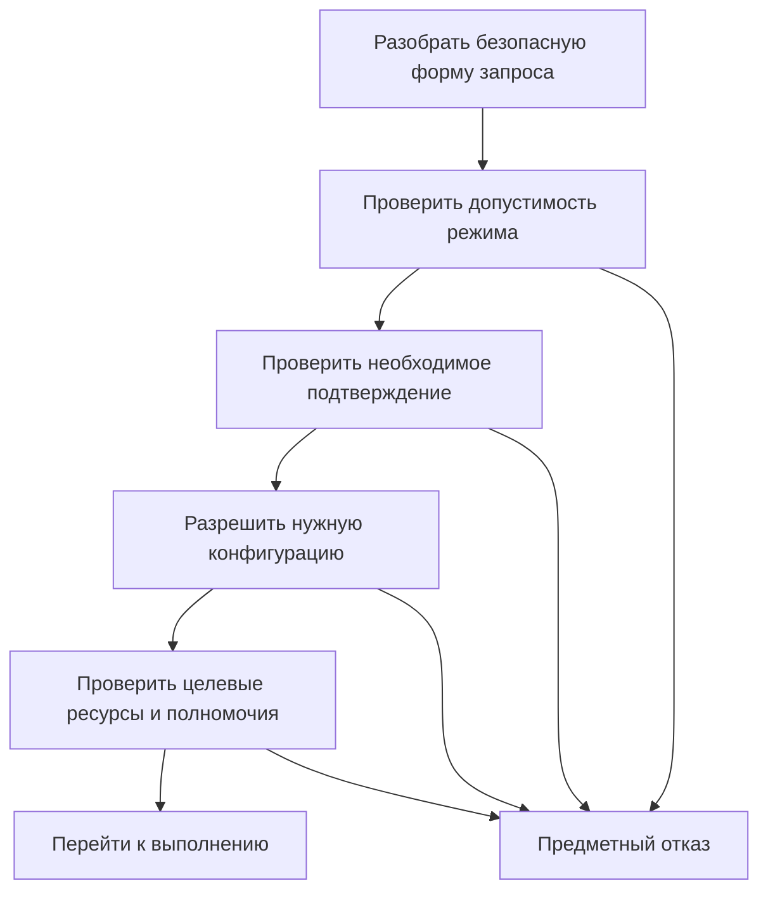

Это пример для операции с ранним запретом live-исполнения. В другом API аутентификация или ограничение раскрытия существования ресурса может потребовать иного порядка. Универсального правила «всегда сообщать самую раннюю предметную ошибку» здесь нет.

Для технического разбора достаточно нескольких различающих пар: неподтверждённое действие плюс плохая конфигурация; некорректный запрос плюс недоступная сеть; отсутствие доступа плюс несуществующий объект.

### Наблюдение не должно незаметно менять допуск 📡

Метаданные, трассировка и форматирование полезны, пока не создают другой сценарий. Получение красивого имени профиля не должно подменять причину раннего отказа. Ошибка отправки диагностического события не должна запускать повтор файловой операции.

Есть важная оговорка: **обязательная запись аудита или прикладного журнала может входить в контракт допуска**. Тогда её отказ закономерно блокирует действие. Но это должно быть явным обещанием операции, а не случайным поведением универсального логгера.

---

<a id="read-effects"></a>
## 7. Read-only, dry-run и health — разные обещания 🔍

Название query часто воспринимается слишком широко: раз операция «читает», она не меняет мир, ничего не отправляет и почти ничего не стоит. Для реальных приложений это неверное предположение.

Чтение может обращаться к сети, декодировать большой файл, нагружать модель или обновлять технический кеш. Поэтому для чувствительного сценария важно определить не только отсутствие предметной записи, но и **разрешённые технические действия**.

### Практический случай: status достигал вызова модели 🧠

По сравнительному исследованию, в одной конфигурации поискового приложения цепочка `get_status → capability → health` могла доходить до вызова модели через адаптер. Это статически установленный маршрут. Исследование не устанавливало текущую пользовательскую конфигурацию, конкретную отправку или её стоимость. [П1, §5.8][practice]

Вынос такого вызова из GUI-потока решает отзывчивость. Но он не превращает активную проверку в пассивное чтение и не меняет её смысл для клиента.

### Четыре полезных контракта вместо одного расплывчатого status 📋

| Намерение | Возможная операция | Что должен понимать потребитель |
|---|---|---|
| Узнать последнее известное состояние | `read_observed_state` | Сведения могут устареть; важен момент наблюдения |
| Проверить соединение или кодек | `probe_capability` | Будет выполнено указанное техническое действие |
| Оценить план без отправки | `estimate_locally` | Внешний эффект запрещён; часть оценки может остаться неизвестной |
| Реально выполнить работу | Предметная команда | Действуют обычные правила допуска и последствий |

Имена в таблице — учебные. Они показывают разделение смысла, а не предлагают переименовать все существующие методы.

В конвертере `get_capabilities()` тоже не был чистым чтением констант: он выполнял локальные синтетические проверки кодеков с кешированием в процессе. Это другой характер действия, без автоматически приписываемых сетевых или стоимостных свойств. [П2, §3.3][compressor]

### Dry-run требует собственной границы побочных действий 🧾

В исследованной облачной утилите dry-run для записывающих файловых операций не выполнял backend/temp/journal-эффекты. При этом отдельные читающие сценарии могли обращаться к backend. Следовательно, «dry-run» не означал универсальное «вообще никакого ввода-вывода». [П3, §8][cloud]

Для нового API возможна явная декларация:

```text
Планирование операции:
  локальное чтение входов       — разрешено;
  сетевое чтение метаданных     — запрещено;
  вызов модели                 — запрещён;
  запись результата            — запрещена;
  резервирование целевого пути — не выполняется.
```

Это пример конкретной политики. Другой продукт может разрешить сетевое чтение при подготовке плана. Существенно, чтобы клиент не угадывал такое разрешение по одному имени флага.

> [!note] Предварительный план не является резервированием
> Даже полностью корректный no-write план не гарантирует, что ресурсы останутся неизменными до применения. Перед эффектом проверяются условия, которые могли измениться. Возвращённый preview не становится вечным разрешением на запись.

---

<a id="semantic-identity"></a>
## 8. Одинаковые типы ещё не означают одинаковые данные 🧩

Самые неприятные ошибки общего ядра проходят структурную валидацию. Строка действительно является строкой, изображение — изображением, вектор содержит ожидаемое число координат. Несовпадение находится глубже: значение обозначает не тот объект или не то свойство, которое обещано контрактом.

Здесь полезно различать **представление**, **предметное свойство** и **основание утверждения о нём**.

### Альфа-канал и фактическая прозрачность — не одно свойство 🖼️

**Практический случай.** В конвертере проверка требовала альфа-канал у результата, если он присутствовал у источника. Непрозрачное RGBA-изображение с одинаковой максимальной альфой могло быть корректно сохранено кодеком без избыточного канала, но verifier объявлял такой результат неправильным. Настоящая прозрачность и физическое наличие канала оказались смешаны. [П2, §6.2][compressor]

Исправление определяло семантическую прозрачность подготовленного растра после предусмотренных преобразований. Защита от настоящей потери прозрачности сохранялась; убиралось неверное требование к техническому представлению.

Архитектурно это важнее конкретного режима изображения. **Проверяемое постусловие должно соответствовать обещанному свойству, а не удобному признаку, который лишь иногда с ним совпадает.**

| Неточный признак | Более точный вопрос |
|---|---|
| У источника есть канал A | Есть ли фактически используемая прозрачность в согласованном подготовленном растре? |
| Выходной файл существует | Это допустимый результат данной операции? |
| Библиотека вернула success | Выполнены ли все прикладные постусловия? |
| Длина вектора совпала | Совпадают ли модель, пространство и правила подготовки данных? |
| Строка имеет правильный ID | Относится ли её содержимое к нужному снимку и ресурсу? |

### Свойство исходника нельзя проверять только после его потери 🔬

Другой дефект того же конвертера имел противоположный характер. Контракт запрещал принимать определённые высокоточные изображения как обычные 8-битные. Но проверка выполнялась по высокоуровневому режиму после декодирования. Для цветного PNG16 библиотека уже представляла данные как RGB/RGBA и теряла младшие биты; проверяемый признак исходной точности исчезал. [П2, §6.3][compressor]

Узкая проверка исходного заголовка была перенесена до такого преобразования. Полное декодирование осталось у существующей библиотеки. Это не стало поводом писать второй PNG-декодер.

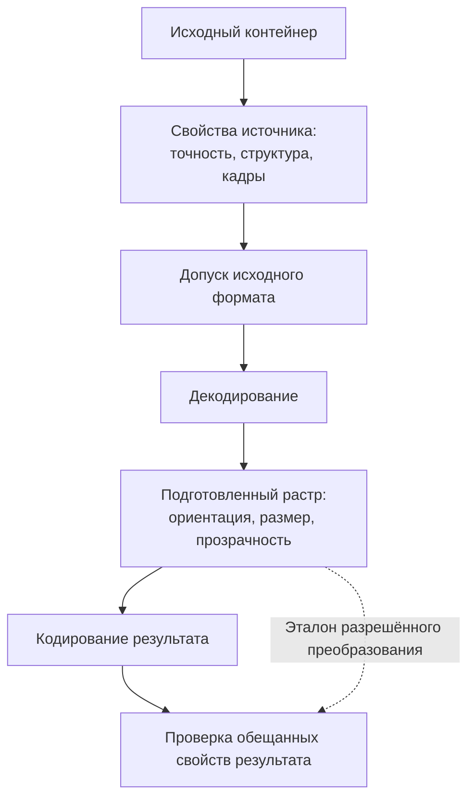

Здесь две проверки не дублируют друг друга. Первая определяет допустимость **источника**. Последняя проверяет соответствие **результата подготовленному представлению**. Сравнение результата с исходником без учёта разрешённого resize, ориентации или потерь также было бы неверным.

### Числовая форма не удостоверяет семантическую идентичность 🧠

Сравнительный отчёт приводит отдельный случай поискового ядра: рецепт указывал `Qwen3-Embedding-0.6B`, а фактический маршрут вызывал `Qwen3-Embedding-4B`. Ответ мог при этом содержать те же 1024 координаты. Структурная форма выглядела подходящей, хотя предметная идентичность расходилась. [П1, §5.7][practice]

Из этого не следует доказанное повреждение пользовательского индекса или нынешняя ошибка провайдера. Исследование устанавливает конкретное историческое несоответствие и границу проверки готовности.

Общий вывод переносится и на обычные приложения: сумма в нужном числовом типе ещё не указывает валюту; время без источника и временной шкалы может быть несопоставимым; файл с нужным расширением не удостоверяет происхождение.

**Предлагаемая модель** — включать в канон данных именно те признаки идентичности, от которых зависит совместимость. Не бесконечный паспорт на каждый объект, а необходимую связь: результат → операция → входная версия → использованный режим. Для поиска это может быть рецепт пространства; для изображения — подготовленные параметры и свойства; для документа — версия источника.

> [!tip] Проверяется не количество метаданных, а различающая способность
> Поле полезно, если без него два существенно разных случая неотличимы. Добавление десятка идентификаторов, которые никто не проверяет, не усиливает контракт. Если нужный владелец рецепта или версии уже существует, следует использовать его, а не создавать параллельный реестр.

---

<a id="query-snapshot"></a>
## 9. Ответ должен соответствовать тому состоянию, по которому он был выбран 📋

Общий API не делает каждое чтение автоматически согласованным. Даже внутри одного процесса допустимы разные снимки одного объекта, полученные до и после обычного завершения работы.

Проблема появляется, если приложение собирает из них один ответ и выдаёт его за единое наблюдение.

### Практический случай: фильтр downloading вернул done ⏱️

В загрузчике запрос сначала выбирал запись по текущему состоянию, затем mapper повторно обращался к живой задаче. Между этими действиями исполнитель завершался. Запрос с фильтром `downloading` возвращал строку со статусом `done`.

Ошибка была воспроизведена контролируемым переходом между отбором и преобразованием. Исправление передавало одну отделённую пару данных записи и задачи через всю цепочку: **capture → filter → limit → mapping**, без повторного live-read. [П4, кейс 2][downloader]

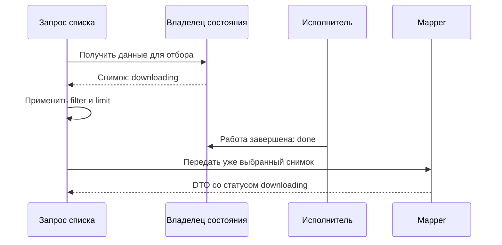

Это не обещание вечной свежести. Ответ может устареть после момента захвата. Но он остаётся **внутренне непротиворечивым**.

### «Самые свежие поля» иногда ухудшают ответ 🧮

Mapper может выглядеть полезным: перед возвратом он перечитывает объект и делает сведения актуальнее. Однако если статус участвовал в фильтрации, новое чтение меняет основание отбора. Аналогично пересчёт отдельных счётчиков может рассогласовать число, страницу и элементы списка.

Для конкретной query следует определить единицу согласованности. Это может быть один объект, одна страница списка или весь снимок коллекции. Требовать глобальной транзакции всего приложения ради одной карточки избыточно. Но смешивать независимые чтения без обозначения их различия тоже нельзя.

### Ограниченная выдача и полный поиск — разные продукты 🔎

Сравнительный отчёт отдельно различает ограниченную ранжированную выдачу и полный фильтр по одному условию. Возвращённые первые N элементов не дают автоматически точное число всех совпадений и продолжение до последнего результата. [П1, §10.7][practice]

В контракте полезно различать:

| Поле или понятие | Что оно может означать |
|---|---|
| `returned_count` | Число элементов текущего ответа |
| `total_matches` | Полное число совпадений, только если оно действительно вычислено |
| `has_more` / continuation | Возможность продолжить выбранную выдачу по её правилам |
| `snapshot_id` / revision | Состояние, к которому относится выборка |
| `unknown` | Сведение не установлено, а не равно нулю |

Это учебные обозначения, а не требование расширить каждый API всеми полями. Главное — не выдавать размер страницы за полный результат и не пытаться исправить отсутствие предметного контракта увеличением GUI-лимита.

В [статье №5][a5] рассмотрено применение снимков в интерфейсе. Здесь существенна серверная граница: **адаптер не способен честно восстановить полноту или согласованность, которых нет в ответе ядра**.

---

<a id="artifact-identity"></a>
## 10. Успешный callback и правильный путь не доказывают принадлежность результата 🪪

Артефакт — файл или другой материальный результат операции. Для автоматизации недостаточно знать, что он существует и находится в разрешённом каталоге. Нужно установить, что он соответствует именно данному намерению и допустимому источнику.

Это особенно важно, если позднее приложение позволит открыть, передать или удалить результат на основании сохранённой записи.

### Практический случай: задача B присвоила файл задачи A 📁

В загрузчике две задачи разных источников имели одинаковый заголовок. Обе прошли предварительные проверки до появления файла. Первая создала результат. Вторая дошла до настоящей ветви библиотеки, которая обнаружила существующий файл и завершила путь без собственного скачивания, но с успешным ответом и финальным hook.

Обе задачи получили состояние завершения и один путь, хотя содержимое принадлежало только первой. В проверке использовались синтетические сеть и медиа на инфраструктурной границе, но значимая ветвь библиотеки и работа общего сценария были реальными. [П4, кейс 3][downloader]

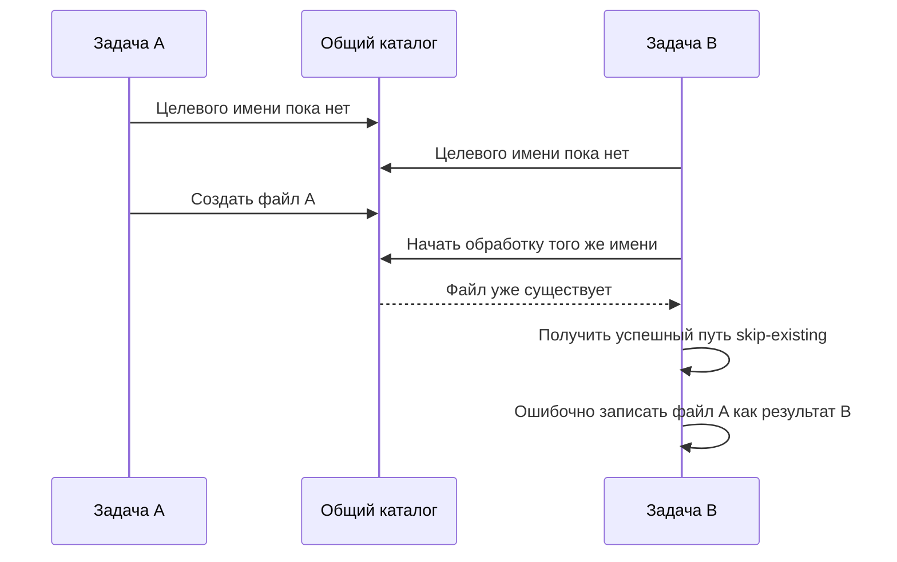

Предварительное `exists()` не устранило гонку. Успешный hook не подтвердил происхождение. Разрешённый root не подтвердил принадлежность.

### Минимальное исправление использовало уже существующую идентичность 🔑

Результаты задач были разведены в отдельные каталоги `download-<task_id>/`. Приложение использовало уже выданный владельцем идентификатор, а не добавляло второй реестр файлов или глобальную блокировку всех загрузок. [П4, кейс 3][downloader]

Это устранение конкретного пересечения в поддержанном runtime. Оно не является универсальной песочницей против другого привилегированного процесса и не описывает автоматически все повторы одной задачи.

Если одна логическая Job действительно имеет несколько попыток, контракт дополнительно должен определить отношение `job_id`, `attempt_id` и результата. Пространство имён на задачу и пространство имён на попытку решают разные проблемы. Для синхронного приложения без повторов не требуется вводить оба идентификатора ради терминологической полноты.

### Повторное использование существующего файла возможно, но должно быть действием контракта ♻️

Существующий артефакт не обязательно является ошибкой. Приложение может поддерживать кеширование или явно разрешённый reuse. Но тогда оно проверяет совместимость входа, параметров, версии и результата по своей политике и сообщает, что использован ранее созданный объект.

Это отличается от предположения «имя совпало, значит файл подходит». Полезны отдельные понятия: **создан данной операцией**, **проверенно переиспользован** и **принадлежность не подтверждена**. Из них следуют разные права на cleanup и разные сообщения клиенту.

### Путь, содержимое и владение отвечают на разные вопросы 🧾

| Основание | Что оно подтверждает | Чего само по себе не подтверждает |
|---|---|---|
| Путь внутри разрешённого каталога | Ресурс находится в выбранной области имён при данной проверке | Что его создала эта операция |
| Совпавший digest | Совпадение проверенного содержимого | Право удалить объект или неизменность его будущего содержимого |
| Идентичность файлового объекта | Что наблюдается тот же объект в оговорённой модели | Что весь путь к нему защищён от переименований |
| Запись результата с operation/task ID | Заявленную связь в прикладной модели | Правильность первоначального присвоения без проверки |
| Подтверждённое создание в собственном namespace | Происхождение в выбранной модели исполнения | Полную изоляцию от любых внешних участников |

**Архитектурный вывод:** идентичность артефакта должна устанавливаться там, где происходит его создание или разрешённое присвоение. Поздний GUI не должен угадывать её по названию файла, времени изменения или «самой свежей папке».

---

<a id="publication"></a>
## 11. Подготовка, публикация, проверка и устойчивость — разные факты 💾

У файловой операции легко появляется слишком короткая модель: библиотека записала файл, значит всё готово. На практике запись временного результата, появление конечного имени, проверка содержимого и обещание пережить сбой имеют разные условия.

Это не повод каждому приложению строить распределённую транзакционную систему. Это повод **не приписывать одному успешному действию гарантии остальных**.

### Практический конвейер конвертера 🖼️

В принятом срезе конвертер сначала формировал набор входов и целей, создавал собственный staging, кодировал и проверял его. Затем перепроверял значимые условия и публиковал результат без замены существующего файла. После публикации артефакт немедленно учитывался как `unverified`; лишь успешное повторное чтение конечного пути повышало его статус до `verified`. [П2, §4.2–4.3][compressor]


В этом конкретном механизме публикация использовала hard link. При отсутствии требуемой поддержки возвращался отказ, а не скрытое переключение на перезапись. Исторически проверенная область не распространялась автоматически на все файловые системы. [П2, §4.3][compressor]

### Точка эффекта меняет допустимое объяснение ошибки 📍

До публикации подготовленный временный файл ещё не является конечным результатом. После успешной публикации ошибка final readback не позволяет сказать «ничего не создано».

| Момент отказа | Что может быть известно | Корректная реакция |
|---|---|---|
| Вход отвергнут до выполнения | Эта операция ещё не создавала результат | Вернуть отказ без выдуманного partial |
| Кодирование staging не завершилось | Есть только собственные временные ресурсы | Очистить их по учёту владения |
| Публикация отвергла занятое имя | Новый конечный файл не создан этим действием | Сохранить чужой файл и объяснить коллизию |
| Публикация произошла, readback не прошёл | Известен эффект публикации, качество подтверждения недостаточно | Сохранить сведения об артефакте и неопределённости |
| Результат проверен, последующая запись истории отказала | Полезный файл существует, история не подтверждена | Не скрывать файл и не объявлять устойчивый учёт |

Внешняя ошибка может оставлять неизвестным даже сам факт публикации. Тогда запись результата должна сообщать именно эту границу знания, а не механически применять строку «файл создан» ко всем сбоям после отправки запроса.

### Атомарная видимость не равна полной транзакции ⚖️

Возможность атомарно создать одно имя без замены не делает атомарными весь пакет, удаление исходника, историю и внешнее уведомление. Она также не является самостоятельным обещанием устойчивости после отключения питания.

В практическом конвертере эти пределы прямо названы: проверенный механизм публикации не объявлялся ни транзакцией всего batch, ни exactly-once, ни power-loss durability. [П2, §4.3][compressor]

**Предлагаемая модель** — описывать гарантию в форме «что именно и при каких условиях становится видимым», а не словом «атомарно» без объекта.

Например: «Существующий целевой файл не заменяется; после успешной публикации новая запись доступна по конечному имени. Общая фиксация файла и истории не обещана». Такое описание полезнее универсального `AtomicStorage`, если реализация обеспечивает только первый пункт.

### Проверка результата имеет собственный предел 🔬

Полное декодирование и сверка свойств подтверждают конкретный набор условий. Проверка тем же декодером не удостоверяет совместимость со всеми внешними просмотрщиками. Сверка digest не доказывает визуальную пригодность lossy-преобразования. Совпадение размеров не означает сохранения всех метаданных.

Поэтому `verified` всегда должно означать **проверено по определённой политике**, а не «все возможные свойства результата доказаны». Практические исследования специально сохраняют эти ограничения. [П1, §11.1][practice]; [П2, §7.3][compressor]

---

<a id="outcome-model"></a>
## 12. Результат операции — не один boolean, но и не бесконечный набор флагов 📦

Операция может создать полезный файл и завершиться с ошибкой сохранения истории. Может прекратить пакет после нескольких успешных элементов. Может опубликовать результат, но не подтвердить судьбу исходника после отдельного действия.

Если всё это сворачивается в `success: false`, клиент теряет уже выполненную работу. Если в `success: true` — он теряет предупреждение о невыполненном обязательстве.

### У результата несколько независимых измерений 🧭

| Измерение | Основной вопрос | Пример различия |
|---|---|---|
| **Исход сценария** | Все ли обязательства запроса выполнены? | `succeeded`, `partial`, `failed`, `cancelled` |
| **Подготовка полезного результата** | Получены ли нужные данные? | Кодирование завершено, но публикация отказала |
| **Публикация** | Стал ли результат доступен в целевой области? | Staging существует, конечного файла ещё нет |
| **Проверка результата** | Какие свойства подтверждены? | Опубликован, но final readback не прошёл |
| **Судьба источника** | Что произошло с исходным объектом? | Сохранён, удалён, не подтверждено |
| **Сохранение учёта** | Зафиксированы ли итог и история? | Файл есть, terminal persistence отказала |
| **Доставка ответа** | Получил ли клиент подтверждение? | Приложение завершило работу, соединение оборвалось |

Это аналитические оси. Не каждой операции нужны все поля. В обычном чтении нет публикации, а в конвертации без удаления судьба исходника может быть единственным неизменным условием. Но там, где измерения расходятся, их нельзя скрывать.

Такие расхождения подтверждены в практическом корпусе: опубликованный непроверенный файл, полезный результат при ошибке последующего действия, ошибка сохранения истории и неизвестный исход native-удаления. [П1, §9.1][practice]

### Partial и unknown отвечают на разные вопросы 🌫️

**Partial** обычно характеризует полноту исполнения: часть обязательств или элементов выполнена, часть — нет. **Unknown** характеризует знание: исход определённого эффекта не установлен.

Они могут существовать одновременно. Например, результат изображения проверен, а исход удаления оригинала неизвестен. Сценарий неполон по подтверждённым обязательствам, и один из его эффектов имеет неизвестный исход.

Неизвестное не равно неуспешному. Но оно также не является разрешением считать всё успешным. Клиенту нужно безопасное следующее действие: сверка, ожидание, запрос отдельного статуса либо обращение к человеку.

### Предлагаемая форма результата 🧾

Ниже приведён **учебный DTO**, а не фактический ответ исследованных приложений. Он показывает полезный результат при неоднозначном исходе последующего действия:

```json
{
  "operation_id": "op-demo-42",
  "outcome": "partial",
  "effective_options": {
    "format": "webp",
    "quality": 80,
    "source_policy": "delete_after_verified_publication"
  },
  "items": [
    {
      "item_id": "item-1",
      "conversion": {
        "status": "succeeded"
      },
      "publication": {
        "status": "published",
        "artifact": {
          "path": "output/photo.webp",
          "ownership": "created_by_operation",
          "verification": "verified"
        }
      },
      "source_disposition": {
        "status": "unknown",
        "reason_code": "DISPOSITION_CONFIRMATION_UNAVAILABLE"
      }
    }
  ],
  "recovery": {
    "action": "reconcile_source_disposition",
    "repeat_entire_operation": false
  }
}
```

Значение `repeat_entire_operation: false` здесь — решение выбранной модели, а не универсальное свойство любых partial-ответов. Поле recovery подсказывает допустимое продолжение, но не выдаёт новых полномочий на него.

Доставка собственного ответа обычно не является достоверным полем этого же ответа. Если соединение оборвалось, приложение может не знать, получил ли клиент данные. Поэтому «доставлено» полезно хранить отдельно только там, где действительно существует соответствующее подтверждение.

### Варианты и инварианты лучше независимых флагов 🔒

Вместо разрешения любых сочетаний `published=true`, `verified=false`, `artifact=null` контракт должен ограничивать варианты.

```text
PublicationOutcome =
    NotPublished(reason)
  | Published(artifact, verification)
  | PublicationUnknown(target_reference, evidence)

SourceDisposition =
    Retained(evidence)
  | Deleted(evidence)
  | Unknown(reason, last_observation)
```

`PublicationUnknown` нужен только если используемая граница действительно допускает такой исход. Нельзя вводить его как универсальный ответ на любую ошибку валидации.

У предложенной модели есть межполевые правила. Подтверждённая публикация требует сведений об артефакте. `Deleted` требует достаточного подтверждения удаления в выбранной платформенной модели. `Retained` не должен оставаться значением по умолчанию после попытки, которая уже могла удалить объект. Полный `succeeded` требует выполнения всех обязательных постусловий выбранного режима.

Эти правила должны проверяться владельцем результата и контрактными проверками, а не только наличием полей в схеме.

### Итоговые счётчики могут пересекаться 📊

В позднем кандидате конвертера отмена после публикации, но до удаления могла сочетаться с уже успешной конвертацией и опубликованным файлом. Счётчик удалённых при этом оставался нулевым. Это не обязательно арифметическая ошибка: измерялись разные факты. [П2, §6.10][compressor]

Поэтому равенство вида `total = succeeded + published + cancelled` обычно бессмысленно, если категории не являются взаимоисключающими. Для суммы нужны именно разделяющие исходы элементов. Для эффектов допустимы отдельные пересекающиеся счётчики с ясным определением.

**Предлагаемая модель:** сначала хранить подтверждённые поэлементные факты, затем вычислять сводку по явно заданным правилам. Обратный путь — угадать факты из одного общего числа — намного слабее.

> [!important] Успешная операция и полезный результат — не синонимы
> Прикладной сценарий может не выполнить все обязательства, но оставить полезный результат. Этот результат нельзя скрывать, автоматически удалять или создавать повторно только потому, что общий статус не зелёный.

---

<a id="batch"></a>
## 13. Пакетная операция не должна терять историю собственных эффектов 📚

Пакет создаёт дополнительную границу: несколько действий объединены одним запросом, но не обязательно одной транзакцией.

Первый элемент может успешно завершиться, второй — опубликовать непроверенный результат, третий — отказать ещё до записи. Если внешняя обработка исключения заменит всё одним `INTERNAL_ERROR`, клиент перестанет знать, что уже произошло.

### Практический случай: внешняя error boundary стирала выполненные элементы 🧨

В облачной утилите неожиданное обычное исключение очередного элемента могло привести к потере уже накопленных результатов всего batch. Исправление перенесло подходящую границу обработки внутрь владельца пакетного сценария: прежние outcomes сохранялись в порядке выполнения, действовали политики stop/continue и существующий partial-итог. [П3, MC-06][cloud]

Это не требование ловить абсолютно все ошибки и любой ценой возвращать JSON. Сигналы прерывания процесса и исключения, не относящиеся к обычному отказу элемента, не следует автоматически превращать в рядовой предметный результат.

### Предварительный план и исполнение имеют разные обещания 🗂️

Preflight полезен: он может заранее найти пересечения целей, недопустимые параметры или конфликт входа и выхода. Но он не превращает будущую внешнюю работу в транзакцию. Файл может измениться, сеть — исчезнуть, место на диске — закончиться.

В конвертере полный manifest формировался до записи. Это позволило согласовать порядок, дедупликацию и группы конфликтующих целей. При этом ошибка неполного discovery не должна была случайно запускать обработку лишь успевшей обнаружиться части. [П2, §4.2; §4.4][compressor]

В другом продукте обработка допустимого подмножества может быть разрешённой функцией. Но тогда это отдельная политика: клиент знает, какие элементы исключены и считается ли такой результат полным. Нельзя заимствовать слово «partial» без определения того, какие действия были допущены.

### Псевдокод границы пакета ⚙️

Следующая схема — **предлагаемый алгоритм**, а не копия исследованной реализации:

```text
execute_batch(frozen_plan, policy):
    outcomes = []

    for item in frozen_plan.items:
        if cancellation_requested():
            return summarize_with_unstarted_remainder(
                outcomes,
                reason="cancelled"
            )

        try:
            outcome = execute_item_with_effect_accounting(item)
        catch ordinary_unexpected_failure as failure:
            outcome = classify_failure_preserving_known_effects(
                item,
                failure
            )

        outcomes.append(outcome)

        if policy.requires_stop_after(outcome):
            return summarize_with_unstarted_remainder(
                outcomes,
                reason="stopped_after_item"
            )

    return summarize(outcomes)
```

Ключевой компонент здесь — не `catch`, а учёт эффектов внутри элемента. Если после низкоуровневого вызова ничего не известно, внешний обработчик не вправе сочинить `no_effect`. Если известно, что файл опубликован, это знание должно пережить ошибку следующего шага.

### Не начатое отличается от неуспешного ⏳

У пакета полезно различать запланированные, попытанные, выполненные и не начатые элементы. В исследованной облачной утилите `total` означал число попыток, а не обязательно исходный размер плана. [П3, §8][cloud]

Для нового контракта возможны более явные имена `planned`, `attempted`, `not_started`, но переименование существующего поля требует проверки совместимости. Главное — не подставлять под знакомое имя другую единицу измерения.

Предложенный контракт stop-on-error также должен объяснять судьбу уже работающих параллельных элементов. «Не запускать следующие» и «немедленно остановить уже запущенные» — разные гарантии. В последовательном профиле A этот вопрос проще, но не исчезает автоматически при добавлении пула.

---

<a id="reconciliation"></a>
## 14. Неизвестный исход требует сверки, а не автоматического повтора 🔁

Тайм-аут сообщает о границе ожидания. Он не является универсальным свидетельством отсутствия внешнего эффекта.

Запрос мог не дойти. Мог быть принят, но ещё выполняться. Мог завершиться, а ответ — потеряться. Для изменяющей операции эти варианты требуют разных продолжений.

В HTTP это различие отражено в ограничениях автоматического повтора неидемпотентных запросов: клиенту нужно основание считать повтор безопасным либо знать, что прежнее действие не применилось. Прикладной API вне HTTP сталкивается с той же проблемой знания, хотя не обязан использовать HTTP-методы. [RFC 9110, §9.2.2][http-semantics]

### Практический случай: внешнее копирование не повторили после тайм-аута ☁️

В проверке облачной утилиты бюджет наблюдателя закончился до подтверждения копирования. Остался промежуточный объект с неучтённым именем. Очистка сначала отказалась его удалять.

Затем отдельная сверка чтением подтвердила принадлежность синтетического содержимого этому запуску по нескольким основаниям. Только после этого точный объект был учтён и удалён в разрешённой области. Неоднозначное копирование не повторяли. Первый неуспех проверки сохранили, а бюджет следующего отдельного запуска изменили без подмены продуктовой retry-политики. [П3, MC-08][cloud]

Это положительный пример применения уже существовавшего правила: **сначала выяснить, что случилось, затем выбирать действие**.

### Неопределённость относится к конкретному наблюдателю 🌫️

Приложение может иметь подтверждённый итог, который потерялся только у клиента. В таком случае полезен запрос операции или результата.

Но иногда и принимающая сторона не получила подтверждения от внешней системы. Тогда запрос локального статуса не создаст отсутствующего знания. Он должен честно вернуть неопределённость и доступные сведения о последней достигнутой границе.

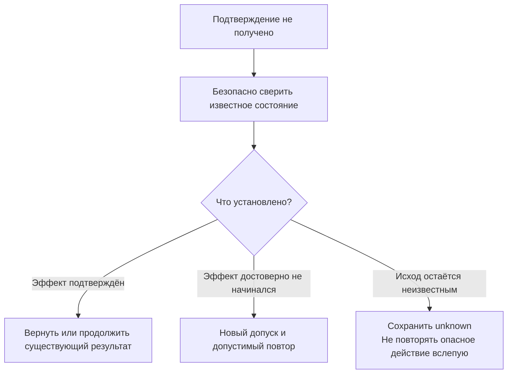

*Подтверждение отсутствия должно быть достаточным для выбранной внешней системы. Одно временное отсутствие в кешированной выдаче не является универсальным доказательством, что операция не выполнялась.*

### Идемпотентность — свойство протокола, а не поля UUID 🪪

Ключ идемпотентности полезен, если приложение связывает его с конкретным намерением, сохраняет результат и корректно обрабатывает конкурентные повторы. В [AWS Builders’ Library][idempotent-api] отдельно рассматриваются клиентский идентификатор, атомарная связь учёта с изменением и конфликт одинакового ключа при разных параметрах.

Для рассматриваемой архитектуры это означает необходимость определить область ключа, срок его хранения и поведение после истечения. Повтор с тем же ключом не должен внезапно стать новым запросом с другими параметрами. Сохранённый ответ не должен обходить актуальные ограничения доступа.

Однако дедупликация запуска Job не доказывает однократности всех внешних действий её исполнителя. Внешняя запись имеет собственную границу подтверждения и может требовать поддержки со стороны принимающей системы.

У синхронного конвертера без устойчивого учёта намерений новый вызов остаётся новым действием. Исследованный контракт именно так и трактовал повтор: занятая цель давала коллизию, а потеря stdout не разрешала автоматически включить overwrite. [П2, §4.4][compressor]

### Временная ошибка и безопасный повтор — разные оси ⚖️

Поле `retryable: true` часто слишком грубо. Недоступность сети может быть временной, но прежняя запись уже могла состояться. Ошибка очистки может исчезнуть при повторе очистки, но это не означает необходимости заново выполнять конвертацию.

**Предлагаемая модель** различает техническую причину и способ восстановления:

| Ситуация | Возможное продолжение | Что не следует делать автоматически |
|---|---|---|
| Вход отвергнут до эффекта | Исправить запрос и пройти допуск заново | Скрывать отказ как сетевую проблему |
| Подтверждённый transient-сбой чтения | Повторить по политике чтения | Распространять ту же политику на записи |
| Потерян ответ записи | Сверить операцию или внешний ресурс | Повторить с новым ключом ради быстрого успеха |
| Результат создан, история не сохранена | Восстановить учёт результата | Повторить дорогое или необратимое основное действие |
| Исход удаления неизвестен | Проверить судьбу конкретного объекта | Повторно удалить всё по прежнему пути |

Reconciliation — сверка — не обязательно отдельный сервис. Для небольшого приложения это может быть один ограниченный запрос и понятный ручной маршрут. Архитектурная обязанность состоит в сохранении неопределённости до получения достаточных фактов, а не в обязательном автоматическом «исцелении» любой ошибки.

---

<a id="cleanup"></a>
## 15. Очистка должна освобождать приобретённое, а не всё обнаруженное 🧹

Cleanup часто воспринимается как технический хвост, который уже не влияет на полезный результат. Но он способен закрыть чужой поток, удалить чужой файл, освободить блокировку слишком рано или заменить первоначальную ошибку новой.

Поэтому владение ресурсами относится к контракту операции так же, как вход и результат.

### Практический случай: поздний чужой handler был закрыт 🪝

В загрузчике контекст логирования запоминал список handlers на входе, а при выходе закрывал текущие и восстанавливал прежний список. Проверка с ранним заимствованным handler проходила.

Но вызывающая сторона могла добавить новый собственный handler уже после входа в контекст. Независимый контрпример сделал это через настоящий подписчик события. Полезная операция завершилась, CLI вернул корректный результат, а поздний чужой handler оказался закрыт и перестал записывать данные. [П4, кейс 5][downloader]

Исправление вело список **конкретно приобретённых собственных ресурсов**. Оно не требовало нового фреймворка логирования.

### Список «до и после» не является доказательством владения 📒

Ресурс, отсутствовавший при входе и появившийся позднее, не обязательно создан текущим контекстом. В общей среде его мог добавить другой компонент.

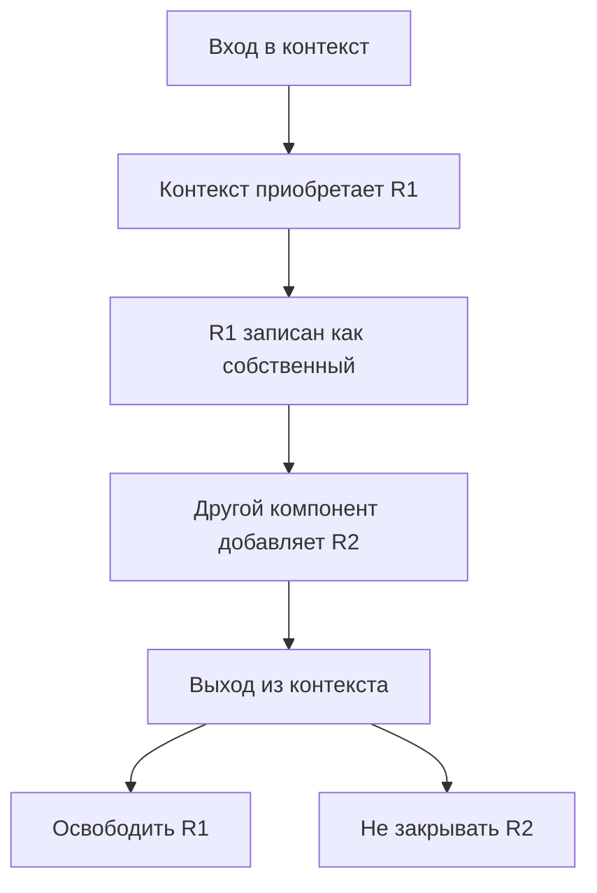

Внутренний учёт может быть очень небольшим: стек завершения, список приобретений или структурированный контекст владения. Его задача — сохранить причинную связь «этот ресурс приобретён здесь», а не вычислять её по изменению глобальной коллекции.

### Частичное приобретение тоже требует владельца 🔧

Создание ресурса может состояться до следующего потенциально неуспешного шага подготовки. Если информация о владении записывается слишком поздно, исключение может оставить объект, который финальная очистка уже не знает.

В конвертере исследование отдельно отмечает передачу владения staging до оставшихся потенциально неуспешных шагов подготовки. Это позволяло учитывать частично приобретённые ресурсы. [П2, §4.3][compressor]

При этом сам реестр владения не должен создавать дополнительную рискованную операцию без защиты. Конкретная реализация отвечает за то, чтобы acquisition и передача ответственности не оставляли неучтённого окна в поддержанной модели исполнения.

### Ошибка cleanup не должна стирать основной итог 🧾

Если файл уже опубликован, сбой удаления временного каталога не делает публикацию несуществующей. Если основное действие отказало, исключение из `finally` не должно скрывать причину и известные последствия.

**Предлагаемая модель:** основной исход и исход освобождения ресурсов учитываются отдельно, после чего формируется общий результат. Необязательный cleanup может породить warning; обязательное закрытие или потеря гарантии владения может потребовать прекратить дальнейшее исполнение. Но в обоих случаях сведения о состоявшихся эффектах сохраняются.

```text
основной исход:
  опубликованный результат известен;
  проверка результата успешна.

освобождение ресурсов:
  собственный временный объект не удалён;
  чужие объекты не затронуты.

итог:
  полезный результат сохраняется;
  возвращается предупреждение и точная оставшаяся обязанность.
```

Это не универсальное разрешение продолжать работу после любого cleanup failure. Например, неизвестная судьба удерживаемого native-ресурса может нарушать дальнейшие гарантии; тогда безопаснее остановить последующие рискованные действия.

### Известный путь не всегда даёт право на удаление 🔐

Временный объект должен быть собственным не только по имени. Если его могли подменить, очистка обязана учитывать предусмотренную модель идентичности. Не следует превращать небольшой остаток в рекурсивное удаление общей пользовательской папки.

Практический конвертер чистил только учтённые временные объекты; подозрительная подмена или ошибка очистки не становилась основанием удалять чужое содержимое. [П2, §4.3][compressor]

Тема владения временем жизни GUI подробно раскрыта в [статье №5][a5]. Здесь главное обобщение: **cleanup — действие над реальными ресурсами, а не бесплатная зона вне контракта последствий**.

---

<a id="destructive"></a>
## 16. Опасная операция начинается раньше вызова delete 🛡️

Удаление — удобный пример, потому что ошибка быстро становится необратимой. Но те же вопросы возникают у замены файла, публикации во внешнюю систему, массового изменения документов и перезаписи индекса.

Надёжный контракт определяет не только механизм последнего вызова, но и область действия, основание разрешения, актуальность плана и способ сообщения неизвестного исхода.

### Подтверждение должно относиться к определённому намерению 📝

В исследованном загрузчике удаление общей папки было заменено точным планом по записанным файлам, token и повторной проверкой идентичности у эффекта. Не выполнялось сканирование каталога для произвольного расширения области удаления. [П4, кейс 4][downloader]

**Предлагаемая модель** такого сценария выглядит следующим образом:

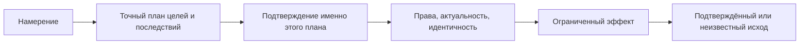

Изменение набора файлов после подтверждения должно менять и основание разрешения. Иначе подтверждение превращается в общий флаг «можно удалять что угодно».

Наличие token не означает аутентификацию клиента. В локальном доверенном процессе он может связывать preview и действие. На удалённой границе дополнительно нужны проверка инициатора, полномочий и допустимой области. Проверка доступа на каждом относящемся обращении соответствует рекомендациям [OWASP Authorization][authorization].

### Неподтверждённое удаление нельзя назвать сохранностью 🌫️

В авторском native-проходе загрузчика обращение к настоящей Корзине вернуло частичный неизвестный исход. Исходный файл после попытки отсутствовал, но место назначения и восстановление не были подтверждены. История сохранилась. На границе исследования не было итоговой независимой приёмки этого среза. [П4, кейс 4; §8.4][downloader]

Это наблюдение имеет точный смысл: произошла попытка с неподтверждёнными последствиями. Оно не доказывает ни «ничего не изменилось», ни «восстановимое удаление работает», ни окончательную безвозвратную потерю.

В позднем кандидате конвертера аналогичное различие было выражено состояниями `retained`, `deleted`, `unknown`. После принятого destructive-вызова известность могла стать `unknown`; подтверждённое удаление появлялось только после соответствующего завершения. Это описание кандидата, а не заявление о его окончательной поставке. [П2, §6.7; §6.10][compressor]

### Уточнение к формулировке о сохранении исходника 📌

В практическом примере [статьи №4][a4] формулировка «при неудачной очистке исходник остаётся» нуждается в ограничении по моменту отказа. Сравнительное исследование прямо отмечает, что она слишком сильна для эффекта, который уже мог примениться. [П1, §15.5][practice]

Корректная семантика такова:

> [!warning] Отказ не всегда означает отсутствие эффекта
> Готовый результат не удаляется автоматически из-за сбоя последующего действия. Если отказ произошёл до действия над источником, его сохранность может быть подтверждена в рамках выбранного протокола. Если действие уже могло примениться, но исход не установлен, сообщается `unknown`. Неопределённость не заменяется значением `retained` и не разрешает слепой повтор.

Это уточнение не вводит новый обязательный фреймворк удаления. Оно исправляет смысл обещания, на которое опирается клиент.

### Отмена, компенсация и восстановление — разные сценарии 🔄

После остановки пакета готовые результаты могут оставаться. Для возврата прежнего состояния требуется отдельное действие. Оно должно учитывать последующие изменения других участников, собственные ошибки и полномочия.

[Compensating Transaction][compensation] описывает именно отдельную, предметно-зависимую логику компенсации уже состоявшихся шагов. Такая операция не обязана буквально возвращать мир к прежнему снимку и сама может потребовать восстановления после отказа.

Поэтому GUI-кнопка «Отменить изменения» и агентная команда `cancel` не должны незаметно получать одинаковую реализацию. Одна прекращает дальнейшую работу в оговорённых точках, другая меняет уже случившиеся последствия.

---

<a id="native-guarantees"></a>
## 17. Название guard не доказывает платформенную гарантию 🔒

Низкоуровневая защита часто выглядит убедительно уже в плане: объект открыт по handle, идентичность сверена, share-mask ограничена. Но каждая из этих мер запрещает определённые действия только в конкретной модели операционной системы и файловой системы.

Чтобы контракт был честным, требуется связать **механизм**, **обещаемый запрет** и **условия, в которых он действует**.

### Практический случай: открытый directory handle не остановил нужное переименование 🗂️

В позднем протоколе удаления конвертера первоначальный план считал открытие каталогов с metadata-доступом достаточной защитой от rename. Реальный конкурирующий процесс показал, что отдельный родительский каталог назначения всё ещё переименовывается.

Исправление изменило конкретный способ приобретения ancestor handle. При этом сохранили отдельную проверку поздних ветвей и положительный контроль после освобождения. Ошибка плана была признана, а весь поздний кандидат не объявлен окончательно принятым только по одному ремонту. [П2, §6.8][compressor]

Официальная документация [CreateFileW][create-file] действительно разделяет запрашиваемый доступ и sharing mode. Но из этого не следует универсальный рецепт «подставить найденное число флагов». Историческое сочетание относится к конкретному Windows-протоколу и проверенной области.

### Объект, пространство имён и полномочия — разные измерения 📐

| Утверждение | Что требуется установить |
|---|---|
| Читается тот же объект | Идентичность объекта в поддержанной модели |
| Объект не меняется во время работы | Допустимые виды конкурентной записи и механизм их ограничения |
| Путь продолжает вести к допустимому объекту | Политика пространства имён, предков, ссылок и переименований |
| Действие разрешено | Полномочия процесса и прикладной политики |
| После освобождения всё снова доступно | Корректный lifetime удержаний, а не оставленная блокировка |

Один handle не является автоматическим доказательством всей таблицы. И проверка исходного каталога может случайно проходить за счёт другого уже удерживаемого ресурса. Поэтому независимый каталог назначения способен оказаться существенным различающим случаем.

### Нормализация пути может скрыть предмет проверки 🧭

В том же позднем кандидате ранняя свёртка пути с `..` скрывала значимую исходную цепочку, включая реальный junction в синтетическом сценарии. Ожидался отказ до staging, но проверка достигала публикации и удаления. Затем исходное представление сохранили для нужной проверки до свёртки, и те же случаи перестали проходить опасный путь. [П2, §6.9][compressor]

Вывод зависит от политики. Если правило запрещает определённые исходные предки, их нельзя сначала убрать и затем утверждать, что они проверены. Если политика допускает нормализованный путь, должны быть отдельно определены правила разрешения ссылок и проверки реального объекта.

Не существует универсального требования отвергать любой `..` во всех продуктах. В облачной утилите некоторые ожидания тестов, наоборот, не совпадали с действовавшей допустимой нормализацией прежнего владельца. [П3, MC-05][cloud]

**Правильный вопрос — какую именно цепочку разрешает контракт и в какой момент реализация её проверяет.**

### Портативный интерфейс не делает переносимой всякую гарантию 🌐

Метод `safe_delete()` может иметь реализации для разных ОС. Но общее имя не позволяет обещать одинаковую силу защиты без соответствующих механизмов и проверенных предпосылок.

Для такого порта полезнее описать поддержанные возможности и ограниченные режимы, чем скрывать всё за boolean. В неподдержанной среде корректный отказ может быть лучше ослабленного fallback. При этом ограничение должно быть видимо как продуктовый предел, а не преподноситься как универсальная работа функции.

Подробные native-проверки относятся к следующему материалу о доказательстве работоспособности. Для архитектуры здесь достаточно удержать принцип: **обещание должно соответствовать наблюдаемому действию механизма, а не его названию в плане**.

---

<a id="safe-projection"></a>
## 18. Безопасная проекция должна сохранять и секретность, и полезный смысл 🧼

Общий API нередко становится первым местом, откуда результат получает не только CLI, но и прямой библиотечный клиент. Это меняет границу безопасности: недостаточно скрыть чувствительные данные только в финальной строке терминала, если до неё клиент уже получил открытые поля объекта.

В облачной утилите безопасные данные требовались именно на прямой прикладной границе. Существующая сериализация также применяла фильтрацию. Их композиция обнаружила отдельный дефект. [П3, MC-04][cloud]

### Практический случай: повторное скрытие секрета изменяло уже обработанный текст 🔁

Sanitizer не полностью учитывал собственный маркер и на следующем проходе добавлял лишнюю закрывающую скобку. Прямой API и CLI выдавали разные значения. В наблюдавшихся примерах синтетический секрет был скрыт; исследование квалифицирует это как дефект стабильности проекции, а не доказанную утечку. [П3, MC-04][cloud]

Исправили прежнего владельца фильтрации. Защиту не удаляли, входному маркеру не стали доверять и неправильные ответы не нормализовали в тесте ради паритета.

### Идемпотентная обработка не должна создавать доверенный префикс 🔐

Для одного и того же получателя и одной политики полезно свойство:

```text
S(S(x)) = S(x)
```

Это математическое описание стабильности повторной проекции, а не доказательство её полной безопасности. Нужны и другие условия: запрещённое не появляется, разрешённые факты сохраняются, соседний настоящий секрет не прячется от проверки за пользовательским текстом `[REDACTED]`.

Если у двух получателей разные полномочия, проекции могут закономерно отличаться. Локальная карточка результата и обезличенный support-export — разные каналы. Общая политика данных не требует одинакового набора полей во всех контекстах.

### Пустой ответ не является качественной безопасной наблюдаемостью 📋

Две проверки независимы: запрещённые данные отсутствуют, а нужные разрешённые сведения присутствуют. Отключение журнала или обнуление результата легко выполняет первую и нарушает вторую.

Для практической модели важно заранее определить, какие факты остаются доступными: код причины, стадия, идентификатор разрешённого результата, известные последствия. Сырые исключения, credentials и произвольное содержимое документа не должны автоматически становиться внешним сообщением.

В HTTP для машинно-читаемого описания проблем существует [RFC 9457][problem-details]. Он может быть выбран адаптером, но не заставляет внутреннее ядро зависеть от HTTP и не заменяет предметное описание уже состоявшихся эффектов.

**Архитектурный вывод:** проекция — содержательный владелец правил раскрытия и представления, но не новая реализация самой операции. Её отказ не должен запускать конвертацию заново или скрывать известный результат за ложным «ничего не произошло».

---

<a id="adapters"></a>
## 19. Общий смысл не требует одинаковой оболочки ответа для всех клиентов 🔌

GUI, CLI, библиотечный клиент и MCP имеют разные способы доставки. Им не обязательно возвращать побайтно одинаковые документы. Но они должны сохранять значение ключевых фактов: что принято, что выполнено, что сохранено и что ещё неизвестно.

Тонкий адаптер вправе локализовать сообщение, выбрать канал вывода и сопоставить прикладной отказ с протокольным статусом. Он не вправе незаметно менять частичный результат на полный успех.

### Практический случай: первый JSON был лишь подтверждением принятия 📨

В самостоятельном CLI загрузчика команда добавления сначала печатала `queued/task_id`, затем ожидала окончательный исход и сохранение. Поздняя ошибка могла появиться в stderr и изменить exit code процесса. Поэтому успешный документ в stdout ещё не означал успешную загрузку. [П4, §6.3][downloader]

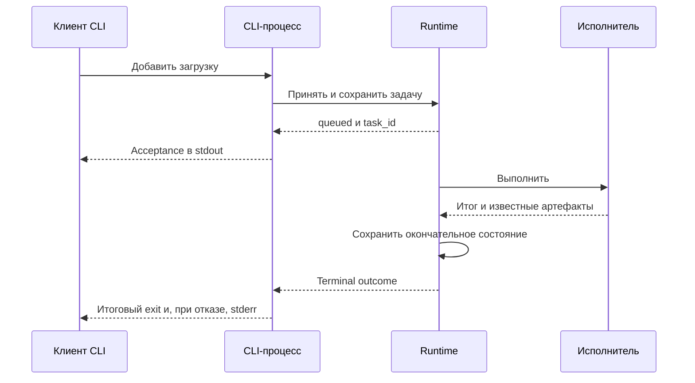

В другом режиме тот же CLI-адаптер мог заимствовать живой runtime вызывающей стороны, которая обеспечивала дальнейшую жизнь задачи. Тогда окончание адаптерного вызова после принятия имело иной допустимый смысл. Эти режимы были описаны отдельно. [П4, §5.2][downloader]

### Канал, exit и результат должны рассматриваться вместе 🧭

| Поверхность | Законная задача адаптера | Опасная подмена |
|---|---|---|
| Direct API | Вернуть типизированный результат без печати и завершения процесса | Прятать полезные последствия только в stdout |
| CLI | Сохранить документированный stdout/stderr/exit-контракт | Считать первый JSON окончательным итогом любого процесса |
| GUI | Показать факты и доступные действия | Выводить зелёный успех из одного счётчика |
| MCP | Сопоставить вызов инструмента с прикладной операцией | Считать успешную доставку tool-ответа доказательством завершённой Job |
| HTTP или IPC | Передать данные и протокольные ошибки | Выдавать потерю связи за отсутствие эффекта |

Эта таблица — предлагаемое распределение обязанностей. Конкретные codes и envelopes остаются частью существующего продукта.

### Неоднородность существующего API нельзя исправлять молча 🧩

В загрузчике некоторые legacy-запросы возвращали ошибку с `code: null`, хотя другие имели `NOT_FOUND`. Проверочный код, ожидавший единый непустой код везде, оказался неверен относительно действующего контракта. Это не было основанием незаметно изменить продукт ради теста. [П4, §6.4; кейс 7][downloader]

Такая неоднородность может быть неудобной и заслуживать будущего улучшения. Но сначала требуется назвать изменение, проверить потребителей и определить совместимость. Формула «теперь есть общий API» не делает все старые wire-представления автоматически одинаковыми.

То же относится к нескольким serializers. Наличие общего DTO не доказывает, что CLI-normalizer и сетевой serializer одинаково обрабатывают новые enum, `null`, пустые коллекции и отсутствующие поля. Проверяется реальный выход каждого нужного адаптера, а не только исходный объект.

---

<a id="evolution"></a>
## 20. Контракт меняется по смыслу, даже когда схема почти не изменилась 🧬

API развивается. Появляется новый результат, новый режим, новый способ остановки. Опасность состоит в предположении, что небольшая дельта полей обязательно означает небольшую дельту поведения.

Клиент может успешно прочитать новый ответ и всё равно принять неправильное решение. Например, считать любой неизвестный статус вариантом успеха или интерпретировать `succeeded=1` как разрешение удалить исходник.

### Добавление enum особенно заметно у потребителей 🔤

В позднем кандидате конвертера прежнее поле судьбы исходника было расширено вариантами `retained/deleted/unknown`, добавился счётчик удалённых. Существующие потребители обновлялись вместе с provider, а режим по умолчанию сохранял прежнюю неразрушающую политику. Исследование прямо отмечает: такое решение не означает автоматической безопасности нового enum для независимо обновляющихся клиентов. [П2, §6.10][compressor]

| Изменение | Почему оно может оказаться ломающим |
|---|---|
| Новое необязательное поле ответа | Строгий старый декодер отвергает неизвестные поля |
| Новое значение существующего enum | Исчерпывающий обработчик не знает допустимого действия |
| Новый default | Старый запрос выполняет другое намерение |
| Новая проверка допуска | Прежний сценарий перестаёт выполняться |
| Более сильное обещание `accepted` | Требуется фактическая фиксация до возврата |
| Ослабление значения `verified` | Старый клиент переоценивает подтверждённый результат |
| Новый layout выходных файлов | Клиент, вычислявший путь самостоятельно, теряет результат |

[AIP-180][api-compatibility] отдельно рассматривает семантическую совместимость и ограничения ожиданий независимо обновляющихся клиентов. Для локального совместно поставляемого продукта допустимы другие процедуры перехода, но их нужно выбрать осознанно.

### Версия схемы не делает переход безопасным сама по себе 📏

Увеличение `schema_version` сообщает о различии, но не исправляет старый consumer. Сохранение прежнего номера не доказывает отсутствия различия.

Для выбранного продукта возможны разные варианты: одновременное обновление всех клиентов, поддержка прежней формы, согласование версии на соединении или отдельная версия операции. Универсального требования множить endpoint для любого нового поля нет.

**Предлагаемая модель:** сначала перечисляются реальные потребители и их решения по изменяемым полям. Затем выбирается способ перехода. Только после этого назначается техническая версия.

### Один канон схемы не заменяет весь контракт 📜

Code-first модели и schema-first описание могут быть хорошими источниками структуры. Но смысл ошибки, условия эффекта и срок жизни результата остаются дополнительными обещаниями.

Не следует заводить независимые ручные определения одного DTO в ядре, CLI, MCP и документации. Однако и генерация типов не переносит автоматически произвольное правило нормализации или авторизации.

Практический критерий — несколько общих контрольных сообщений через реальные пути: отсутствующее поле, явный `null`, известный ноль, неизвестный enum, частичный результат и отказ после эффекта. Эти примеры должны проверять поведение действующего канона, а не создавать второй конкурирующий стандарт.

### Изменение формы ответа может быть правильным, но всё равно требует объяснения 🧾

В загрузчике task-specific каталоги устранили ложную принадлежность файлов. Это обоснованное изменение. Но клиенту теперь нужно использовать возвращённый путь, а не вычислять его по старому title-layout. [П4, §6.5][downloader]

Аналогично обязательный token удаления повышает безопасность, но старый вызов без token больше не выполняется как раньше. Улучшение и совместимость — разные оценки. Честная документация сохраняет обе.

---

<a id="vertical-migration"></a>
## 21. Перенос по вертикальным срезам: один сценарий целиком, а не все слои понемногу 🌱

Практическая миграция проще контролируется, когда каждый этап переносит законченный сценарий. Тогда можно проверить не только новый интерфейс, но и его действительную связь с прежними правилами, результатами и потребителями.

Если сначала создать все DTO, затем все services, затем переписать все GUI-вызовы, промежуточное состояние может долго не иметь ни одного работающего пути.

### Положительный пример: существующие нижние владельцы сохранились 🧱

Облачная утилита переносилась несколькими срезами: сначала короткие операции чтения, затем файловые, системные и пакетные сценарии, затем удаление временного orchestration. Нижние владельцы команд, путей, журнала и технического исполнения в значительной части остались прежними. [П3, §4.2; §5.1][cloud]

Это не означает, что те же этапы следует повторять для другого проекта. Полезен сам принцип: **новый вход получает реальные обязанности, а уже правильный механизм не переписывается ради нового названия архитектуры**.

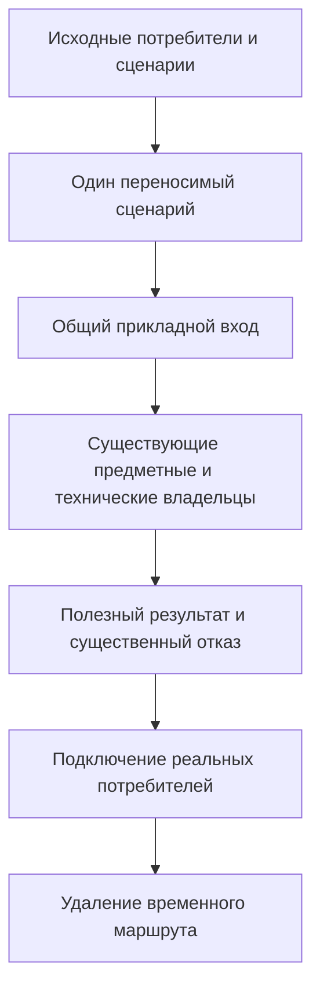

### Временная граница допустима, если она действительно временная ⏳

Во время миграции могут существовать старые немигрированные сценарии и переходные test seams. Их наличие не обязательно является дефектом. Опасно, если уже перенесённая операция скрыто продолжает пользоваться прежним обходом или временный путь остаётся навсегда без владельца завершения.

В облачной утилите временное двойное тестовое подключение было заранее отделено от runtime fallback. Поздний cleanup-срез имел проверки, которые обнаруживали сохранение старой orchestration. Прежние compatibility-тесты сами по себе не доказывали, что временный путь уже удалён. [П3, MC-07][cloud]

Для архитектуры достаточно определить: какой сценарий уже мигрирован, какой ещё нет, где допустим переходный код и по какому наблюдаемому условию он исчезнет.

### Зелёный фасад не закрывает обходные входы 🚪

Если GUI продолжает напрямую менять repository, наличие нового `ApplicationAPI` рядом не делает его владельцем всех правил. Если MCP создаёт второй runtime вместо использования нужного, одинаковые классы не обеспечивают общую очередь.

Исследование загрузчика показывает именно такой тип работы: API существовал раньше, но требовалось переподключить фактических потребителей и определить ownership. [П4, §3.1; §5][downloader]

Следовательно, завершение миграции проверяется не числом новых методов, а отсутствием **непредусмотренных обходов конкретного перенесённого сценария**.

### Рост требований не следует скрывать в обязательной архитектуре 🧭

У синхронной утилиты может не быть адресуемых Job, IPC и восстановления после падения. Если эти возможности не обещались, их отсутствие не является остатком незавершённого command-first.

Практический конвертер имел прогресс и остановку внутри одного вызова без Job Manager. Загрузчик нуждался в задачах между отдельными обращениями. Облачная утилита сохраняла синхронный сценарий без собственного cancel API. [П1, §4.2–4.4][practice]

Материал о вариантах архитектуры уже объясняет эту развилку. Практическое дополнение состоит в другом: **сценарий переносится целиком в выбранных границах, но не разрастается до всех возможных будущих гарантий**.

---

<a id="worked-example"></a>
## 22. Сквозной пример: пакет подготовлен, результат полезен, продолжение требует осторожности 🎬

Ниже описан **учебный сценарий**, собранный из разобранных принципов. Это не реконструкция ещё одной исторической разработки и не готовый протокол безопасного удаления.

Условная утилита преобразует несколько изображений, публикует новые результаты без замены существующих файлов и поддерживает отдельно допущенное удаление источников после проверки. Агент вызывает тот же прикладной API, что и GUI. Сам GUI лишь отображает результаты по контракту статьи №5.

### Вход содержит намерение, а приложение определяет эффективные параметры 📨

Агент передаёт список источников, формат и явное качество `0`. В выбранном учебном контракте ноль допустим. Поэтому адаптер не заменяет его на 80 через проверку истинности.

Если профиль не указан, общий resolver выбирает его по документированному порядку. Отсутствие профиля не превращается в явно выбранный `default`. Запрос разрушительного режима проходит отдельный допуск; произвольный клиентский `approved=true` не является доказательством полномочий.

План фиксирует входы и цели. Возможные коллизии проверяются до начала записи. Preview не обещает, что файловая система останется неизменной; перед эффектом действуют окончательные проверки.

### Первый элемент завершается полностью ✅

Приложение проверяет допустимость исходного контейнера до потери значимых свойств, готовит растр и кодирует staging. При сверке прозрачности учитывается фактическое подготовленное содержимое, а не одно наличие канала A в исходнике.

Результат публикуется выбранным no-replace-механизмом, учитывается и проверяется в конечной области. Последующее действие над источником завершается с достаточным подтверждением. Для первого элемента есть определённый итог.

### У второго элемента полезный файл готов, но судьба источника не подтверждена 🌫️

Конвертация и публикация второго файла завершились. После отдельного действия над источником подтверждение получить не удалось. Приложение не оставляет старое значение `retained`, не сообщает `deleted` и не удаляет готовый output ради внешней симметрии.

В выбранной политике неизвестный исход разрушительного действия прекращает запуск последующих элементов. Эта политика — отдельное учебное решение; другой продукт может иметь иной допустимый режим, но он должен быть явным.

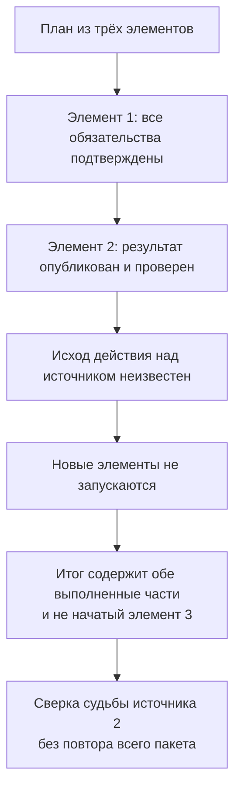

### Итог сохраняет структуру знания 📋

| Элемент | Конвертация | Публикация | Судьба источника | Следующее действие |
|---|---|---|---|---|
| 1 | Успешна | Проверена | Удаление подтверждено в выбранном протоколе | Дополнительной работы нет |
| 2 | Успешна | Проверена | `unknown` | Ограниченная сверка именно этого источника |
| 3 | Не начиналась | Нет эффекта этой операции | Не затрагивался этой операцией | Новый допуск, если выполнение будет продолжено |

Общий partial-итог не стирает первый результат и не перекрашивает второй в «ничего не произошло». Отмена или остановка дальнейшего выполнения не превращает не начатый третий элемент в ошибочно сконвертированный.

### Действия агента опираются на факты, а не на цвет статуса 🤖

Агент не повторяет весь запрос из-за неполного успеха. Не добавляет overwrite, чтобы обойти занятые результаты. Не удаляет источник по совпавшему имени. Не трактует неизвестность как разрешение попробовать опасный вызов ещё раз.

Он может запросить предусмотренную сверку или передать человеку конкретную границу: полезный файл создан, подтверждение судьбы исходника отсутствует. Если приложение не предоставляет безопасный способ дальнейшего действия, это ограничение не заполняется догадкой модели.

Именно такой контракт делает приложение пригодным для автоматизации: клиент получает не только команды, но и достаточно точную модель последствий, чтобы **не усугублять ошибку следующей командой**.

---

<a id="operation-passport"></a>
## 23. Компактный паспорт операции: достаточно конкретики без второго регламента 📓

Практические ошибки легко превратить в бесконечный checklist. Более полезен небольшой паспорт конкретного сценария, в котором каждый пункт отвечает на наблюдаемый вопрос.

Это может быть раздел существующего контракта или задания. Отдельный файл на каждую строку не требуется.

### Пример для операции преобразования и публикации 📄

| Вопрос | Пример определённого ответа |
|---|---|
| **Что выполняется?** | Преобразование явно выбранных входов и публикация новых результатов |
| **Что не входит?** | Неявный overwrite, автоматический replay после неизвестного исхода, управление независимым процессом |
| **Кто владеет сценарием?** | Один прикладной обработчик; кодек и файловый адаптер реализуют узкие порты |
| **Как трактуются параметры?** | Отсутствие отдельно от явного нуля/false/пустой строки; resolver один |
| **Какие ранние отказы существенны?** | Неподдержанный режим и отсутствие необходимого допуска до опасного действия |
| **Что фиксируется до работы?** | Набор входов, эффективные параметры и рассчитанные цели |
| **Что перепроверяется у эффекта?** | Актуальность объектов, разрешённая область и условия публикации |
| **Когда возникает результат?** | После известной публикации он учитывается, даже если последующая проверка откажет |
| **Что означает успех?** | Все обязательные постусловия выбранного режима подтверждены |
| **Что остаётся при partial?** | Поэлементные факты и известные артефакты не теряются |
| **Как обрабатывается unknown?** | Не подменяется отсутствием эффекта; предусмотрена ограниченная сверка |
| **Что очищается?** | Только приобретённые и всё ещё допустимые к очистке собственные ресурсы |
| **Какие клиенты затронуты?** | Реальные GUI, CLI, прямой API и опубликованные агентные адаптеры |
| **Что изменилось относительно прежней версии?** | Отдельно сохранённое, исправленное, временно ограниченное и согласованно исключённое |

Такой паспорт не заменяет код и тесты. Он делает явным, **что именно они должны подтверждать**.

### Карта минимальных исправлений 🛠️

| Наблюдённая проблема | Где находится причина | Достаточное направление исправления |
|---|---|---|
| Omitted-параметр перекрывает окружение | Адаптер и resolver | Сохранить наличие/происхождение значения |
| Metadata закрывает нужный ранний отказ | Порядок прикладного допуска | Восстановить значимые зависимости проверок |
| Допустимое изображение отвергается по alpha-mode | Предметная image-policy | Проверять реальное требуемое свойство |
| Исходная точность потеряна до проверки | Граница декодирования | Проверить значимый признак до преобразования |
| Ответ противоречит своему фильтру | Query projection | Один согласованный снимок через отбор и mapping |
| Файл другой задачи объявлен своим | План имён и attribution | Использовать достаточную существующую идентичность |
| Ошибка скрывает уже опубликованный результат | Учёт эффектов и error boundary | Сохранить известные последствия в итоговом контракте |
| Cleanup закрывает чужой поздний ресурс | Владелец lifetime | Учитывать приобретённое, а не разность коллекций |
| Повторная redaction меняет данные | Прежний владелец безопасной проекции | Исправить композиционную устойчивость без удаления защиты |
| Временный отказ стал исчезновением функции | Граница требований | Явно решить судьбу пользовательского сценария |

Строки опираются на случаи, разобранные в статье. Они не образуют универсальный список обязательных подсистем. Ни одна из этих причин сама по себе не требует шины команд, нового брокера или второго реестра схем.

### Пример не всегда означает нехватку правила 🧠

Сравнительное исследование отмечает, что многие необходимые нормы уже присутствовали в применённой методике: один владелец, различие принятия и результата, учёт частичных эффектов, owned/borrowed, безопасный повтор. Найденная ошибка не всегда доказывает отсутствие нужного текста. [П1, §15.1][practice]

Поэтому полезно различать исправление неоднозначной формулировки, добавление хорошего контрпримера и ремонт исполнения уже достаточного правила.

Если проблема заключалась в неподтверждённом решении убрать функцию, ещё одна диаграмма слоёв её не устранит. Если причиной был второй live-read в mapper, общий лозунг «состояние должно быть согласованным» не заменит конкретную поправку. Если документация обещала безусловную сохранность после неизвестного эффекта, исправление действительно требуется в самом обещании.

---

<a id="conclusion"></a>
## 24. Итог: достоверный контракт важнее одинакового фасада 🧭

Практика не отменяет command-first. Она показывает, за счёт чего этот подход становится полезным и где заканчивается его автоматическое действие.

Общий прикладной вход позволяет сосредоточить правила и исправлять их для всех клиентов. Но сохранение сценариев требует работы с требованиями. Корректный вход требует различать форму и намерение. Правильный результат требует предметной идентичности. Безопасное продолжение требует знания о последствиях. Совместимость требует понимания решений реальных потребителей.

В центре остаётся короткая последовательность:


Она одинакова по смыслу для GUI, CLI и агента. Отличаются способы ввода, доставки и представления, но не право переиначить уже произошедшее.

> [!summary] Практическая формула
> Хороший контракт сохраняет не только имя операции и форму DTO, но и намерение, область полномочий, условия эффекта и границу знания о результате. Он не выдаёт временную неподдержку за перенесённую функцию, существующий файл — за свой артефакт, тайм-аут — за откат, неизвестность — за сохранность, а полезный частичный результат — за отсутствие работы.

### Переход к следующему материалу 🔬

Следующая статья посвящена проверке и поставке: как подтвердить эти обещания реальными путями, различить дефект продукта и ошибку стенда, сохранить границы доказательства и связать принятые исходники с приложением, которое получает пользователь.

Это следующий вопрос, а не дополнительное обещание данной статьи. Здесь определено, **что должно оставаться истинным**. Далее требуется установить, **какие наблюдения действительно подтверждают эту истину**.

[К статье №5 — «Живой GUI и общее ядро: состояние, выполнение и контроль»][a5] · [К статье №2 — «Слои, контракты и управляемое выполнение»][a2].

---

<a id="sources"></a>
## Источники, происхождение примеров и границы применимости 🔗

Материал сочетает практические наблюдения из предоставленных исследований, их архитектурное объяснение и явно обозначенные учебные модели. Приложения, исходные Git-объекты, пользовательские среды и платформенные сценарии заново не исполнялись.

Исторические статусы не обновлены предположениями: поздний кандидат удаления конвертера и следующий нативный срез загрузчика не объявлены окончательно принятыми. Случаи поискового ядра используются по сравнительному документу, а не по отсутствующим здесь первичным отчётам. Из количества примеров не выводятся частота ошибок, стоимость разработки или превосходство конкретной команды и модели.

### Практический корпус 📚

Обозначения П1–П4 действуют в этой статье. Ссылки относительные: исходные отчёты открываются, если находятся рядом с ней под указанными именами. Наличие ссылки не означает публикации отчёта в интернете.

| Обозначение | Материал | Использованная область |
|---|---|---|
| **П1** | [Command-first на практике: сравнительный документ][practice] | Различия проектов, миграция, семантика, эффекты, поисковое ядро, адресные уточнения серии |
| **П2** | [Конвертер: ядро, CLI и качество миграции][compressor] | Defaults, manifest, image-policy, публикация, известные артефакты, отказ удаления и поздний кандидат |
| **П3** | [Облачная утилита: Command-first и сохранение поведения][cloud] | Существующие владельцы, precedence, допуск, batch, redaction, неоднозначная внешняя запись и переходные пути |
| **П4** | [Загрузчик: Command-first и границы поставки][downloader] | Согласованные query, принадлежность файлов, runtime, persistence, native unknown, owned/borrowed и wire-нюансы |

### Карта важнейших практических привязок 🗺️

| Разбор в статье | Опорное место исследования | Сохранённая граница |
|---|---|---|
| Потеря функции при безопасном отказе | П2, §6.4; П1, §3.4 | Отказ был явным; недостаточно установлено основание окончательного исключения |
| Default профиля и приоритет ошибок | П3, MC-03 и MC-06 | Конкретные исправления миграции, не новый универсальный порядок всех проверок |
| Альфа и исходная точность | П2, §6.2–6.3 | Подтверждённые исторические дефекты и ремонты; не новый прогон кодеков |
| Активная проверка под видом status | П1, §5.8 | Статический маршрут; фактическая текущая отправка и стоимость не установлены |
| Семантическая идентичность модели | П1, §5.7 | Историческое несоответствие маршрута; не утверждение о повреждении пользовательских данных |
| Снимок от capture до mapping | П4, кейс 2 | Реальная логическая гонка с подменённой внешней download-границей |
| Присвоение чужого артефакта | П4, кейс 3 | Подтверждённый конфликт внутри изученного runtime; не полная межпроцессная песочница |
| Публикация и unverified | П2, §4.3–4.4 | Конкретная файловая гарантия, не общая транзакция и не power-loss proof |
| Сверка вместо повтора cloud write | П3, MC-08 | Историческая проверка на собственных ресурсах; не нынешний облачный запуск |
| Поздний borrowed handler | П4, кейс 5 | Конкретный дефект владения и его ремонт, не необходимость нового logger |
| Native Trash с неизвестным исходом | П4, кейс 4; §8.4 | Авторское наблюдение без конечной независимой приёмки соответствующего среза |
| Directory guard и lexical path | П2, §6.8–6.9 | Ошибки позднего кандидата и проверенные исправления в ограниченной области |
| Новые исходы удаления | П2, §6.10 | Кандидат и связанные consumer-проверки, не окончательно поставленная версия |
| Стабильность безопасной проекции | П3, MC-04 | Доказанное расхождение результатов; не доказанная утечка секретов |
| Удаление временного маршрута | П3, MC-07 | Проверяемое завершение конкретной staged-миграции |

### Внешние первичные источники ⚙️

Внешняя документация проверена **26 октября 2026 года**. Она используется для названных общих понятий; наблюдения о конкретных проектах подтверждаются практическим корпусом выше.

| Источник | Что уточняет |
|---|---|
| [Martin Fowler — Definition of Refactoring][refactoring] | Отличие изменения структуры от изменения наблюдаемого поведения |
| [Google AIP-180 — Backwards compatibility][api-compatibility] | Source, wire и semantic compatibility; зависимость требований от модели обновления клиентов |
| [JSON Schema — Annotations][json-defaults] | `default` как аннотация, а не обязательная вставка значения валидатором |
| [OWASP — Input Validation][input-validation] | Структурная и семантическая допустимость входа; границы валидации |
| [OWASP — Authorization][authorization] | Минимальные полномочия и проверка доступа на относящихся запросах |
| [IETF RFC 9110 — HTTP Semantics][http-semantics] | Идемпотентность и условия автоматического повтора |
| [AWS Builders’ Library — Making retries safe with idempotent APIs][idempotent-api] | Идентичность намерения, учёт повторов и конфликт параметров |
| [Microsoft — Compensating Transaction][compensation] | Отдельное восстановление последствий, не автоматический rollback всего процесса |
| [Microsoft — CreateFileW][create-file] | Раздельная семантика доступа, sharing и файлового handle |
| [IETF RFC 9457 — Problem Details for HTTP APIs][problem-details] | Машиночитаемая форма ошибок на HTTP-границе |

### Связанные статьи серии 🧭

[01 — Знакомство][a1] · [02 — Архитектура и контракты][a2] · [03 — Вариации архитектуры][a3] · [04 — Конвертер изображений][a4] · [05 — Живой GUI и общее ядро][a5].

[a1]: 01_Command_First_Introduction.md
[a2]: 02_Command_First_Architecture_and_Contracts.md
[a3]: 03_Command_First_Architecture_Variants.md
[a4]: 04_Command_First_Image_Converter_Architecture.md
[a5]: 05_Command_First_Live_GUI_Backend.md
[practice]: COMMAND_FIRST_PRACTICE.md
[compressor]: 01-core-cli-and-command-first.md
[cloud]: 01-command-first-and-architecture.md
[downloader]: 01-command-first-and-scope.md
[refactoring]: https://martinfowler.com/bliki/DefinitionOfRefactoring.html
[api-compatibility]: https://google.aip.dev/180
[json-defaults]: https://json-schema.org/understanding-json-schema/reference/annotations
[input-validation]: https://cheatsheetseries.owasp.org/cheatsheets/Input_Validation_Cheat_Sheet.html
[authorization]: https://cheatsheetseries.owasp.org/cheatsheets/Authorization_Cheat_Sheet.html
[http-semantics]: https://www.rfc-editor.org/rfc/rfc9110.html#name-idempotent-methods
[idempotent-api]: https://aws.amazon.com/builders-library/making-retries-safe-with-idempotent-APIs/
[compensation]: https://learn.microsoft.com/en-us/azure/architecture/patterns/compensating-transaction
[create-file]: https://learn.microsoft.com/en-us/windows/win32/api/fileapi/nf-fileapi-createfilew
[problem-details]: https://www.rfc-editor.org/rfc/rfc9457.html
