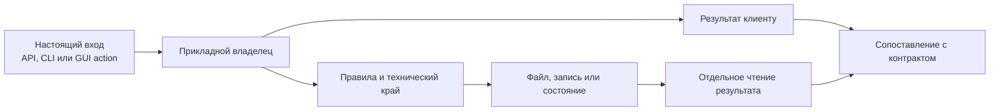
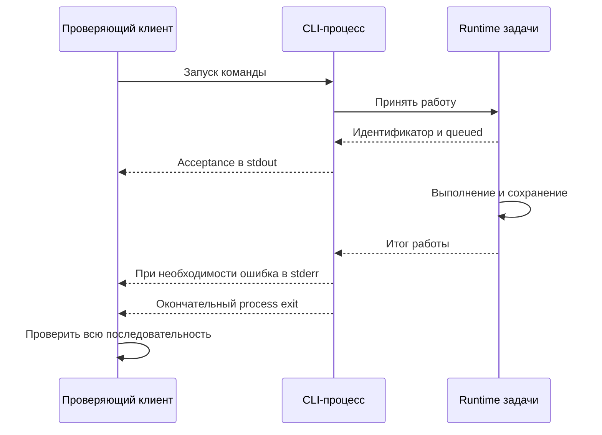
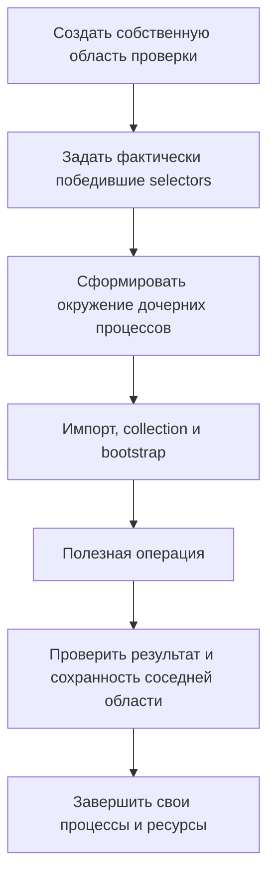
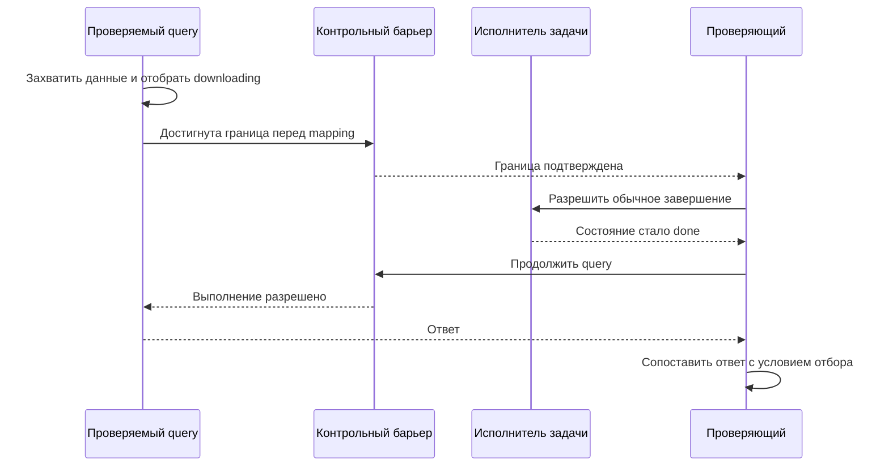
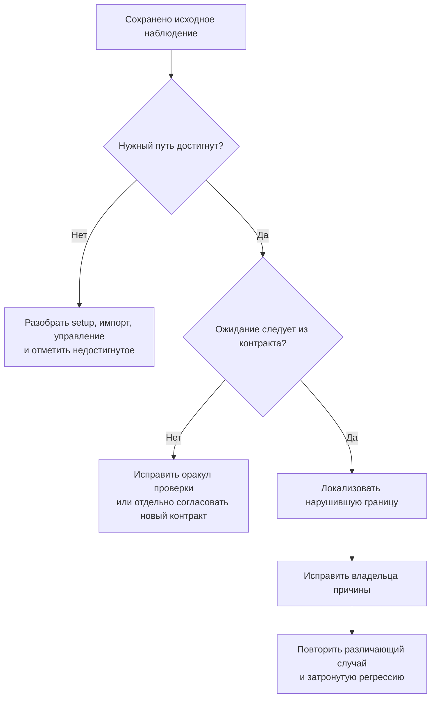
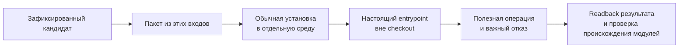
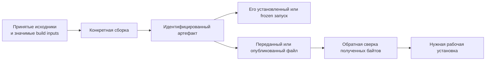
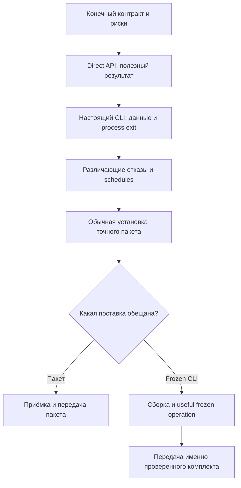
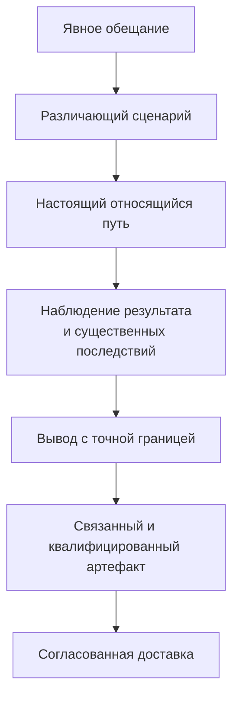

## 07 — Проверка и поставка command-first-приложения: от контракта до работающего артефакта 🧭

*Как подтвердить обещания общего ядра, отличить ошибку программы от ошибки проверки и довести принятый результат до того приложения, которое действительно запускает человек или агент.*

У приложения появился общий API. Все необходимые команды существуют, типы проверяются, тесты завершаются успешно. Графический интерфейс обращается к тому же сценарию, что и CLI. Сборщик создал исполняемый файл.

Тем не менее несколько важных вопросов ещё остаются открытыми. Действительно ли тест прошёл через нужную реализацию? Не получил ли он заранее правильный результат от подставного сервиса? Были ли проверены последствия ошибки после записи файла? Установленный пакет импортируется из своей среды или незаметно из рабочего каталога? Включена ли принятая правка в переданный бинарник? И что именно означает итоговое слово «готово»?

Эта статья посвящена **проверке обещаний и связи между проверенным кодом и поставленным продуктом**. Она не предлагает заменить разработку бесконечной системой отчётов. Её цель противоположна: сделать проверки достаточно различающими, а завершение работы — достаточно определённым, чтобы не проверять одно и то же без причины и не объявлять непроверенное выполненным.

> [!abstract] Главная мысль
> Проверка полезна, когда связывает конкретное обещание, конкретную реализацию и наблюдаемый результат. Поставка полезна, когда сохраняет эту связь до конкретного переданного артефакта. Ни количество тестов, ни успешная сборка, ни название архитектурного паттерна не заменяют такую цепочку.

### Место статьи в серии 📚

[Статьи 01–03][a1] вводят общий язык операций, объясняют [границы и контракты][a2] и помогают выбрать [достаточную архитектуру][a3]. [Статья 04][a4] рассматривает проект конвертера изображений. Практическое продолжение разделено по ответственности: [статья 05][a5] разбирает связь GUI с backend, а [статья 06][a6] — сохранение смысла операций, совместимость и последствия.

Седьмой материал отвечает на следующий вопрос: **какие наблюдения позволяют считать эти свойства подтверждёнными и как не потерять подтверждение на пути к пользователю**.

| Предыдущий вопрос | Вопрос этого материала |
|---|---|
| Кто должен владеть правилом? | Как установить, что реальный клиент действительно использует этого владельца? |
| Что означает частичный результат? | Как получить различающий случай и проверить его реальные последствия? |
| Как устроена отмена? | Как подтвердить запрос, реакцию исполнителя, остаточные эффекты и освобождение ресурсов? |
| Как GUI связан с ядром? | Какая проверка достигает настоящего действия, а не только отображает заранее подготовленный DTO? |
| Что должно входить в поставку? | Как связать исходники, пакет, ресурсы, бинарник и фактический запуск? |

Визуальное проектирование, FigCraft, выбор шрифтов и оформление контролов остаются за границей статьи. GUI рассматривается как **потребитель общего API и участник жизненного цикла выполнения**. Примеры Python-пакетов и Windows-бандлов иллюстрируют общие принципы; материал не привязан к одному языку.

### Практическая основа и границы утверждений 🔎

Исторические случаи взяты из предоставленных исследований конвертера, облачной утилиты, загрузчика и сравнительного документа. Их временная граница — **25 октября 2026 года, 16:51:37.796228 UTC+05:00**. Это граница исследованной истории, а не дата новой проверки продуктов. Статья не запускает эти приложения, не обращается к их рабочим хранилищам и не выдаёт нового решения об их готовности. [П1, §1; §17][practice]

В тексте сохраняются три уровня: **практический случай** из исследования, **инженерный вывод** из его механизма и **предлагаемая проверка** для похожей системы. Последняя не объявляется выполненной. Для поискового приложения используются только сведения сравнительного документа; упомянутые им дополнительные отчёты не выдаются за самостоятельно проверенный первичный корпус.

Внешняя документация используется отдельно: она уточняет возможности инструментов тестирования, установки, сборки и контроля происхождения. Она не подтверждает задним числом конкретный запуск исследованного продукта.

### Карта чтения 🗺️

> [!info] Маршруты по статье
> **Основания:** [проверяемое обещание](#claims) → [идентичность проверяемого объекта](#subject) → [статусы и границы знания](#statuses).
>
> **Содержательная проверка:** [соединённый путь](#connected-path) → [тестовые двойники](#doubles) → [различающий пример](#discriminators) → [границы и адаптеры](#boundaries).
>
> **Трудные случаи:** [изоляция](#isolation) → [конкуренция](#concurrency) → [отмена и ресурсы](#lifetime) → [native-гарантии](#native) → [сбой после эффекта](#effects) → [диагностика провала](#failure-analysis).
>
> **Поставка:** [установленный пакет](#installed) → [полнота сборки](#bundle) → [нативная и внешняя среда](#environment) → [происхождение артефакта](#provenance) → [приёмка](#acceptance) → [повторное использование проверок](#reuse) → [доставка](#delivery).
>
> **Применение без бюрократии:** [сквозной маршрут](#worked-route) → [компактная передача результата](#handoff) → [критерий завершения](#finish-line).

---

<a id="claims"></a>
## 1. Проверяется обещание приложения, а не наличие паттерна 🎯

Фраза «command-first внедрён» слишком широка для теста. Она может означать, что логика вынесена из окна, что CLI стал тонким адаптером, что агент подключён к живой очереди или что приложение получило управляемые операции с надёжным хранением. Это разные утверждения.

Проверка начинается с наблюдаемого обещания. Например: публичный библиотечный вход преобразует изображение без установленного GUI-фреймворка; существующий выходной файл не заменяется; человек может запросить остановку работы, начатой агентом в том же runtime; установленная команда получает те же предметные результаты, что и прямой API.

Каждое обещание требует собственного способа опровержения. Если невозможно объяснить, при каком наблюдении проверка должна провалиться, её зелёный результат мало что добавляет.

### Из архитектурного лозунга — в наблюдаемое свойство 📐

| Общая формулировка | Более точное обещание | Недостаточная проверка |
|---|---|---|
| Ядро не зависит от GUI | Полезная операция выполняется при отсутствии GUI-зависимостей | Импорт одного лёгкого модуля |
| Все оболочки используют один сценарий | Настоящие входы достигают общего владельца правил и сохраняют результат | Сравнение двух заранее построенных DTO |
| Публикация безопасна | Существующий или конкурентно появившийся объект не заменяется | Проверка `exists()` до запуска |
| Остановка работает | Запрос достигает исполнителя, итог и оставшиеся эффекты соответствуют контракту | Вызов метода с названием `cancel` |
| Сборка готова | Нужная операция выполняется из передаваемой поставки вне исходного каталога | Успешный запуск сборщика |
| Исправление доставлено | Пользовательский артефакт связан с исправленными исходниками и проверен в своей форме | Коммит исправления без новой сборки |

Таблица — предлагаемая форма уточнения требований, а не универсальный список обязательных проверок. Для библиотеки, которую не планируется поставлять как EXE, последний вид проверки не нужен.

Общая идея тестирования поведения через публичный API, а не случайной последовательности внутренних вызовов, рассматривается в [Google Testing Blog][test-behavior]. Но у command-first есть важная особенность: некоторые **архитектурные границы сами являются требованием**. Например, возможность использовать ядро без Qt. Для неё допустима целевая проверка импортов и состава поставки — вместе с полезным выполнением, а не вместо него.

### Отсутствие нарушения ещё не доказывает полезность 🔍

Пустая программа может не удалять исходники, не отправлять секреты и не создавать лишних потоков. Эти свойства ничего не говорят о её способности выполнить задачу.

Поэтому полезная проверка обычно соединяет две стороны: **нужный результат появляется, недопустимый эффект не происходит**. Конвертация создаёт читаемый файл и сохраняет исходник. Отказ по конфликту не перезаписывает чужие байты и не ломает следующий допустимый вызов. Безопасный журнал содержит необходимые сведения, но не содержит запрещённого содержимого.

Это не требование всегда проверять всё в одном большом тесте. Это требование к общему основанию вывода: безопасность не должна доказываться отключённой функциональностью, а работоспособность — ценой нарушения заявленных ограничений.

### Масштаб проверки следует за масштабом обещания 🧭

В практическом корпусе облачная утилита получила синхронный API без Job Manager, а конвертер — синхронный сценарий с локальным прогрессом и отменой. Загрузчик имел адресуемую очередь и общего владельца для GUI и встроенного MCP. Проверять у первых двух восстановление долговечной очереди означало бы проверять незаказанную архитектуру. Не проверять принадлежность файлов у загрузчика означало бы пропустить настоящее обещание. [П1, §4.2–4.5][practice]

**Инженерный вывод:** корректный план проверки начинается не с максимальной матрицы, а с конечного набора обязательств и явно названных нецелей.

---

<a id="subject"></a>
## 2. У проверки есть точный объект, а не только название проекта 🪪

Сообщение «тесты прошли» теряет смысл, если неизвестно, какие байты были выполнены. Рабочая копия могла измениться во время прогона. Установленный пакет мог остаться прежним. Новый бинарник мог получить старые ресурсы. Проверяющий мог импортировать модуль из checkout вместо установленной поставки.

Поэтому свидетельство о проверке относится не к абстрактному проекту, а к конкретному сочетанию условий.

```text
Проверяемое обещание
+ редакция контракта
+ исполняемые исходники или артефакт
+ зависимости и сборочные входы
+ среда и полномочия процесса
+ входные данные и расписание событий
+ способ наблюдения
= область применимости результата проверки
```

Это модель рассуждения, не обязательная схема новой базы данных.

### Что требуется связывать 📎

| Измерение | Пример вопроса | Почему одного имени недостаточно |
|---|---|---|
| Контракт | Какой отказ считается правильным? | Новый тест может ожидать ещё не согласованное поведение |
| Исходники | Какой коммит или зафиксированный набор файлов выполнялся? | Ветка и рабочий каталог изменяемы |
| Артефакт | Какой wheel, архив или bundle запускался? | Одинаковый номер версии допускает разные сборки |
| Зависимости | Какой кодек, runtime и plugin были доступны? | Одинаковый Python-код не означает одинаковое исполнение |
| Среда | Какая ОС, файловая система и модель прав? | Elevated-проверка не подтверждает обычный пользовательский режим |
| Стенд | Какие края подменены и какие барьеры установлены? | Настоящий callback может относиться к синтетической сети |
| Наблюдение | Что перечитано после выполнения? | Полученный JSON может не соответствовать сохранённым данным |

Для маленького изменения достаточна короткая запись этих условий в существующем результате проверки. Не требуется создавать отдельный «паспорт» на каждый импорт.

### Замороженный кандидат не обязан означать остановку всей разработки 🧊

Кандидат для приёмки — конкретный набор исходников и входов сборки, который не меняется незаметно во время относящихся проверок. Это может быть коммит, архив или инвентарь файлов с хешами. Последний вариант требует особенно аккуратно учитывать зависимости и неучтённые файлы.

Параллельная работа допустима в непересекающейся области. Но если проверяемая функция импортирует модуль, который в это время меняется, формальная неизменность одного файла с функцией ничего не гарантирует. Граница кандидата должна охватывать значимые исполняемые зависимости либо запускаться из отдельного неизменного снимка.

В загрузчике техническую приёмку и последующее сохранение разделили: проверенный набор путей сохранялся отдельно, а следующая работа могла продолжаться в непересекающихся файлах. Исследование описывает это как конкретный успешный режим с одним владельцем Git index, а не как право коммитить произвольное содержимое общего dirty tree. [П4, кейс 8][downloader]

### Хеш отвечает на узкий вопрос 🔢

Хеш помогает установить совпадение байтов при выбранном способе вычисления. Он не доказывает, что программа правильна, что именно эти байты исполнялись или что описанный запуск действительно состоялся.

Полезная цепочка включает и идентичность, и действие: определённый артефакт был запущен определённым способом; получены сохранённые наблюдения; они сопоставлены с конкретным ожиданием. Наличие файла `manifest.json` без такой связи — ещё не свидетельство работоспособности.

> [!important] Проверенная версия — не «последняя»
> Результат сохраняет привязку к своему объекту. Более поздний коммит не наследует приёмку целиком только потому, что расположен дальше в той же ветке. Более ранний принятый бинарник не становится новым от изменения исходников рядом с ним.

---

<a id="statuses"></a>
## 3. Результат теста, исход операции и решение о готовности — разные оси 🚦

Продукт способен корректно отказать, тест — успешно подтвердить отказ, а общая поставка — оставаться незавершённой из-за другого обязательного сценария. В обратную сторону тоже нет автоматического перехода: ошибка стенда не доказывает дефект продукта, а успешный технический результат не подтверждает его доставку.

Смешение этих состояний особенно опасно в агентной разработке. Один слой печатает `exit 0`, следующий пересказывает его как «всё прошло», а итоговая сводка превращает это в «пользователь получил исправленное приложение».

### Четыре независимых вопроса 📋

| Ось | Возможные значения по смыслу | Что она не заменяет |
|---|---|---|
| **Исполнение проверки** | Не запущена, запущена, прервана, закончена | Оценку предметного результата |
| **Проверяемое утверждение** | Подтверждено, опровергнуто, недостаточно данных, нужная ветка не достигнута | Судьбу файлов и внешних эффектов |
| **Исход операции продукта** | Успех, корректный отказ, частичный результат, отмена, неизвестный эффект | Решение о готовности всей поставки |
| **Приёмка и доставка** | Кандидат проверяется, принят в указанной области, сохранён, опубликован, установлен | Безошибочность во всех средах |

Это аналитическое разделение. Конкретная команда может использовать другой набор полей. Важно не кодировать все четыре оси одним `ok`.

### Что означает ожидаемый ненулевой код ✅

Если CLI обязан вернуть код ошибки при недопустимых параметрах, правильный negative case получает ненулевой код продукта. Проверяющий процесс при этом может завершиться с нулём, потому что ожидание выполнено.

В учебной квитанции это различие видно явно:

```json
{
  "example_only": true,
  "case": "reject_unsupported_input",
  "product_exit": 2,
  "expected_product_exit": 2,
  "output_created": false,
  "source_preserved": true,
  "assertions_passed": true,
  "verifier_exit": 0
}
```

Код `2` здесь условен и не предписывается всем CLI. Значение берётся из контракта конкретного продукта.

В облачной утилите проверяющий действительно ошибся, потребовав нулевой выход у всех команд, включая специально ожидаемые отрицательные и частичные исходы. Исправили карту ожиданий стенда, а не заставили продукт возвращать ложный успех. [П3, MC-09][cloud]

Даже у самого test runner коды различают причины завершения: например, pytest отдельно обозначает провал тестов, внутреннюю ошибку, ошибку использования и отсутствие собранных тестов. Поэтому один «ненулевой код» недостаточен для диагноза. [pytest — Exit codes][pytest-exits]

### NOT_RUN, UNREACHED и неизвестный эффект нельзя смешивать 🌫️

`NOT_RUN` означает, что проверка не выполнялась. `UNREACHED` полезно использовать, когда запуск состоялся, но нужная ветка не была достигнута. Например, ранний отказ не позволил испытать блокировку итогового файла.

Неизвестный эффект — другая ситуация: действие уже могло произойти, но его исход не подтверждён. В нативной проверке Корзины загрузчика исходный файл после попытки отсутствовал, а место назначения и восстановление не были установлены. Это не просто отсутствие теста и не доказательство безопасного сохранения. [П4, кейс 4][downloader]

Если отсутствующая проверка обязательна для выпуска, её `NOT_RUN` оставляет соответствующее обязательство открытым. Если условие вне согласованной области, оно ограничивает формулировку результата, но не превращается автоматически в новый блокер.

> [!warning] Честный статус не равен разрешению выпускать
> Корректно сообщённый `unknown` лучше ложного успеха. Но если продукт обещал подтверждённое восстановимое удаление, одно умение описывать неизвестность не выполняет это обещание. Решение о допустимой границе принимается отдельно и не выводится из правильного сообщения об ошибке.

---

<a id="connected-path"></a>
## 4. Соединённая проверка проходит через настоящий смысловой путь 🔗

У каждого слоя могут быть зелёные тесты, а целый сценарий всё равно способен работать неправильно. GUI вызывает не тот сервис. CLI нормализует параметры иначе. Serializer теряет `False`. Установленная команда загружает старый модуль. Событие об успехе относится к чужому файлу.

Поэтому наряду с локальными тестами требуется хотя бы несколько проверок, которые соединяют реальные границы.



Схема не требует реальной внешней сети для каждого прогона. Она требует не подменять **предмет проверки** заранее правильным результатом.

### Что подтвердили практические пути 🔬

В конвертере прямой API и CLI создавали файлы, которые затем отдельно открывали и полностью декодировали. В облачной утилите настоящий CLI проходил через прикладную границу, прежние services и политики; для части проверок заменялся внешний execution edge. В загрузчике проверки гонок сохраняли реальные coordinator, repository и JSON, заменяя сеть и подготовку медиа на инфраструктурной границе. [П1, §11.1][practice]

Это три разных по охвату проверки. Они сильнее parser-only теста, но не тождественны полной эксплуатации со всеми внешними сервисами.

Фраза «сквозной тест» сама по себе не определяет границы. Полезнее уточнение: «CLI → общий сценарий → настоящий файловый результат; сеть заменена локальным источником». Такое описание сообщает больше, чем три буквы E2E.

### Отдельное чтение не означает абсолютную независимость 🪞

Повторное открытие файла проверяет, что результат действительно доступен через сохранённое представление, а не только существует в памяти кодека. Однако тот же декодер может разделять с кодировщиком ошибки интерпретации. Следовательно, readback тем же стеком подтверждает более узкое свойство, чем совместимость со всеми сторонними просмотрщиками.

Для обычной проверки внутреннего результата такой readback полезен. Для обещания внешней совместимости нужен потребитель соответствующего класса. Для свойства исходного контейнера иногда нужен отдельный ограниченный анализ до нормализации. Конкретный уровень независимости выбирается по заявленной гарантии, а не по принципу «второй декодер обязателен всегда».

Эта граница прямо сохранена в сравнительном исследовании: настоящая загрузка локального файла не доказывает работу внешнего extractor, а декодирование своим стеком не квалифицирует все внешние приложения. [П1, §11.1][practice]

### Полезный вертикальный срез не обязан быть огромным 🌱

Один небольшой сценарий может одновременно подтвердить несколько связей: установленная команда принимает параметры, проходит общий API, создаёт результат, сохраняет исходник и возвращает машинно-разбираемый итог. Рядом располагается значимый отказ — например, занятое имя результата.

Такая пара даёт опору для дальнейших локальных тестов. Она не заменяет всю регрессию, но предотвращает ситуацию, когда приложение состоит из отдельно проверенных частей, ни разу не соединённых в реальную работу.

---

<a id="doubles"></a>
## 5. Подмена допустима там, где она не подменяет проверяемую гипотезу 🎭

Тестовые двойники необходимы: они позволяют управлять временем, воспроизводить ошибки и не обращаться к дорогим или опасным внешним системам. Проблема не в наличии fake или mock, а в том, **какое утверждение пытаются подтвердить после подмены**.

Если проверяется преобразование `JobSnapshot` в карточку, заранее заданный снимок уместен. Если проверяется путь от запуска до файла, подмена всего Application API готовым `succeeded` проверяет только способность клиента принять этот ответ.

### Граница подмены зависит от вопроса 🧩

| Проверяемое свойство | Допустимая управляемая подмена | Что должно остаться настоящим |
|---|---|---|
| Представление partial-result | Готовый DTO с известными сочетаниями фактов | Код проекции и выбор отображаемого смысла |
| Порядок допуска | Технический край, учитывающий попытки обращения | Публичный вход, validation и admission |
| Сохранение prior outcomes в batch | Один сбой внешней операции в нужной позиции | Реальный цикл пакета и построение результата |
| Согласованность live-query | Управляемое завершение backend | Владелец задачи, отбор и mapping |
| No-clobber публикации | Барьер перед реальной публикацией | Настоящий primitive файловой системы и проверка байтов |
| Нативная Корзина | Подмена подходит только для политики вызова | Для вывода о Корзине нужен настоящий системный край |
| Frozen dynamic import | Синтетические разрешённые данные | Собранный процесс и настоящая динамическая загрузка модуля |

Такая таблица полезна до запуска: она ограничивает будущие формулировки результата.

### Настоящий SDK ещё не делает всю проверку внешней 🌐

В кейсе двух загрузок с одинаковым названием настоящая библиотека достигала своей ветки skip-existing и настоящего final hook. Сеть и медиа при этом были синтетическими. Это содержательно подтверждало ошибку присвоения артефакта, потому что спорная ветка библиотеки действительно исполнялась. Но оно не проверяло YouTube, cookies и внешнюю доступность. [П4, кейс 3][downloader]

Аналогично локальный HTTP-сервер проверяет реальную передачу по HTTP, но не все условия удалённого сервиса. Подмена не обесценивает результат; она очерчивает его.

### Fault injection и fake результата — не одно и то же ⚡

При fault injection проверка вызывает отказ на определённой границе: сохранение истории не удаётся, наблюдатель бросает исключение, подтверждение внешней операции теряется. Прикладная логика сама должна построить соответствующий исход.

Если вместо этого тест подставляет готовый `Result(persisted=False)`, он уже не проверяет, правильно ли приложение реагирует на реальную ошибку сохранения. Он проверяет только потребителя такого результата.

Оба теста могут быть нужны, но их роли различаются. Особенно опасно использовать второй как доказательство первого.

### Стенд не должен случайно исправлять продукт 🩹

Подмена способна скрыть дефект: fake возвращает всегда уникальный путь, хотя реальный backend повторно использует имя; fake мгновенно завершает поток, хотя настоящий worker живёт после результата; fake parser всегда передаёт явные defaults, скрывая отсутствие параметра.

Поэтому тестовый край должен сохранять существенную для гипотезы неоднозначность. Для проверки гонки имён он допускает совпадение. Для проверки частичного результата — реальный отказ после полезного первого эффекта. Для проверки shutdown — задержку завершения после доставки результата.

> [!tip] Полезный вопрос к двойнику
> Если реальная зависимость нарушит именно исследуемое предположение, способен ли данный стенд это воспроизвести? Если двойник по построению всегда выдаёт благоприятный исход, он не подходит для подтверждения устойчивости к этому случаю.

---

<a id="discriminators"></a>
## 6. Хорошая регрессия различает правильную и неправильную семантику 🔬

Большой набор зелёных примеров может не содержать нужного различия. Все PNG в тестах имеют настоящую прозрачность. Все задачи получают уникальные имена. Все ответы успевают вернуться до следующего запроса. Все ресурсы создаются до входа в проверяемый контекст.

В такой выборке ошибочная реализация и правильная ведут себя одинаково.

**Различающий пример**, или дискриминатор, специально выбирает условие, в котором эти реализации должны разойтись. Он проверяет не название метода, а спорное предположение.

### Пример 1: наличие канала и наличие прозрачности 🖼️

В конвертере verifier сначала требовал альфа-канал, если он присутствовал у исходника. Непрозрачный RGBA с полностью заполненной альфой кодек мог законно сохранить без избыточного канала. Корректный результат отвергался. Контрольный пример с настоящей прозрачностью помог не «исправить» ошибку простым отключением защиты прозрачности. [П2, §6.2][compressor]

Различающая пара здесь такова:

| Вход | Что должно различаться |
|---|---|
| Изображение с альфа-каналом, но без прозрачных пикселей | Допустимость результата без избыточного канала |
| Изображение с действительной прозрачностью | Необходимость сохранить предусмотренную прозрачность |

Проверка только `mode == RGBA` не выражает это различие. После ремонта нужен и прежний контрпример, и соседний допустимый случай, который нельзя сломать.

### Пример 2: состояние после нормализации скрывает исходное свойство 🧬

Другой дефект касался цветного PNG16: после декодирования библиотека представляла данные как обычный RGB/RGBA, хотя исходная точность уже была потеряна. Проверка только высокоуровневого режима не могла подтвердить отказ от неподдерживаемого исходного формата. Отдельный grayscale-пример проходил и не покрывал цветной случай. [П2, §6.3][compressor]

Здесь различающий тест должен установить свойство исходного контейнера, затем провести настоящий публичный сценарий и проверить отсутствие опубликованного результата при требуемом отказе. Подмена декодера готовым флагом `is_high_precision=True` не достигает причины ошибки.

### У теста есть оракул — основание ожидания 📏

**Тестовый оракул** — правило, по которому наблюдение считается правильным или неправильным. Это не обязательно отдельная программа и не обязательно агент с ролью Oracle.

Ожидание должно опираться на действующий контракт. Если новый тест требует от legacy-метода код `NOT_FOUND`, а договорённость пока допускает `code: null`, несовпадение ещё не доказывает дефект продукта. Возможно, требуется отдельно согласовать изменение контракта; возможно, ошибся сам verifier. Такой случай действительно возник в загрузчике. [П4, §6.4; кейс 7][downloader]

Поэтому «тест красный до изменения» необходимо, но недостаточно. Важно, **почему** он красный. Ошибка импорта, неверное поле helper-а и достигнутый неправильный результат — разные основания.

### Положительный контроль защищает от бессмысленного отказа ✅

Если проверяется, что система отвергает опасный вход, рядом нужен допустимый вход, который действительно выполняется. Иначе реализация «отвергать всё» пройдёт проверку безопасности.

Если проверяется блокировка конкурирующего действия, тот же конкурирующий исполнитель должен уметь выполнить его без блокировки или после её освобождения. Иначе причиной отказа могли быть неверный путь, отсутствие прав или неисправный helper.

Положительный контроль не обязательно повторяет весь большой сценарий. Он подтверждает критическое предположение стенда: **условие, которое тест пытается запретить, вообще достижимо**.

### Свойства и последовательности дополняют конкретные случаи 🔁

После понятного контрпримера полезно проверять более широкое свойство. Например, повторная безопасная проекция не меняет уже обработанные разрешённые данные; порядок завершённых элементов сохраняется; чужой результат не становится собственным из-за совпадения имени.

Stateful property-based testing позволяет генерировать последовательности действий и проверять инварианты между ними. В документации Hypothesis отдельно описывается генерация не только входов, но и последовательностей операций. Это возможное усиление проверки состояния, а не обязательный инструмент каждого проекта. [Hypothesis — Stateful tests][stateful-tests]

Генерируемая модель тоже может ошибаться. Если она повторяет дефектный алгоритм продукта, совпадение двух реализаций подтверждает только их общую ошибку. Поэтому исходные конкретные контрпримеры сохраняют самостоятельную ценность.

---

<a id="boundaries"></a>
## 7. Архитектурные и контрактные проверки должны доходить до реальных потребителей 🧱

У command-first есть две группы обещаний. Первая относится к предметному поведению: что делает операция. Вторая — к устройству границ: какой компонент принимает решение и кто вправе его обходить.

Проверка результата не всегда обнаруживает нарушение второй группы. GUI может выдавать правильный файл через собственную копию логики. Пока обе реализации совпадают, функциональный тест зелёный, но исправление общего ядра уже не гарантирует исправления окна.

### Проверка границы не сводится к поиску имени класса 🔍

Для утверждения «прикладной слой не зависит от CLI» полезны анализ импортов и прямой вызов при недоступном CLI SDK. Для утверждения «GUI использует общий сценарий» полезно настоящее действие через GUI-контроллер и проверка того, что оно не публикует файл самостоятельно.

Статический контроль позволяет найти очевидный обход. Динамический — увидеть путь, который действительно исполняется. Ни один не покрывает всё автоматически: произвольный динамический импорт может не быть виден простому анализатору, а один запуск — не пройти все условные ветки.

В облачной утилите финальный этап миграции специально проверял отсутствие прежней CLI-оркестрации и временной двойной тестовой проводки. На предыдущей принятой стадии два новых дискриминатора были красными; совместимость промежуточной миграции сама по себе не доказывала завершённость целевой архитектуры. [П3, MC-07][cloud]

Это пример оправданной структурной проверки: удаление временного маршрута было частью конкретного результата, а не произвольным предпочтением к внутренним именам.

### Direct API проверяется без помощи parser-а 📦

CLI-parser может гарантировать часть типов, но прямой клиент его обходит. Поэтому проверка общего входа должна включать фактически неверные значения, а не только объекты, уже идеально подготовленные терминальной оболочкой.

В практических проектах такие проверки различали отсутствующее значение, ноль и `False`, а также проверяли действительные типы на прикладной границе. Frozen DTO использовался для фиксации запроса, но не объявлялся автоматическим валидатором. [П1, §5.2–5.3][practice]

Проверки схемы, статической типизации и предметного сценария дополняют друг друга. Схема может подтвердить структуру ответа, но не принадлежность файла. Анализатор типов может подтвердить допустимость обращения к полю, но не соответствие фильтру запроса.

### Один смысл не требует побайтного равенства всех оболочек ⚖️

GUI, CLI и MCP могут по-разному оформлять одно событие. Контрактная проверка должна сравнивать именно обещанный уровень: предметные поля, смысл отказа, канал доставки, код завершения и условия ожидания.

Побайтное сравнение уместно, когда формат действительно заморожен или когда сравнивается точная поставка. Для ответа с динамическим временем требуется иной оракул: проверка типа, происхождения и допустимой изменчивости конкретного поля, а не удаление всех неудобных полей из сравнения.

В MailCloud изменялась временная метка каталога между двумя чтениями. Проверяющий уточнил ожидание для этого поля, сохранив строгие проверки остальных данных. Это не стало разрешением принимать любое различие между API и CLI. [П3, MC-09][cloud]

### Матрица совместимости остаётся небольшой 📋

Для затронутой операции достаточно выделить реальные способы вызова и важные классы входов:

| Класс входа | Что проверяется через разные адаптеры |
|---|---|
| Параметр пропущен | Один документированный порядок выбора effective value |
| Параметр передан явно | Он не теряется при совпадении с default или ложным значением |
| Вход отклонён до эффекта | Согласованный смысл отказа и отсутствие недопустимой работы |
| Получен частичный результат | Не теряются уже выполненные элементы и известные артефакты |
| Появилось новое значение статуса | Реальный consumer не трактует его как прежний полный успех |

Не требуется полное произведение всех полей и всех интерфейсов. Выбираются различия, которые адаптер действительно способен исказить, и затронутые решения потребителей.

---

<a id="wire"></a>
## 8. Машинный интерфейс проверяется по реальным байтам, каналам и завершению процесса 📬

Для агента CLI — не только функция с аргументами. Это исполняемый процесс, stdout, stderr, код завершения, возможное ожидание и срок жизни запущенной работы.

Проверка внутреннего `main()` полезна для parser-а и маршрутизации. Она не обязательно проверяет установленный launcher, кодировку, наследование окружения и фактическое завершение процесса.

### Успешное принятие может быть не последним ответом ⏳

В загрузчике самостоятельный `queue add` сначала печатал acceptance с идентификатором задачи. Затем CLI ожидал terminal-состояния и сохранения результата. Поздний отказ мог изменить код выхода и сформировать отдельную ошибку в stderr. Первый JSON в stdout не означал успешную загрузку. [П4, §6.3][downloader]



*Схема отражает конкретный вид контракта. Другой CLI может возвращать один окончательный JSON или завершаться сразу после принятия, если работу сохраняет отдельный сервис.*

### Что проверяется на проводе 🔌

Для выбранного интерфейса фиксируются границы сообщений, допустимые дополнительные строки, кодировка, правило ошибок и момент окончания ожидания. Если stdout предназначен для JSON, диагностическая строка перед ним может сломать клиента, хотя внутренний объект результата корректен.

Для stdio-сервера отдельно проверяется, что обычная диагностика не загрязняет протокольный поток. Для MCP недостаточно увидеть имя инструмента в каталоге: требуется хотя бы полезный вызов через настоящий сервер и клиентский путь в согласованной области. Это не обязывает запускать языковую модель ради проверки детерминированного транспорта.

В корпусе native-проверка загрузчика проходила через настоящий SDK и frozen stdio/HTTP-сервер. Но её статус на исторической границе оставался авторским результатом ещё не завершённой независимой Q2-приёмки. [П4, §8.3–8.4][downloader]

### Код внешнего helper-а не заменяет вложенные результаты 🪆

В одной цепочке могут присутствовать код запускающего процесса, код тестируемой программы и логические поля проверочного JSON. Успешное чтение файла с `match: false` — не успешное совпадение.

В MailCloud outer-команда завершилась с нулём, но её JSON сообщал несовпадение вручную перенесённых контрольных хешей. Отдельный launch guard отказал до назначения работы. Причина находилась в передаче проверочных данных, а не в кандидатных исходниках. [П3, MC-10][cloud]

**Предлагаемая политика:** агрегатор сохраняет сырые коды каждого существенного процесса и отдельно вычисляет результат проверяемых условий. Он не объявляет весь набор успешным только потому, что смог прочитать отчёт.

### Примеры из help тоже являются интерфейсом 🧾

Наличие команды в справке не доказывает исполнимость напечатанного примера. Пример может зависеть от исходного cwd, другого способа импорта или старого правила изоляции.

Проверять буквально все справочные примеры при каждой правке не обязательно. Но изменённый или объявленный основным путь запуска должен совпадать с поставленным интерфейсом. В загрузчике исследование отдельно отмечало статическое расхождение старых help-примеров с каноническим маршрутом тестового запуска; это было рассогласование текста, а не доказанный провал каждой команды. [П4, §9.3][downloader]

---

<a id="isolation"></a>
## 9. Изоляция начинается до импорта и распространяется на дочерние процессы 🛡️

Временный каталог внутри теста не гарантирует, что приложение уже не успело открыть другое хранилище. Конфигурация могла быть прочитана при импорте, пользовательский профиль — выбран переменной окружения, а recovery — выполнен в момент создания runtime.

Поэтому изоляция относится ко **всему пути запуска**, а не только к аргументу `output_dir` последней функции.

### Практический случай: зелёный smoke изменил другой synthetic-профиль 🔎

В загрузчике появился более приоритетный `YTDL_DATA_DIR`. Старый helper менял APPDATA и home, но не этот selector. Настоящий smoke завершился успешно, однако открыл другой специально подготовленный тестовый профиль, создал там writer lease и перевёл незавершённую запись в `INTERRUPTED`. Личные данные в контрпримере не использовались. [П4, кейс 1][downloader]

Причина была тонкой: runtime мог правильно выполнить свою recovery-политику, но стенд направил её не в тот store. Исправление требовалось пути изоляции, а не алгоритму восстановления как таковому.

### Сначала выбирается допустимая среда, затем запускается продукт 🧱



Способ подмены окружения зависит от инструмента. Например, pytest предоставляет управление переменными окружения, cwd и `sys.path` через `monkeypatch`. Но такая подмена должна произойти до того действия, которое она призвана изолировать; уже выполненный bootstrap она не отменяет. [pytest — monkeypatch][pytest-monkeypatch]

Если конфигурация читается при collection, слишком поздняя fixture не помогает. Практическим решением может быть отдельный запускающий процесс с заранее собранным окружением или исправление побочного действия при импорте, если оно противоречит архитектурному контракту.

### Проверяется и работа внутри области, и сохранность снаружи 🧪

Контрольный соседний профиль создаётся самим стендом и содержит узнаваемые безвредные данные. После запуска проверяется не только целевой результат, но и то, что соседняя запись не изменилась, чужая lease не появилась и посторонняя recovery не была выполнена.

Это не предложение сканировать личные каталоги ради доказательства их сохранности. Достаточная контролируемая область строится на собственных synthetic-объектах. Для её сравнения выбираются существенные свойства: байты записи, ожидаемые файлы, доступность дальнейшей операции. Изменчивые системные метаданные не объявляются неизменными без основания.

Наследование environment дочерним процессом — отдельная часть проверки. Родитель может быть изолирован, а helper, сервер или кодек — запущен с прежними selectors. Аналогично отдельные output roots не спасают, если оба проверяющих публикуют wheels в один общий каталог и принимают первый найденный файл за свой.

### Сам тест не получает неограниченные полномочия 🧯

Проверка не должна завершать процессы по общему имени, очищать неизвестный каталог или использовать реальные пользовательские документы только потому, что продукт технически способен к ним обратиться.

Для очистки учитываются конкретно созданные процессы, временные файлы и разрешённые внешние объекты. При неизвестном исходе разрушительного действия область сохраняется для сверки, а не удаляется рекурсивно ради чистого отчёта.

В статьях о контрактах это правило относилось к приложению. Здесь оно относится и к **самому стенду**: испытание безопасной программы не должно становиться небезопасной операцией вокруг неё.

---

<a id="concurrency"></a>
## 10. Конкуренция проверяется управляемым порядком событий, а не надеждой на sleep ⏱️

Обычный последовательный тест не обнаруживает ситуацию, в которой состояние меняется между двумя допустимыми действиями. Многократный случайный запуск иногда обнаруживает её, но плохо объясняет причину и не гарантирует повторяемость.

Для конкретной гипотезы полезнее построить **управляемое расписание**: остановить выполнение на известной границе, совершить конкурирующее действие, затем продолжить и проверить результат.

### Разобранный schedule для несогласованного query 📋

В загрузчике запрос отбирал задачу со статусом `downloading`, затем mapper повторно читал уже изменившуюся live-задачу и возвращал `done`. Контрпример допустил обычное завершение worker-а между отбором и mapping. Реальные owner, repository и JSON продолжали участвовать. [П4, кейс 2][downloader]



После ремонта query должен вернуть согласованные данные своего снимка, а не обязательно самое свежее состояние мира. Проверка не требует остановить все изменения приложения; она требует не склеивать несовместимые версии в одном ответе.

### Барьер не должен создавать другую программу 🧩

Контрольная точка допустима, если при обычном выполнении она не меняет предметную семантику, а в тесте только управляет временем. Если ради теста снять блокировку, которую продукт всегда удерживает, можно искусственно создать недостижимую гонку. Если добавить блокировку, отсутствующую в продукте, можно случайно её устранить.

Поэтому описываются место барьера, удерживаемые ресурсы и действие конкурирующего участника. Важно, чтобы тест достигал того же owner-path, который используется в приложении, а не отдельной упрощённой копии алгоритма.

Короткий псевдокод подчёркивает эту обязанность:

```text
подготовить принадлежащие стенду ресурсы
запустить настоящий сценарий с управляемой границей
дождаться подтверждения, что нужная граница достигнута
выполнить предусмотренное конкурирующее действие
разрешить продолжение
проверить ответ, сохранённые данные и оставшиеся ресурсы
в любом исходе завершить собственных участников
```

Это план проверки, не готовая реализация синхронизации.

### Watchdog ограничивает зависание, но не доказывает гонку ⌛

Если ожидание барьера истекло, ещё неизвестно, нарушен ли контракт продукта. Возможно, нужная ветка не была достигнута, setup неверен или сам helper удерживает неподходящий lock.

Поэтому timeout ожидания обозначает прежде всего **отсутствие нужного наблюдения**. Для продуктового вывода требуется установить, что именно было достигнуто и какое обещание нарушено. Простое увеличение всех тайм-аутов или повторение до первого зелёного запуска скрывает причину.

Документация pytest связывает flaky-проверки, в частности, с неконтролируемым состоянием, порядком тестов и многопоточностью. Она полезна как перечень классов причин, но конкретный диагноз всё равно строится по наблюдаемой цепочке данного сценария. [pytest — Flaky tests][flaky-tests]

### Детерминированный пример и нагрузочная проверка дополняют друг друга 🔁

Управляемый schedule хорошо проверяет известное окно ошибки. Нагрузочный прогон ищет дополнительные сочетания и проверяет устойчивость при большом числе операций. Одно не заменяет другое.

Но результаты следует формулировать точно: один воспроизводимый schedule не доказывает отсутствие всех гонок, а тысяча удачных случайных запусков не доказывает невозможность конкретного редкого interleaving. Для принятия узкого ремонта особенно ценен тот же различающий schedule до и после изменения.

---

<a id="lifetime"></a>
## 11. Отмена и освобождение ресурсов проверяются продолжением жизни системы 🛑

Проверка `cancel.called == true` подтверждает только факт вызова. Она не показывает, обработал ли исполнитель запрос, что успело измениться и можно ли после этого безопасно закрыть host или начать следующую работу.

Для этой области особенно важны проверки **после предполагаемого завершения**. Следующий вызов должен работать, чужой handler — продолжать писать, порт — освобождаться, а новый владелец хранилища — получать право записи только после реального выхода прежнего.

### Проверяется последовательность, а не одна галочка 🔄

| Контрольный момент | Существенное наблюдение |
|---|---|
| Отмена до фактического начала | Исполнитель не очищает ранее поданный сигнал и не начинает запрещённую работу |
| Отмена во время обработки | Управляющий путь доступен; реакция наступает в предусмотренной точке |
| Отмена после части результатов | Известные эффекты сохранены в итоге; остановка не выдаётся за Undo |
| Результат получен, worker ещё жив | Ресурсы не уничтожаются преждевременно |
| Закрытие host | Новая работа не принимается; свои исполнители завершаются по договорённости |
| После завершения | Следующий допустимый запуск и заимствованные ресурсы остаются работоспособны |

Применяются только строки, соответствующие выбранному профилю. Синхронная библиотечная операция не обязана поддерживать независимый `cancel(job_id)` из другого процесса.

В конвертере историческая проверка отличала `result_ready` от `QThread.finished`, удерживала worker до действительного завершения и проверяла отложенное закрытие. При этом нативная доставка консольного Ctrl-C в первоначальной CLI-области оставалась `NOT_RUN`: проверка handler → token → pipeline не была выдана за проверку всех механизмов Windows console. [П2, §4.5][compressor]

### Поздно заимствованный ресурс — сильный контрпример 🧹

В загрузчике cleanup сохранял список logging handlers на входе, а затем закрывал весь текущий список. Проверка добавила принадлежащий caller-у handler **после входа**, через настоящий subscriber события очереди. Основная операция завершилась успешно, но последующая запись в поздний handler пропала. [П4, кейс 5][downloader]

Проверка раннего ресурса была бы недостаточна. Нужен был именно поздний участник, который не существовал в начальном снимке, но от этого не становился собственностью обёртки.

После исправления проверялась не только структура списка и не только число вызовов `close()`, а полезная запись после выхода из контекста и её чтение с диска. Это подтверждало настоящее обещание: **закрываются только приобретённые данным владельцем ресурсы**.

### Проверка следующего запуска ловит скрытый ущерб 🔋

Некорректный cleanup может не испортить текущий результат. Он оставляет закрытый общий logger, неосвобождённую lease, занятой порт, старую подписку или токен, который случайно используется повторно.

Поэтому короткая последовательность «операция → отказ или отмена → корректный следующий вызов» иногда полезнее ещё одного изолированного положительного теста. Она показывает, что ошибка не разрушила последующую работоспособность владельца.

При этом новый процесс не всегда является эквивалентной проверкой: он может скрыть повреждение состояния старого runtime. Если обещано повторное использование того же экземпляра, следующий вызов должен обратиться именно к нему.

### Проверяющий не должен прятать зависание своим teardown 🚧

Принудительное завершение собственного зависшего child допустимо как ограничение аварии стенда, если это разрешено средой. Но оно не превращается в успешный graceful shutdown продукта.

В загрузчике один контрольный запуск действительно потребовал аварийного завершения собственного процесса из-за проблемы console-control в verifier-е. Этот исход сохранили как нештатный, а после ремонта helper-а отдельно проверили остановку сервера, повторное использование порта и следующего writer-а. [П4, кейс 7][downloader]

**Инженерный вывод:** аварийная очистка может быть правильной реакцией проверки. Она не является доказательством, что приложение само корректно освободило ресурсы.

---

<a id="native"></a>
## 12. Нативная гарантия подтверждается реальным запрещаемым действием 🔒

Некоторые свойства нельзя подтвердить одной подменой: атомарное создание без замены, особенности файлового handle, блокирование переименования каталога, доставка сигнала процессу, перемещение в системную Корзину.

Тест политики приложения может корректно доказать, что оно вызывает нужный порт, обрабатывает отказ и сохраняет частичный результат. Но это отдельное утверждение от того, что конкретная операционная система действительно обеспечивает нужный эффект.

### Три уровня файловой проверки 🗂️

| Уровень | Что подтверждается | Чего он не подтверждает |
|---|---|---|
| Fake файлового порта | Выбор операции и реакция приложения на исход | Реальное поведение ОС и файловой системы |
| Настоящий primitive в контролируемом каталоге | Конкретная системная семантика в данной среде | Все платформы, права, сетевые FS и аварии питания |
| Связный публичный сценарий с реальным конкурентом | Что нужный primitive действительно защищает прикладной путь | Полная песочница против любого враждебного процесса |

Сила вывода определяется достигнутым уровнем. Эти уровни не обязаны выполняться в каждом тесте, но не должны подменять друг друга в итоговой сводке.

### Практический случай: открытый handle не запрещал ожидаемое переименование 🧪

В позднем кандидате конвертера первоначальный план объявлял metadata-only directory handle защитой от rename. Настоящий конкурирующий child-процесс показал, что отдельный destination-parent всё ещё переименовывается. Идентичность каталога совпадала, handle был открыт, но требуемого запрета не было. [П2, §6.8][compressor]

Исправление уточнило режим доступа именно для нужных ancestors. Исследование сохраняет точные Windows-флаги, однако переносимый вывод состоит не в копировании числовой маски: **нужно проверить конкретную запрещаемую операцию на конкретном объекте**.

Документация `CreateFileW` действительно различает запрошенный доступ и sharing, причём обращения к атрибутам имеют отдельные особенности. Название обёртки `guard` не заменяет эту системную семантику. [Microsoft — CreateFileW][create-file]

### Правильный контроль состоит из «можно → нельзя → снова можно» 🔁


Такой контроль отличает действие защиты от случайного запрета доступа. Для опасной операции используются собственные синтетические файлы и точно ограниченные цели; реальные пользовательские данные не нужны.

Если source-parent уже защищён открытым исходным файлом, его отказ может скрывать неверную защиту другого каталога. Поэтому в практическом случае важен отдельный destination-parent. Это пример **различающего ресурса**, а не требование каждому тесту создавать одинаковое дерево.

### Ранний отказ не подтверждает позднюю защиту 🚪

Если запуск остановился до создания итогового файла, он не проверил его последующую защиту. Наличие в helper-е кода для позднего действия также не доказывает его выполнения.

Нужна квитанция достижимости: создан временный результат, достигнута публикация, получен final handle, выполнена проверка конкурирующим участником. Если этап не достигнут, его результат остаётся `UNREACHED`, даже когда общий отказ был безопасным.

В конвертере исследование отдельно подчёркивает достижение поздних веток после ремонта: успешная ранняя helper-проверка не была достаточным основанием объявить весь destructive-путь принятым. Сам поздний срез при этом не получил конечного независимого ACCEPT в исторической границе. [П2, §6.8; §7.2][compressor]

### Crash и отключение питания — не обычное исключение 💥

Исключение перед записью, аварийное завершение процесса и потеря питания проверяют разные условия. Мягкий fault может оставить возможность выполнить `finally`, которой при аварии нет. Атомарная видимость одного имени не доказывает долговечность после отключения питания и не создаёт транзакцию нескольких файлов.

В первом срезе конвертера local NTFS и create-only публикация были подтверждены в своей области; power-loss durability и универсальная поддержка файловых систем не обещались. Это ограничение следует сохранять, а не расширять от одного удачного `os.link`. [П2, §4.3; §7.3][compressor]

---

<a id="effects"></a>
## 13. Отказы нужно вводить по обе стороны точки эффекта 💾

Проверки только входной валидации не покрывают наиболее неприятный случай: операция уже изменила ресурс, а ответ, проверка результата или сохранение истории завершились ошибкой.

[Статья 06][a6] объясняет семантику таких исходов. Здесь важен способ проверки: **сбой должен произойти в той точке, для которой заявлена гарантия**.

### Карта точек сбоя для файлового сценария 📍

| Точка | Что должен установить тест |
|---|---|
| До начала предметной работы | Предусмотренный отказ и отсутствие недопустимого эффекта |
| Во время подготовки staging | Исходники и чужие результаты сохранены; собственный остаток учтён |
| После появления конкурентной цели | Публикация не заменяет чужие байты |
| После публикации, до окончательной проверки | Известный артефакт не скрыт; проверенность не выдумана |
| После полезного результата, при сохранении истории | Выполненное не превращается в «ничего не произошло» |
| После потенциального destructive-вызова, до подтверждения | Неопределённость отражена; нет автоматического unsafe retry |
| При доставке ответа или работе подписчика | Повтор полезной операции не запускается только ради доставки |

Это меню по применимости. Для read-only query нет смысла испытывать удаление исходника. Для пакета с внешними эффектами одной проверки неверного аргумента недостаточно.

### Сохраняется не только первый отказ, но и первые полезные эффекты 📚

В облачной утилите общий обработчик неожиданного исключения мог потерять результаты уже выполненных элементов batch. Исправление перенесло обработку обычного item-сбоя внутрь владельца пакета и сохранило ordered outcomes. Проверка достигала реального цикла после успешного первого элемента, а не только проверяла конструктор partial-ответа. [П3, MC-06][cloud]

Различающий сценарий содержит минимум два элемента: первый действительно выполняется, второй получает управляемый отказ. Затем проверяются и внешние данные первого элемента, и его сохранённое представление в результате пакета. При политике continue дополнительно проверяется допустимое продолжение; при stop — отсутствие следующего действия.

Количество выполненных, опубликованных и подтверждённых элементов определяется контрактом. Один счётчик не должен использоваться как доказательство всех этих фактов сразу.

### Неоднозначный write сначала сверяется, затем решается 📡

В практическом облачном canary наблюдатель исчерпал свой бюджет, пока copy ещё не вернул определённого завершения. Внешний промежуточный объект остался. Проверяющие не повторили copy вслепую: сначала read-only-сверкой установили собственное содержимое и принадлежность, затем выполнили разрешённую точную очистку. Первый неуспех сохранился. [П3, MC-08][cloud]

Для теста это важный двойной результат: он обнаружил неоднозначный исход и продемонстрировал допустимое восстановление знания. Увеличение бюджета следующего отдельного запуска не превращает первый тайм-аут в исторический успех.

Общее определение идемпотентности и ограничения автоматического повтора неидемпотентных запросов описаны в RFC 9110. Прикладной контракт поверх CLI или локального API должен самостоятельно задавать аналогичные правила повторов; транспортный timeout сам их не создаёт. [RFC 9110 — Idempotent Methods][http-idempotency]

### Синтетическое unknown и наблюдённое unknown — разные свидетельства 🌫️

Подстановка неопределённого ответа позволяет проверить реакцию приложения: сохранение артефактов, запрет повтора, честное сообщение. Настоящий системный вызов с неподтверждённым исходом показывает, что такая неопределённость действительно возникла на данной платформе.

В native Trash-сценарии загрузчика было второе. Поэтому нельзя описывать его только словами «всё проверено на fake» или, наоборот, «восстановимое удаление успешно». Проверенная обработка неопределённости и неподтверждённая системная способность остаются отдельными оценками. [П4, кейс 4; §8.1][downloader]

### Очистка не должна уничтожать свидетельство неопределённости 🧹

После ошибки стенд стремится удалить временные данные. Но для эффекта с неизвестной принадлежностью сначала требуется установить, что именно допустимо удалять. Простая очистка всего каталога может стереть результат, который приложение уже опубликовало, или скрыть важный остаток.

Предлагаемая политика: собственные известные временные объекты очищаются по учёту владения; неизвестные последствия отражаются отдельным остатком с безопасным способом дальнейшей сверки. «После теста чисто» не должно достигаться ценой недостоверного отчёта о том, что сделал продукт.

---

<a id="privacy"></a>
## 14. Безопасная диагностика проверяется одновременно на отсутствие лишнего и наличие полезного 🧼

Тест приватности легко сделать бессодержательным: отключить журнал, удалить весь payload или заменить все значения одинаковым маркером. Запрещённые данные исчезнут, но вместе с ними исчезнет способность объяснить действие и продолжить работу.

Поэтому проверка безопасной проекции имеет два независимых условия: запрещённое не раскрывается, а разрешённые факты сохраняются в нужном канале.

### Синтетические маркеры вместо настоящих секретов 🔐

Контрольные данные могут содержать специально созданные строки, обозначающие секрет, частный путь или идентификатор. Проверяются прямой DTO, сериализация, stdout/stderr, технический журнал и экспорт поддержки — в пределах реально заявленных каналов.

Настоящие credentials для такого теста не нужны. При этом отсутствие конкретного маркера доказывает лишь свойство соответствующей выборки и канала, а не универсальную защиту от утечек всех возможных данных.

OWASP рекомендует исключать или специально обрабатывать чувствительное содержимое журналов, ограничивать доступ и испытывать поведение logging-системы при сбоях. В этой статье эти рекомендации применяются к конкретной наблюдаемой цепочке, а не объявляются сертификатом безопасности. [OWASP — Logging Cheat Sheet][logging-security]

### Повторная проекция должна оставаться стабильной 🪞

В MailCloud добавление безопасного прямого API столкнулось с повторной сериализационной фильтрацией. Sanitizer при втором проходе изменял уже обработанный результат, добавляя лишний символ. Секрет в показанных ответах был скрыт; установленный дефект состоял в нестабильности и расхождении API/CLI, а не в доказанной утечке. [П3, MC-04][cloud]

Различающий тест проверял не только отсутствие synthetic-secret, но и равенство повторной проекции, сохранность полезных полей и случай, когда рядом с похожим на служебный маркером присутствует настоящий контрольный секрет.

Это не означает, что все функции форматирования обязаны быть идемпотентными. Свойство требуется именно там, где повторное прохождение безопасной проекции является допустимым маршрутом приложения.

### Понятность, приватность и корректность — разные проверки 🧩

Технический журнал конвертера мог быть безопасным и непустым, но оставаться малоинформативным для человека. Исследование GUI отдельно показало, что безопасный event-string не объяснял полученный результат. Это не опровергало выполненную privacy-проверку; оно обнаруживало другое требование. [П5, кейс D][gui-report]

В серии визуального дизайна этому соответствует работа над человеческим представлением. Здесь важна граница доказательства: отсутствие секретов не подтверждает полезность текста, а полезный текст не подтверждает отсутствие секретов.

### Проверочный архив тоже является выходным каналом 📦

Логи тестов, снимки экрана, диагностические архивы и история инструментальных вызовов могут содержать больше данных, чем пользовательский итог. Удаление одного локального файла не доказывает удаления всех ранее сохранённых представлений этого содержимого.

В сравнительном отчёте такой предел отмечен для support-export: технический результат был принят отдельно от ошибок управления и описания проверочного процесса. Конкретное содержимое непроверенных изображений и дальнейшая передача не были установлены; статья не расширяет этот вывод. [П1, §11.8][practice]

**Предлагаемая практика:** проверочный набор использует собственные данные, сохраняет минимально необходимое свидетельство и явно описывает его каналы. Это уменьшает риск, не требуя публиковать полные журналы и окружение каждого запуска.

---

<a id="failure-analysis"></a>
## 15. Красный результат сначала классифицируется, а не немедленно «чинится» 🩺

Ненулевой код — наблюдение. Вывод «сломана программа» — гипотеза, которую ещё требуется связать с действующим контрактом и достигнутым путём.

Обратная ошибка столь же опасна: объявить любой неудобный результат «проблемой теста». Для обеих крайностей лекарство одно — сохранить исходное наблюдение и установить место причины.

### Практические категории отказов 📋

| Наблюдение из исследований | Классификация | Что изменялось |
|---|---|---|
| Цветной PNG16 принят как обычный поддержанный вход | Дефект предметной политики | Общий imaging-владелец |
| Query с фильтром `downloading` вернул `done` | Дефект согласованности результата | Захват и передача одного снимка |
| Fake выдавал LF, а Windows-fixture создавала CRLF | Несоответствие проверочных данных | Внешний fake edge, без ослабления byte-проверки |
| Валидатор пытался разрешить локальный `$ref` через DNS | Ошибка настройки проверочного инструмента | Локальное разрешение схемы |
| Helper ожидал несуществующее поле `ProgressEvent.kind` | Ошибка самого helper-а | Проверяющий код по фактическому контракту |
| Frozen-процесс не находил динамический модуль | Дефект упаковки | Канонический состав bundle и повторная сборка |
| Child не реагировал на сигнал из-за наследования console-control стенда | Ошибка управляющего запуска | Исправление verifier-а и новый scoped recheck |

Первые исторические результаты не стирались исправлением. Эти случаи описаны в предметных отчётах; последний и packaging-кейс загрузчика относятся к авторской Q2-проверке без конечного независимого verdict на отсечке. [П2, §6.3; §7.2][compressor]; [П3, MC-09][cloud]; [П4, кейсы 2, 6–7][downloader]

### Диагноз строится по цепочке причины 🔍



Эта схема не требует отдельной длительной расследовательской фазы для каждой опечатки. Она предотвращает изменение продукта лишь ради зелёного индикатора.

### Что нельзя делать с ожиданием после провала 🚫

Ожидание не должно автоматически подстраиваться под текущий ответ. Если код обязан сохранять чужой файл, нельзя заменить проверку его байтов на простое существование каталога. Если отрицательная ветка должна отказывать, нельзя принять любой код выхода. Если ошибка связана с нестабильным полем, нельзя исключить из сравнения половину ответа.

Коррекция оракула допустима, когда установлено, что прежнее ожидание не выражало контракт или наблюдаемую среду. Она должна быть узкой и объяснимой. В примере с LF/CRLF сохранили сравнение настоящих байтов, исправив происхождение fixture. В примере с volatile-временем уточнили только соответствующее поле. [П3, MC-09][cloud]

### Первый провал сохраняет объяснительную ценность 🧾

После ремонта важны три связанных состояния: исходный кандидат и его контрпример; изменение причины; новый результат той же содержательной проверки. Это позволяет увидеть, что именно исправлено.

При этом не каждый первый failure является продуктовым RED. Ошибка collection или неверный helper остаются ошибками проверки даже после успешного продолжения. Сохранение истории не означает приписывание каждого неуспеха продукту.

### Полезная диагностика иногда заканчивается «недостаточно данных» 🌫️

Если timeout не позволяет установить достигнутую фазу, корректно зафиксировать неопределённость и ограничить вывод. Уверенная причина, выдуманная по общему симптому, хуже узкого незавершённого диагноза.

Для следующего шага тогда выбирается минимальное различающее наблюдение: подтвердить вход в нужный обработчик, происхождение импортируемого модуля, состояние child до сигнала или фактическую запись на диске. Это лучше нового полного прогона всего продукта без уточнения гипотезы.

---

<a id="installed"></a>
## 16. Исходники и установленный пакет — разные проверяемые продукты 📦

Программа может работать из репозитория и не работать после установки. Причина не обязательно в самой операции: в пакет не попал модуль, ресурс лежит только рядом с исходниками, launcher указывает на другой entrypoint, а импорт незаметно использует текущий каталог.

Для command-first это особенно существенно. Обещание «ядро доступно агенту без GUI» относится к реальному программному входу, а не только к удачному импорту внутри среды разработчика.

### Editable-проверка полезна, но отвечает на другой вопрос 🧰

Обычная и editable-установка имеют разную семантику. Editable-режим предназначен для работы с исходной копией; pip отдельно рекомендует обычную установку для условий, приближённых к реальному развёртыванию. pytest также различает тестирование локальной и установленной копии. [pip — Local project installs][pip-installs]; [pytest — Good Integration Practices][pytest-integration]

Из этого не следует запрет editable-режима в разработке. Следует лишь ограничение: его успех не подтверждает полноту поставляемого пакета.

### Минимальная installed-проверка проходит вне исходного дерева 🔗



**Предлагаемый маршрут** фиксирует не только факт установки, но и происхождение реально импортированного кода. Новый cwd сам по себе недостаточен, если `PYTHONPATH`, editable hook или иной механизм всё ещё указывает на checkout.

Проверка установленного headless-входа может выполняться в среде, где GUI-пакетов физически нет. Но это должна быть именно заявленная optional-граница. Если продукт законно использует компонент Qt как инфраструктурную зависимость, слово «без окна» не превращает её отсутствие в обязательное требование.

### Практический пример конвертера 🖼️

В первом принятом срезе был создан свежий wheel и установлен в отдельный venv без Qt. Запуски происходили вне исходного cwd и `PYTHONPATH`; результаты прямого API и CLI действительно создавались и затем открывались. Это существенно сильнее `--help` или проверки parser-а. [П2, §5.2][compressor]

При этом установленный `image-compressor.exe` в venv был console launcher Python-пакета, а не отдельной standalone-поставкой без Python. Поздний GUI EXE представлял другую поверхность. Специальная MCP-регистрация тоже не возникла из установки библиотеки. [П2, §5.3][compressor]

Эти различия должны попасть в результат проверки. Иначе доказанное headless-исполнение превращается в неподтверждённое обещание «любой агент уже имеет доступ к любому открытому GUI».

### Что именно проверяется у пакета 📋

| Свойство | Содержательная проверка |
|---|---|
| Полнота Python-пакета | Нужный модуль импортируется из установленной области, не из checkout |
| Настоящий launcher | Установленная команда исполняет требуемый entrypoint |
| Доступность данных | Runtime читает нужные встроенные ресурсы |
| Независимость от optional GUI | Полезный headless-сценарий работает без соответствующей optional-зависимости |
| Семантика ошибки | Важный refusal сохраняет формат, каналы и exit |
| Полезность | Созданный результат перечитывается, а не только отражается в JSON |

Wheel сам по себе — устанавливаемый архив с кодом и метаданными, а не самостоятельный исполняемый продукт. Его состав и роль `RECORD` описаны в спецификации формата. Метаданные помогают проверить комплектность, но не заменяют полезного запуска. [PyPA — Binary distribution format][wheel-format]

---

<a id="bundle"></a>
## 17. Успешная сборка не подтверждает полноту runtime-зависимостей 🧳

Сборщик может успешно создать бинарник, который запускается, показывает версию и падает только при первом полезном действии. Эта ситуация особенно вероятна там, где модули, plugins, кодеки и ресурсы выбираются динамически.

Поэтому у собранного приложения проверяется не только наличие файла и не только entrypoint, но и **полнота зависимостей конкретной нужной ветки**.

### Практический случай: frozen MCP не нашёл регистратор 🔌

В загрузчике первая console-сборка завершилась успешно. Но запуск frozen stdio-сервера привёл к `ModuleNotFoundError`: нужные MCP-регистраторы импортировались строками и не попали в обычный анализ зависимостей. [П4, кейс 6][downloader]

Исправление использовало существующий `MCP_TOOL_MANIFEST` как источник включаемых модулей. Не был создан второй вручную поддерживаемый список инструментов. После этого собрали следующий кандидат и повторили относящуюся серверную ветку. На исторической отсечке это оставалось авторским Q2-результатом, а не завершённой независимой приёмкой.

Документация PyInstaller прямо описывает hidden imports: динамические обращения могут быть невидимы анализу и проявиться только как runtime ImportError. Это техническая причина, а не особенность command-first. [PyInstaller — When Things Go Wrong][pyinstaller-hidden]

### Ресурс — часть работающего поведения 🎨

Иконка, таблица локализации, конфигурация plugin-а и вспомогательный executable могут быть нужны только в определённой ветке. Наличие их в исходном дереве не доказывает включение в поставку.

В GUI конвертера после принятого ремонта появились дополнительные SVG-ресурсы, тогда как прежний frozen spec перечислял старый набор. Исправленные исходники и прежний EXE оставались разными результатами; новый package-data glob или source-запуск не обновлял ранее собранный бинарник. [П5, кейс G][gui-report]

Здесь не рассматривается внешний вид иконок. Проверяемое свойство уже: **поставленный код получает свои реальные ресурсы и использует их без зависимости от checkout**.

### Relocation проверяет скрытые привязки к машине разработки 📁

Запуск из каталога сборки иногда использует случайно доступные файлы. Перенос всей поставки в другой собственный каталог помогает обнаружить абсолютные пути, неправильное обращение к cwd и отсутствующих companions.

Для PyInstaller важно различать внутренние bundled-ресурсы, файлы рядом с исполняемым модулем и текущий рабочий каталог. Документация runtime отдельно описывает эти расположения. Для one-folder и one-file также различается размещение содержимого bundle. [PyInstaller — Run-time Information][pyinstaller-runtime]

Relocation сама по себе не делает проверку «чистой машиной». На компьютере всё ещё могут присутствовать системные DLL, runtime и инструменты, случайно удовлетворяющие зависимость. Более сильное обещание переносимости требует соответствующей среды; более узкое — честно ограничивается проверенным переносом.

### One-folder — это весь комплект, а не один executable 📦

Если поставка собрана как каталог с библиотеками и ресурсами, проверка и передача относятся к этому каталогу. Копирование только главного EXE создаёт другой продукт.

PyInstaller описывает one-folder и one-file как разные варианты упаковки. Выбор между ними не меняет обязанность проверить нужную функцию в окончательной форме поставки. [PyInstaller — Operating Mode][pyinstaller-mode]

В исследованном console-кандидате загрузчика была именно onedir-поставка. Её успешное выполнение не доказывало переносимость одного вынутого `ytdl.exe` и не означало наличия GUI-бандла. [П4, §8.2][downloader]

### Тот же принцип применяется вне Python 🌐

У JavaScript/TypeScript-пакета проверяемым объектом может быть созданный package tarball, а не только workspace. `npm pack` формирует распространяемый архив; installed consumer должен проверять его содержимое и реальные exports в требуемой среде. [npm — pack][npm-pack]

У desktop-продукта отдельным объектом становится итоговый bundle, у веб-приложения — собранные ресурсы и их развёртывание. Это инженерное применение одного принципа: **исполняется та форма, которую получает потребитель**, а не более богатая среда автора.

---

<a id="environment"></a>
## 18. «Настоящий запуск» всегда имеет границу среды 🌍

Слово native часто звучит как высшая степень проверки. Но оно описывает только некоторую реальность: настоящий системный вызов, настоящий executable, настоящий windowing backend или настоящий сетевой обмен. Оно не делает все остальные части сценария автоматически внешними и полными.

### Полезные различия среды 🧭

| Подтверждённое условие | Что нельзя автоматически приписать |
|---|---|
| Настоящий executable читает локальное видео через loopback HTTP | Работу внешнего YouTube extractor и пользовательских cookies |
| Реальный filesystem primitive на local NTFS | Все сетевые, съёмные и другие файловые системы |
| Offscreen GUI action проходит до API и результата | Физический file dialog, drag-and-drop и все варианты desktop-input |
| Проверка под повышенными правами | Работу из обычного пользовательского сеанса |
| Нативная ошибка Корзины корректно описана | Подтверждённое перемещение и восстановление из Корзины |
| Успешный current runtime | Работу с другим набором зависимостей и после будущего обновления |

Это не обесценивание выполненных проверок. Это карта того, что именно они установили.

В загрузчике frozen EXE действительно выполнял загрузку через настоящий yt-dlp из собственного loopback HTTP и проверял валидное локальное медиа. Но внешняя YouTube-проверка не состоялась в указанной разрешённой области. Нельзя назвать это ни полным live YouTube PASS, ни обнаруженной поломкой YouTube. [П4, §8.1–8.3][downloader]

### Разрешённый canary должен иметь конечную область 🧪

Для внешнего сервиса полезен небольшой canary: заранее определённые собственные данные, ограниченная область записи, понятные ожидаемые результаты и контролируемая очистка.

В MailCloud исторический installed canary выполнял настоящие операции в собственном тестовом поддереве, делал full-byte/hash readback и подтверждал удаление своих объектов. Он не распространял тестовые разрешения на отдельный production-public сценарий. Также local elevated-проверка не была выдана за ordinary-user qualification. [П3, §5.2–5.3; §11][cloud]

Это пример конечной проверки, а не рекомендация каждому агенту самостоятельно выбирать внешние ресурсы. Полномочия на запуск и область эффектов устанавливаются для текущей задачи; историческое разрешение не переносится автоматически на новую работу.

### Отказ среды и продуктовый отказ различаются 🚧

Неподдерживаемая файловая система может приводить к предусмотренному `PUBLICATION_UNSUPPORTED`. Для такого контракта отказ является правильным. Но если продукт обещал поддержку этой системы, тот же исход становится незавершённым требованием или дефектом.

Значит, один raw outcome не определяет оценку без контракта среды. Формулировка «на этой машине безопасно отказало» и формулировка «на этой машине функция работает» сообщают разные вещи.

### Будущая совместимость не выводится из сегодняшнего PASS 📆

У внешних сервисов и runtime-зависимостей есть собственные изменения. Проверка должна сохранять дату, версию и существенные условия, а итог — избегать обещания вечной пригодности.

Для этой статьи исторические кейсы намеренно ограничены исходной отсечкой. Последующие возможные ремонты, новые сборки и решения не дописываются к ним предположениями. Именно такое ограничение делает материал пригодным для повторной проверки, а не только для убедительного рассказа.

---

<a id="provenance"></a>
## 19. От исходника к артефакту нужна цепочка происхождения, а не один номер версии 🧬

Принятые исходники могут не совпасть с рабочей копией. Рабочая копия — с входами сборки. Входы сборки — с опубликованным архивом. А установленная команда может ссылаться на прежнюю версию, несмотря на успешное создание нового файла.

**Происхождение артефакта** связывает эти переходы. Оно отвечает на вопросы, из чего, как и где появился конкретный результат. Это не доказательство предметной правильности само по себе.



*Не каждая задача включает публикацию и operational install. Цепочка обрывается на согласованной форме передачи, а не дополняется незапрошенными действиями.*

### Что фиксируется у сборки 📎

Для воспроизведения связи обычно нужны источник, build configuration, значимые dependency inputs, способ сборки, состав результата и идентификатор итоговых байтов. Секреты и полное environment в открытый отчёт не переносятся; фиксируются только необходимые безопасные параметры и факт применения чувствительной конфигурации без её содержимого.

В SLSA provenance происхождение также отделяется от функциональной оценки, а описание SLSA прямо ограничивает область гарантий цепочкой поставки и не объявляет качество кода доказанным. Небольшому desktop-проекту не обязательно внедрять весь стандарт, чтобы сохранить полезную связь source → build → artifact. [SLSA — Provenance][slsa-provenance]; [SLSA — About][slsa-about]

Обычный локальный хеш помогает обнаружить несовпадение с доверенным ожидаемым значением. Сам по себе неподписанный файл с хешем не устанавливает доверенного автора и не защищает от подмены одновременно артефакта и списка хешей. Уровень защиты определяется моделью угроз поставки.

### Git-объект и рабочие байты могут различаться 📄

Настройки текстовых преобразований способны менять окончания строк между индексом и рабочей копией. Git документирует роль `text`, `eol` и связанных атрибутов. Поэтому проверка точного содержимого должна понимать, какая форма сравнивается. [Git — gitattributes][gitattributes]

В MailCloud отдельно разбирались Git blobs, рабочие EOL и входы конечного wheel. После документационной правки изменились packaged metadata, хотя Python members остались прежними. Финальный артефакт пересобрали и связали с поставкой заново; прежние неизменённые поведенческие свидетельства использовали по применимости. [П3, MC-11][cloud]

Из этого не следует универсальная рекомендация отключать нормализацию во всех проектах. Требуется согласованное правило представления и проверка фактических build inputs, а не глобальная перестройка Git ради одного отчёта.

### Совпадение исходников не означает побайтно воспроизводимую сборку 🔁

У воспроизводимой сборки отдельный смысл: при тех же исходниках, определённой среде и инструкциях другая сторона способна получить побайтно идентичные заявленные артефакты. Это определение приведено проектом Reproducible Builds. [Reproducible Builds — Definitions][reproducible]

Повторная успешная сборка с другим хешем не автоматически является дефектом, если reproducibility не обещана. Но она создаёт новый артефакт, для которого нельзя без объяснения присвоить идентичность старого.

Точно так же «повторно устанавливается» и «побайтно воспроизводится» — разные свойства. Для обычной поставки достаточно ясной цепочки происхождения и квалификации конкретного результата; более сильная воспроизводимость добавляется как отдельное требование.

### Проверка полного комплекта важнее случайного главного файла 🧳

У onedir-продукта идентичность относится ко всему передаваемому набору. У wheel — к архиву и его ожидаемому составу. У веб-сборки — к согласованному набору ресурсов. Один хеш исполняемого файла не обнаружит заменённую библиотеку рядом с ним.

Если используется manifest файлов, он также должен обнаруживать отсутствие ожидаемого и появление неучтённого значимого содержимого. Проверка только перечисленных пяти файлов не доказывает, что в каталоге нет шестого загружаемого plugin-а.

Это не требование хранить тысячи хешей в пользовательском README. Подробности могут оставаться в машинном отчёте сборки, а человеку достаточно идентификации поставки, её формы и существенных ограничений.

---

<a id="acceptance"></a>
## 20. Независимая приёмка проверяет утверждение, а не пересказывает авторский итог 🔎

Авторское выполнение и независимая проверка могут использовать одинаковые инструменты, но отвечают за разные действия. Автор показывает, что реализация готова к оценке. Проверяющий устанавливает, какое из заявленного действительно подтверждено для конкретного кандидата.

Наличие второй роли полезно там, где риск и стоимость ошибки оправдывают её. Оно не означает обязательных двух агентов для каждой небольшой функции. И название Reviewer не делает любое действие этой роли независимой проверкой автоматически.

### Что приносит отдельный проверяющий 🧠

Его ценность состоит не только в повторе большого suite. Он может поставить другой различающий вопрос: что происходит с непрозрачным RGBA, с цветным PNG16, с чужим handler-ом после входа в контекст или с двумя одинаковыми названиями задач.

Именно такие случаи обнаружили независимые проверки в практическом корпусе. После ремонта повторяли исходные контрпримеры и затронутые наборы, а не заменяли их новыми удобными fixtures. [П2, §6.2–6.3; §7.1][compressor]; [П4, кейсы 2–5][downloader]

Но независимость роли не отменяет зависимости от общей модели ожиданий. Автор и проверяющий способны одинаково неверно понять контракт. Поэтому хороший review проверяет и основание самого утверждения, особенно при несовместимом изменении функции.

### Приёмка ограничивается кандидатом и областью 📌

В решении должны быть понятны исполняемые байты, заявленные свойства, реальные и подменённые зависимости, существенные отказы и неиспытанные условия. Если часть проверок переиспользована, она так и называется.

Успешные отдельные исполнения в незавершённом review не следует обнулять словами «ничего не проверено». Но они также не превращаются в конечный ACCEPT без решения о всей назначенной области.

В позднем срезе удаления конвертера сохранены успешные независимые selections, однако итоговый verdict отсутствовал на отсечке. У console-кандидата загрузчика был построенный bundle и авторская функциональная матрица, но независимая Q2-приёмка ещё не завершилась. Обе границы сохранены в исследованиях. [П2, §7.2][compressor]; [П4, §8.4][downloader]

### Документационный closeout не становится вторым независимым review 📝

Проверяющий может после технической приёмки получить право обновить документацию и выполнить доставку. Его собственная проверка внесённых им текстов остаётся self-check этой дельты. Она не превращается в независимую оценку собственного изменения только из-за прежней роли.

В конвертере такой переход дополнительно столкнулся с ограничением write-policy: технический результат был принят, но действующая роль ещё не разрешала доставку. Корректным решением стало обновление фазового задания, а не обход запрета. [П2, §6.5–6.6][compressor]

### Новое замечание не стирает прежний успех и не опровергается им ⚖️

Если после приёмки найден конкретный дефект, требуется пересмотреть затронутое обещание. Прежний ACCEPT мог правильно подтверждать другие свойства и одновременно не содержать различающей проверки нового случая.

В GUI конвертера техническая и визуальная приёмка не обнаружила все последующие замечания. Это не делало фиктивными реальные API/worker/installed-проверки, но и не позволяло отклонить обоснованную новую жалобу ссылкой на старый общий вердикт. [П5, §6][gui-report]

**Инженерный вывод:** приёмка — ограниченное основание для решения, а не бессрочный запрет на новые факты.

---

<a id="reuse"></a>
## 21. Повторная проверка определяется изменением, а не желанием снова увидеть всё зелёным 🔁

После ремонта существует две противоположные опасности. Первая — считать прежние проверки автоматически применимыми к новым байтам. Вторая — после любой правки повторять всю кампанию, включая дорогие внешние записи, не устанавливая, что именно могло измениться.

Разумный выбор находится между ними: **объяснить область влияния дельты и повторить проверки, необходимые для обновлённого утверждения**.

### Применимость старого результата — отдельное решение 📐

| Что изменилось | Какая часть проверки обычно требует внимания | Чего нельзя заключить автоматически |
|---|---|---|
| Предметное правило | Его исходный контрпример, соседние controls и затронутые consumers | Что достаточно нового unit-теста без реального входа |
| DTO или serializer | Действительные входы и выходы потребителей, defaults, partial и новые варианты | Что статическая компиляция доказала wire-совместимость |
| Worker, token или cleanup | Отмена, реальное завершение, следующий запуск, borrowed-ресурсы | Что финальный success покрывает lifecycle |
| Build spec или package data | Новая поставка и полезная ветка с изменённым составом | Что старый бинарник стал исправленным |
| Зависимость или её версия | Сценарии, чьи предположения зависят от этой библиотеки | Что неизменный собственный код означает прежнее поведение |
| Только verifier | Исправленная проверка на установленном неизменном объекте | Что продукт обязательно надо пересобирать |
| Документация внутри пакета | Новый packaged artifact, metadata и установка по применимости | Что обязательно нужно повторить неизменённую внешнюю запись |
| Только внешний текст, не входящий в поставку | Точность текста и его ссылок | Что изменились исполняемые байты |

Таблица задаёт направление анализа, а не автоматический алгоритм выбора tests. Скрытая зависимость или неопределённая область влияния может потребовать более широкой проверки.

### Байтовое совпадение необходимо не всегда, достаточно не всегда 🧬

Для точного переиспользования полезно знать совпадение значимых исходников. Но одинаковые исходники с другим кодеком, режимом прав или настройками импорта могут выполняться иначе.

И наоборот, изменение комментария не обязано менять предметную семантику. Если оно попало в распространяемый пакет, появился другой artifact и требуется новая связь с поставкой; однако заново выполнять необратимое облачное действие ради проверки комментария обычно не следует без отдельной причины.

В MailCloud финальная документационная дельта изменила wheel metadata и `RECORD`, но Python members совпали с ранее проверенными. Финальный wheel пересобрали, сверили и переустановили; неизменённые cloud writes не повторяли только ради текста. [П3, MC-11; §5.3][cloud]

Это пример обоснованного reuse, а не универсального правила «документация никогда не влияет на программу». Документационные файлы могут участвовать в генерации, загрузке справки и других runtime-путях.

### Свежие и переиспользованные свидетельства не складываются в один прогон 🧾

Если новый reviewer выполнил только затронутую выборку, а остальное использовал из неизменённого принятого кандидата, отчёт должен сохранить это различие. Утверждение «свежий полный suite» в такой ситуации неверно.

В загрузчике после отдельных ремонтов исследования явно различают новые affected-проверки и ранее выполненные полные наборы. В облачной утилите свежая независимая область также отделена от переиспользованных авторских результатов. [П4, §3.2][downloader]; [П3, §5.2][cloud]

Reuse — не слабость сам по себе. Слабость возникает, когда исчезает основание применимости или прежнее выполнение пересказывается как новое.

### Изменённый критерий не переписывает историю 🕰️

Иногда владелец требований законно меняет обязательство: принимает другую задержку, исключает среду или выбирает более узкую поставку. Тогда дальнейшая проверка оценивается по обновлённому контракту.

Но старый failure остаётся failure относительно прежнего критерия. Нельзя объявить, что приложение задним числом уложилось в старое время, только потому, что новый предел шире.

Сравнительный отчёт содержит такой случай для настроек поискового приложения: позднее решение изменило обязательство по задержке, а самостоятельная проверка корректности поздних изменений была выполнена отдельно. Статья использует этот эпизод только как пример разделения требований и исторических результатов. [П1, §11.8][practice]

> [!important] Достаточный повтор — это не компромисс с правдивостью
> Он сохраняет прежние результаты в их области, добавляет новые наблюдения там, где изменились условия, и не называет ничего повторно выполненным без запуска. Такая схема экономит работу за счёт точности, а не за счёт ослабления проверок.

---

<a id="delivery"></a>
## 22. Доставка — отдельный проверяемый путь после технической готовности 🚚

Работа может быть реализована и принята, но ещё не попасть в репозиторий или установленное приложение. Это не обязательно продуктовый дефект, однако это незавершённая доставка, если она входила в задачу.

Для короткого библиотечного среза конечной формой может быть patch или commit. Для готовой утилиты — опубликованный пакет. Для desktop-продукта — конкретный bundle. Поэтому маршрут доставки определяется заранее и не достраивается бесконечно по одному слову «готово».

### Какие переходы нельзя сливать 📋

| Переход | Что подтверждается | Чего ещё может не быть |
|---|---|---|
| Реализация завершена автором | Автор передал кандидат и свои результаты | Независимого решения |
| Кандидат принят | Указанная область удовлетворяет критериям review | Commit, remote или готового bundle |
| Изменения сохранены | Нужные байты вошли в локальный commit | Публикации на нужной ветке |
| Remote подтверждён | Указанный ref содержит ожидаемый commit | Release assets и operational install |
| Артефакт опубликован или передан | Потребителю доступен конкретный файл или комплект | Проверенной установки именно этого комплекта |
| Нужная установка проверена | Реальный пользовательский путь использует эту поставку | Всеобщей платформенной квалификации |

Ступени применяются по согласованному объёму. Не всякая библиотечная правка требует Release, а отсутствие GUI-сборки не является недостатком CLI-задачи.

### Remote readback связывает доставку с адресатом 🔗

Успешный push полезно связывать с точным целевым ref и ожидаемым commit. При этом feature branch, основная ветка и tag — разные адресаты.

Первый срез конвертера имел отдельные сохранённые подтверждения commit, push и совпадения удалённой feature-ветки. Это не было автоматически merge или release. В MailCloud конечная поставка дополнительно связывала final revision, release assets, обратное скачивание и operational install. [П2, §6.6][compressor]; [П3, §5.3][cloud]

Сеть не требуется проверять заново при написании исторической статьи: здесь используются сохранённые результаты отчётов. Для новой реальной доставки нужны собственные текущие подтверждения, а не их копия.

### Исправленный source не заменяет исправленный EXE 🖥️

В истории GUI конвертера controls-срез был принят в исходниках, а пользовательский EXE всё ещё содержал прежние байты. Принятый source-result сохранял ценность, но запрос «исправлено в EXE» оставался открытым. [П5, кейс G; §11][gui-report]

Это наиболее простой и важный пример: работа не становится доставленной из-за убедительного объяснения архитектуры. Требуется новая соответствующая сборка, её проверка и передача.

При необходимости сохраняется прежний рабочий артефакт как предыдущая версия. Но его нельзя переименовать в новый результат или приписать ему позднюю приёмку без связи байтов.

### CI проверяет свой commit и свою конфигурацию 🤖

Зелёная CI-задача относится к конкретным исходникам, командам и среде. Старый зелёный запуск не подтверждает новый head. Отсутствие workflow или checks не равно успешной CI-проверке.

В загрузчике exact-head hosted CI имел ноль workflows/checks/statuses, что было обозначено как `NOT_RUN`, несмотря на существующие локальные проверки. В MailCloud remote CI и local operational Windows также учитывались отдельно: одно не подменяло другое. [П4, §3.2; §8.1][downloader]; [П3, §5.2][cloud]

### Готовый результат ещё должен быть прочитан координатором 📬

В одном историческом случае загрузчика окончательный результат проверки уже существовал, но пользовательская передача запоздала из-за несвоевременной обработки terminal handoff. Это не означало, что продукт всё это время продолжал проверяться. [П4, кейс 9][downloader]

Поэтому сообщение о текущем состоянии работы должно опираться на содержательное завершение, а не только на наличие процесса, heartbeat или прежний pending-label.

Это организационная граница, не причина добавлять новый слой в приложение. Короткая актуальная передача результата полезнее повторной приёмки уже законченного среза.

---

<a id="worked-route"></a>
## 23. Сквозной маршрут: как проверить небольшой конвертер без испытательной бюрократии 🧪

Ниже предлагается учебный маршрут. Он не описывает новый выполненный запуск исторического конвертера и не меняет его требования.

Условная задача ограничена: существует общий синхронный API и устанавливаемый CLI. Программа преобразует разрешённый вход, сохраняет пропорции при заданном resize, не заменяет существующий результат, возвращает структурированный итог и допускает остановку в определённых точках. GUI может использовать тот же API, но отдельная standalone GUI-поставка в этот срез не входит.

### Сначала — конечные обещания и собственные данные 📓

Проверка использует небольшой набор synthetic-изображений с известными свойствами, отдельные input/output roots и контрольный чужой результат, тоже созданный самим стендом. Реальные пользовательские изображения не нужны.

В существующем плане достаточно короткой матрицы:

| Обещание | Основной пример | Различающий отказ или переход |
|---|---|---|
| Полезная конвертация | Поддержанный файл даёт читаемый результат | Повреждённый вход не выдаётся за успех |
| Пропорциональный размер | Размеры соответствуют правилам операции | Upscale/no-upscale различается только согласно заданной политике |
| Сохранение исходника | Байты исходника после операции совпадают | Ошибка кодека не запускает destructive cleanup |
| No-clobber | Свободная цель публикуется | Цель, появившаяся после preflight, остаётся чужой и неизменной |
| Честный partial | Первый элемент действительно завершён | Поздний сбой не стирает его outcome и артефакт |
| Управляемое завершение | Отмена достигает предусмотренной точки | Следующий вызов работает после окончания первого |
| Установленный вход | Настоящий launcher из отдельной среды создаёт файл | Работа не зависит от checkout и optional GUI |

Матрица не требует отдельного теста для каждой клетки каждого формата. Выбираются представительские случаи, а сложные свойства форматов получают собственные различающие пары.

### Один полезный путь выполняется до сложной матрицы 🔧

Сначала прямой API создаёт результат, который отдельно открывается и сравнивается с ожиданием. Затем настоящий CLI проходит тот же предметный сценарий, а проверка разбирает его фактические потоки и exit.

Если этот минимальный путь не работает, запуск десятков сложных race-schedules пока не добавляет полезного основания. Вначале устанавливается работоспособность соединения, затем испытываются его границы.

### Риск проверяется в своей точке, а не рядом с ней 🎯

Для no-clobber конкурент создаёт цель после предварительной проверки, но до настоящей публикации. Стенд подтверждает достижение этой точки. После продолжения проверяется и код отказа, и сохранность контрольных байтов цели.

Для partial после первого элемента вводится управляемая ошибка следующего технического действия. Затем проверяются существующий результат первого файла и ordered outcomes общего ответа.

Для отмены выбирается поддержанная checkpoint-граница. Если native-кодек не прерываем внутри вызова, тест не требует невозможной мгновенной остановки. Он подтверждает объявленное поведение и отсутствие преждевременного освобождения ресурсов.

### После source-проверки меняется объект, а не только команда запуска 📦

Из зафиксированного кандидата создаётся пакет. Он устанавливается обычным способом в отдельную среду. Проверяется происхождение модулей, выполняется полезная операция вне checkout и важный отказ.

Если поставляется frozen CLI, следующим объектом становится именно bundle. Проверяются ресурсы и динамические ветки, перенос комплекта, настоящий машинный вывод и контролируемое завершение. Если frozen-поставка не заказана, этот этап отсутствует и не становится скрытым требованием к библиотеке.



### Что меняется при добавлении GUI или Job-профиля 🧩

Для GUI добавляется один настоящий action → controller/worker → API → результат, а также относящиеся промежуточные, cancel и close-переходы. Не требуется повторять через окно всю предметную комбинаторику кодеков, если она не меняется в адаптере. Но требуется проверить параметры и отображение тех исходов, которые GUI способен исказить.

Для Job-профиля добавляются принятие, адресуемость задачи, сохранение по контракту, запрос состояния, связь с тем же владельцем и terminal/persistence. Если автоматическое продолжение после crash не обещано, сохранённая история не выдаётся за такой механизм и resume-тест не вводится без нового требования.

Так проверка растёт вслед за архитектурной гарантией, а не вслед за желанием иметь одинаковый набор файлов у всех приложений.

---

<a id="handoff"></a>
## 24. Короткий отчёт должен сохранять смысл длинных свидетельств 📓

Содержательная проверка может оставить много файлов: команды, stdout, JUnit, inventories, артефакты и контрпримеры. Для текущей работы не требуется каждый раз перечитывать весь архив.

Нужны два разных представления: **сохранённые свидетельства**, позволяющие восстановить причину вывода, и **актуальная краткая сводка**, по которой понятно, что делать дальше. Второе ссылается на первое, а не переписывает его целиком.

### Минимальная карточка результата 📋

| Поле | Что в нём действительно нужно |
|---|---|
| Область | Какие сценарии и форма поставки оценивались |
| Кандидат | Точная редакция или фиксированный инвентарь значимых входов |
| Новые проверки | Что реально исполнено в этом проходе |
| Переиспользованное | Какие прежние результаты применены и почему |
| Существенные исходы | Подтверждённые свойства, failures, partial/unknown и их классификация |
| Ограничения | Что не запускалось, не достигнуто или вне согласованной области |
| Решение | Принято ли именно это обязательство и на каких условиях |
| Доставка | Что сохранено, опубликовано или установлено; точный артефакт по применимости |
| Следующий переход | Конкретный открытый остаток либо отсутствие обязательного остатка |

Это содержание можно поместить в существующий `VERIFICATION` или итоговый handoff. Новый универсальный registry ради самой карточки не требуется.

### Пример записи, а не фактический вердикт 🧾

```yaml
example_only: true
scope: "Синхронный API и устанавливаемый CLI"
candidate:
  identity: "ссылка на зафиксированную редакцию"
  package: "ссылка на конкретный проверенный пакет"
verification:
  fresh:
    - "Direct API: полезный файл и readback"
    - "Installed CLI: та же семантика и значимый refusal"
    - "Контроль коллизии на реальной файловой системе"
  reused:
    - evidence: "предыдущая проверка неизменённого image-policy"
      basis: "сохранены значимые исходники, зависимости и условия"
  limits:
    - "Внешние просмотрщики не квалифицированы"
    - "Восстановление после аварии не входит в контракт"
acceptance:
  status: "пример поля решения; не настоящий ACCEPT"
delivery:
  target: "согласованный пакет, не самостоятельный GUI EXE"
```

Формат произволен. Значение имеет явное различение свежего, переиспользованного, принятого и доставленного.

### Числа тестов не складываются без определения единиц 🔢

Повтор одного case на новом кандидате — новое исполнение, но не обязательно новая уникальная проверка. Тот же case на другой платформе — отдельная среда. Дополнительный installed probe может пересекаться по смыслу с suite, но проверять другую границу поставки.

В исследованиях конвертера отдельно учитывались основной suite, source/installed матрицы и последующие повторные прогоны. Число `170` относилось ко всему suite, а не к «170 CLI-тестам». В GUI-отчёте `47` новых и `170` прежних случаев составляли непересекающийся набор именно в указанной области. Эти числа не следует затем снова складывать с повторными запусками тех же cases. [П2, §5.2; §7.1][compressor]; [П5, §6][gui-report]

Полезная сводка сообщает и единицу, и область: уникальные cases выбранного набора; исполнения на перечисленных средах; отдельные connected probes. Утверждение «выполнен весь suite» проверяется по выборке, а не только по отсутствию skips: deselected-тесты тоже существуют.

### Один владелец текущего статуса лучше нескольких пересказов 🧭

История и актуальный остаток имеют разные задачи. Старые `NEEDS_CHANGES` сохраняются для прежних кандидатов; текущая сводка связывает их с закрывшими проверками. Иначе один документ создаёт впечатление незакрытого дефекта, а другой — впечатление, что отказа никогда не было.

В загрузчике исследование отмечает повторение текущих статусов в множестве документов и предлагает использовать уже существующее место актуальной сводки вместо нового tracker-а. Это не призыв удалять доказательства, а разделение рабочего контекста и архива. [П4, §9.2][downloader]

### Передача контрольных полей лучше копирования прозы 🪪

Идентификаторы кандидата, хеши и ссылки на terminal-результат полезно переносить из машинной квитанции, а не перепечатывать вручную. В MailCloud именно ручной перенос контрольных значений вызвал отказ запуска следующей фазы при неизменных кандидатных байтах. [П3, MC-10][cloud]

Это улучшение инструмента передачи. Оно не требует ещё одного слоя бизнес-логики и не превращает любой Markdown в объект отдельной многоэтапной приёмки.

---

<a id="finish-line"></a>
## 25. Когда проверки достаточно и работа действительно может закончиться 🏁

Достаточность не означает отсутствие любых неизвестных ошибок. Она означает, что согласованные обязательства получили применимые подтверждения, найденные обязательные дефекты закрыты или решение по ним явно изменено уполномоченной стороной, а форма передачи соответствует обещанной.

Без такого критерия архитектурная работа легко становится бесконечной: после CLI обязательно появляется GUI, после GUI — daemon, после daemon — recovery, затем новая проверочная платформа. Каждая возможность полезна сама по себе, но не каждая относится к текущему результату.

### Остатки имеют разный смысл 📋

| Вид остатка | Что с ним происходит |
|---|---|
| Подтверждённый дефект обязательного сценария | Требует ремонта или явного решения изменить обязательство |
| Обязательная проверка не выполнена | Не закрывается общим PASS соседних проверок |
| Нужная ветка не достигнута | Требует подходящего setup или ограничения заявленной гарантии |
| Непроверенная среда вне текущего объёма | Сохраняется как ограничение, не становится автоматическим новым поручением |
| Необещанная возможность | Не считается недоделкой текущей архитектуры |
| Ошибка только проверочного инструмента | Исправляется проверка, затем обновляется соответствующий вывод |
| Исторический дефект, закрытый successor-ом | Сохраняется в истории, но не числится текущей поломкой |

Решение «сейчас принимается более узкая область» допустимо, если оно действительно согласовано. Нельзя молча сузить обещание в итоговом отчёте, потому что неудобная проверка не прошла.

### Сильный итог не обязан говорить «всё проверено» ✅

Хороший итог может быть таким: общий API и установленный CLI приняты для указанной среды; полезный результат и значимые отказы проверены; исходники сохранены; конкретный пакет передан; отдельная native-возможность не входит в эту поставку.

Другой честный итог: исходники приняты, bundle построен автором, его независимая проверка ещё не завершена. Эта формулировка сообщает реальное продвижение без ложного завершения.

Практические исследования дают оба типа результата. В MailCloud законченная историческая цепочка дошла до release и установки. У позднего console-кандидата загрузчика существовал артефакт и авторские проверки, но итоговое независимое решение ещё отсутствовало. У позднего удаления конвертера успешные selections не заменяли финального принятия и новой интегрированной поставки. [П3, §11][cloud]; [П4, §8.4; §11][downloader]; [П2, §7.2; §10][compressor]

### Не требуется доказывать то, чего продукт не обещает 📐

Приложению профиля A не нужен испытанный durable workflow только потому, что операция длительная. Профилю B не требуется многопользовательское совместное редактирование. Установленному Python CLI не нужно притворяться standalone EXE. Корректный safe refusal не обязан становиться полноценной поддержкой запрещённой платформы.

Но выбранная простота не освобождает от собственных обещаний. Если CLI объявлен пригодным для агентов, его машинный вывод должен быть пригоден реальному клиенту. Если GUI показывает отмену, она должна относиться к реальной работе. Если результат назван проверенным, должен существовать соответствующий путь проверки.

### Процесс проверки не должен становиться вторым продуктом без причины 🌱

Общая библиотека вспомогательных проверок оправдана, когда устраняет повторяемую техническую работу. Универсальный framework с десятками статусов, реестров и документов не появляется автоматически из нескольких сложных случаев.

В большинстве рассмотренных ремонтов понадобилось точнее выбрать существующего владельца, добавить различающий пример, исправить границу стенда или квалифицировать фактический артефакт. Корпус не даёт основания объявить обязательными новый брокер, вторую schema-систему или повсеместную долговечную очередь. [П1, §15; §17][practice]

> [!summary] Конечный критерий
> Нужный сценарий проходит через обещанный вход, соблюдает контракт на существенных положительных и отрицательных случаях, сохраняет наблюдаемые последствия и работает в согласованной форме поставки. Остальные условия названы честно. После этого работа завершается, а новые возможности и более сильные гарантии становятся отдельными решениями.

---

<a id="conclusion"></a>
## 26. Итог: общему ядру нужны общие правила доказательства, а не общая зелёная галочка 🧭

Command-first упрощает проверку, потому что смысловые операции можно вызвать без конкретного экрана. Общий владелец позволяет исправлять правила для нескольких клиентов сразу. Отделённые порты позволяют безопасно управлять внешними зависимостями в тесте. Явные результаты помогают видеть частичный эффект и неопределённость.

Но эти преимущества работают только тогда, когда сама проверка сохраняет смысл границ.

Fake не должен изображать выполненную операцию там, где проверяется её выполнение. Статическая схема не должна выдавать принадлежность файла. Контроль отмены не должен останавливаться на нажатии кнопки. Тестовый timeout не должен превращаться в разрешение повторить внешнюю запись. Исторический ACCEPT не должен переходить на новые байты, а принятый source — на старый EXE.



Эта цепочка не является обязательным набором сервисов, файлов или отдельных ролей. В небольшой программе она помещается в несколько tests и короткий отчёт. В сложном продукте распадается на контролируемые срезы и разные формы поставки. Смысл остаётся одинаковым: **вывод не должен быть сильнее выполненного наблюдения**.

### Как замыкается практическая тройка 📚

[Статья 05][a5] объясняет, как интерфейс остаётся связан с реальным выполнением. [Статья 06][a6] — как операция сохраняет намерение и честно сообщает последствия. Этот материал связывает оба уровня с проверкой и поставкой.

Вместе получается не обещание безошибочной автоматизации, а инженерная дисциплина: значимое действие имеет одного ответственного владельца, результат имеет определённый смысл, свидетельство имеет установленную область, а переданный продукт имеет проверяемое происхождение.

> [!summary] Практическая формула
> Не «тесты зелёные, значит всё готово», а «это обещание проверено этим путём на этом кандидате; эти последствия установлены; эти условия не охвачены; именно такой артефакт передан». Точность этой формулы позволяет одновременно работать надёжнее и останавливаться вовремя.

[К статье №5 — «Живой GUI и общее ядро»][a5] · [К статье №6 — «Совместимость, смысл контрактов и последствия операций»][a6] · [К базовой архитектуре — статья №2][a2].

---

<a id="sources"></a>
## Источники, происхождение примеров и границы применимости 🔗

Статья объединяет предоставленные практические исследования, инженерные выводы и явно обозначенные учебные маршруты. Она не является новым аудитом Git-репозиториев или установленного ПО. Описанные исторические проверки не исполнялись повторно при подготовке текста.

Общая историческая граница корпуса — **25 октября 2026 года, 16:51:37.796228 UTC+05:00**. Последующие потенциальные завершения не добавлены предположениями. В частности, поздний deletion-кандидат конвертера и Q2-сборка загрузчика не объявляются окончательно принятыми на основании одних успешных отдельных исполнений.

Из числа тестов и случаев не выводятся частота ошибок агентов, стоимость разработки, превосходство конкретной модели или выигрыш времени относительно другой архитектуры. Это не статистический эксперимент, а набор предметно разобранных наблюдений.

### Практический корпус 📚

Ссылки относительные: отчёты открываются, если лежат рядом со статьёй под указанными именами. Их отсутствие рядом не мешает чтению основных разборов, но ограничивает возможность открыть подробные исторические основания. Личные пути, идентификаторы переписок, аккаунты и ссылки на частные среды в статью не перенесены.

| Обозначение | Материал | Для чего используется |
|---|---|---|
| **П1** | [Command-first на практике: сравнительный документ][practice] | Общая модель доказательств, связные пути, классификация ошибок, пределы исследования |
| **П2** | [Конвертер: ядро, CLI и качество миграции][compressor] | Различающие image-policy проверки, installed headless, native-гарантии и пределы поздней приёмки |
| **П3** | [Облачная утилита: Command-first и сохранение поведения][cloud] | API/CLI parity, оракулы и fixtures, неоднозначная запись, происхождение wheel и конечная доставка |
| **П4** | [Загрузчик: Command-first и границы поставки][downloader] | Изоляция, schedules, чужие ресурсы, dynamic imports, native unknown и console-поставка |
| **П5** | [Конвертер: FigCraft → PySide6 и границы приёмки интерфейса][gui-report] | Только граница поведения/проверки/поставки: настоящий GUI→API, промежуточные состояния и source–EXE drift |

### Карта опорных практических случаев 🗺️

| Тема | Основание | Что сохранено в формулировке |
|---|---|---|
| Проверяется общий сценарий, а не количество классов | П1, §2; §11.1–11.2 | Разные проекты имели разные исходные обязанности |
| Expected negative exit | П3, MC-09; П1, §5.5 | Ненулевой product exit может быть правильным исходом теста |
| Ошибочные контрольные хеши | П3, MC-10 | Outer exit не заменяет вложенные predicates; кандидатные байты не объявлены дефектными |
| Opaque alpha и цветной PNG16 | П2, §6.2–6.3 | Реальные исторические контрпримеры и ремонты, без новой проверки кодеков |
| Удаление временной миграционной проводки | П3, MC-07 | Архитектурный discriminator дополняет функциональную совместимость |
| Другой synthetic-профиль | П4, кейс 1 | Контрольные данные принадлежали стенду; не заявлено повреждение личной истории |
| Filter/query race | П4, кейс 2 | Настоящий owner и controlled transition, подменённая внешняя download-граница |
| Принадлежность одноимённого файла | П4, кейс 3 | Настоящая SDK-ветка, но не реальная YouTube-проверка |
| Result-ready и thread finish | П2, §4.5; П5, §6 | Runtime/handler proof не приравнивается ко всем физическим GUI-сценариям |
| Поздний borrowed handler | П4, кейс 5 | Основной успех не исключал последующего повреждения caller-owned ресурса |
| Нативная защита каталога | П2, §6.8 | Платформенный контрпример; не универсальный рецепт флагов и не общий ACCEPT позднего среза |
| Неизвестный исход Корзины | П4, кейс 4 | Наблюдённый частичный исход, не NOT_RUN и не подтверждённое восстановление |
| Cloud timeout и reconciliation | П3, MC-08 | Первый неуспех сохранён, неоднозначная запись не повторялась вслепую |
| Повторная redaction | П3, MC-04 | Установлен дефект паритета; не приписана недоказанная утечка |
| Сбой frozen dynamic import | П4, кейс 6 | Авторский Q2 repair, без переноса статуса на незавершённую независимую приёмку |
| Исправленный GUI и старый EXE | П5, кейс G; §11 | Source-приёмка не обновляет существующий бинарник |
| Git/EOL/final wheel | П3, MC-11 | Различаются source bytes, packaged metadata, установка и повторяемые проверки |
| Конечная поставка | П3, §5.3; П2, §6.6; П4, §8.4 | Commit, feature delivery, release и installation не объединены в один статус |
| Изменённый критерий и исторический failure | П1, §11.8 | По сравнительному исследованию; старый результат не переписан задним числом |

### Внешние первичные источники ⚙️

Внешняя документация проверена **26 октября 2026 года**. Ссылки `stable` и `latest` могут обновляться. В статье используются относящиеся концепции и документированные особенности, а не обещание пригодности любой будущей версии инструмента.

| Источник | Использованное понятие |
|---|---|
| [Google Testing Blog — Test Behavior, Not Implementation][test-behavior] | Проверка поведения публичного API и осмысленная граница implementation checks |
| [Hypothesis — Stateful tests][stateful-tests] | Генерация последовательностей действий для проверки состояния |
| [pytest — Flaky tests][flaky-tests] | Неконтролируемое состояние, порядок и причины нестабильных прогонов |
| [pytest — Monkeypatch][pytest-monkeypatch] | Управление окружением и подменами в проверке |
| [pytest — Exit codes][pytest-exits] | Различение причин завершения test runner |
| [pytest — Good Integration Practices][pytest-integration] | Локальная и установленная копии приложения |
| [pip — Local project installs][pip-installs] | Обычная установка и editable-режим |
| [PyPA — Binary distribution format][wheel-format] | Состав и назначение wheel |
| [PyInstaller — When Things Go Wrong][pyinstaller-hidden] | Hidden imports и предел статического анализа зависимостей |
| [PyInstaller — Run-time Information][pyinstaller-runtime] | Размещение bundled-ресурсов и различие runtime-путей |
| [PyInstaller — Operating Mode][pyinstaller-mode] | One-folder, one-file и состав самостоятельной поставки |
| [npm — pack][npm-pack] | Распространяемый архив пакета как отдельный объект проверки |
| [Microsoft — CreateFileW][create-file] | Раздельная семантика доступа и sharing файлового handle |
| [IETF RFC 9110 — Idempotent Methods][http-idempotency] | Ограничения безопасного автоматического повтора |
| [OWASP — Logging Cheat Sheet][logging-security] | Чувствительные данные, полезность logging и проверка отказов |
| [Git — gitattributes][gitattributes] | Преобразования между рабочим текстом и репозиторным представлением |
| [SLSA — Provenance][slsa-provenance] | Проверяемое происхождение артефакта |
| [SLSA — About][slsa-about] | Границы гарантий цепочки поставки и отличие от оценки качества кода |
| [Reproducible Builds — Definitions][reproducible] | Побайтная воспроизводимость как отдельное обещание |

### Связанные материалы серии 🧭

[01 — Знакомство][a1] · [02 — Архитектура и контракты][a2] · [03 — Вариации архитектуры][a3] · [04 — Конвертер изображений][a4] · [05 — Живой GUI и общее ядро][a5] · [06 — Совместимость, смысл контрактов и последствия][a6].

[a1]: 01_Command_First_Introduction.md
[a2]: 02_Command_First_Architecture_and_Contracts.md
[a3]: 03_Command_First_Architecture_Variants.md
[a4]: 04_Command_First_Image_Converter_Architecture.md
[a5]: 05_Command_First_Live_GUI_Backend.md
[a6]: 06_Command_First_Contracts_Compatibility_and_Effects.md
[practice]: COMMAND_FIRST_PRACTICE.md
[compressor]: 01-core-cli-and-command-first.md
[cloud]: 01-command-first-and-architecture.md
[downloader]: 01-command-first-and-scope.md
[gui-report]: 02-design-to-code.md
[test-behavior]: https://testing.googleblog.com/2013/08/testing-on-toilet-test-behavior-not.html
[stateful-tests]: https://hypothesis.readthedocs.io/en/latest/stateful.html
[flaky-tests]: https://docs.pytest.org/en/stable/explanation/flaky.html
[pytest-monkeypatch]: https://docs.pytest.org/en/stable/how-to/monkeypatch.html
[pytest-exits]: https://docs.pytest.org/en/stable/reference/exit-codes.html
[pytest-integration]: https://docs.pytest.org/en/stable/explanation/goodpractices.html
[pip-installs]: https://pip.pypa.io/en/stable/topics/local-project-installs/
[wheel-format]: https://packaging.python.org/en/latest/specifications/binary-distribution-format/
[pyinstaller-hidden]: https://pyinstaller.org/en/stable/when-things-go-wrong.html
[pyinstaller-runtime]: https://pyinstaller.org/en/stable/runtime-information.html
[pyinstaller-mode]: https://pyinstaller.org/en/stable/operating-mode.html
[npm-pack]: https://docs.npmjs.com/cli/v11/commands/npm-pack/
[create-file]: https://learn.microsoft.com/en-us/windows/win32/api/fileapi/nf-fileapi-createfilew
[http-idempotency]: https://www.rfc-editor.org/rfc/rfc9110.html#name-idempotent-methods
[logging-security]: https://cheatsheetseries.owasp.org/cheatsheets/Logging_Cheat_Sheet.html
[gitattributes]: https://git-scm.com/docs/gitattributes
[slsa-provenance]: https://slsa.dev/provenance
[slsa-about]: https://slsa.dev/spec/v1.2/about
[reproducible]: https://reproducible-builds.org/docs/definition/
