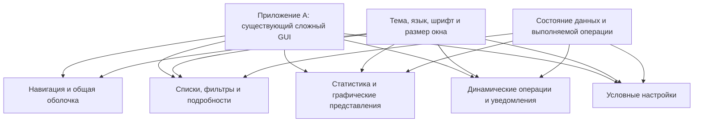
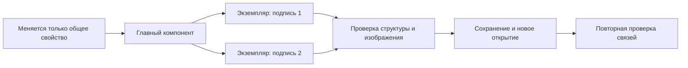
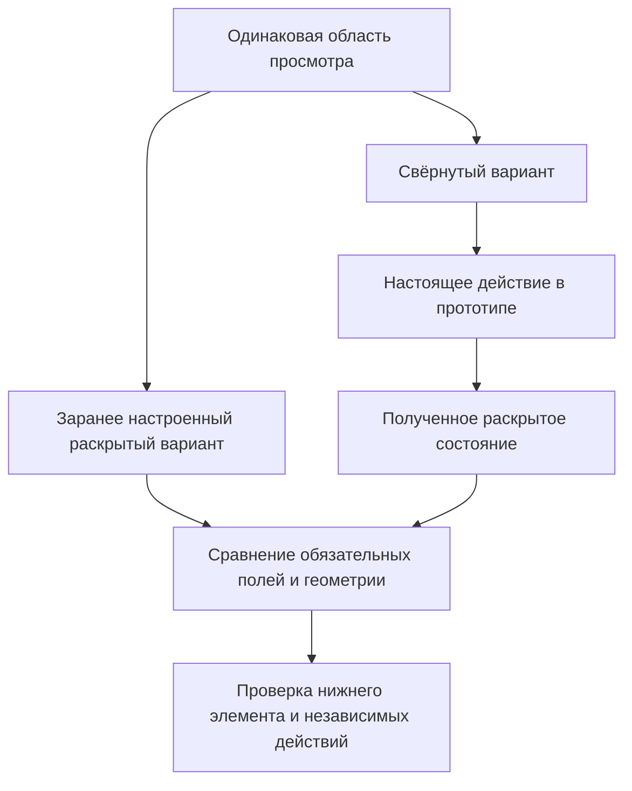
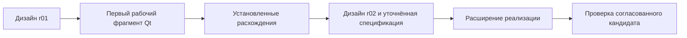
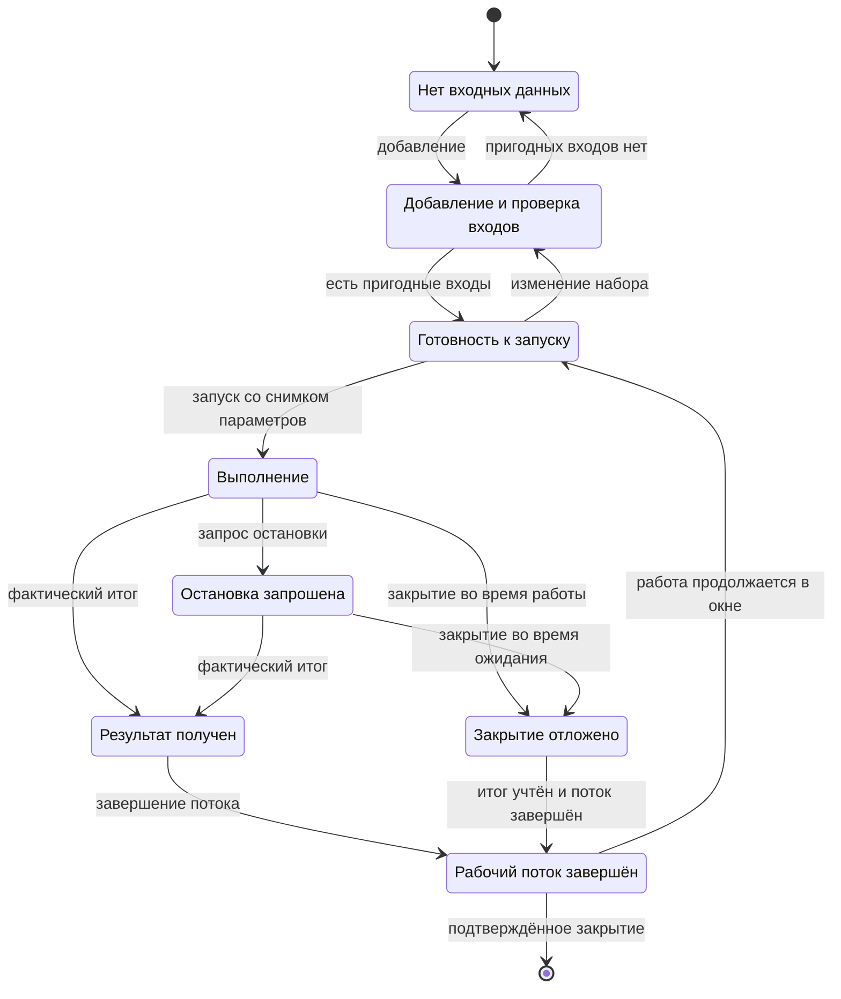
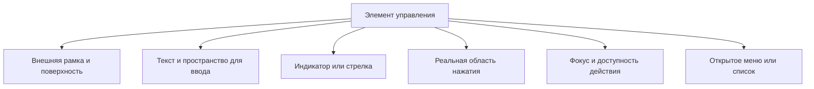
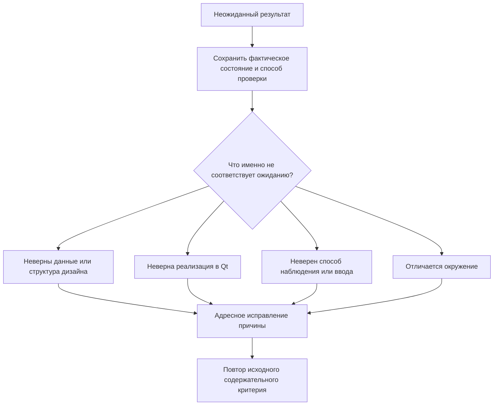

## FigCraft на практике: два пути к настоящему интерфейсу 🧩

**Часть II. Как агент воссоздаёт уже написанный сложный GUI и как проектирует новую оболочку поверх готового ядра.**

Небольшой макет отвечает на вопрос, умеет ли агент пользоваться редактором. Настоящее приложение задаёт более трудный вопрос: способен ли агент сохранить смысл интерфейса, когда за кнопками стоят разные состояния, за числом — конкретный источник данных, а за аккуратным полем — вполне определённое поведение.

Именно на этом переходе FigCraft перестаёт быть просто инструментом рисования. Редактируемый документ становится местом, где можно обнаружить противоречие до написания нового GUI, восстановить утраченную визуальную спецификацию или передать следующему исполнителю решения, которые иначе пришлось бы угадывать по скриншоту.

В статье рассматриваются два обезличенных случая.

**Приложение A** — большая настольная система с уже существующим сложным интерфейсом на PySide6. В учебном описании её можно рассматривать как аналитическое приложение: несколько семейств экранов, статистические представления, графика, фильтры, подробности результатов, динамические уведомления и много условных настроек. Задача — воссоздать существующий интерфейс в FigCraft, сохранив его структуру и существенные состояния.

**Приложение B** — более компактная утилита пакетной обработки изображений. Её ядро и программный интерфейс уже готовы, но новую графическую оболочку разрешено спроектировать заново. Задача — создать дизайн в FigCraft, а затем реализовать его в PySide6, подключив к существующим операциям.

> [!abstract] Две задачи — два разных результата
> В случае A код и наблюдаемое поведение становятся источником редактируемого дизайна. В случае B дизайн становится источником решений для нового GUI. Успех первого направления не доказывает автоматического обратного переноса, а успех второго не означает, что FigCraft сам генерирует готовое Qt-приложение.

### Навигация по материалу 🧭

| Раздел | Главный вопрос |
|---|---|
| [Основания и уточнения](#basis) | Что установлено практикой и что следует точнее читать в первой части |
| [Две разные сложности](#complexity) | Почему большое существующее приложение и новая компактная оболочка требуют разных подходов |
| [Кейс A: приложение → FigCraft](#case-a) | Как восстановить систему интерфейса, а не нарисовать её правдоподобную имитацию |
| [Кейс B: FigCraft → приложение](#case-b) | Как пройти от готовых возможностей ядра до удобного рабочего окна |
| [Повторяемый процесс](#workflow) | Что передавать между агентами и как проверять результат без бесконечного аудита |
| [Постановки задач](#agent-briefs) | Два самостоятельных шаблона задания и пример содержательной приёмки |
| [Выводы и источники](#conclusion) | Что подтверждено, где остаются ограничения и на чём основаны рекомендации |

<a id="basis"></a>
## Основания: практика, обобщение и границы выводов 📚

Материал опирается на предоставленные исследования разработки и первую часть руководства. Историческая граница исследований — **25 октября 2026 года, 16:51 по времени Asia/Almaty, UTC+5**. Проверенные в этих работах действия FigCraft относятся к **версии 0.10.0**. Это разбор конкретного опыта, а не заявление о последней доступной версии редактора.

Названия продуктов, локальные пути, идентификаторы участников и внутренние номера задач исключены. Обозначения A и B введены только для статьи. Предметное описание A обобщено до сложной аналитической системы: оно сохраняет характер интерфейсных затруднений, но не приписывает исходному продукту неописанные математические алгоритмы. Формулы и схемы ниже объясняют сложность интерфейса и проверки, а не восстанавливают вычислительное ядро приложения.

**Техническое обозначение в обоих GUI-кейсах — PySide6 / Qt 6**, как указано в исследованиях. У B до эксперимента существовала другая Qt-оболочка; «с нуля» относится к новому дизайну и его отдельной PySide6-реализации, а не к разработке всего продукта. PySide6 является Python-привязкой к Qt; рассматриваемый путь использует Qt Widgets.[^basis][^qt-python]

Исторические результаты приводятся по исследованиям, в которых изучались исходники, сохранённые команды, дизайн-файлы и решения проверяющих. Подготовка этой статьи не включала новый запуск приложений, FigCraft или EXE и не повторяла продуктовые тесты. Несколько отчётов разбирают одни и те же события; это не несколько независимых воспроизведений опыта.

В тексте различаются **установленное наблюдение**, **объяснение его причины** и **предлагаемый способ следующей работы**. Учебные карточки, схемы каталогов, формулы и задания агентам — методические примеры. Они не выдаются за точный экспорт исходных проектов. Отдельные ссылки на официальную документацию Qt используются для пояснения терминов и механизмов, но не как доказательство успеха конкретных приложений.

Command-first здесь — только исходное условие приложения B: операции доступны независимо от графической оболочки. Его архитектура, миграция ядра и устройство CLI относятся к другой серии. Предмет этой статьи — проектирование, воссоздание, перенос и проверка GUI.

## Что практика уточняет в первой части 🔎

Первая часть уже правильно отделяла макет от прототипа, экспорт от приложения и визуальное сходство от действующей функции. В ней также было явно указано, что первоначальный небольшой эксперимент не проверял перенос в Qt, React или Django. Новые кейсы не отменяют эти оговорки: они добавляют опыт одного конкретного Qt-пути и существенно более сложного восстановления интерфейса.[^guide-scope]

Поэтому полезнее не объявлять прежний текст ошибочным целиком, а выделить несколько мест, где практическая формулировка должна стать точнее.

### Код показывает реализацию, но не выдаёт разрешение менять продукт 🧾

В первой части код назван главным источником функционального контракта. Для установления фактического поведения это сильный ориентир. Но текущая реализация может уже содержать временный отказ или потерянную прежнюю возможность.

В случае B такой разрыв действительно существовал: операция с оригиналами была доступна раньше, но к началу нового GUI её уже отвергал общий API. Новый интерфейс честно показывал недоступность. Однако честная индикация не означала, что требование реализовано или что функцию разрешено исключить навсегда.[^feature-gap]

Более точная формулировка:

> **Код устанавливает, что реализовано сейчас. Требования к новому интерфейсу определяются сопоставлением прежних сценариев, текущего API и согласованных изменений продукта.**

Из этого не следует, что дизайнер должен немедленно чинить ядро. Достаточно не спрятать конфликт: временная неподдержка, условно выключенный контрол и окончательно исключённая возможность — разные состояния.

### Перед расположением элементов нужен смысл сообщения 💬

Структура окна и визуальные роли важны, но их недостаточно. Ещё до рисования полезно сформулировать, что человек узнает после добавления данных, во время работы, при частичном результате и после завершения.

В случае B технический журнал оказался недостатком уже самого макета. Затем код достаточно точно воспроизвёл этот недостаток. Следовательно, более аккуратный перенос не решил бы проблему: требовалось изменить содержание пользовательского представления.[^human-output]

Уточнённый порядок выглядит так: **задача человека → известные факты и ограничения → понятное сообщение и следующее действие → визуальная композиция**. Это не отдельный большой документ, а несколько конкретных примеров до работы с холстом.

### Дизайн до кода — не запрет обратной связи 🔁

В случае B настоящий дизайн и первая спецификация появились до нового Qt-кода. Но финальная правка логического свойства компонента произошла уже во время реализации. Практика подтвердила не неизменяемую последовательность «нарисовать абсолютно всё и больше не трогать», а небольшой обратный цикл.[^chronology]

Достаточная основа создаётся заранее. Затем один рабочий фрагмент проверяет предположения. Обнаруженные ограничения возвращаются в дизайн, получают новую редакцию и учитываются в дальнейшем переносе. Это сохраняет роль FigCraft, не превращая макет в неприкосновенную картинку.

### Компонентность и адаптивность проверяются действием 🧱

Запись о связи экземпляра с главным компонентом подтверждает структуру, но ещё не подтверждает правильное наследование всех свойств. Два фрейма разной ширины показывают два подготовленных состояния, но не обязательно рабочую перестройку между ними.

В исследованиях пришлось отдельно различать изменение главного компонента, изменение только корня, раскрытие блока настоящим кликом, автоматическую смену компоновки и достижимость нижнего содержимого. Для каждого свойства понадобилось собственное наблюдение.[^a-components][^a-live]

Это уточнение не требует проверять весь редактор. Оно требует перестать называть словом «адаптивность» несколько разных обещаний сразу.

### Принятый GUI и переданная сборка — разные результаты 📦

Первая часть уже напоминала о ресурсах установленного приложения. Практика дала конкретный пример: внутренние элементы контролов исправили в исходниках и приняли отдельно, но прежний EXE продолжал содержать старое оформление. Новые SVG также требовали включения в новую сборку.[^delivery]

Поэтому «исправлено» должно иметь объект: макет, исходники GUI, установленный пакет или конкретный EXE. Проверка одного не обновляет остальные автоматически.

### Не каждое затруднение требует нового правила ⚖️

Часть проблем возникла не из-за отсутствия хороших рекомендаций, а потому, что они не были применены к нужному месту. Уже существовали требования проверять состояния, структуру, ресурсы и результат. Слабее оказались конкретные вопросы: что означает надпись, удобно ли нажимать на стрелку, дошло ли исправление до переданного файла.[^method]

Вторая часть поэтому строится не вокруг ещё одного универсального регламента, а вокруг различимых ситуаций. Смысл практики — понять, **что именно наблюдать**, чтобы отличить правильный результат от внешне похожего неправильного.

<a id="complexity"></a>
## Две разные сложности: большая система и компактная утилита 🧠

Сложность GUI плохо выражается количеством кнопок. Небольшое окно может требовать тонкого поведения отмены и частичных результатов. Большая система может иметь десятки похожих экранов, но всего несколько принципиально разных семейств компоновки.

| Измерение | Приложение A: воссоздание | Приложение B: новый GUI |
|---|---|---|
| Исходная база | Действующее большое приложение | Готовое ядро, API и сохраняемые сценарии |
| Визуальная свобода | Сначала точность воспроизведения | Новая композиция разрешена |
| Основная неопределённость | Что действительно показывается и при каких условиях | Как представить возможности удобно и реализуемо |
| Структурная сложность | Много экранов, ветвей настроек и взаимосвязанных областей | Более компактное окно с насыщенным рабочим циклом |
| Поведенческая сложность | Разные владельцы состояния, источники и сроки жизни данных | Добавление, запуск, прогресс, остановка, результат, повтор |
| Конечный результат кейса | Редактируемый дизайн существующего GUI | Редактируемый дизайн и отдельная рабочая оболочка |
| Главный риск | Подменить воспроизведение незаметным редизайном | Нарисовать сведения и действия, которых приложение не обеспечивает |

Это сравнение описывает два исходных задания, а не рейтинг качества приложений. По материалам нельзя вычислить, какой путь быстрее или дешевле: исходные активы, охват и критерии различались.[^comparison]

### Сложность возникает на пересечении условий 🕸️

Для A полезно представить не перечень экранов, а несколько взаимодействующих систем. Схема ниже — учебное обобщение, а не карта модулей исходного продукта.



Каждая область может выглядеть правдоподобно сама по себе и противоречить соседней. Например, сообщение о выполнении операции не должно сопровождаться пустой очередью, если речь идёт об одной и той же задаче. А карточка статистики должна сохранять смысл периода и единицы измерения, даже если её оформление полностью перенесено.

Условная модель изображения экрана может быть записана так:

$$
V = P(D, S, C, L, T, W, F),
$$

где $D$ — данные, $S$ — состояние операции, $C$ — доступные возможности, $L$ — язык, $T$ — тема, $W$ — размер области содержимого, $F$ — параметры шрифта. $P$ означает правила представления. Это не формула движка FigCraft, а способ напомнить: одинаковый экран определяется не только координатами.

### Почему не требуется рисовать все комбинации 🧮

Для иллюстрации: 12 семейств экранов, по 4 состояния, 2 темы, 3 языка и 3 ширины дали бы наивное произведение:

$$
N = 12 \times 4 \times 2 \times 3 \times 3 = 864.
$$

Числа условные и не описывают объём исходных проектов. Они показывают, почему механическое размножение всех сочетаний быстро становится плохим способом работы.

Практичнее проверять семантически разные состояния и структурно разные компоненты, а дополнительные комбинации выбирать по риску. Длинная локаль нужна для плотной панели. Тёмная тема особенно важна для всплывающего списка. Узкая ширина — для фильтров и нижних действий. При этом обязательное семейство нельзя объявить выполненным только потому, что похожая кнопка проверена в другом месте.

Малый набор представителей сокращает дублирование, но не гарантирует автоматически полноту проверки. Его достаточность определяется тем, различает ли он конкретные опасные ситуации. Такой подход прямо соответствует выводам сравнительного исследования.[^coverage]

## До большого холста: проверить маршрут работы агента 🔌

Установка и регистрация MCP подробно разобраны в первой части. Для продолжения важнее не повторить все команды настройки, а убедиться, что агент работает с правильным документом и действительно может получить пригодный результат.

### Headless и Attached выбираются по задаче 🪟

В **Headless** агент работает с отдельной сессией движка без окна. В **Attached** — обращается к запущенному редактору через его управляющий канал. Эти режимы описаны в первой части как разные способы доступа, а не как две степени подлинности дизайна.[^guide-tools]

Для нового изолированного документа удобен Headless: меньше риска задеть чужой несохранённый холст. Для совместной работы человека и агента нагляднее Attached. Но успешный headless-экспорт не доказывает работу кликов в открытом проигрывателе, а подключение к окну само по себе не доказывает сохранность файла.

В случае B официальный CLI создавал и сохранял настоящий `.figcraft`. Скрипт подготавливал команды движку, а не вручную собирал ZIP с похожим JSON. Сохранение, завершение процесса, новое открытие и повторный экспорт были отдельными проверками.[^b-native]

### Пробный компонент полезнее большого обещания 🧪

До массового построения достаточно небольшой копии рабочего документа с главным компонентом, двумя экземплярами и коротким контейнером. Проверка должна ответить на несколько предметных вопросов: распространяется ли изменение главного компонента, сохраняются ли разные подписи экземпляров, перестраиваются ли потомки после изменения только корня и остаётся ли структура после повторного открытия.

Эта проба не обязана превращаться в отдельный исследовательский проект. Её задача — проверить именно тот механизм, на котором затем будет держаться массовая сборка. Если надпись не наследуется уже в двух экземплярах, нет смысла сначала создавать ещё двести.

Точные команды и поля читаются у используемой версии. В практике B неглубокий `node.get` сначала не давал полного дерева, а проверочный разбор искал `variableBindings` вместо фактического `boundVariables`. Это была проблема наблюдения, а не доказательство отсутствия компонентов.[^b-tools]

> [!warning] Текущее состояние редактора тоже является работой
> Перед изменениями сохраняется рабочая копия именно текущего документа, включая изменения в памяти. Копирование старого файла с диска не защищает несохранённый холст. После потери ответа на изменяющую команду сначала читается состояние: слепой повтор может продублировать уже выполненное действие.[^guide-safety]

<a id="case-a"></a>
## Кейс A. Воссоздать сложный интерфейс, а не придумать похожий 🪞

Приложение A уже существует. У него есть собственные виджеты, ресурсы, переводы, правила компоновки и набор состояний. FigCraft нужен не для написания второй программы, а для получения редактируемой визуальной системы.

Такой заказ полезен, когда интерфейс вырос быстрее своей документации: повторяющиеся элементы трудно сравнивать, знания рассыпаны по модулям, а для последующего обсуждения изменений нужен общий дизайн-документ. Однако воссоздание и улучшение должны оставаться различимыми действиями.

### Сначала устанавливается, какая реализация является образцом 🔍

В большой кодовой базе часто остаются старые классы, совместимые имена, альтернативные прототипы и неиспользуемые панели. Поиск файла с подходящим названием не гарантирует, что найден текущий экран.

В источниках A карта действующих связей помогла отличить реальную вкладку от совместимого псевдонима, актуальную реализацию списка от прежней и живую поверхность уведомлений от похожего старого виджета. Кроме того, рабочая копия содержала изменённые и ещё не учтённые Git-файлы. Поэтому одного номера коммита было недостаточно, чтобы точно описать интерфейс того момента.[^a-map]

Практический результат этого этапа — короткая карта: откуда запускается окно, какие области оно действительно создаёт, кто предоставляет им данные, где определены тема, размеры и переводы. Не требуется читать весь репозиторий без разбора. Требуется установить действующий путь для выбранных семейств.

Если исходная рабочая копия содержит изменения, фиксируется именно доступная редакция: какие относящиеся файлы прочитаны и к каким контрольным изображениям они относятся. Это не предложение коммитить чужую незавершённую работу, а защита от сравнения разных версий под одним словом «текущая».

### Несколько источников объясняют разные стороны интерфейса 🧭

| Источник | Что он помогает установить | Чего недостаточно вывести только из него |
|---|---|---|
| Действующий код | Создание виджетов, условия видимости, связи, ограничения | Фактически выделенную геометрию при конкретном шрифте |
| Контрольное изображение | Отрисованное состояние и визуальную иерархию | Настоящие компоненты, скрытые условия и поведение кнопки |
| Реальное взаимодействие | Переход, прокрутку, раскрытие и доступность действия | Все другие состояния и редакции программы |
| Каталоги ресурсов и переводов | Исходные иконки, строки, контексты и варианты | Что именно из этого разрешилось в текущем окне |
| Задание на воссоздание | Разрешённые изменения и ожидаемый охват | Факт выполнения |

Таким образом, код и скриншот не конкурируют за звание единственного источника правды. Они отвечают на разные вопросы. Конкретное расхождение требует адресного уточнения, а не произвольного выбора того источника, с которым проще получить красивый результат.

### От технического отчёта к входным данным для дизайна 📋

В исследовании A анализ кода разделяли между тематическими читателями, а холст оставался у одного автора. Это оказалось полезной организацией чтения, но само по себе не решило передачу знаний: длинный отчёт пришлось дополнять компактными данными для построения макета.[^a-handoff]

Дизайнеру нужен не весь рассказ о классах, а конкретный образец состояния. Например, следующая карточка — **учебная форма передачи**, не команда FigCraft и не извлечённый JSON проекта:

```yaml
surface: settings/processing
state: local-mode-advanced-open
basis: observed-current-ui
visible:
  - mode-selector
  - local-options
  - advanced-options
hidden:
  - remote-endpoint
  - remote-credential-action
actions:
  apply: enabled
  cancel: enabled
facts:
  connection_status: not_applicable
  estimated_duration: unknown
layout:
  root_size: measured
  content_scroll: required
resources:
  labels: approved-translation-context
  icons: existing-application-assets
```

Названия здесь условные. Польза формы в другом: она связывает видимость, данные и действия. Поле `unknown` не превращается в ноль, удалённая настройка не появляется в локальном режиме, а обязательная прокрутка не заменяется обещанием «всё поместится».

Для небольшой задачи тот же смысл помещается в абзац или таблицу. Машинная схема оправдана, когда агент строит много однотипных объектов, но она не должна становиться новым обязательным форматом всего проекта.

## Кейс A. Состояния: почему список контролов ещё не экран 🧠

Большая форма обычно содержит не все свои поля одновременно. Одни зависят от выбранного режима, другие — от доступности возможностей, третьи появляются только после раскрытия дополнительных настроек.

### Каталог возможностей нельзя выдавать за пользовательское состояние 🧩

В раннем построении A универсальный обработчик понимал обычные разделы и поля, но пропускал отдельные виды входных данных. Одновременно он показывал взаимоисключающие ветви. В результате часть действий исчезла, некоторые альтернативы оказались раскрыты вместе, а вместо реальных подписей появились шаблонные значения. Панель журнала превратилась в обычную форму, хотя исходное приложение использовало панель действий и растягиваемую область просмотра.[^a-states]

Такой результат может быть аккуратным по сетке и всё равно неверным. Универсальность строителя не заменяет понимание того, что он строит.

Полная библиотека всех контролов полезна как технический каталог. Но пользовательский экран должен представлять **одну согласованную конфигурацию**. Для каждого входного элемента достаточно указать, куда он перенесён либо почему отсутствует именно в этом состоянии. Это позволяет заметить потерю поля до того, как она размножится на все темы и языки.

### Соседние области должны рассказывать одну историю 🔗

В A наблюдалось противоречие: карточка сообщала о выполняемой обработке, а соседняя очередь выглядела пустой. Проблема была не в оттенке или расстоянии. Два блока представляли несовместимые сведения об одной работе.[^a-states]

Для сложного аналитического приложения такой риск шире: выбранный период может не соответствовать показанной сводке, подробности — относиться к прежней строке, а уведомление — к уже завершённой операции.

Предлагаемая компактная запись состояния:

$$
S_{ui} = (id, phase, facts, actions, exit).
$$

Здесь `id` связывает показанное с конкретным объектом или операцией, `phase` обозначает этап, `facts` — известные сведения, `actions` — доступные действия, `exit` — условие завершения состояния. Это методическая запись, а не требование внедрить новую машину состояний в приложение.

Она полезна тем, что не даёт заменить всё одним словом `processing`. При одинаковой подписи «выполняется» могут различаться доступная отмена, уже готовый частичный результат и допустимость закрытия окна.

### Ноль, отсутствие и неизвестность — разные сведения 📊

Для статистического представления особенно опасен красивый ноль. Он может выглядеть убедительнее пустого места, но сообщать ложный смысл.

Измеренное нулевое значение — результат. Отсутствующая выборка — иная ситуация. Ошибка чтения не означает пустую статистику. А неизвестная длительность не превращается в нулевую только потому, что числовая карточка требует заполнения.

Следующая таблица — предлагаемая учебная семантика, а не описание реализованного расчётного модуля A:

| Ситуация | Понятное представление | Неверная подмена |
|---|---|---|
| Выборка ещё загружается | Состояние загрузки, период остаётся видимым | `0` как будто данные уже получены |
| Данных за период нет | Сообщение об отсутствии данных | График с придуманными нулевыми измерениями |
| Измеренное значение равно нулю | Ноль с единицей и понятной подписью | Пропуск значения как «пустого» |
| Чтение завершилось ошибкой | Причина на доступном уровне и повтор | «Ничего не найдено» |
| Сохранённое значение относится к прежнему состоянию | Явная отметка его актуальности | Выдача старой сводки за новую |

В исследованиях A неизвестные сведения и диагностические примеры действительно оставляли различимыми. Длинный тестовый текст использовали для проверки компоновки, но не называли реальным форматом вывода приложения.[^a-unknown]

> [!tip] Сначала проверяется один законченный представитель
> Для обычной формы, длинного списка, области подробностей и статистического представления выбираются отдельные представители. После проверки их содержания и структуры добавляются необходимые варианты. Размножение непроверенного образца увеличивает число файлов, а не уверенность в результате.

## Кейс A. Геометрия: измерять интерфейс, а не угадывать по числам 📐

Кодовая формула описывает намерение компоновки. Фактический размер зависит ещё от ограничений детей, текста, шрифта, выбранного стиля и доступной области. Воссоздание существующего GUI особенно чувствительно к этой разнице: здесь требуется сохранить не просто разумное расположение, а установленное поведение источника.

### Запрошенная ширина может не стать фактической 📏

В одном из измерений A панели фильтров задали ширину 370, но фактически получили 450. Минимум всего главного окна также не доказывал, что отдельная панель действительно работает на той же узкой ширине. В некоторых контролах исходный текст жёстко обрезался.[^a-geometry]

У дизайнера возникает естественное желание исправить неудобство: добавить многоточие, перенести поле или убрать часть элементов. Для нового дизайна это допустимое решение. Для точного воссоздания это уже изменение, которое должно быть показано отдельно.

Полезная запись измерения выглядит так:

```text
Запрошенный размер
    → фактическая область окна
    → внутренний viewport
    → ограничения и sizeHint
    → выделенные прямоугольники
    → реально видимая часть содержимого
```

Одно число `width=370` не заменяет эту цепочку. Особенно если проверочный инструмент сообщил, что запрос выполнен, но сам виджет сохранил больший размер.

### Порог компоновки относится к конкретной области 🪟

В другой панели A при ширине клиентской области 1430 внутреннее содержимое имело ширину 1382. Поэтому условие, связанное с внутренней шириной 1400, нельзя было проверять по числу 1430 внешнего контейнера. Разница возникала ещё до выбора широкой или вертикальной композиции.[^a-geometry]

Для объяснения достаточно простой модели:

$$
W_{content} = W_{client} - M_{left} - M_{right} - W_{reserved}.
$$

Слагаемые здесь обозначают реальные занимающие место области. Не все интерфейсы используют их одинаково; формула не заменяет измерение. Она показывает причину типичной ошибки: проверяются разные величины, хотя обе называются «шириной окна».

Аналогично коэффициенты растяжения не следует трактовать как обещание точной доли пикселей во всех условиях. Qt-компоновка учитывает размеры, политики и ограничения виджетов. Восстановление должно опираться на наблюдаемое распределение, а не только на найденные в коде числа.[^qt-layout]

### Логические пиксели, физические пиксели и размер шрифта 🔤

В Qt геометрия высокоуровневого интерфейса обычно выражается в независимых от устройства координатах. Физический размер изображения связан с ними через коэффициент масштаба, DPR. Например, область в 200 логических пикселей при DPR 2 занимает 400 физических пикселей. Буфер изображения при этом хранит физические пиксели.[^qt-dpi]

Для сопоставления полезна приближённая запись:

$$
W_{physical} \approx W_{logical} \times DPR.
$$

Округление и конкретный способ захвата требуют отдельного учёта. Смысл формулы не в автоматическом пересчёте любого скриншота, а в необходимости подписывать единицы.

Размер шрифта — ещё одна независимая величина. В A исходная типографика задавалась в пунктах и зависела от пользовательской базы, а в B новая спецификация явно использовала размер шрифта в пикселях. Одинаковое число нельзя было механически перенести одинаковым вызовом в обоих случаях.[^units]

### Изображение эталона должно иметь условия получения 🖼️

Для сложного фрагмента достаточно сохранить рядом с кадром размер содержимого, тему, язык, разрешившийся шрифт, DPR и существенные подмены стенда. Снимок настоящих виджетов с безопасными тестовыми данными полезен, но не доказывает работу внешних устройств, сети или вычислений, если эти части заменены.

В источниках A штатная утилита снимков не считалась автоматически безопасным способом запуска: исследователи сначала выясняли, что создаётся вместе с окном и какие реальные настройки или внешние зависимости могут быть затронуты. Следующий этап получал изолированные кадры на разрешённых границах.[^a-unknown]

При подготовке этой статьи сами такие кадры не выдаются за заново просмотренные или полученные. Для повторения методики нужны реальные изображения выбранной редакции приложения; текстовый пересказ отчёта не заменяет их визуального сравнения.

## Кейс A. Компоненты, темы и тексты: построить систему, а не коллекцию копий 🧱

Восстановление большого GUI становится полезным, когда повторяющиеся решения начинают жить как связанные элементы. Тогда изменение общего отступа или оформления карточки не требует редактирования каждого экрана отдельно.

### Компонент выделяется по смыслу, а не только по форме 🧩

Две прямоугольные карточки могут иметь разное назначение. Одна показывает результат, другая — текущую операцию, третья — ошибку с доступным повтором. Общая внешняя оболочка может быть переиспользована, но состояние и действия нельзя свести к замене цвета.

Для A разумная библиотека могла бы включать карточку результата, строку фильтров, область подробностей, статистическую карточку и раскрываемую группу параметров. Это учебные имена, не названия реальных узлов исходного файла. Каждый элемент должен сохранять собственный смысл: что он показывает, какие значения неизвестны и какие действия разрешены.

В исследованиях A настоящие главные компоненты, экземпляры, редактируемые тексты и векторы действительно получились. Однако связь `mainComponent` не подтверждала автоматически корректный текст вложенного слоя или работу логического свойства видимости.[^a-components]

### Маленькая проверка должна менять только один источник 🧪

Для наследования меняется **только главный компонент**. Затем проверяются уже существующие экземпляры: общее свойство изменилось, индивидуальные подписи сохранились.

Для компоновки меняется **только корневой контейнер**. Если агент после этого вручную передвинул детей, он проверил собственную способность дорисовать новый размер, а не правила растяжения.

Для логического свойства мало добавить имя `Expanded` или `Checked`. Нужна связь свойства с соответствующей видимостью или представлением. Для текстового свойства проверяются значение, фактические символы дочернего текстового слоя и свежий рендер. После сохранения существенные связи проверяются снова в открытом с диска документе.[^a-components]



Схема описывает проверочный приём. Она не означает, что всякое изменение любого свойства одинаково поддерживается инструментом.

### Независимые тема и язык уменьшают число расходящихся копий 🌗

Тема отвечает за визуальные роли, язык — за содержимое. Их полезно сохранять независимыми: переключение темы не должно незаметно возвращать прежние подписи, а смена языка — подменять состояние операции.

В A возникали ошибки контекста перевода и смешанные подписи. Поздние проверки сверяли не только выбранный режим, но и фактические символы, включая отображение служебного значения `auto` понятным словом и форматирование чисел. Подготовка к дополнительному языку не выдавалась за уже выполненную локализацию продукта.[^a-locale]

Предлагаемая структура для аналогичного документа:

```text
Theme: светлая / тёмная
Locale: поддержанные языки
State: содержательные состояния конкретного компонента
Metrics: повторяющиеся размеры и интервалы
```

Это логическое разделение, а не требование создать именно четыре коллекции в каждом проекте. Существенно, чтобы разные причины изменения не были случайно объединены в один набор вроде «тёмный русский экран ошибки».

### Значение токена ещё должно дойти до видимого слоя 🎨

В статистическом фрагменте A нужные тёмные значения существовали, но белая заливка структурной обёртки перекрывала и тему, и выделение. Исправление требовалось в самом покрывающем слое, а не в палитре и не в готовом PNG.[^a-paint]

Полезная цепочка диагностики:

**семантический токен → привязка → итоговое свойство → верхний покрывающий слой → изображение.**

Она помогает отделить отсутствие нужного значения от неправильного применения. Если значение уже правильное, добавление ещё одного цвета с похожим названием лишь усложнит систему.

## Кейс A. Живой прототип: растяжение, раскрытие и прокрутка — не одно и то же 🖱️

На статических экранах сложность часто выглядит уже побеждённой: все поля видны, рамки растянуты, нижняя кнопка на месте. Но настоящий переход должен получить это состояние сам, из предыдущего, без ручной подготовки нужной геометрии.

### Четыре отдельных обещания адаптивности 📐

| Обещание | Проверка, которая действительно его различает | Недостаточное свидетельство |
|---|---|---|
| Подготовленный макет растягивается | Изменяется только корень, проверяются потомки и нижние действия | Два вручную расставленных фрейма |
| Раскрытие перестраивает форму | Настоящий клик меняет размеры предков и доступное содержимое | Прямое открытие заранее раскрытого фрейма |
| Компоновка меняется на пороге ширины | Порог пересекается без ручного выбора варианта | Наличие вариантов Wide и Narrow в документе |
| Длинная область прокручивается | Ввод попадает в нужную область, последний обязательный элемент достижим | Нарисованный скроллбар или прекращение движения колеса |

В A были установлены конкретные неудачи: подготовленное раскрытое состояние выглядело правильно, но живое раскрытие накладывало поля на соседние области; в другом случае рамка не росла вместе с содержимым; ещё в одном нижний элемент оставался недоступным после переключения режима.[^a-live]

Эти результаты нельзя превращать в утверждение, что FigCraft вообще не умеет перестраивать интерфейс. Они относятся к исследованным композициям и способам управления в версии 0.10.0. Но и успешный статический вариант не закрывает их задним числом.

### Подготовленный правильный вариант — эталон для перехода 🧭

Полезный способ проверки — сравнить два пути к одному состоянию при одинаковом размере:



Сравниваются не любые изменившиеся пиксели, а содержательные признаки: появились ли нужные поля, выросли ли правильные контейнеры, изменился ли диапазон прокрутки, осталось ли доступным последнее предупреждение и не исчезли ли соседние значения.

Если переход пока не работает, статический вариант можно сохранить как проверенную визуальную спецификацию. Неподтверждённую активную область лучше отключить и назвать ограничение. Но отключение не является ремонтом перехода и не закрывает заказ на интерактивность.

### Иногда ошибается проверка, а не документ 🔬

В одном эпизоде A большой импульс колеса двигал и вложенный редактор, и его предка. Это могло выглядеть как отсутствие независимой внутренней прокрутки. Более короткий ввод показал, что внутреннее содержимое прокручивается отдельно; основной макет менять не потребовалось.[^a-observer]

Из этого следует не разрешение ослаблять проверки, а необходимость исследовать сам способ наблюдения. Где находится указатель? Какая область получила ввод? Успело ли выполниться действие? Проверяется достижимость последней строки или неподтверждённый расчётный максимум?

Одинаково вредны две крайности: чинить правильный макет из-за плохого теста и объявлять реальное наложение полей «слишком строгой проверкой». Хороший контроль сохраняет исходный пользовательский критерий и меняет лишь ошибочную предпосылку стенда.

### Каков результат направления A ✅

По исследованиям получен настоящий редактируемый проект, а не набор подложек. Подтверждены компоненты и полезные отдельные семейства, измеренные образцы, часть меню, прокрутки и живого изменения размеров. Полное воссоздание всего интерфейса, автоматические пороги компоновки и часть структурных переходов не были завершены.[^a-result]

Поздняя выполненная проверка статистического фрагмента также закрывала пункт, который ещё оставался помеченным как ожидающий в более ранней записи. При этом она не закрывала соседние вопросы начального сохранённого состояния и задержек. Это показательный случай: итог формируется по последним относящимся результатам, а не копированием самой удобной сводки.

Практическая ценность A состоит в том, что существующий GUI удалось превратить в редактируемую систему и выявить точные границы такого переноса. Это не новый производственный интерфейс и не обещание, что обратное преобразование в код уже выполнено.

<a id="case-b"></a>
## Кейс B. Новый интерфейс поверх готового ядра 🎨

В приложении B исходная задача другая. Уже существуют обработка изображений, правила параметров, результаты и программный вход. Новая композиция разрешена: не требуется перерисовывать старое окно один в один.

Общий API позволяет не создавать второй обработчик ради другого оформления. Но он не определяет автоматически информационную иерархию, полезность сообщений, удобство полей и то, какие сведения человек увидит после операции. Это самостоятельная работа над GUI.

### Достаточно понять доступные возможности, а не повторить архитектурную миграцию 🧭

До рисования была составлена карта фактических функций и ограничений. Она различала выбор файла и папки, отдельный диалог и перетаскивание, диапазоны параметров API и старого контрола, точный пустой ввод и прежнюю подстановку значения. Новый интерфейс строился по этой карте, а не по предположению о том, что «обычно умеет конвертер».[^b-contract]

Для статьи важна только интерфейсная граница: какие действия доступны, какие сведения возвращаются, что происходит при ошибке и что должно сохраниться. Подробности организации ядра остаются за рамками.

Следующая таблица показывает, как техническое различие превращается в решение на экране.

| Различие в работе | Что необходимо выразить в GUI |
|---|---|
| Выбор папки ещё не означает завершённое обнаружение входов | Отдельная стадия добавления, понятные проблемы обнаружения |
| Предварительный список не резервирует будущие выходные файлы | Итог берётся из реального выполнения, конфликт может возникнуть при запуске |
| Обработка идёт одним пакетом | GUI передаёт согласованный набор, а не незаметно меняет смысл на независимые вызовы |
| Остановка сначала запрашивается | Надпись «Остановка запрошена», без ложного мгновенного завершения |
| Результат может прийти раньше завершения рабочего потока | Повторный запуск и закрытие разрешаются по действительному состоянию |
| Часть сведений пока неизвестна | Пустое или объяснённое неизвестное значение, а не придуманный ноль |

Эти различия были установлены и спланированы в реальном опыте B. Они не требуют отдельного экрана на каждую техническую фазу, но должны влиять на доступные действия и сообщения.[^b-contract]

### Новый GUI не обязан повторять слабости старого 🧩

Если цель — новая композиция, прежнее окно служит источником сценариев, а не обязательным образцом внешнего вида. Можно иначе организовать очередь, параметры и результаты. Но изменение формы не должно незаметно менять возможности продукта.

Например, недоступная опасная операция может быть честно обозначена как временное ограничение. Она не должна оживать через обход общего API в обработчике кнопки. И одновременно серый флажок нельзя записать в выполненные возможности только потому, что он присутствует на макете.[^feature-gap]

Так сохраняется правильное разделение: дизайн вправе предложить лучшее представление, но не присваивает себе право выдумывать продуктовые решения.

## Кейс B. Сначала полезное содержание, затем оформление 💬

У компактной утилиты особенно легко недооценить содержание. Основной сценарий кажется очевидным: выбрать файлы, нажать кнопку, показать прогресс. Но пользователь открывает такую программу не ради полосы прогресса. Ему нужен понятный результат.

### Три вопроса вместо одной технической ленты 🧾

В опыте B основной журнал содержал строку вида:

```text
event=selection_finished available=3 issues=0
```

Она присутствовала уже в FigCraft и затем попала в настоящий GUI. Значит, проблема возникла до переноса стилей. Технический канал был ограничен и проверен на отсутствие чувствительных данных, но это не делало его удобным главным сообщением.[^human-output]

Для следующей реализации предлагается разделить три назначения:

| Представление | Вопрос человека | Содержимое |
|---|---|---|
| Ход работы | Что сейчас происходит? | Понятное действие, известный прогресс, частичный итог |
| Результат выбранного объекта | Что именно получилось? | Фактические сведения до и после, параметры выполненной операции, доступ к результату |
| Дополнительная диагностика | Что поможет разобрать проблему? | Технические коды и детали в подходящем канале |

Такое представление — **рекомендация по итогам опыта**, а не утверждение, что поздний ремонт уже был завершён.

Основное сообщение могло бы выглядеть так: «К обработке готовы 3 изображения». Это не художественный перевод каждого технического события. Интерфейс выбирает событие, которое действительно важно человеку, и выражает его смысл.

Карточка результата могла бы сообщать: «Изображение обработано. Формат: … Размер: … → … Параметры: … Оригинал: …». Поля заполняются только данными соответствующего результата. Текущие настройки формы не должны переписывать сведения о ранее выполненной операции.

### Проценты имеют смысл только вместе с основанием 🧮

Если известны исходный размер $B_{in}>0$ и размер результата $B_{out}$, относительное уменьшение вычисляется так:

$$
r = 100 \times \frac{B_{in}-B_{out}}{B_{in}}.
$$

Это обычное производное значение, а не новая функция FigCraft. Положительное $r$ означает уменьшение, отрицательное — увеличение. При неизвестном исходном размере процент не вычисляется. Успешная обработка также не гарантирует уменьшение файла: интерфейс должен честно показать увеличение, а не назвать его отрицательной «экономией» без объяснения.

В исходном API B значительная часть полезных сведений уже была: размеры, форматы, выходной путь, параметры и предупреждения. Но пофайлового времени и ETA в результате не было. Их нельзя представлять как измеренные лишь потому, что где-то в диагностике существует таймер.[^human-output]

Аналогично показатель

$$
p = 100 \times \frac{k}{n}
$$

может означать долю завершённых элементов при известных $k$ и $n>0$. Он не становится автоматически процентом прошедшего времени: один большой файл способен занимать больше времени, чем несколько маленьких. Подпись «Обработано 3 из 10» часто честнее безымянных «30%».

### Один зелёный статус не обязан описывать весь исход 🚦

Готовый результат и судьба оригинала — разные факты. Полезный выходной файл может существовать, даже если последующая операция не выполнена. И наоборот, наличие файла ещё не подтверждает, что все проверки завершения прошли.

Для GUI это означает, что рядом могут существовать положительный результат и отдельное предупреждение. Не требуется превращать строку в техническую энциклопедию, но нельзя терять различие между «результат готов», «дополнительное действие не выполнено» и «исход дополнительного действия неизвестен».[^b-outcomes]

> [!important] Содержание проверяется до украшения
> До работы с цветом достаточно написать по одному образцу сообщения о ходе, результата выбранного объекта и ошибки со следующим действием. Если эти тексты не отвечают на вопрос пользователя, качественная типографика лишь сделает непонятное сообщение более заметным.

## Кейс B. Создание редактируемой основы в FigCraft 🧱

Когда возможности и содержание определены, агент может переходить к композиции. В этом направлении FigCraft особенно полезен тем, что сохраняет решения независимо от кода: структуру экрана можно обсудить и проверить до того, как она обрастёт обработчиками событий.

### Какой дизайн действительно появился 🗂️

В исследованном опыте официальный FigCraft CLI создал документ с восемью основными экранами: ключевые состояния на русском в светлой и тёмной темах, а также контрольные варианты английского и казахского текста на минимальном размере. Обычный размер основы составлял 1120 × 760 логических пикселей, минимальный — 900 × 640. Это параметры данного дизайна, не универсальные размеры удобного окна.[^b-native]

Сохранённая независимая проверка структуры зафиксировала:

| Объект | Количество | Что существенно помимо количества |
|---|---:|---|
| Главные компоненты | 10 | Проверялось распространение изменения на экземпляры |
| Экземпляры | 148 | Связи и индивидуальные подписи сохранялись |
| Текстовые слои | 363 | Надписи оставались редактируемыми |
| Векторные слои | 18 | Ресурсы не заменялись снимком всего экрана |
| IMAGE-слои | 0 | В проверенном дереве не было растровой подложки вместо интерфейса |

Эти числа подтверждают характер полученного документа, но не являются показателем качества дизайна. Более важны выполненные действия: изменение только главного компонента, изменение только корня, сохранение, завершение процесса и новое открытие с повторным экспортом.[^b-native]

При этом восемь основных фреймов не выдавались за полное покрытие всех состояний runtime. Часть переходов описывалась и проверялась уже в рабочем приложении. Интерактивный FigCraft-прототип не был самостоятельным обязательным результатом этого кейса, поэтому отсутствие проверки всех кликов редактора не превращалось в провал задания.

### Как строить основу небольшими содержательными порциями 🛠️

Предлагаемый порядок для следующего аналогичного проекта начинается с общей оболочки и одного законченного состояния: например, несколько добавленных файлов, согласованные параметры и доступный запуск. Не стоит сначала наполнять весь холст пустыми страницами только ради внешнего ощущения объёма.

После оболочки создаются повторяющиеся элементы, затем — связи текста, состояния и темы. Агент читает возвращённые идентификаторы узлов и сохраняет соответствия; имена вроде `PrimaryButton` удобны человеку, но не заменяют реальный ID, полученный из документа.

Каждая порция заканчивается двумя проверками. Структурная отвечает, что действительно создано. Визуальная — как это отображается. При белой поверхности тёмной темы проверяется слой-владелец заливки. При обрезанной иконке — геометрия вектора и его рамка. Исправление экспортированного PNG не исправляет источник.

В опыте B именно такие проблемы встречались: неявная белая заливка, неверные границы вектора, недостаточно глубокое чтение дерева и поздно уточнённое логическое состояние флажка.[^b-tools]

### Один экран может представлять несколько фаз 🎛️

Состояния «готово к запуску», «обработка» и «остановка запрошена» не обязательно требуют трёх независимых композиций. Они могут использовать один каркас с разными доступными действиями и содержимым.

Это особенно важно для агентной работы. Если каждый исход рисуется как отдельная несвязанная копия, поздняя правка шапки или поля начинает расходиться между экранами. Но и чрезмерно универсальный компонент с десятками несогласованных флагов становится трудным для проверки.

Практический компромисс — общая композиция там, где сохраняется структура, и отдельные варианты там, где действительно меняются её существенные части. Решение принимается по смыслу интерфейса, а не по желанию уменьшить число фреймов любой ценой.

## Кейс B. Передача в PySide6: не экспорт приложения, а перевод решений 🐍

В рассмотренной FigCraft 0.10.0 не было встроенного экспортера Python, QSS, QML или Qt Designer `.ui`. Новая оболочка появилась благодаря работе агента по структуре и спецификации, а не вследствие команды «сохранить как PySide6».[^b-tools]

Это ограничение не делает дизайн бесполезным. Оно уточняет его роль: FigCraft определяет визуальные решения, а агент переводит их в механизмы выбранного интерфейсного инструментария.

### Что передаётся напрямую, а что требует реализации 🔗

| Решение в FigCraft | Реализация в GUI B | Что остаётся отдельной работой |
|---|---|---|
| Иерархия основных областей | Qt layouts и политики размеров | Достижимость действий при изменении окна |
| Повторяющаяся строка файла | `QTableView` и модель данных | Идентичность строки и обновление её результата |
| Цветовые роли и интервалы | Нормализованные токены, QSS, QPalette | Состояния и внутренние части контролов |
| Типографика | QFont с явной единицей размера | Реальные метрики и наличие нужных символов |
| Векторная иконка | SVG, QIcon и ресурсы пакета | Границы, цвет и доступность после установки |
| Примеры языковых вариантов | Каталоги и обновление текстов в runtime | Динамические сообщения и форматирование |
| Экраны выполнения и результата | Контроллер, рабочий поток, ответы API | Настоящая работа, остановка и завершение |

Это соответствие отражает реализованный маршрут B. Общий API при добавлении оболочки не переписывался ради второго обработчика; старый GUI также не подменялся новым входом по умолчанию.[^b-mapping]

### Сырой экспорт и рабочая спецификация не должны смешиваться 📤

Сырой JSON нужен как неизменённое свидетельство того, что вернул FigCraft. Для приложения удобнее отдельное нормализованное представление со стабильными ролями и единицами. Рабочий GUI — третий слой, который нельзя бездумно перезаписывать очередным экспортом.

Небольшой пакет передачи может выглядеть так:

```text
design/
├── interface.figcraft
├── raw/
│   ├── document.json
│   └── variables.json
├── references/
│   ├── ready-dark-ru.png
│   └── processing-light-ru.png
├── assets/
└── handoff/
    ├── specification.md
    └── tokens.json
```

Это рекомендуемая структура, не встроенный стандарт FigCraft и не утверждение о наличии этих файлов в исходном проекте. Для маленького задания спецификация может быть разделом существующего документа; отдельная папка на каждый контрол не нужна.

Пример нормализованного токена:

```json
{
  "schemaVersion": 1,
  "spacing": {
    "panel": { "value": 24, "unit": "logical-px" }
  },
  "typography": {
    "body": { "size": 14, "unit": "font-px" }
  },
  "source": {
    "document": "interface.figcraft",
    "revision": "design-r02"
  }
}
```

Значения и схема иллюстративные. Важен явный смысл числа. Интервал, размер шрифта, прозрачность и вес начертания не должны проходить через один бездумный адаптер «все числа — пиксели».

### Компоновка переносится правилами 📐

В Qt расположение виджетов задаётся layouts, а оформление — стилем и палитрой. Поэтому координаты FigCraft полезны как наблюдаемый результат и ориентир, но не как приказ установить всем элементам фиксированные размеры. Qt предоставляет менеджеры горизонтальной, вертикальной, сеточной и формовой компоновки; их назначение — управлять положением и размерами при изменении доступного пространства.[^qt-layout]

В B повторяющиеся строки стали моделью и представлением, а не отдельной тяжёлой группой виджетов на каждый файл. Полосы прокрутки стали настоящими элементами Qt, а не растровыми частями макета. Именно такие решения превращают визуальный образ в поддерживаемое приложение.[^b-mapping]

Соответствие нельзя оценивать только по одному скриншоту. Сохранены ли порядок, смысл группировки, размеры ключевых областей, доступность основного действия и поведение длинного содержимого? Эти вопросы полезнее требования одинакового сглаживания каждой буквы между двумя разными рендерерами.

### Обратная связь не должна разрушать историю дизайна 🔁

В B ранняя спецификация предшествовала коду, затем исправлялись ресурсы, а позднее — логическая связь флажка. Поэтому корректная история выглядит как несколько редакций, а не как один финальный файл, который будто бы существовал с самого начала.[^chronology]



Повторный экспорт используется для сравнения и переноса изменений. Он не должен уничтожать обработчики, переводы, доступность и исправления компоновки в рабочем коде. А позднее уточнение макета не является основанием назвать первоначальную передачу несуществовавшей.

## Кейс B. Достоверное поведение между «Старт» и «Готово» ⏱️

Самые неприятные ошибки GUI часто находятся между двумя красивыми состояниями. Пустое окно выглядит правильно, итоговый результат тоже, но во время работы интерфейс показывает устаревшую строку, не позволяет понять остановку или слишком рано разрешает следующий запуск.

### Предлагаемая карта переходов 🚦

Схема ниже обобщает существенные различия, установленные в B. Она не является точным перечислением его классов или констант.



Состояние результата может содержать успех, частичную неудачу, отказ или отмену. Схема намеренно не рисует нажатие Stop как мгновенное исчезновение всех последствий.[^b-runtime]

### Параметры результата относятся к выполненному запросу 📸

При запуске фиксируется снимок выбранных путей и параметров. Если после завершения человек меняет качество в форме, подробности прошлого результата должны продолжать показывать прежнее качество.

Тот же принцип действует при смене темы или языка: меняется представление, но не операция. Очередь не должна очищаться, работа — запускаться повторно, а данные — незаметно заменяться текущими значениями полей.

При позднем ответе предыдущего запуска интерфейс должен установить, относится ли он ещё к текущему состоянию. Но защита от старых ответов не должна превращаться в запрет всех обновлений: положительный актуальный результат также требуется доставить. Именно поэтому проверяется не только отказ устаревшей ветки, но и нормальный текущий путь.[^b-runtime]

### Промежуточный момент требуется наблюдать отдельно 🔬

В B воспроизводились ситуации, когда один файл уже обработан, а следующий ещё выполняется. В этот момент полоса продолжала показывать неопределённую активность, а завершённая строка могла оставаться в состоянии ожидания. Итоговый успешный экран сам по себе не обнаруживал эти ошибки.[^b-progress]

Исправления сохраняли последнее известное состояние прогресса и уже завершённые элементы при сокращении частоты обновлений. Это важное различие: интерфейс не обязан перерисовываться на каждое техническое событие, но обязан не терять смысл последнего наблюдаемого результата.

Хороший тест специально удерживает операцию в промежуточной точке и проверяет видимые факты. Он не заменяет реальную обработку заранее подготовленным успешным ответом.

### Дизайн не должен заставлять интерфейс угадывать 🧭

В макете B была подсветка активной строки. Однако событие начала обработки не содержало надёжного идентификатора исходного файла, а индекс предварительного списка не гарантировал нужного соответствия. Реализация показывала общую активность, не угадывая текущий объект. Завершённые строки обновлялись по данным настоящего результата.[^b-mapping]

Это правильное отклонение от картинки. Возможны два честных продолжения: сохранить общую индикацию или отдельно расширить контракт прогресса. «Вероятно сейчас обрабатывается вот этот файл» — не третий вариант измеренного состояния.

### Кнопка остановки выражает обещание, а не только действие мыши 🛑

В исследованном B обработчик мог ещё выполнять работу после запроса остановки. Получение результата также было отделено от действительного завершения рабочего потока. Интерфейс сохранял ссылку на рабочий объект и не должен был уничтожать его раньше времени.[^b-runtime]

Для человека это означает понятное промежуточное состояние, блокировку недопустимого повторного запуска и честное объяснение ожидания. Для дизайнера — необходимость предусмотреть соответствующую надпись и доступность действий. Для программиста — реальное соединение с существующим механизмом исполнения.

Прототип может объяснить этот сценарий, но не проверяет его системные последствия. Здесь заканчивается роль макета и начинается обязательная проверка приложения.

## Кейс B. Почему аккуратное поле оказалось неудобным 🎛️

После первоначальной технической и визуальной приёмки обнаружились мелкие стрелки числовых полей и слабые индикаторы флажков и списков. Общая композиция при этом сохранилась, а локализация получила положительную обратную связь. Не требовалось начинать новый редизайн всего окна.[^b-controls]

### Внешняя рамка не описывает весь контрол 🧩

В исходной теме были настроены фон, рамки, отступы, минимальная высота и фокус. Но внутренние части ряда виджетов оставались базовому стилю Fusion под изменённой внешней оболочкой.

У числового поля это области и стрелки увеличения и уменьшения. У выпадающего списка — область раскрытия, стрелка и отдельная поверхность самого списка. У флажка — индикатор и его состояния. Qt предоставляет отдельные подэлементы для такого оформления; настройка общего прямоугольника не равнозначна полному описанию сложного контрола.[^qt-qss]

В данном случае причина была установлена по коду темы. Её нельзя обобщать в «Qt не умеет рисовать красиво» или объяснять недоказанной неисправностью масштабирования на конкретном компьютере.[^b-controls]

### Полезная анатомия элемента управления 🔬



Такая схема — помощь для передачи и приёмки, а не требование самостоятельно перерисовать каждый стандартный виджет. Можно выбрать штатный стиль и принять его целиком. Но если внешняя оболочка меняется существенно, смешение с базовыми внутренними элементами становится отдельным риском.

В исправлении B проверялись нажатия возле краёв, клавиатура, крайние значения, отключённое состояние, выбранный флажок и **открытый** список. Дополнительно обнаружились прижатое число и белые области вокруг тёмного всплывающего списка; их исправили в рамках того же ограниченного изменения.[^b-controls]

### Что должно появиться в приёмке 🧪

| Проверяемый аспект | Вопрос, на который должен отвечать результат |
|---|---|
| Стрелка числового ввода | Действительно ли удобно попасть в нужное действие, а не только увидеть значок? |
| Текст поля | Не заходит ли число под канал стрелок при крайних значениях? |
| Флажок | Различимы ли включённое, выключенное, недоступное и сфокусированное состояния? |
| Выпадающий список | Правильны ли не только закрытое поле, но и поверхность, строки и выбор открытого списка? |
| Клавиатура | Работают ли предусмотренные переходы фокуса и активация основного действия? |
| Длинная надпись | Сохраняется ли смысл без перекрытия соседних действий? |

Размер области нажатия, измеренный в одном принятом кандидате, не становится универсальным стандартом для всех приложений. Важен способ проверки: фактическая геометрия и действие, а не оценка по внешней высоте поля.

## Кейс B. Приёмка и поставка: что действительно было доказано ✅

Первоначальная проверка не ограничивалась открывшимся окном. В исследованиях описан настоящий путь от действия MainWindow через контроллер, рабочий поток и публичный API до создания файла и его отдельного чтения. Проверялись также отмена, закрытие, следующий запуск, установленный пакет и структура FigCraft.[^b-acceptance]

Независимая проверяющая роль получила **47 новых GUI-тестов и 170 прежних тестов**. Это разные наборы, но их сумма не превращается в универсальную оценку надёжности продукта. Сохранённые изображения также представляли разные виды наблюдений, а не автоматически такое же число независимых пользовательских сценариев.

### Новый дефект не обнуляет старый успех, но и не исчезает от слова ACCEPT ⚖️

Проверенная конвертация остаётся проверенной, даже если основной журнал неудобен. И наоборот, широкий зелёный набор тестов не опровергает конкретное замечание о слабой стрелке или непонятном результате.

Приёмка всегда относится к определённому кандидату и набору критериев. Последующая обратная связь может обнаружить то, что эти критерии различали недостаточно хорошо. Полезная реакция — сохранить установленные результаты и адресно проверить новый дефект, а не защищать прежнюю формулировку «всё принято».[^b-acceptance]

### Четыре результата, которые нельзя смешивать 📦

| Результат | Что подтверждено историей B | Что нельзя автоматически приписать ему |
|---|---|---|
| Дизайн и новая оболочка из исходников | Ограниченная независимая приёмка и рабочий путь через API | Полноту всех функций и всех платформ |
| Установленный Python-пакет | Отдельный запуск установленного GUI | Наличие самостоятельного EXE |
| Первоначальный самостоятельный EXE | Собственная проверка конкретной сборки | Более поздние исправления исходников |
| Последующее исправление контролов | Техническая и визуальная приёмка исходников | Наличие исправления в прежней сборке |

К границе исследований полезное человеческое представление результатов и новый интегрированный EXE ещё не были завершены. Восстановление отдельной функции имело реализацию и успешные проверки, но завершённая итоговая приёмка этого продолжения не была установлена.[^delivery]

Итог кейса поэтому нельзя свести ни к «ничего не получилось», ни к «всё полностью готово». **Доказана работоспособность направления FigCraft → отдельный PySide6 GUI поверх готового ядра. Обнаружены конкретные недостатки представления и поставки, часть из которых исправлена в ограниченной области.**

Проверки физического диалога ОС, всех масштабов, всех шрифтов, доступности для экранного диктора и чужих машин не следует считать выполненными по одному набору кадров. Непроверенное — граница вывода, а не автоматически найденная неисправность.

<a id="workflow"></a>
## Повторяемый процесс: уменьшать неопределённость, а не наращивать отчёты 🛠️

Оба кейса дают общий практический приём: передавать следующему этапу не обещание, а достаточно конкретную основу. Для A это установленное состояние исходного GUI. Для B — проверенная композиция и описание того, как она связана с реальными возможностями.

### Две передачи имеют разное содержимое 📬

**Исследователь → дизайнер** передаёт ограничения источника: действующий экран, порядок и типы контролов, точные подписи, условия видимости, данные, единицы, ресурсы и контрольные изображения. Главная задача — не заставить дизайнера повторно угадывать изученное.

**Дизайнер → разработчик** передаёт решения: конкретную редакцию `.figcraft`, компоненты и реальные идентификаторы, токены, ресурсы, эталоны, состояния и допустимые отклонения в Qt. Главная задача — не заставить разработчика извлекать поведение из одного PNG.[^handoff]

Обе передачи должны включать известные ограничения. «Этот вариант проверен статически, переход пока не работает» полезнее общей пометки «почти готово». «API не возвращает идентификатор активного элемента» полезнее молчаливого ожидания, что следующий агент его как-нибудь вычислит.

### У связанного результата должна быть короткая прослеживаемая цепочка 🔗

Для практической работы достаточно такого соответствия:

```text
Редакция дизайна и реальный узел
    → компонент реализации
    → пользовательский сценарий
    → конкретная проверка
    → нужная форма поставки
```

Не обязательно заводить отдельную базу этих связей. Для компактного интерфейса хватит таблицы в спецификации. Для A полезнее карта семейств с несколькими представительными состояниями. Масштаб документации определяется количеством действительно независимых решений, а не количеством действий агента.

| Условный элемент | В FigCraft | В реализации или проверке | Содержательный критерий |
|---|---|---|---|
| A: панель фильтров | Компонент и измеренные варианты | Сравнение с текущим GUI | Сохранены порядок, видимость и исходная геометрия |
| A: раскрываемая группа | Состояния и переход | Настоящее действие в прототипе | Нижний элемент достижим после раскрытия |
| B: строка результата | Компонент с известными полями | Модель и представление Qt | Отображён результат именно выбранного объекта |
| B: поле параметра | Состояния и оформление | Настоящий Qt-контрол | Работают внутренние действия, фокус и пределы |
| B: завершение | Эталон и описание исходов | Полный путь через API | Полезный результат подтверждён отдельным чтением |

Все строки этой таблицы — примеры организации следующей работы. Реальные IDs и имена модулей заполняются из конкретного проекта, а не копируются из статьи.

### Один изменяет общий документ; остальные помогают независимо 🤝

Параллельное чтение исходников, подготовка текстов и проверка экспортов хорошо разделяются. Одновременная несогласованная запись в один холст — другое дело. В исследованной практике использовался один автор общего дизайн-документа; это снижало риск конкурирующих изменений.[^a-handoff]

При этом не требуется обязательная команда из нескольких агентов для каждой формы. Роли могут выполняться последовательно. Важнее, чтобы проверка имела самостоятельный критерий и не сводилась к повторению авторского сообщения.

Если обнаружен дефект, полезно вернуть его тому же исполнителю с конкретным контрпримером. Новый участник не должен заново исследовать весь проект только потому, что нужно исправить один раскрытый список. И дополнительный пересказ результатов координатором не считается ещё одной независимой проверкой.

## Проверка качества: достаточно строгая, но конечная 🔬

Хорошая проверка начинается с вопроса, какой неправильный результат она должна отличить от правильного. «Проверить GUI» слишком широко. «После раскрытия блока последнее действие остаётся доступным» уже задаёт наблюдаемый критерий.

### Разные доказательства нельзя заменять друг другом 🧪

| Уровень | На какой вопрос отвечает | Характерный пример |
|---|---|---|
| Смысл и требования | Сохранён ли нужный сценарий? | Недоступная возможность не объявлена реализованной |
| Структура документа | Настоящие ли связи и свойства? | Изменение главного компонента наследуется |
| Изображение | Правильно ли отображается нужное состояние? | Тёмная поверхность не перекрыта белой обёрткой |
| Взаимодействие | Можно ли выполнить действие? | Открывается список, доступна последняя строка |
| Поведение приложения | Получен ли настоящий результат? | Действие GUI прошло через API и создало читаемый файл |
| Поставка | Проверен ли именно переданный результат? | Новый EXE действительно содержит новые ресурсы |

Для A не требуется заново реализовать вычисления исходного приложения, чтобы принять редактируемый макет. Для B настоящий рабочий путь обязателен, если заказана работающая оболочка. Для отдельного заказа на EXE появляется проверка именно этой формы поставки.[^acceptance-layers]

### Сравнение изображений должно сохранять смысл 📷

Перед сравнением уравниваются данные, состояние, язык, тема, область содержимого и масштаб. Сначала проверяются наличие и порядок элементов, затем взаимные размеры, переносы и доступность действий. Мелкие различия сглаживания рассматриваются после этого.

Воссоздание A и перенос B также имеют разные эталоны. Для A эталон — установленная реализация исходного GUI. Для B — конкретная редакция дизайна с оговорёнными адаптациями Qt. Регрессионное сравнение приложения с его собственным ранее принятым снимком — ещё один отдельный вопрос.[^guide-quality]

Такое разделение позволяет не превращать необходимую инженерную адаптацию в «ошибку каждого пикселя» и одновременно не прощать потерянную кнопку только потому, что общий фон похож.

### Причина сбоя может находиться в четырёх местах 🧭

В исследованиях встречались ошибки макета, реализации, проверки и окружения. Например, проверочный процесс мог неверно создать Qt-окружение, неправильно интерпретировать шрифт или подать синтетический клик не так, как ожидалось. Такие случаи не следовало лечить переделкой продукта.[^probe-errors]

Полезная схема разбора:



Если критерий после ремонта изменился на более слабый, прежний дефект нельзя считать закрытым только по новому зелёному результату. И наоборот, исправление ошибочного наблюдателя не требует менять корректный интерфейс.

### Когда работа действительно заканчивается 🏁

Финальная сводка сопоставляет исходный заказ с последними достаточными результатами. Полезно различать четыре состояния: выполнено, подтверждённый дефект, обязательное непроверенное и вне текущей задачи.

Новый частный дефект не стирает все прежние успехи. Старый успех не закрывает новую редакцию автоматически. Более поздняя выполненная проверка может сделать прежнюю пометку ожидания устаревшей. Но она не закрывает соседний пункт, который проверял другое свойство.[^finish]

После достижения согласованного результата работа останавливается. Идея нового экрана или более сложной анимации становится отдельным предложением, а не бесконечным продолжением первой задачи.

## Когда FigCraft полезен, а когда достаточно самого приложения ⚖️

Для A редактор полезен, когда действительно нужен редактируемый двойник существующего интерфейса, библиотека компонентов или основа для дальнейшего обсуждения изменений. Если требуется лишь исправить конкретную подпись или отступ, полная реконструкция может добавить ненужную синхронизацию.

Для B редактор полезен, когда ещё предстоит выбрать композицию, содержание и визуальную систему. При уже установленном стиле и небольшой новой форме иногда достаточно реализовать ограниченный рабочий фрагмент прямо в Qt и сравнить его с существующим интерфейсом.

Это условия выбора, а не измеренное утверждение, что один подход всегда быстрее. Исходные исследования не содержат сопоставимого эксперимента «те же требования, те же модели, с FigCraft и без него». Они подтверждают пригодность двух маршрутов и показывают их реальные границы.[^comparison]

Особенно невыгодно пытаться доказать ценность редактора количеством нарисованных страниц. Готовый документ имеет смысл, если уменьшает неопределённость следующего решения: что воспроизвести, что изменить, как реализовать и чем проверить.

<a id="agent-briefs"></a>
## Две постановки задачи агентам 📝

Шаблоны ниже предназначены для следующей работы. Они не являются историческими заданиями из рассмотренных проектов и не запускают никаких действий сами по себе. Конкретная редакция источника, доступные инструменты, рабочая папка и форма результата задаются в настоящем проекте.

### Приложение A: воссоздание существующего интерфейса 🪞

```text
Задача: воссоздать в FigCraft согласованный набор экранов существующего
сложного приложения на PySide6. Требуется редактируемый дизайн,
а не новый GUI и не самостоятельный редизайн продукта.

Сначала агент устанавливает действующую точку входа, актуальные компоненты,
источники данных, темы, переводы и существенные локальные изменения.
Для назначенных семейств готовится компактный вход: состояние, порядок
контролов, точные подписи, условия visible/enabled, ресурсы, единицы,
контрольное изображение и явно неизвестные сведения.

Дизайн создаётся штатными средствами FigCraft. Сначала проверяется один
законченный представитель каждого структурно различающегося семейства.
Только после проверки содержания и связей добавляются необходимые варианты.
Каталог всех альтернатив не выдаётся за одно допустимое состояние экрана.

Проверяются реальные компоненты и экземпляры, текстовые и логические связи,
изменение только корня, сохранение и новое открытие документа.
Для заказанных интерактивных сценариев выполняется настоящий переход:
его нельзя заменять прямым открытием целевого фрейма.

Подготовленные состояния, живое раскрытие, автоматическая смена компоновки
и настоящая прокрутка получают отдельные результаты проверки.
Предложения улучшить исходный GUI записываются отдельно от воспроизведения.

Результат: редактируемый документ, контрольные изображения, компактная карта
покрытых семейств и конкретные ограничения. Исходное приложение не меняется.
Если заказан только ограниченный фрагмент, работа не расширяется до полного
двойника продукта без отдельного решения.
```

### Приложение B: новый дизайн и рабочая оболочка к готовому ядру 🎨

```text
Задача: спроектировать новый GUI в FigCraft и реализовать отдельную оболочку
на PySide6 поверх существующего API. Ядро готово; его архитектурная
переработка не входит в эту задачу. Новая визуальная композиция разрешена.

Перед макетом агент сопоставляет сохраняемые пользовательские сценарии,
фактические возможности API и согласованные ограничения. Временная
неподдержка отмечается отдельно, а не превращается в выполненную функцию.

До оформления подготавливаются примеры человеческого сообщения о ходе,
результата выбранного объекта и ошибки со следующим действием.
Неизвестные время, процент, размер или исход операции не выдумываются.

В FigCraft создаются настоящие компоненты, осмысленные связи и необходимые
представительные состояния. Проверяются наследование, индивидуальные
подписи, изменение корня, сохранение и повторное открытие.

Передача включает конкретную редакцию дизайна, сырые данные, нормализованные
токены с единицами, ресурсы, эталоны и описание поведения. Не предполагается
наличие Qt-экспортера, если он не установлен у используемой версии.

Первым реализуется один настоящий путь: действие в GUI → существующий API
→ фактический результат → понятное отображение. Затем добавляются остальные
состояния, прогресс, остановка, повтор, закрытие и актуализация данных.

Отдельно проверяются внутренние части контролов, открытые списки,
клавиатурный путь, темы, длинные надписи и доступность нижних действий.
Обратные уточнения дизайна сохраняются версиями; повторный экспорт
не перезаписывает поддерживаемую логику GUI.

Форма поставки фиксируется заранее: исходники, установленный пакет или EXE.
Каждый обещанный результат проверяется именно в этой форме.
Итог сохраняет выполненные проверки и явно называет незавершённое.
```

### Пример небольшого, но содержательного контрольного задания 🧪

Для A подходящим учебным фрагментом может быть одна сложная панель с условным разделом, длинной подписью и независимой прокруткой. Результат считается полезным, когда её исходное состояние установлено, элементы редактируются, необходимые связи сохраняются после открытия, а заявленный переход действительно приводит к доступному содержимому. Полную систему для этого сначала восстанавливать не требуется.

Для B подходящим первым фрагментом может быть обработка одного тестового изображения с показом результата, а затем отказ при известном конфликте выходного имени. Такой опыт проверяет и положительный путь, и понятное поведение при отказе. Он значительно содержательнее окна с активной кнопкой, которая лишь переключает надпись на «Готово».

Это предлагаемые упражнения, не дополнительные выполненные проверки исторических приложений. Они рассчитаны на собственные тестовые данные и ограниченную область изменений.

<a id="conclusion"></a>
## Итог: FigCraft полезен там, где сохраняется смысл интерфейса 🎯

Два кейса показали, что агентная работа в FigCraft может давать не только изображение. В одном направлении появились редактируемые компоненты и части большого существующего интерфейса. В другом — проверенная дизайнерская основа и отдельный работающий GUI на PySide6 поверх готового ядра.[^basis]

Но самые важные уроки оказались не о скорости создания прямоугольников.

**Для приложения A** решающими стали точность исходного состояния, согласованность соседних областей, реальные измерения и различие между подготовленной композицией и живым переходом. Здесь ошибка часто возникает раньше рисования: неверно понятый источник затем аккуратно воспроизводится сотней слоёв.

**Для приложения B** решающими стали содержание сообщений, достоверность результата, перенос в настоящие Qt-контролы и проверка поставленной сборки. Здесь хороший общий API не отменяет самостоятельную работу над представлением. А точное следование неудачному макету способно сохранить неудобство не хуже, чем сохранить цвет кнопки.

В обоих случаях редактируемый файл — важный, но промежуточный результат. Он становится практически ценным, когда связывает намерение, структуру, состояние, наблюдаемое действие и понятный итог.

> [!summary] Главный практический принцип
> **Качество агентного GUI определяется не количеством экранов и не числом зелёных проверок, а сохранённым пользовательским сценарием.** Для воссоздания это точность того, что уже существует. Для нового интерфейса — понятное и действительное использование готовых возможностей. FigCraft помогает сделать эти решения явными; он не освобождает от их проверки.

## Источники и способ чтения ссылок 📚

Источники практических выводов — документы исходного комплекта. Они перечислены по именам файлов, без раскрытия продуктовых названий, локальных каталогов и внутренних идентификаторов. Сноски указывают конкретные разделы, а не предлагают считать весь набор повторной независимой проверкой.

| Обозначение | Материал | Роль в статье |
|---|---|---|
| **И1** | `DESIGN_AND_CODE_PRACTICE.md` | Основное сравнительное исследование двух направлений; источник кейса A и общих выводов |
| **И2** | `02-design-to-code(1).md` | Предметное исследование нового GUI, структуры FigCraft, переноса в Qt, обратной связи и поставки |
| **И3** | `01-core-cli-and-command-first(1).md` | Только граница готового API, происхождение потерянной функции и факт переиспользования ядра |
| **И4** | `COMMAND_FIRST_PRACTICE(1).md` | Только относящиеся к GUI различия представления, общей библиотеки и общей живой сессии |
| **И5** | `07-gui-next-steps.md` | Рекомендации о дальнейшем применении уже полученного дизайна; не доказательство выполненной будущей реализации |
| **И6** | `FigCraft_AI_GUI_Design_Guide_RU(2).md` | Первая часть: исходные формулировки, режимы работы, передача, темы, проверка и ограничения версии |

У статьи нет приложенного запускаемого учебного проекта, исходных `.figcraft` или набора контрольных PNG. Схемы и примеры создают методический маршрут, а не подменяют эти артефакты. Исторические результаты относятся к сохранённым исследованиям; предлагаемые улучшения остаются предложениями, пока не реализованы и не проверены отдельно.

Официальная документация Qt ниже подтверждает общие механизмы. Она не используется для вывода, что конкретная сборка A или B успешно прошла все платформенные сценарии.

[^basis]: И1, «Короткий ответ», «Основания и границы исследования», §§ 1.1, 9.1, 18. И2, §§ 1–2. В источниках A — существующий PySide6 GUI; B — новая отдельная PySide6-оболочка поверх готового API. У B сохранённая прежняя оболочка использовала PyQt6. Тексты исследований не являются новым запуском при подготовке этой статьи.

[^qt-python]: [Qt for Python — официальное описание PySide6](https://doc.qt.io/qtforpython-6/index.html). Использовано для уточнения названия Python-привязки и её связи с Qt 6, не для установления версии зависимостей исследованных проектов.

[^guide-scope]: И6, «Что FigCraft не делает автоматически» и «Небольшой практический эксперимент: от прямоугольников к прототипу». Первая часть явно различает макет, прототип, экспорт и приложение; перенос в Qt, React/Electron и Django в первоначальном небольшом опыте не был проверен.

[^feature-gap]: И1, § 10.2; И2, § 7, кейс C; И3, § 6.4. Первоначальное отключение операции произошло до FigCraft-дизайна. Источники отличают безопасный временный отказ, согласованное изменение продукта и выполнение самого сценария.

[^human-output]: И1, § 15; И2, § 7, кейс D. Техническое сообщение существовало в макете и было воспроизведено в GUI. Полезные поля результата перечислены в исследовании; предложенное человеческое представление на границе истории не было закончено.

[^chronology]: И1, § 9.1; И2, § 2 и поправка к формулировке «сначала дизайн, потом код». Ранняя дизайн-основа существовала до Qt-реализации; поздняя редакция уточняла свойства уже после её начала.

[^a-components]: И1, § 5.1 и § 23. Разделяются связь компонента, наследование, реальные символы, логическая видимость, изменение только корня и сохранность после открытия.

[^a-live]: И1, §§ 6.1–6.2; И5, §§ 7.4–7.5. Установлены конкретные различия между подготовленными вариантами, живым раскрытием, автоматическими порогами и прокруткой. Рекомендации И5 не объявляются новыми выполненными тестами.

[^delivery]: И1, § 16; И2, § 7, кейс G, и § 11. Исходная оболочка, установленный пакет, первоначальный EXE, последующий ремонт контролов и незавершённое продолжение имеют разные статусы.

[^method]: И1, §§ 26–27; И2, § 10. Исследования разделяют уточнение текста, практический пример и применение уже достаточного правила.

[^comparison]: И1, §§ 18–19. Сравнение механизмов не является сравнением скорости, стоимости или общей эффективности двух направлений.

[^coverage]: И1, § 22; И2, § 4, «Чего эти доказательства не означают». Матрица выбирается по различающим рискам; полное произведение всех тем, языков и состояний не требуется автоматически.

[^guide-tools]: И6, «Два режима: с открытым редактором и без окна», «Что именно слушает порт 7979», «Когда полезен Headless», «Как агент получает данные из редактора». Утверждения о режиме относятся к описанной там версии FigCraft.

[^b-native]: И1, § 11.1; И2, § 4, «Что доказано, а не просто названо компонентами». Количества объектов и размеры приведены как результаты исторической проверки конкретного документа, а не как рекомендации по объёму нового дизайна.

[^b-tools]: И1, §§ 11.2–11.3; И2, § 4. Источники описывают глубину чтения дерева, поле `boundVariables`, заливки, векторные границы, логические свойства и отсутствие встроенного Qt-экспортера в рассмотренной версии 0.10.0.

[^guide-safety]: И6, «Ошибка процесса, которую важно не повторить» и «Правила для агента, который редактирует документ». Различаются сохранённый файл и текущее состояние, а также повтор чтения и слепой повтор изменяющей команды.

[^a-map]: И1, §§ 1.1–1.2. Источник описывает действующие пути GUI, устаревшие альтернативы и рабочую копию с локальными изменениями.

[^a-handoff]: И1, §§ 2.1, 2.3 и 21.1. Разделение чтения между участниками не заменяет компактного содержательного входа дизайнеру; один холст имел одного автора.

[^a-states]: И1, § 2.2. Установлены потери отдельных полей, одновременный показ альтернатив, неверная форма некоторых областей и противоречие между карточкой операции и очередью.

[^a-unknown]: И1, §§ 3.1–3.3. Неизвестные сведения, диагностические данные, реальное состояние и подмены стенда оставлялись различимыми.

[^a-geometry]: И1, §§ 4.1–4.3. Размеры 370/450 и 1430/1382 относятся к конкретным сохранённым измерениям, а не к универсальным ограничениям Qt или FigCraft.

[^qt-layout]: [Qt — Layout Management](https://doc.qt.io/qt-6/layout.html). Официальное описание менеджеров компоновки и управления геометрией. Данные конкретных приложений и примеры измерений взяты из исследований, а не из этой страницы.

[^qt-dpi]: [Qt — High DPI](https://doc.qt.io/qt-6/highdpi.html). Общая модель независимых от устройства координат, физического изображения и DPR. Конкретная настройка дисплея или системы в историческом кейсе этой ссылкой не устанавливается.

[^units]: И1, § 12.2; И2, § 5. Источники отдельно указывают различие исходной типографики A и явного `font px` в спецификации B.

[^a-locale]: И1, § 5.2. Проверяются контекст перевода, значение свойства, фактические символы и отображение. Подготовка дополнительного языка не равна выполненному переводу.

[^a-paint]: И1, §§ 5.2–5.3. Источник описывает белые структурные обёртки и необходимость сверять эффективную видимую поверхность.

[^a-observer]: И1, § 6.3. Наблюдение вложенной прокрутки уточнялось без изменения основного макета; количество технических наблюдений не выдавалось за такое же число независимых тестов.

[^a-result]: И1, § 7; И5, § 2.2. Отдельные результаты и поздняя проверка статистического фрагмента подтверждены; полный перенос, часть переходов, начальное сохранённое состояние и ограничения времени не объявлены закрытыми.

[^b-contract]: И1, §§ 10.1, 13; И2, § 3. Карта функций и план различали обнаружение входов, выполнение, предварительный список, остановку, результат и завершение потока.

[^b-outcomes]: И1, §§ 15.3–15.4; И3, §§ 4.3–4.4 и 6.10–6.11. Полезный результат, его проверка и последующее действие с исходником имеют разные значения. Поздний кандидат не подменяет принятую поставку.

[^b-mapping]: И1, §§ 12.1–12.3; И2, § 5. Описаны соответствия FigCraft → Qt, сохранность существующего ядра и отказ угадывать активный файл при недостаточных данных прогресса.

[^b-runtime]: И1, § 13; И2, §§ 3, 6–7; И4, §§ 8.3–8.4, 10.3. В статье используются только относящиеся к видимому поведению выводы, без повторного изложения архитектуры Command-first.

[^b-progress]: И1, § 13; И2, § 7, кейс E. Промежуточная проверка обнаружила неопределённую полосу и устаревший статус уже завершённой строки; исправления проверялись на соответствующих моментах, не только по финалу.

[^b-controls]: И1, § 14; И2, § 7, кейс B. Причина частичного оформления установлена по теме. Исправление контролов и его проверка относятся к исходникам, а не к автоматически обновлённому EXE.

[^qt-qss]: [Qt — Style Sheets Reference](https://doc.qt.io/qt-6/stylesheet-reference.html), описания QSpinBox, QComboBox, QCheckBox и их subcontrols. Источник поясняет механизм оформления, но не заменяет проверку геометрии и удобства конкретной темы.

[^b-acceptance]: И1, §§ 13, 16.1; И2, § 6. Исторические 47 GUI-тестов и 170 прежних тестов не складываются с повторными запусками как с новыми уникальными сценариями. В исследованиях отдельно описан реальный путь создания и чтения результата.

[^handoff]: И1, §§ 20–21; И5, § 8.1. Таблицы и структура передачи в этой статье — предлагаемая компактная адаптация этих выводов, не обязательная новая система документов.

[^acceptance-layers]: И1, § 24. Виды доказательств выбираются по заказанному результату; больше проверяющих не означает автоматически больше независимых оснований.

[^guide-quality]: И6, «Проверка качества: красивый макет, правильная структура и рабочее приложение», особенно «Как сравнивать FigCraft и реальное окно». Различаются сравнение с дизайном и регрессионное сравнение приложения с собственным эталоном.

[^probe-errors]: И2, § 7, кейс F; И1, § 6.3. Источники различают дефекты продукта, ошибочные проверочные предпосылки и особенности окружения.

[^finish]: И1, § 25; И5, §§ 7.5 и 9. При подведении итога учитываются последние достаточные результаты, действующая область задачи и конкретные оставшиеся ограничения.
