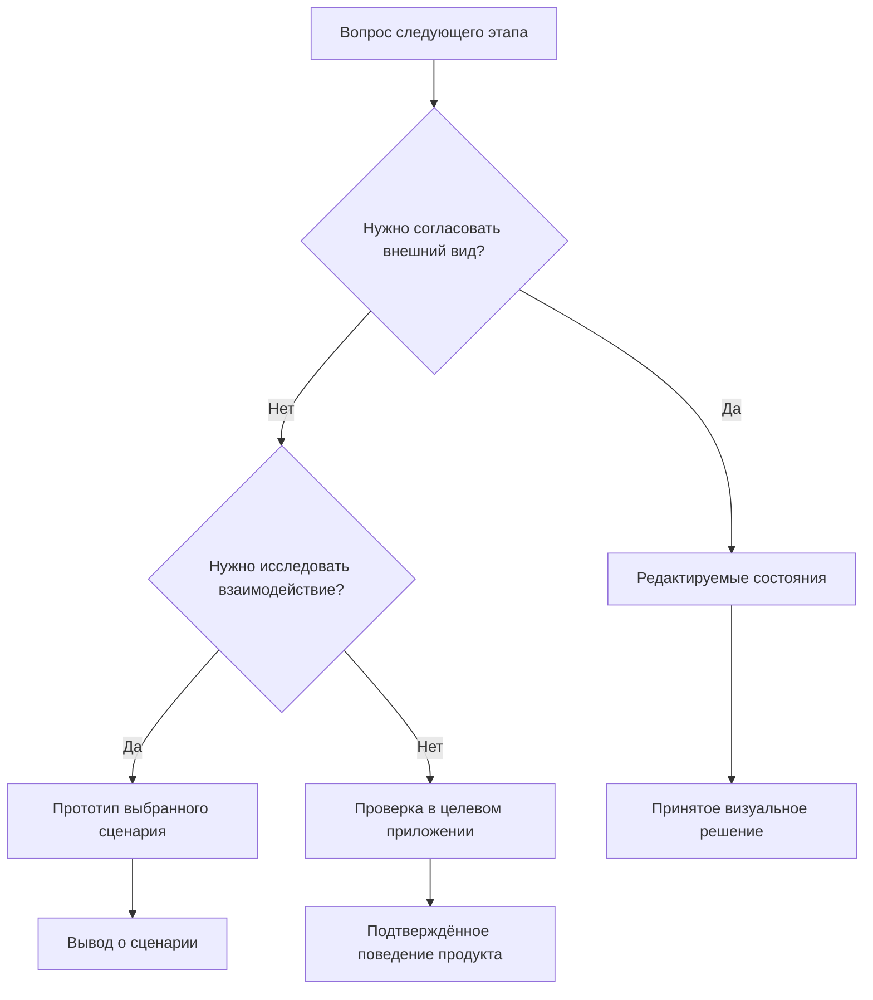
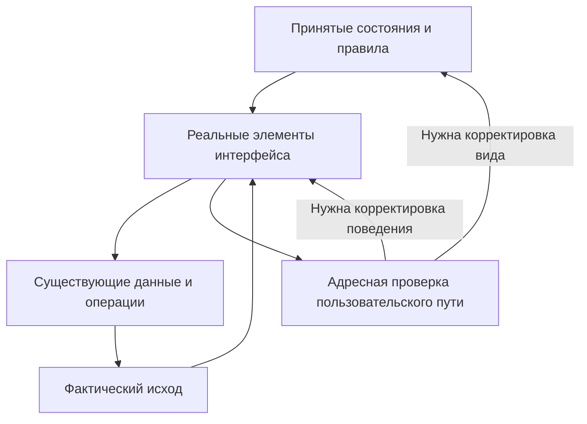
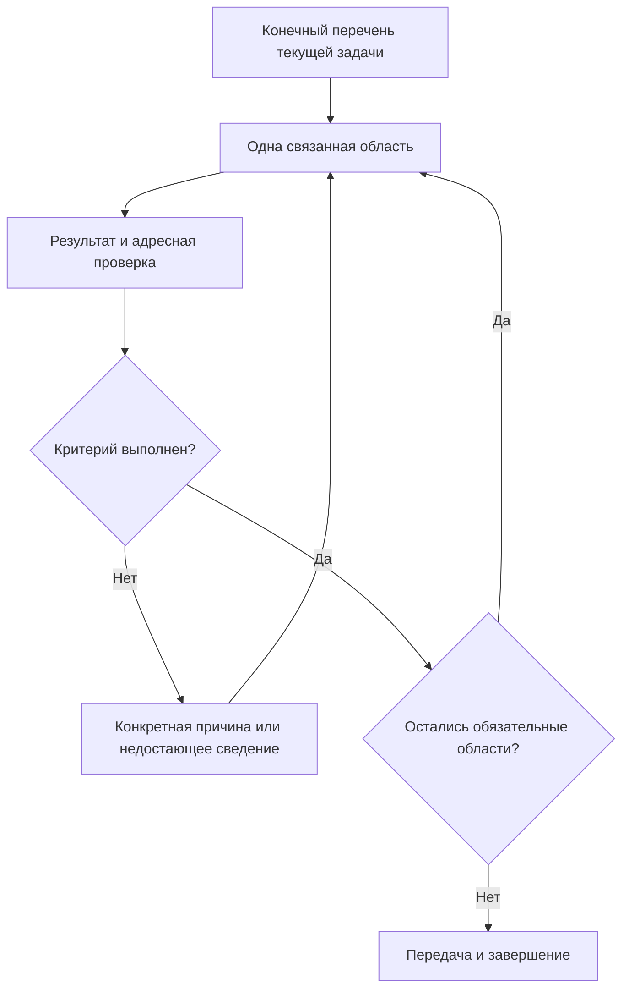

## FigCraft в сложном проекте: как выбрать глубину дизайна и довести работу до результата 🧭

**Часть III. Визуальный эталон, поведение интерфейса, связь с ядром и наблюдаемость работы агентов.**

Большой дизайн-проект может выглядеть почти законченным и при этом оставаться далеко от завершения. На холсте уже есть окна, карточки, настройки, светлая и тёмная темы. Тексты переведены, значки подобраны, компоненты аккуратно названы. Однако очередная проверка обнаруживает ещё один переход, ещё одно состояние, ещё один случай изменения размеров. Исполнитель продолжает добросовестно работать, а ответ на вопрос «что осталось?» становится всё менее определённым.

В такой ситуации полезно проверить само назначение результата. От дизайна могли ожидать наглядного представления приложения, библиотеки элементов и понятного источника решений для разработки. Между тем работа постепенно превратилась в создание ещё одной программы: со своей навигацией, памятью выбора, обработкой ошибок, имитацией сохранения и сложным поведением окон.

Все эти свойства могут быть полезны. Но каждое из них должно отвечать на конкретный вопрос, ради которого создаётся макет. Возможность сделать интерфейс интерактивным ещё не определяет необходимую глубину заказа.

**Редактируемый визуальный эталон может быть самостоятельным законченным результатом.** Он показывает, как устроены экраны, какие компоненты используются, что написано в разных языковых вариантах, как меняется оформление и какие правила действуют при недостатке места. Следующий исполнитель получает принятые решения и реализует их средствами настоящего приложения.

Эта статья посвящена выбору такого результата. Она продолжает [руководство по FigCraft](FigCraft_AI_GUI_Design_Guide_RU.md) и [разбор двух практических путей](FigCraft_Practice_Part_2_RU.md), но рассматривает другой вопрос: как организовать работу так, чтобы сложность продукта не превращалась в бесконечную сложность дизайн-заказа.

> [!abstract] Основной принцип
> Глубина представления выбирается по решению, которое предстоит принять. Внешний вид подтверждается редактируемыми состояниями, спорное взаимодействие — выбранным сценарием, работа продукта — действием настоящего приложения. У каждого результата есть собственная достаточная проверка.

### Навигация по статье 🗺️

| Раздел | Что помогает решить |
|---|---|
| [Назначение и глубина](#purpose) | Что именно заказывается и какие варианты процесса существуют |
| [Разделение ответственности](#responsibilities) | Где заканчивается визуал и начинаются frontend и интеграция |
| [Состояния и варианты](#states) | Как получить конечный перечень без размножения всех комбинаций |
| [Размеры окна](#layout) | Что должны объяснять подготовленные компоновки |
| [Наблюдаемость](#observability) | Как видеть работу агентов и состояние продукта |
| [Передача и реализация](#handoff) | Что нужно следующему исполнителю в Qt или веб-приложении |
| [Управление большим остатком](#scope) | Как сменить глубину работы и сохранить достоверную историю |
| [Затраты и завершение](#completion) | Откуда может взяться экономия и когда следует остановиться |

### Основание и границы материала 📚

Методика опирается на первые две части серии и предоставленную ретроспективу сложного настольного проекта. Техническая база исходного руководства — FigCraft v0.10.0; практические наблюдения второй части ограничены 25 октября 2026 года. Ретроспектива и настоящее уточнение процесса относятся к 26 октября. Эти даты обозначают исторические границы, а не актуальность версии на любое будущее время.[^series][^retrospective]

При подготовке этой статьи приложения и FigCraft заново не запускались. Ниже различаются наблюдения из материалов, предлагаемые правила работы и условные учебные примеры. Рассуждения о сокращении затрат не являются результатом сравнительного измерения токенов. Путь в Next.js приведён как возможное применение подхода; отдельный эксперимент переноса в Next.js в описанной практике не проводился.

Названия частных проектов, персональные данные, внутренние пути и идентификаторы исключены. Обобщённый пример формы обработки изображений используется для объяснения процесса. Он не должен восприниматься как точное описание возможностей какого-либо исходного продукта.

## Сначала определяется назначение результата 🎯

### Один документ может завершать дизайн и начинать разработку 📦

У визуального эталона есть две совместимые роли. Для дизайнера он может быть законченным результатом: внешний вид согласован, существенные состояния представлены, компоненты доступны для изменения. Для разработчика тот же документ становится входом в следующую работу.

Отсутствие готового приложения не делает завершённый дизайн автоматически незавершённым. Аналогично готовый проект дома остаётся результатом проектирования, хотя сам дом ещё предстоит построить. В обоих случаях качество определяется тем, достаточно ли решений для следующего действия и выполнены ли обязательства текущего этапа.

Это различие особенно важно при работе с агентами. Формулировка «сделать интерфейс полностью» допускает несколько прочтений. Один исполнитель понимает её как полноту видимых экранов, другой — как каждый доступный клик, третий — как подключение операций к данным. Без уточнения каждый следующий участник добавляет собственное определение полноты.

Полезная постановка называет наблюдаемый результат: «подготовить редактируемый каталог основных экранов, их значимых состояний и правил компоновки для последующей реализации». В такой задаче можно установить конечный перечень. При необходимости проверить порядок действий появляется отдельный конкретный сценарий прототипирования.

### Направление работы и глубина — независимые решения 🧩

Направление отвечает на вопрос, откуда берётся интерфейс: восстанавливается существующее приложение, проектируется новая оболочка или меняется отдельная область. Глубина отвечает на другой вопрос: насколько поведение нужно исполнять в создаваемом результате.

Поэтому большое существующее приложение вполне может потребовать подробного визуального каталога с минимальной интерактивностью. Маленький мастер из трёх шагов, напротив, может нуждаться в работающем прототипе: его главная неопределённость связана с последовательностью, возвратом и сохранением введённых значений.

| Ситуация | Следующее решение | Подходящий результат |
|---|---|---|
| Сложный существующий GUI нужно сделать обозримым | Как устроены экраны, тексты, компоненты и состояния? | Редактируемый визуальный каталог с известными правилами поведения |
| Меняется одна форма | Какой вариант композиции и содержания принять? | Несколько сравнимых состояний затронутой формы |
| Для готового ядра создаётся новый GUI | Как представить доступные операции и результаты? | Дизайн выбранного пользовательского пути, затем его реализация |
| Неясен порядок действий | Понимает ли человек следующий шаг и последствия возврата? | Выборочный интерактивный прототип спорного фрагмента |
| Меняется знакомый элемент существующего интерфейса | Корректно ли изменение в реальной среде? | Адресная правка приложения и достаточная проверка |

Таблица описывает варианты, а не лестницу обязательного взросления. Визуальный каталог не обязан сначала стать полным прототипом, чтобы разработчик получил право пользоваться им. Небольшая правка не обязана проходить через FigCraft, если её вид и смысл уже определены.

Даже внутри одного проекта глубина может различаться. Основные настройки представлены подготовленными состояниями. Только спорный диалог получает переходы. История операций сохраняется как каталог, потому что её действующее поведение уже известно. Такая неоднородность помогает сосредоточить работу на реальных вопросах.

Схема показывает выбор основного доказательства. Если задача содержит несколько независимых вопросов, ей могут понадобиться несколько результатов. Это всё равно не означает необходимости воспроизводить весь продукт на каждой площадке.

## Что должно остаться после визуального заказа 🖼️

Подготовленные состояния имеют ценность только тогда, когда их можно использовать. Красивый кадр, в котором невозможно найти компонент, заменить текст или понять значение цвета, оставляет следующему агенту почти ту же неопределённость, что и обычный скриншот.

Качественный эталон сохраняет редактируемую структуру: текст остаётся текстом, значок — отдельным ресурсом, повторяющийся элемент — экземпляром понятного компонента. Общие размеры и цветовые роли позволяют менять систему согласованно. Важные состояния расположены так, чтобы их можно было найти и сравнить. При этом дерево документа не обязано повторять внутреннюю архитектуру приложения.

Визуальная полнота означает, что представлен весь **согласованный объём различий**, нужных для реализации. Например, карточка операции может иметь состояния ожидания, обработки, остановки и завершения. Если меняются текст, набор действий или смысл статуса, разработчику нужен эталон этого различия. Однако каждый промежуточный процент обработки отдельного кадра не требует.

К каждому сложному месту полезно добавить короткое правило: где появляется новый блок, какая область прокручивается, что остаётся видимым, какие значения сохраняются. Правило передаёт намерение без обязательной реализации механизма внутри проигрывателя.

> [!tip] Полезный вопрос к любому дополнительному действию
> Какую неопределённость следующего исполнителя оно снимет? Если работа улучшает только полноту внутренней симуляции, а все необходимые визуальные и продуктовые решения уже переданы, основание для неё следует проверить отдельно.

Существующие удобные переходы можно сохранить. Кнопка перехода к настройкам, открытие образца диалога или переключение нескольких вариантов помогают просмотру. Отказ от цели полного прототипа не требует удалять уже работающую навигацию. Он ограничивает дальнейшие обязательства тем, что действительно нужно для выбранного результата.

## Три ответственности: визуал, поведение и связь с ядром 🧱

### Разделение помогает локализовать работу 🔍

Внешне одна кнопка может объединять несколько разных задач. Ей нужны правильные размеры, текст и состояние фокуса. Нажатие должно менять интерфейс в нужный момент. Настоящая операция должна получить корректные данные и вернуть результат. Если всё это названо просто «доработать кнопку», работа легко теряет границы.

Удобнее различать три ответственности. **Визуальная** определяет, что человек видит. **Frontend** определяет, как интерфейс реагирует на действия и изменения своего состояния. **Интеграционная** связывает представление с действующими источниками данных и операциями. Это разделение ответственности, а не требование трёх отдельных агентов или репозиториев.

| Пример требования | Что решает дизайн | Что проверяется в приложении |
|---|---|---|
| Раскрываются дополнительные параметры | Состав, порядок и вид раскрытой группы | Обработка действия, перерасчёт компоновки, сохранение значений |
| Сохранение недоступно | Вид кнопки и объяснение причины | Действительное условие блокировки и отсутствие недопустимого вызова |
| Возникла ошибка сохранения | Текст, место сообщения, доступные следующие действия | Получение реального исхода, сохранность черновика, повторная попытка |
| Операция выполняется | Понятные статусы и отображение доступного прогресса | Связь с владельцем операции, обновления и завершение |
| Изменён язык | Переводы и геометрия соответствующих вариантов | Обновление открытого интерфейса по действующим правилам продукта |

Такое разделение позволяет принимать дизайн, не дожидаясь реализации сети или распознавания. Одновременно оно сохраняет обязанность разработчика проверить настоящий пользовательский путь, когда заказан работающий GUI. Макет сообщает, какой исход должен увидеть человек; только приложение подтверждает, что этот исход соответствует реальному выполнению.

### Один и тот же экран — три разных задания 🧪

Рассмотрим учебную форму пакетной обработки изображений. В ней есть выходной формат, размер, папка результата и раскрываемая группа дополнительных настроек. При ошибке записи форма должна объяснить проблему и дать понятный следующий шаг.

**Задание на визуальный эталон** заканчивается подготовкой обычного и раскрытого состояния, примера ошибки, вида недоступного действия, языковых и тематических вариантов, а также правил ограниченной высоты. Значения могут быть демонстрационными. Реальная обработка и запись файлов не входят в такой результат.

**Задание на исследование взаимодействия** добавляет выбранный вопрос. Например, нужно понять, замечает ли человек дополнительные настройки и понятно ли возвращение из ошибки к исправлению папки. Тогда реализуется короткая последовательность: раскрыть группу, изменить значение, получить демонстрационную ошибку, вернуться к исправлению. Прототип использует условные данные, и его назначение обозначено прямо.

**Задание на настоящий GUI** требует связать выбранные параметры с существующей операцией. Ошибка записи приходит от реального источника; интерфейс сохраняет введённые значения и предоставляет предусмотренную повторную попытку. Здесь уже проверяется поведение целевой программы. Дополнительная полностью действующая копия этой же цепочки в FigCraft не является обязательным промежуточным результатом.

У всех трёх заданий может быть один и тот же красивый конечный кадр. Различается то, что этот кадр доказывает. Именно поэтому качество нельзя оценивать только количеством страниц, нажимаемых кнопок или выполненных инструментальных вызовов.

Схема допускает обратную связь, но не требует повторного построения всей системы. Выявленное несоответствие возвращается к той ответственности, где действительно находится причина.

## Как получить конечный перечень состояний 🗂️

### Состояние определяется различием для человека 🔎

Большое приложение содержит гораздо больше внутренних состояний, чем требуется показывать в дизайне. Два разных служебных события могут приводить к одинаковому экрану. Напротив, два внешне похожих сообщения могут означать принципиально разные исходы: операция завершилась, результат получен частично или результат пока неизвестен.

Для визуального каталога полезно выделять состояние, когда меняется хотя бы одно существенное свойство: смысл сообщения, доступное действие, состав данных или геометрия. Такое правило даёт содержательный перечень и помогает не создавать отдельные страницы для каждого технического флага.

Например, «обработано 12 объектов» и «обработано 18 объектов» обычно используют один компонент. Состояние «обработка ещё не началась» может потребовать другого текста и отсутствия индикатора. Состояние «обработка закончена, но дополнительный отчёт сохранить не удалось» требует различить полезный результат и неудавшееся действие. Сведение последнего случая к общей красной ошибке изменило бы смысл продукта.

| Различие | Отдельный эталон обычно нужен? | Причина |
|---|---|---|
| Изменилось только число внутри того же допустимого диапазона | Нет | Общая структура и набор действий сохраняются |
| Число стало настолько длинным, что меняет геометрию | Нужен контрольный пример | Проверяется устойчивость компонента к содержимому |
| Появились дополнительные поля | Да | Меняются состав и высота формы |
| Действие стало недоступно | Да, если состояние значимо для задачи | Требуется показать ограничение и его объяснение |
| Ноль заменяется отсутствием сведений | Да, если различие видно пользователю | «Ничего нет» и «неизвестно» сообщают разные факты |
| Поменялся внутренний этап без видимого изменения | Обычно нет | Дизайн не обязан отражать невидимую детализацию исполнения |

Эта таблица служит способом рассуждения, а не автоматическим генератором новых экранов. Окончательный набор определяется назначением конкретной области. Для обновления цветовой схемы не потребуется заново описывать всю модель операций.

### Единица планирования — законченная область решения 📋

Вместо неопределённого «доработать настройки» полезно получить несколько содержательных единиц: основная форма, раскрытая группа, предупреждение о несовместимых параметрах, результат сохранения. Для каждой единицы отмечается, какой вид ещё отсутствует, какое правило не определено и что мешает передаче.

Рабочая запись может быть совсем короткой:

| Область | Что должно стать однозначным | Условие окончания |
|---|---|---|
| Дополнительные параметры | Состав полей и положение следующей группы | Подготовлен согласованный раскрытый вид |
| Ошибка сохранения | Смысл ошибки и доступные действия | Есть текст, эталон сообщения и правило сохранности черновика |
| Небольшая высота окна | Где заканчивается содержимое и находятся действия | В контрольной области понятна достижимость всех обязательных элементов |

Такая таблица делает остаток обозримым, но не измеряет трудоёмкость. Следующий шаг выбирается по тому, какое решение он завершает, а не по тому, какую мелкую проверку легче выполнить прямо сейчас.

### Языки, темы и размеры не умножают смысловые экраны 🧮

В большом документе возникает соблазн посчитать каждую комбинацию отдельной работой. Один и тот же экран на двух языках, в двух темах и трёх размерах превращается в двенадцать оформленных экземпляров. Это полезные варианты, но они не обязательно представляют двенадцать разных продуктовых решений.

Следует разделять **смысловое покрытие** и **проверку вариантов**. Смысловое покрытие отвечает, какие пользовательские ситуации представлены. Варианты показывают, что принятые решения выдерживают нужные условия. Такое разделение позволяет честно говорить: «состояния определены, осталось проверить длинный перевод на ограниченной ширине», вместо расплывчатого «почти все экраны готовы».

Полный перебор комбинаций не обязателен по умолчанию. Для переноса текста выбираются длинные строки и тесные области. Для темы — поверхности, границы, акценты и состояния, где меняется читаемость. Для сложного наложения факторов нужен их совместный пример: длинное предупреждение в тёмной теме при небольшой высоте. Выбор проверки должен соответствовать конкретному риску, а не удобству получения ещё одного кадра.

> [!note] Сокращение перебора не отменяет покрытие
> Если конкретная комбинация входит в условия приёмки, её требуется проверить. Выбор представительных вариантов помогает убрать бессодержательные повторы, но не позволяет объявить непроверенный обязательный случай успешным.

## Темы и локализация как часть визуальной системы 🌗

### Общие роли важнее случайных значений 🎨

Светлая и тёмная темы удобнее передаются через роли: основной фон, приподнятая поверхность, обычный текст, вторичный текст, граница, акцент, предупреждение. Тогда разработчик понимает, почему два элемента используют один цвет и почему третий должен отличаться. Простая коллекция шестнадцатеричных значений эту связь не передаёт.

Это не требует строить новую универсальную систему токенов в каждом проекте. Если приложение уже имеет согласованные роли и компоненты, дизайн использует их или явно предлагает ограниченное изменение. Переименование всей системы ради одного экрана создаёт дополнительную миграцию, которую следует оценивать как самостоятельную работу.

У темы есть и содержательная сторона. Предупреждение должно оставаться предупреждением, выбранная строка — выбранной, недоступное действие — различимым. Передача пары аккуратных фонов недостаточна, если важные состояния теряют различие. При этом каждому повторяющемуся экземпляру не нужен собственный независимый набор цветов.

### Языковые варианты показывают реальный текст 🔤

Для визуальной работы важны конкретные формулировки, переносы, длина подписей, даты, числа и сочетания значка с текстом. Короткая условная подпись не заменяет длинный утверждённый перевод. Иначе разработчик получает композицию, пригодную только для демонстрационных данных.

Текст может иметь разное происхождение. Уже существующая подпись берётся из разрешённого актуального источника. Новый текст оформляется как предложение. Демонстрационная ошибка обозначается как пример. Эти категории не следует смешивать: правдоподобная фраза не становится подтверждённым содержимым приложения только потому, что хорошо поместилась в карточке.

Если перевод не помещается, сначала исследуется компоновка: перенос, расширение области, порядок элементов, способ раскрытия подробностей. Сокращение текста допустимо как редакционное решение, когда оно сохраняет смысл и принято для продукта. Самовольное удаление важной части сообщения ради красивого кадра переносит проблему следующему исполнителю.

### Горячая смена языка принадлежит поведению продукта 🔄

В рассматриваемом исходном проекте смена языка уже происходит во время работы приложения. Это сохраняемое продуктовое свойство. Представление его в дизайне через отдельные русские и английские варианты не отменяет существующий механизм и не создаёт требования перезапуска.[^runtime-language]

Для заказа на визуальный каталог достаточно показать соответствующие тексты и их геометрию. Если общий переключатель в FigCraft уже работает и помогает просмотру, его можно использовать. Если его нет, разработка собственного механизма обновления всех открытых состояний не становится обязательной только ради демонстрации переводов.

В реальном Qt-приложении динамическая смена языка связана с механизмами переводов и обновлением элементов при `LanguageChange`. Официальная документация описывает обработку этого события и обновление видимого текста. Наличие двух кадров в редакторе такой механизм не проверяет.[^qt-language]

При изменении затронутого GUI проверяется именно действующее продуктовое требование: обновились ли нужные тексты, сохранился ли пользовательский ввод, не изменился ли смысл активной операции. Объём проверки определяется изменением. Новый глобальный аудит локализации не требуется после любой правки отступа.

Новые языки также не добавляются автоматически. Поддержка двух локалей в текущем задании не означает обязанности подготовить ещё несколько «на будущее». Дополнительная локаль может потребовать других шрифтов, форматов и правил направления текста; это отдельное принятое расширение.

## Размеры окна: подготовить решение и выбрать место проверки 📐

### Несколько компоновок могут быть полным результатом дизайна 🪟

Широкий и узкий варианты показывают, какие изменения композиции приняты. При уменьшении ширины карточки могут переходить из ряда в колонку, боковая панель — занимать отдельную область, вторичная информация — перемещаться ниже основного содержания. Это уже существенные решения, даже если редактор не переключает варианты автоматически.

Однако из нескольких подготовленных кадров нельзя вывести, что открытое окно корректно переживает непрерывное изменение размеров. Проверенный вид при ширине 700 единиц и проверенный вид при ширине 1000 единиц подтверждают эти виды. Сохранность выбора, пересчёт меню, удержание прокрутки и момент смены компоновки требуют иной проверки, когда именно это поведение заказано.

Визуальный эталон полезно сопровождать правилами. Вместо «должно быть адаптивно» записывается, какая область растягивается, какая имеет минимальную ширину, где допускается перенос и что происходит при недостаточной высоте. Разработчик получает конкретное намерение, а не слово с неограниченным объёмом.

### Высота требует отдельного внимания ↕️

Длинный диалог может прекрасно выглядеть в высоком окне и скрывать нижние действия при небольшой высоте. Во входной ретроспективе такой случай был зафиксирован для подтверждения импорта: при высоте 500 px нижние кнопки обрезались, а при 900 px содержимое помещалось. Это наблюдение о конкретном прототипе; оно само по себе не устанавливает причину и не доказывает аналогичный дефект настоящего приложения.[^retrospective]

Для визуального заказа такой пример всё равно важен. Требуется показать принятый способ размещения длинного текста и действий при ограниченной высоте. Можно предусмотреть прокрутку содержимого при видимой панели действий или другое согласованное решение. Не достаточно сохранить только высокий кадр и объявить вопрос закрытым.

| Свойство | Что передаёт визуальный эталон | Где подтверждается исполнение |
|---|---|---|
| Длинное содержимое | Граница области просмотра и правило прокрутки | В прототипе, если прокрутка заказана; в настоящем GUI при реализации |
| Нижние действия | Положение и способ достижения в контрольной области | В соответствующей исполняемой среде |
| Раскрываемая группа | Полный состав и корректная геометрия раскрытого состояния | При реальном раскрытии, если проверяется поведение |
| Смена широкой и узкой компоновки | Обе композиции и правило выбора | При изменении размеров целевого окна или заказанного прототипа |
| Сохранность выбора | Явное требование к состоянию интерфейса | При действиях и изменении размеров в приложении |

Визуальная проверка при ограниченной высоте не требует обязательно реализовать всю прокрутку в FigCraft. Но правило должно быть конкретным, а кадр — честно показывать видимую область. Нельзя изображать обязательную кнопку за пределами этой области так, будто она доступна без дополнительного действия.

### Контрольный размер должен быть определён однозначно 📏

Для сравнения полезно указывать размер именно той области, к которой относится решение: внутренней поверхности окна, содержимого диалога или панели. Внешний размер окна с рамкой и размер рабочей области могут различаться. При переносе в приложение также важны масштаб интерфейса и шрифт. Эти обстоятельства уже подробно разобраны во второй части; здесь они нужны для одного вывода: размеры в передаче должны иметь понятный смысл.[^geometry]

В Qt Widgets геометрией дочерних элементов управляют layouts. Они учитывают изменение доступного пространства и содержимого; политики размера и подсказки размеров участвуют в распределении места. Поэтому перенос дизайна в Qt обычно выражает правила через существующие компоновки и ограничения, а не превращает каждый прямоугольник в независимую жёсткую координату.[^qt-layout]

Из этого не следует обещание автоматического экспорта рабочего окна из FigCraft. Дизайн передаёт принятые отношения и ресурсы. Разработчик выбирает подходящие средства целевой технологии и проверяет их в нужных условиях.

> [!important] Принятый способ представления не нужно бесконечно улучшать
> Если заказчик согласовал точные широкую, среднюю и узкую компоновки как результат визуальной работы, их наличие и качество закрывают соответствующий пункт. Автоматическое переключение между ними становится новым обязательством только при включении в задачу.

## Наблюдаемость: три разных предмета внимания 👀

### Работа агента должна быть обозримой 🛠️

Одна из причин использовать визуальный редактор — возможность видеть результат по мере его появления. Человек может заметить неверную композицию, уточнить текст, сравнить состояния и остановить нежелательное направление до большой переделки. При этом нужно видеть реальные изменения рабочего документа, а не только обещания исполнителя.

Такое наблюдение не зависит от полноты интерактивного прототипа. Редактируемая форма, которая ещё не умеет сохранять настройки внутри проигрывателя, уже позволяет обсуждать внешний вид. Напротив, сложная симуляция может оставаться плохо обозримой, если непонятно, какая версия актуальна и какие области ещё не закончены.

Наблюдаемость работы складывается из доступного результата, понятного текущего состояния и короткого объяснения следующего шага. Полезная сводка сообщает: «согласованы основные поля и предупреждение; осталось разместить раскрытую группу при небольшой высоте; следующий просмотр проверит доступность действий». Количество созданных узлов и число вызовов инструментов могут быть полезны для технического журнала, но мало говорят о приближении к цели.

### Пользователь продукта наблюдает свою задачу 📊

Другой вид наблюдаемости относится к самой программе. Человеку нужно знать, началась ли операция, что происходит сейчас, можно ли её остановить, что получилось и где находится результат. Дизайн определяет представление этих сведений; frontend связывает его с действительными данными.

Показанный в макете пример прогресса допустим как демонстрация. В приложении тот же процент требует основания. Если известен только текущий этап, полезнее передать этап. Если часть результата получена, а дополнительное действие не удалось, интерфейс должен сохранить это различие. Вторая часть серии подробно разбирает такие случаи; для организации работы важно заранее определить, кто отвечает за достоверность каждого значения.[^product-status]

### Разработчик наблюдает исполнение 🔧

Третий вид — техническая диагностика: события, ошибки, сведения о вызовах и состоянии выполнения. Она помогает установить причину проблемы. Для неё используются действующие средства проекта; разработка нового общего слоя журналирования не становится обязательной частью переноса одной формы.

| Вид наблюдаемости | Главный вопрос | Достаточное представление |
|---|---|---|
| Работа агента | Что уже сделано и какое решение ещё открыто? | Актуальный документ, остаток и содержательные обновления |
| Состояние продукта | Что происходит с пользовательской задачей? | Понятные статусы, результат, ошибка и доступное действие |
| Техническое исполнение | Почему система повела себя именно так? | Адресные диагностические сведения существующего проекта |

Эти представления связаны, но у них разные читатели. Техническая строка может помочь разработчику и ничего не объяснить пользователю. Красивый индикатор может быть удобен пользователю и не содержать сведений о причине сбоя. Подробный журнал работы агента не заменяет принятого визуального результата.

> [!tip] Наблюдаемость должна уменьшать неопределённость
> Для каждого нового отчёта, индикатора или журнала полезно назвать читателя и решение, которое ему предстоит принять. Если такого решения нет, дополнительная детализация может увеличить объём работы без заметной пользы.

## Передача, после которой можно продолжать работу 📬

### Следующему агенту нужен компактный рабочий контекст 🧾

Передача всех накопленных сообщений не гарантирует понимания проекта. В большой истории соседствуют ранние предположения, исправленные ошибки, несколько вариантов одного экрана и уже отменённые требования. Новый исполнитель вынужден снова выяснять, что действительно принято.

Полезная передача выделяет актуальную редакцию, существенные состояния, повторно используемые элементы, ресурсы и несколько правил. Она содержит достаточно сведений для следующей задачи и ссылки на подробности там, где они понадобятся. Размер такого пакета должен соответствовать изменению: одному компоненту не нужен заново собранный справочник всего приложения.

| Что передаётся | Для чего это нужно | Чего следует избегать |
|---|---|---|
| Актуальный экран и его идентификатор | Найти нужное решение среди вариантов | Ссылки на устаревшие копии без указания редакции |
| Значимые состояния | Понять разницу содержания и доступных действий | Перечень внутренних флагов без пользовательского смысла |
| Компоненты и цветовые роли | Использовать общие решения согласованно | Независимые стили для каждого экземпляра |
| Шрифты, значки и тексты | Сохранить оформление и содержание | Растровый экран как единственный источник ресурсов |
| Правила размеров и поведения | Реализовать отношения между элементами | Единственный идеальный кадр без ограничений |
| Известная связь с реализацией | Найти существующий компонент или операцию | Выдуманные имена API и требование нового общего аудита |
| Проверенное и открытое | Выбрать следующий шаг на достоверном основании | Общий статус «всё работает» без границ |

Шаблоны такого пакета приведены в [практическом приложении](FigCraft_Practical_Workbook_RU.md). Их можно разместить в существующем описании задачи. Создавать отдельную систему документов ради соблюдения формы не требуется.

### У разных сведений разные источники достоверности 🔗

Утверждённое дизайнерское решение определяет желаемый вид. Разрешённое наблюдение за приложением показывает существующее поведение. Действующая спецификация операции описывает её данные и результаты. Старый комментарий может объяснять историю, но не обязан правильно описывать текущую систему.

Поэтому выражение «единый источник истины» полезно уточнять применительно к конкретному свойству. Дизайн может быть основным источником принятого оформления, а код — фактической реализации. Несоответствие между ними требует решения: обновить реализацию, принять допустимое различие нативного элемента или пересмотреть дизайн. Механическое копирование в любую сторону способно закрепить ошибку.

Изменение требования владельцем задачи также должно иметь приоритет над устаревшей записью. Если актуальное поведение подтверждено, нельзя продолжать воспроизводить старое ограничение только потому, что оно встретилось в прежнем документе. При этом дизайнер не получает права самостоятельно объявить любую неудобную функцию отменённой.

Источники удобно различать тремя пометками: **наблюдено**, **передано как требование**, **предложено**. Это особенно полезно в восстановлении существующего GUI. Предложенная композиция может быть хорошей, но её не следует выдавать за точную копию, если соответствующего исходного состояния никто не видел.

### Нехватка сведений должна оставаться локальной ❓

Допустим, для формы известны поля, тексты и обычный результат, но отсутствует точный вид редкой ошибки. Исполнитель может закончить известную часть, описать недостающий случай и подготовить явно обозначенное предложение. Если ошибка обязательна для приёмки, вопрос остаётся открытым; если она находится за пределами текущего задания, она не блокирует весь каталог.

Нехватка одного примера не оправдывает выдумывание существующего поведения. Она также не требует автоматически перечитать весь backend, журналы всех запусков или весь репозиторий. Следующий запрос должен быть адресным: нужен такой-то исход, поле или подтверждение правила.

Границы чтения и изменения сохраняются при любом варианте процесса. Если дизайнеру разрешены только подготовленные материалы, он работает с ними. Разработчику для реализации могут быть разрешены конкретные исходники. Передача между этими ролями не является способом расширить доступ неявно.

## Как меняется процесс в разных проектах 🛤️

### Восстановление существующего приложения 🪞

Здесь отправной точкой служат действующий интерфейс и разрешённые материалы о нём. Сначала выбирается репрезентативная область: она должна показать используемые шрифты, основные компоненты, пример длинного текста и хотя бы одно содержательно отличающееся состояние. На ней проверяется, что создаётся действительно редактируемый документ с пригодной структурой.

Затем работа расширяется по семействам экранов. Компоненты повторно используются; новые состояния добавляются там, где появляется новое различие. Нет необходимости после каждой карточки заново исследовать всю историю продукта. Известные решения сохраняются, а пробелы формулируются адресно.

Для восстановления особенно полезно разделить точное воспроизведение и предложение улучшения. Существующий неудобный элемент может быть зафиксирован как исходный, а улучшенный вариант — показан рядом. Это сохраняет возможность сравнения и не приписывает приложению того, чего в нём ещё нет.

### Новый GUI поверх готового ядра 🧩

Здесь нужно понять доступные операции, необходимые входные данные, существенные результаты и ограничения. Полное повторное исследование архитектуры ядра не является предварительным условием каждой формы. Если нужные сведения уже переданы и подтверждены, они становятся рабочим основанием.

Дизайн отвечает на вопрос, как человек будет пользоваться возможностями. После принятия ограниченного пути разработчик соединяет реальные элементы с действующими операциями. Например, сначала реализуется выбор параметров, запуск и вывод результата одной операции. Такой законченный путь позволяет увидеть разницу между принятым дизайном и фактическим GUI без преждевременного переноса всех экранов сразу.

Если используемый контракт оказался недостаточным, проблема формулируется конкретно: отсутствует необходимое поле, не различаются два исхода, нельзя получить требуемое событие. Исправление оценивается в рамках задачи или выделяется отдельно. Формула «сначала приведём в порядок весь backend» не даёт конечной границы переноса интерфейса.

### PySide6 и веб-приложение получают одни решения разными средствами 🖥️

В PySide6 / Qt Widgets используются подходящие виджеты, действующие layouts, принятые механизмы тем и локализации. Вложенность декоративных слоёв FigCraft не требует такого же количества классов или контейнеров. На этапе реализации сохраняется смысл визуальных отношений, а техническая структура выбирается под целевую среду.[^qt-layout][^transfer]

В проекте на Next.js аналогично используются существующие компоненты, стили и способы работы с данными. При реализации интерактивных фрагментов учитывается действующая граница серверных и клиентских компонентов: официальная документация связывает клиентскую сторону, в частности, с состоянием и обработчиками событий. Сам дизайн-файл эту границу не устанавливает.[^next]

Это примеры переноса решений, а не рекомендация менять технологию проекта. Для обеих сред нужен достаточный набор состояний, ресурсов и правил. Для обеих остаётся работа по реализации настоящего поведения. Автоматически полученное оформление, если оно используется, также требует соответствия структуре конкретного приложения.

### Небольшое изменение иногда лучше выполнить сразу в коде ✏️

Если требуется заменить уже утверждённую подпись или исправить очевидный отступ в существующем компоненте, отдельный дизайн-цикл может оказаться лишним. Критерий выбора прост: требуется ли новое визуальное решение или достаточно корректно выполнить известное?

Наличие FigCraft в процессе не обязывает проводить через него каждое изменение. Каталог следует обновлять там, где он действительно остаётся источником нужных решений. Если поддержка полной копии каждого несущественного изменения становится самостоятельной нагрузкой, полезно сократить область каталога до того, что команда использует.

## Ответственности можно разделить без разрастания команды 🤝

Исследование источников, дизайн, реализация и проверка — разные виды работы. Их может выполнять один агент последовательно, несколько агентов независимо или команда людей. Названия ролей помогают понимать ответственность, но сами по себе не требуют увеличения числа участников.

Параллельная работа полезна там, где задачи действительно независимы: один участник готовит тексты, другой сопоставляет состояния, третий проверяет комплект ресурсов. Если несколько исполнителей одновременно меняют один общий документ без согласования, появляется дополнительная проблема соединения результатов. В рассмотренной практике отдельно отмечалась польза назначенного исполнителя общего документа и независимой подготовки остальных материалов.[^collaboration]

Проверяющему тоже нужна граница. При проверке визуального эталона он смотрит на состав, структуру и содержание согласованного результата. При проверке GUI — на затронутый пользовательский путь. Независимость оценки не даёт оснований произвольно расширять заказ до проверки всего backend или полного исследования всех возможных состояний.

Передача завершает ответственность за конкретный результат, но сохраняет возможность адресной обратной связи. Если разработчик обнаружил, что длинный текст не помещается в реальном контроле, возвращается этот вопрос. Не требуется заново открывать каждое ранее принятое решение.

## Как завершать большой проект, который уже разросся 🧭

### Сначала пересматривается остаток, затем продолжается работа 📋

В предоставленной ретроспективе были выделены восемь крупных областей интерфейса. Все они уже имели визуальное представление, но минимум пять требовали содержательной доработки. Остаток был сгруппирован в двенадцать пакетов. При этом точный конечный перечень обязательных состояний ещё не был сведён.[^retrospective]

Такое описание гораздо полезнее необоснованного процента, но само по себе ещё не даёт оценки трудоёмкости. Пакеты неодинаковы: один может состоять из нескольких связанных состояний, другой — из трудного перехода с сохранением выбора. Количество уже оформленных экземпляров также мало помогает, если они повторяют одинаковые решения в разных вариантах.

После согласованного сокращения интерактивных требований и выбора визуального эталона прежний остаток необходимо **переклассифицировать**. Часть пунктов остаётся обязательной. Часть превращается в короткое правило для реализации. Некоторые исследования больше не относятся к выбранному результату. Это позволяет продолжить существующую работу с понятной границей, сохранив уже созданные компоненты и экраны.

| Проблема из подобных проектов | Что требуется для визуального эталона | Что относится к исполняемому поведению |
|---|---|---|
| При живом раскрытии поля перекрываются, хотя подготовленный раскрытый вид корректен | Сохранить правильный эталон и правило роста группы | Проверить реальное раскрытие и перерасчёт геометрии |
| В прототипе при изменении размеров сбрасывается сортировка истории | Передать выбранное состояние и требование его сохранности | Сохранность выбора проверяется в целевом GUI при реализации; поведение Presenter — только если этот переход отдельно заказан |
| Длинные пункты меню не помещаются по ширине | Определить допустимую ширину, размещение и способ показа длинных подписей | Проверить открытие, достижимость пунктов и положение настоящего меню |
| Не показан результат подтверждённого сброса | Подготовить результирующее состояние и смысл изменённых значений | Выполнить реальную операцию сброса, когда заказана реализация |
| Длинное подтверждение скрывает нижние действия | Показать корректное решение для ограниченной высоты | Проверить достижимость действий в работающем интерфейсе |
| Три компоновки уже приняты, автоматическая смена не заказана | Сохранить принятые варианты и условия их применения | Автоматическое переключение проверяется в отдельном заказанном объёме |

Правая колонка относится к работе над настоящим GUI или к отдельно заказанному интерактивному сценарию. Она не возвращает в приёмку визуального каталога исключённые переходы Presenter.

Таблица не означает, что перечисленные дефекты уже исправлены. Она показывает, как определить дальнейшую работу при новом назначении результата. Оставшийся обязательный пункт закрывается после соответствующей проверки; исключённый новым решением отмечается как находящийся вне текущего объёма.

Особенно важно сохранять место наблюдения. Сброс сортировки внутри прототипа не доказывает сброса в настоящем приложении. Успешная работа приложения не доказывает исправности прототипа, если его взаимодействие отдельно обещано. У каждого вывода должна оставаться своя среда.

### Новая цель не переписывает прежний результат 🕰️

Если раньше требовалось сохранение прокрутки в живом переходе и проверка не прошла, этот факт остаётся в истории. После решения владельца ограничиться визуальным каталогом пункт может перестать быть обязательным для текущей приёмки. Правильный статус — «не входит в новый объём», а не «исправлено».

Также не следует объявлять всю прежнюю проверку бесполезной. Она могла обнаружить недоступные действия, потерю значений и противоречия между состояниями. Эти находки имеют ценность. Организационная проблема состояла в том, что глубина местных проверок не была вовремя связана с конечным перечнем требований и приоритетами всего заказа.

> [!important] Изменение объёма должно быть явным
> Исполнитель может предложить более подходящую глубину и объяснить её пользу. Самостоятельно исключать неудобный обязательный сценарий он не должен. Если владелец уже изменил цель, новое решение применяется без повторного запроса того же разрешения.

### Закрываются связанные области, а не бесконечные отдельные кнопки 🧵

У сложной операции несколько видимых представлений: карточка, очередь, статус, уведомление, подробности результата. Они должны рассказывать согласованную историю. Нельзя считать карточку законченной, если она сообщает «завершено», а соседняя очередь для того же состояния предлагает отменить активную обработку.

Поэтому полезно брать ограниченную, но связанную область. Для ошибки сохранения это может быть состояние формы до попытки, вид ошибки, доступные действия и правило сохранности значений. После их согласования область можно передать. Затем выбирается следующая, а не добавляется бесконечный ряд всё более редких вариаций уже принятой кнопки.

Детальная проверка нужна там, где остаётся конкретная неопределённость. Если очередная попытка не даёт новых сведений, полезно остановить сам способ проверки: уточнить среду, отделить ограничение проигрывателя от дефекта документа, выбрать другое достаточное доказательство. Это не разрешение объявить непроверенное успешным. Обязательный неподтверждённый критерий сохраняется как открытый вопрос.

Новые идеи могут появляться на любом шаге. Их появление не меняет автоматически перечень текущей задачи. Идея получает отдельную запись и входит в работу, когда для неё принято основание.

## Откуда может взяться экономия времени и токенов 📉

### Экономия возникает в повторном использовании решений 🔁

Гипотеза в пользу FigCraft выглядит разумно: агенту легче реализовать уже согласованный вид, чем одновременно придумывать композицию, писать обработчики, разбираться с данными и исправлять визуальные последствия каждого решения. Хороший каталог позволяет сравнивать варианты до вмешательства в рабочий GUI и передавать конкретные компоненты вместо длинного словесного описания.

Возможная экономия складывается из вполне определённых сокращений: меньше повторного поиска актуального экрана, меньше угадывания текста и размеров, меньше независимых трактовок одного состояния, меньше переделок после позднего согласования. Компактная передача также уменьшает необходимость загружать каждому следующему агенту всю историю обсуждений.

Но у этого пути есть собственная стоимость: создание каталога, проверка его структуры, подготовка ресурсов, перенос в целевую среду и последующее согласование изменений. Если каталог превращается в полную вторую реализацию продукта, часть предполагаемой экономии может уйти на обслуживание этой реализации.

### Сравнивать нужно одинаковые результаты ⚖️

Сопоставление «быстро нарисован экран» и «долго написано работающее приложение» ничего не говорит об экономии: сравниваются разные обязательства. Для честного сравнения должны совпадать принятый вид, нужное поведение и критерии результата. В затраты входят все участники, повторные попытки и работа после передачи.

Практически полезно учитывать четыре составляющие: подготовку решения, реализацию, исправление несоответствий и поддержку согласованности. Если дизайн уменьшил вторую и третью, но сильно увеличил первую и четвёртую, общий эффект ещё предстоит оценить. Число кадров или красивый отчёт о снижении одного вида затрат этого вопроса не решают.

Измерение не обязано превращаться в самостоятельный исследовательский проект. Если команда уже ведёт учёт, достаточно фиксировать сопоставимую задачу, результат, суммарные затраты и существенные переделки. До получения таких данных корректны объяснение механизма и осторожная гипотеза. Проценты экономии или кратность ускорения без основания лучше не публиковать.

> [!note] Сложность продукта не гарантирует окупаемость каталога
> Каталог особенно полезен там, где решения действительно обсуждаются, повторно используются и передаются. Для известной локальной правки его создание может добавить работы. Ценность определяется использованием результата, а не размером приложения.

## Приёмка должна быть строгой и достижимой ✅

### Каждое заявление требует своего доказательства 🔬

Фраза «сделано» должна относиться к определённому результату. Для визуального эталона это представленные и согласованные состояния с пригодной структурой. Для выборочного прототипа — дополнительно перечисленные работающие переходы. Для настоящего GUI — реальные действия и исходы в целевой среде.

| Заявление | Достаточное основание в рамках задачи |
|---|---|
| «Компоненты редактируются и используются повторно» | Просмотр структуры и адресная проверка изменения общего элемента |
| «Представлены согласованные состояния» | Сопоставление конечного перечня с актуальными состояниями документа |
| «Подготовлены светлая и тёмная темы» | Просмотр нужных поверхностей и значимых состояний в обеих темах |
| «Переводы пригодны для принятой компоновки» | Проверка требуемых текстов и длинных строк в согласованных условиях |
| «Определено поведение при ограниченном размере» | Контрольные виды и однозначные правила размещения, переноса и прокрутки |
| «Работает конкретный переход прототипа» | Выполнение именно этого перехода в прототипе |
| «Работает функция приложения» | Проверка соответствующего реального пользовательского пути |

Первые строки таблицы не делают последние обязательными для любого задания. Они показывают соответствие между заявлением и доказательством. Приёмка выбирает только те заявления, которые входят в результат.

Общая библиотека тоже не требует бесконечного перебора. После проверки действительно общего компонента повторная проверка нужна там, где экземпляр отличается существенным содержимым или условиями. Если изменился базовый элемент, затронутые места определяются по его использованию. Такой подход точнее случайного обхода множества одинаковых кнопок.

### Открытые вопросы имеют разные последствия 🚦

В итоговой записи стоит различать три ситуации. **Дефект текущего результата** требует исправления. **Обязательная непроведённая проверка** не позволяет заявить соответствующее свойство подтверждённым. **Известное ограничение вне текущего объёма** описывает границу, но само по себе не мешает завершению принятого заказа.

Например, отсутствие раскрытого состояния обязательной формы — пробел визуального эталона. Отсутствие проверки уже заказанного живого раскрытия — пробел прототипа. Отсутствие настоящего сохранения файлов в визуальном каталоге — нормальная граница такого результата. Смешение этих случаев и создаёт впечатление, что дизайн всегда бесконечно далёк от готовности.

Завершение дизайн-задачи также не означает готовность продукта к выпуску. У реализации могут оставаться свои обязанности: подключение операций, проверка данных, упаковка и другие согласованные условия. Отдельная оценка этих работ сохраняет ясность и позволяет принимать результаты последовательно.

### После выполнения критериев работа заканчивается 🏁

Достаточный финальный результат содержит актуальную редакцию, принятый объём, сведения о проверке, ограничения и передачу следующему исполнителю, если она нужна. Отчёт может быть коротким, потому что основная информация уже находится в самом документе.

Найденное необязательное улучшение не обязано исчезать. Оно может остаться в списке будущих задач. Однако исполнитель не должен автоматически превращать его в продолжение уже завершённого заказа. Иначе любое качество становится промежуточным, а критерий окончания постоянно отодвигается.

## Какие правила полезно закрепить в проекте 📌

Долговечная политика должна помогать принимать решения, а не воспроизводить весь текст статьи. В существующих инструкциях проекта достаточно закрепить несколько положений и ссылку на рабочий шаблон.

**Назначение дизайна определяется явно.** По умолчанию выбранный визуальный заказ создаёт редактируемый эталон, компоненты, существенные состояния и правила. Интерактивность описывается конкретными сценариями, когда нужна для решения задачи.

**Существующий результат используется повторно.** Принятые экраны, ресурсы и компоненты сохраняют ценность. Работа продолжается с конечного остатка; очередной агент не начинает проект заново ради собственной структуры.

**Полномочия следуют заданию.** Разрешённые источники, изменения и запуски определяют границу исполнителя. Дизайн-проверка сама по себе не расширяется до аудита всего приложения.

**Продуктовое поведение сохраняется.** Тексты и состояния должны иметь правильный смысл. Существующие функции, включая уже работающую горячую смену языка, не отменяются способом их представления в каталоге.

**Проверка относится к заявлению.** Подготовленный кадр подтверждает вид; исполненный сценарий — соответствующий переход; настоящая операция — поведение продукта. Достаточность выбирается по согласованному результату.

**Остаток и изменения цели называются прямо.** Неудачная проверка остаётся неудачной. Исключённый по новому решению пункт отмечается как исключённый. После выполнения конечных критериев задача закрывается.

Развёрнутое поручение агенту, паспорт задачи, карточка передачи и форма приёмки собраны в [практическом приложении](FigCraft_Practical_Workbook_RU.md). Это заготовки для существующего процесса, которые можно сократить до масштаба конкретного изменения.

Хороший дизайн-документ делает следующую работу понятнее. По нему можно увидеть приложение, обсудить решение, взять нужные ресурсы и реализовать поведение средствами целевой системы. Его полнота определяется тем, насколько надёжно он выполняет эту роль. Когда решения переданы, границы ясны и критерии выполнены, у работы появляется естественная точка завершения.

## Источники и способ чтения ссылок 📚

Основные материалы серии включены в комплект. Они сохраняют собственные даты, границы наблюдений и перечни первоисточников. Ссылки на Qt и Next.js поясняют технические механизмы; они не подтверждают успешность частных проектов. Схемы, классификации, таблицы выбора процесса и учебная форма в настоящей статье являются методическими предложениями.

| Основание | Как используется |
|---|---|
| [Часть I](FigCraft_AI_GUI_Design_Guide_RU.md) | Техническая основа и различение дизайна, прототипа, экспорта и приложения |
| [Часть II](FigCraft_Practice_Part_2_RU.md) | Два практических направления, границы доказательств, передача и проверка |
| Предоставленная ретроспектива от 26.10.2026 | Обезличенные сведения о большом остатке, проверках и ограничениях прототипа; закрытые исходные материалы в комплект не включены |
| Уточнение владельца исходного проекта | Актуальное продуктовое поведение: уже действующая горячая смена языка; выбранная цель визуального представления |
| Официальная документация Qt и Next.js | Пояснение компоновок, динамического перевода и границ выполнения веб-компонентов |

[^series]: [Часть I](FigCraft_AI_GUI_Design_Guide_RU.md), разделы о возможностях инструмента, передаче и границах проверки; [часть II](FigCraft_Practice_Part_2_RU.md), «Основания: практика, обобщение и границы выводов». Часть I датирована 23.10.2026, историческая граница практических исследований части II — 25.10.2026, 16:51 по UTC+5. В обеих частях базовая версия FigCraft — 0.10.0.

[^retrospective]: Предоставленная ретроспектива сложного настольного дизайн-проекта от 26.10.2026 и сопровождающая сводка: восемь крупных областей, минимум пять с существенным остатком, двенадцать укрупнённых пакетов работ, отсутствие сведённого конечного перечня состояний. В них также описано обрезание нижних действий длинного подтверждения импорта при высоте 500 px и размещение при 900 px. Сведения приводятся по материалам, без нового воспроизведения. Сопоставление кадров с разным содержимым не позволяет приписать причину одному только языку или теме.

[^runtime-language]: Прямое актуальное уточнение владельца исходного проекта при подготовке продолжения серии: смена языка происходит во время работы приложения. Это исправляет прежнее неверное описание поведения. Частные идентификаторы проекта исключены; уточнение не выдаётся за результат нового технического теста.

[^qt-language]: [Qt: Writing Source Code for Translation — Prepare for Dynamic Language Changes](https://doc.qt.io/qt-6/i18n-source-translation.html#prepare-for-dynamic-language-changes). Официальное описание `LanguageChange` и обновления переводимого текста. Документация прочитана при подготовке статьи 26.10.2026; версия установленного Qt в частном проекте по этой странице не устанавливается.

[^geometry]: [Часть II](FigCraft_Practice_Part_2_RU.md), «Кейс A. Геометрия: измерять интерфейс, а не угадывать по числам» и «Кейс A. Живой прототип: растяжение, раскрытие и прокрутка — не одно и то же». Используются различия между размерами областей, готовым вариантом и проверкой изменения уже открытого окна.

[^qt-layout]: [Qt Widgets: Layout Management](https://doc.qt.io/qt-6/layout.html). Официальное описание управления геометрией, реакции на изменение содержимого и участия `sizePolicy` / `sizeHint` в распределении места. Используется для пояснения средств реализации, без обещания автоматического переноса дизайна.

[^product-status]: [Часть II](FigCraft_Practice_Part_2_RU.md), «Кейс B. Сначала полезное содержание, затем оформление» и «Кейс B. Достоверное поведение между „Старт“ и „Готово“». Основание различения доступных сведений, содержательного прогресса и фактического результата.

[^transfer]: [Часть II](FigCraft_Practice_Part_2_RU.md), «Кейс B. Передача в PySide6: не экспорт приложения, а перевод решений», «Две передачи имеют разное содержимое» и «У связанного результата должна быть короткая прослеживаемая цепочка». Термины и направление передачи сохранены; настоящий раздел предлагает организационное уточнение, а не новый эксперимент переноса.

[^next]: [Next.js: Server and Client Components](https://nextjs.org/docs/app/getting-started/server-and-client-components). Официальное объяснение серверных и клиентских компонентов, состояния и обработчиков событий. Ссылка используется для возможного маршрута реализации; FigCraft → Next.js в этой серии отдельно не испытывался.

[^collaboration]: [Часть II](FigCraft_Practice_Part_2_RU.md), «Один изменяет общий документ; остальные помогают независимо». Применяется как способ избежать конфликтов общего результата, а не как требование обязательной многоагентной схемы.

---

[К указателю серии](README.md) · [Часть I](FigCraft_AI_GUI_Design_Guide_RU.md) · [Часть II](FigCraft_Practice_Part_2_RU.md) · [Практическое приложение](FigCraft_Practical_Workbook_RU.md)
